# Deklarasi Penggunaan AI

## Tugas Besar IF2150 - Rekayasa Perangkat Lunak

| Informasi | Keterangan |
|---|---|
| Kelas | *K01* |
| Nomor Kelompok | *01* |
| Nama Kelompok | *berjiwa ksatria* |
| Nama Perangkat Lunak | *RAWAT (Ruang Aspirasi Warga dan Aduan Terpadu)* |

**Anggota Kelompok:**

| NIM | Nama |
|---|---|
| *13525103* | *Ravinka Fathia Adinegara* |
| *13525013* | *Samantha Michelle S Silaban* |
| *13525055* | *Syakira Azzahra Rachmania* |
| *13525043* | *Aufa Tatsbita Zahra* |
| *13525046* | *Ghiffari Arya Adhitya* |

---

### Daftar Isi
* [Milestone 7](#milestone-7)
* [Milestone 8](#milestone-8)
* [Milestone 9](#milestone-9)

---

### Log Penggunaan AI per Milestone

Silakan catat penggunaan AI yang berdampak signifikan pada pengerjaan tugas (misal: *generate* fungsi algoritma yang kompleks, *generate* draf dokumen SKPL/DPPL, atau *debugging* error utama). 
*Penggunaan sepele seperti memperbaiki *typo* atau auto-complete satu baris kode tidak perlu dicatat.*

### Milestone 7
| Tool AI | Tujuan Penggunaan | Contoh Prompt Utama | Modifikasi & Validasi Manusia |
| :--- | :--- | :--- | :--- |
| Claude | Membuat salah satu diagram kelas (dikarenakan keterbatasan waktu) | Berdasarkan informasi identifikasi kelas dan skenario use case di atas, buatkan diagram kelas ini dan jelaskan | Dilakukan pemeriksaan ulang terhadap diagram. | |

### Milestone 8
| Tool AI | Tujuan Penggunaan | Contoh Prompt Utama | Modifikasi & Validasi Manusia |
| :--- | :--- | :--- | :--- |
| ChatGPT | Membuat query dan gambaran pseudocode | Buatkan contoh gambaran pseudocode untuk method ini dan berikan & jelaskan implementasi query  | Terdapat beberapa alur yang tidak sesuai diharapkan, seperti pengecekan daftar perubahan. | |
| Figma AI | Membuat rancangan antarmuka website | Buat UI berdasarkan [isi SKPL] dan [isi DPPL] | Hasil akhir UI dimodifikasi agar bisa sesuai dengan tujuan aplikasi dibuat, terdapat beberapa penyesuaian style. |

### Milestone 9
| Tool AI | Tujuan Penggunaan | Contoh Prompt Utama | Modifikasi & Validasi Manusia |
| :--- | :--- | :--- | :--- |
| Claude | Membuat bagian laporan dan lokasi untuk website | Buatkan bagian laporan dan lokasi berdasarkan DPPL, kemudian jelaskan | Terdapat banyak bug sehingga banyak yang harus diperbaiki seperti label-label |
| Copilot (Model GPT-6 Luna) | Membuat testcase untuk frontend dan backend untuk usecase laporan dan lokasi | Buatkan testcase untuk frontend dan backend aplikasi ini untuk usecase-usecase terkait laporan dan lokasi. | Beberapa testcase yang tidak relevan dihapus serta testcase dicoba sendiri |
| Copilot (Model GPT-6 Luna) | Membuat bagian traceability | Di bagian Tabel B.5. Traceability Kelas Perancangan ke Implementasi, tuliskan kelas-kelas terkait lokasi dan laporan | Beberapa urutan kelas tidak sesuai sehingga harus ditulis ulang |
| Copilot | Membuat frontend, backend, dan testcase untuk akun dan profil | Buatkan frontend, backend, dan testcase untuk akun dan profil berdasarkan DPPL | Ada beberapa bug yang perlu diperbaiki, misalnya admin seharusnya tidak bisa hapus akun. |
| GPT | Mengecek kesesuaian dengan DPPL | Apakah kode berikut sudah sesuai dengan DPPL | Menambahkan konteks yang lebih jelas |
| Copilot | Membuat bagian tanggapan untuk website | Buatkan bagian tanggapan berdasarkan DPPL, tuliskan tracebility, buatkan test, beri keterangan PR dan commit serta tampilkan traceability dari fungsi yang dibuat. | Test langung, namun terdapat beberapa bug yang perlu diperbaiki. |
| Copilot | Membantu troubleshooting PostgreSQL, startup backend, koneksi frontend, dan autentikasi akun uji | Bantu jelaskan error, cara menjalankan aplikasi, serta apakah password dapat dilihat dari SQL | Saran dibandingkan dengan konfigurasi dan kode RAWAT; langkah koneksi dan database dijalankan serta diverifikasi oleh anggota kelompok tanpa membagikan kredensial |
| Copilot | Menjalankan test TanggapanController dan menyusun dokumentasi hasil pengujian UC08/UC09 beserta bukti screenshot | Jalankan test TanggapanController, buat dokumentasi seperti AuthController.test.md, dan tautkan screenshot berdasarkan ID test case | Automated test dijalankan: 14 lulus, 0 gagal; screenshot ditautkan sesuai nama file. FE-TGP-03 ditandai perlu dicek karena bukti menampilkan status penanganan `undefined` |

---
### Pernyataan Integritas dan Persetujuan

Kami yang bertanda tangan di bawah ini menyatakan bahwa seluruh log penggunaan AI di atas adalah benar. Kami telah memvalidasi seluruh hasil AI dan bertanggung jawab penuh atas orisinalitas, keamanan, dan kebenaran hasil akhir dari tugas ini.

| Tanda Tangan | Nama Anggota |
| :---: | :--- |
|  | **13525103 - Ravinka Fathia Adinegara** |
|  | **13525013 - Samantha Michelle S Silaban** |
|  | **13525055 - Syakira Azzahra Rachmania** |
|  | **13525043 - Aufa Tatsbita Zahra** |
|  | **13525046 - Ghiffari Arya Adhitya** |
