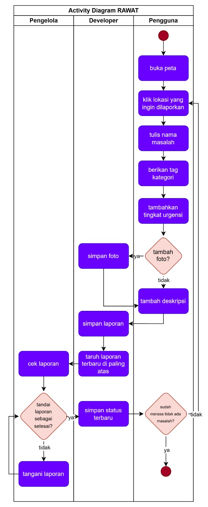

<h1>
IF2150 REKAYASA PERANGKAT LUNAK
 
TUGAS 10
 
HASIL IMPLEMENTASI DAN UJI PERANGKAT LUNAK (HIUPL)
</h1>
 

## *RAWAT (Ruang Aspirasi Warga dan Aduan Terpadu)*

  

### Untuk: *Agatha Tatianingseto*

Dipersiapkan oleh:
| Informasi | Keterangan |
| --- | --- |
| Kelas | *K01* |
| Kelompok | *G01*  |

| NIM | Nama |
| --- | --- |
| *13525103* | *Ravinka Fathia Adinegara* |
| *13525013* | *Samantha Michelle S Silaban* |
| *13525055* | *Syakira Azzahra Rachmania* |
| *13525043* | *Aufa Tatsbita Zahra* |
| *13525046* | *Ghiffari Arya Adhitya* |
---

## Daftar Isi

- [BAB 1: Pendahuluan](#bab-1-pendahuluan)
  - [1.1 Tujuan Penulisan Dokumen](#11-tujuan-penulisan-dokumen)
  - [1.2 Lingkup Masalah](#12-lingkup-masalah)
  - [1.3 Definisi, Istilah, dan Singkatan](#13-definisi-istilah-dan-singkatan)
  - [1.4 Aturan Penomoran](#14-aturan-penomoran)
  - [1.5 Referensi](#15-referensi)
  - [1.6 Deskripsi Umum Dokumen (Ikhtisar)](#16-deskripsi-umum-dokumen-ikhtisar)
- [BAB 2: Deskripsi Umum Perangkat Lunak](#bab-2-deskripsi-umum-perangkat-lunak)
- [BAB 3: Implementasi](#bab-3-implementasi)
  - [3.1 Lingkungan Implementasi](#31-lingkungan-implementasi)
  - [3.2 Implementasi Modul](#32-implementasi-modul)
  - [3.3 Implementasi Antarmuka](#33-implementasi-antarmuka)
  - [3.4 File Lain](#34-file-lain)
- [BAB 4: Hasil Pengujian](#bab-4-hasil-pengujian)
  - [4.1 Strategi dan Kedalaman Pengujian Kelas](#41-strategi-dan-kedalaman-pengujian-kelas)
  - [4.2 Pengujian Unit Kelas](#42-pengujian-unit-kelas)
  - [4.3 Pengujian Integrasi](#43-pengujian-integrasi)
  - [4.4 Pengujian Use Case](#44-pengujian-use-case)
  - [4.5 Pengujian Kebutuhan Non-Fungsional (KNF)](#45-pengujian-kebutuhan-non-fungsional-knf)
  - [4.6 Tangkapan Layar dan Bukti Hasil Pengujian](#46-tangkapan-layar-dan-bukti-hasil-pengujian)
- [BAB 5: Traceability](#bab-5-traceability)

---

## Daftar Perubahan

| Revisi | Deskripsi |
| :--- | :--- |
| *A* | *Deskripsikan perubahan yang dilakukan dari dokumen sebelumnya pada dokumen ini. Jika tidak terdapat perubahan, harap kosongkan tabel.* |
| *B* |  |
| *C* |  |
| ... |  |

---

# BAB 1: Pendahuluan

## 1.1 Tujuan Penulisan Dokumen
Dokumen ini ditulis untuk pengguna serta untuk pengembang sebagai laporan hasil perangkat lunak yang telah diuji. Pengujian dilakukan untuk mengetahui apakah implementasi perangkat lunak telah memenuhi dokumen-dokumen acuannya seperti SKPL, APL, dan DPPL. Sebagai laporan, dokumen ini memastikan apakah perangkat lunak mampu bekerja sesuai harapan, apakah perangkat lunak telah bekerja secara efektif, apakah sistem berfungsi dengan baik, baik secara fungsional maupun nonfungsional, serta apakah perangkat lunak dapat berjalan sebagaimana semestinya.

## 1.2 Lingkup Masalah
Guna membangun kota yang berkelanjutan, fasilitas publik yang aman dan universal menjadi instrumen utama yang tercantum pada Indikator SDG 11.7.1. Namun, pada kenyataannya fasilitas publik justru memiliki banyak catatan yang harus diperbaiki. Mulai dari infrastruktur layanan publik yang terbengkalai, akses jalan yang tidak ramah pejalan kaki, hingga maraknya aksi vandalisme. Sudah banyak metode untuk melaporkan fasilitas publik yang rusak, namun masih berjalan satu arah. Oleh karena itu, website RAWAT (Ruang Aspirasi Warga dan Aduan Terpadu) hadir untuk memfasilitasi sistem pelaporan yang lebih modern dan interaktif. Website ini diharapkan dapat meningkatkan _awareness_ masyarakat tentang kondisi fasilitas dan berkolaborasi dalam permintaan perbaikan fasilitas publik. Melalui fitur-fitur interaktif selayaknya media sosial, warga tidak hanya dapat menyampaikan laporan tetapi juga saling memvalidasi laporan, memberikan tanggapan, dan membangun kepedulian bersama terhadap fasilitas publik.

## 1.3 Definisi, Istilah, dan Singkatan
Semua definisi dan singkatan yang digunakan dalam dokumen ini beserta penjelasannya.

Tabel 1.3. Definisi Istilah dan Singkatan

| Singkatan, Akronim, atau Istilah | Penjelasan |
| :--- | :--- |
| *P/L* | *Singkatan dari Perangkat Lunak, yaitu aplikasi yang memberikan perintah kepada komputer untuk menjalankan tugas tertentu.* |
| *SKPL* | *Singkatan dari Spesifikasi Kebutuhan Perangkat Lunak, yaitu dokumen yang merangkum kriteria-kriteria yang diperlukan untuk membangun aplikasi menjalankan tugasnya.* |
| *DPPL* | *Singkatan dari Deskripsi Perancangan Perangkat Lunak, yaitu dokumen yang menjelaskan rancangan arsitektur, kelas, dan antarmuka P/L.* |
| *HIUPL* | *Singkatan dari Hasil Implementasi dan Uji Perangkat Lunak, yaitu dokumen yang melaporkan hasil implementasi dan pengujian P/L.* |
| *KF* | *Singkatan dari Kebutuhan Fungsional.* |
| *KNF* | *Singkatan dari Kebutuhan Non-Fungsional.* |
| *UC* | *Singkatan dari Use Case.* |
| *TC* | *Singkatan dari Test Case, yaitu satu kasus uji untuk skenario tertentu.* |
| *UT* | *Singkatan dari Unit Test, yaitu test case tingkat kelas/operasi.* |
| *INT* | *Singkatan dari Integration Test, yaitu test case yang menguji interaksi antarkomponen.* |
| *Boundary* | *Kasus uji pada nilai batas masukan, misalnya nilai minimum, maksimum, atau tepat di ambang aturan.* |
| *Coverage* | *Persentase baris/cabang kode yang dieksekusi oleh pengujian.* |
| *...* | *...* |

## 1.4 Aturan Penomoran
Tuliskan aturan penomoran (ID) yang digunakan dalam dokumen ini. Gunakan pola ID yang **sama** dengan yang sudah dipakai pada dokumen-dokumen sebelumnya (SKPL, APL, DPPL), kecuali untuk ID pengujian yang baru diperkenalkan pada dokumen ini.

Tabel 1.4. Aturan Penomoran

| Hal/Bagian | Penomoran | Keterangan |
| :--- | :--- | :--- |
| *Kebutuhan Fungsional* | *KFXX* | *Sesuai SKPL* |
| *Kebutuhan Non-Fungsional* | *KNFXX* | *Sesuai SKPL* |
| *Use Case* | *UCXX* | *Sesuai SKPL* |
| *Kelas* | *CXX* | *Sesuai DPPL* |
| *Antarmuka* | *I-XX* | *Sesuai DPPL* |
| *Test Case Unit* | *CXX-UTYY* | *XX adalah nomor kelas, YY adalah nomor urut test case unit pada kelas tersebut* |
| *Test Case Integrasi* | *INT-TCYY* | *YY adalah nomor urut test case integrasi* |
| *Test Case Use Case* | *UCXX-TCYY* | *XX adalah nomor use case, YY adalah nomor urut test case pada use case tersebut* |
| *Test Case KNF* | *KNFXX-TCYY* | *XX adalah nomor KNF, YY adalah nomor urut test case pada KNF tersebut* |
| *...* | *...* | *...* |

## 1.5 Referensi
<!-- Cantumkan daftar buku, panduan, atau dokumentasi lain yang dirujuk dalam pembuatan dokumen dan pengembangan P/L, **minimal dokumen SKPL, APL, DPPL, dan Implementasi (Tugas 9)**. Tambahkan dokumentasi *framework*/*library*/*testing tool* atau referensi lain apabila digunakan. -->
Berikut ini adalah dokumentasi yang dirujuk oleh dokumen ini.
* [SKPL RAWAT](https://github.com/ajalku/IF2150-RPL-K01-G01/blob/main/docs/M5/K01_G01_SKPL.md)
* [APL RAWAT](https://github.com/ajalku/IF2150-RPL-K01-G01/blob/main/docs/M6/K01_G01_APL.md)
* [DPPL1 RAWAT](...)
* [DPPL2 RAWAT]()
* [Implementasi RAWAT](...)

## 1.6 Deskripsi Umum Dokumen (Ikhtisar)
<!-- Tuliskan sistematika pembahasan dokumen ini secara ringkas dan runut bab demi bab, dengan maksimal 1 paragraf. -->
Dokumen ini terdiri atas 5 bab, yakni Pendahuluan, Deskripsi Umum perangkat Lunak, Implementasi, Hasil Pengujian, dan Traceability. Pada Pendahuluan, terdapat bagian Tujuan Penulisan Dokumen; Lingkup Masalah; Definisi, Istilah, dan Singkatan; Aturan Penomoran; Referensi; serta Deskripsi Umum Dokumen atau Ikhtisar. Bab 2 mencakup gambar dan narasi terkait aplikasi dan konteksnya. Bab 3 yang berisi implementasi berisi lingkungan implementasi, implementasi modul, implementasi antarmuka, dan file lain. Kemudian, bab 4 memiliki berbagai pengujian dari berbagai fungsi dan sudut pandang, seperti strategi dan kedalaman pengujian kelas, pengujian unit kelas, pengujian integrasi, pengujian use case, pengujian KNF, dan tangkapan layar sebagai bukti pengujian. Terakhir, traceability berisi pemetaan KF ke berbagai komponan lainnya.

 

---

# BAB 2: Deskripsi Umum Perangkat Lunak

<!-- Bagian ini diisi dengan *System Overview*, dalam bentuk gambar dan narasi yang memberikan gambaran tentang aplikasi dan konteksnya. **Batasan dan keterkaitan** antara sistem yang dibangun dengan sistem lain di luarnya harus jelas. Deskripsi umum sistem perlu dilengkapi dengan pemodelan kasus yang dihadapi, seperti *use case diagram*. Berikan narasi yang jelas untuk setiap gambar yang ditampilkan.

Bagian ini dapat menyalin atau meringkas dari dokumen SKPL atau DPPL. -->

*RAWAT* merupakan perangkat lunak berbasis _website_ yang memfasilitasi pelaporan interaktif terkait kondisi dan kerusakan fasilitas atau infrastruktur publik. P/L ini berinteraksi dengan sistem pihak ketiga yaitu *Map API* untuk mendukung fitur lokasi pelaporan. Sistem mengirimkan data alamat yang dicatat ke layanan peta eksternal melalui API, lalu menerima dan memproses hasil tersebut untuk memvisualisasikan titik koordinat lokasi kerusakan pada peta interaktif yang dapat diakses pengguna. Sistem menerima input laporan dari *Pengguna* yang berisi nama masalah, lokasi, tingkat permasalahan, foto, deskripsi, serta data interaksi sosial berupa *upvote*. Seluruh data tersebut kemudian diolah dan dikelola di dalam sistem sehingga *Admin* dapat memantau, melakukan varifikasi laporan, dan memperbarui progres terkait laporan sesuai dengan kondisi lapangan.

Dalam memahami bentuk implementasi dari *RAWAT*, akan ditampilkan diagram use case dari perangkat lunak tersebut. Berikut ini adalah diagram use case yang telah dibuat.

<i>Gambar 2.1. Use Case Diagram RAWAT</i>

Use case diagram ini menjelaskan bagaimana aktor-aktor di sekeliling RAWAT dapat berinteraksi dengan sistem.  Misalnya, dalam use case di atas, terdapat beberapa fungsi pengguna dan aktor yang beririsan seperti dapat melakukan login, mendapatkan tutorial apabila baru pertama kali masuk aplikasi, serta mengakses peta interaktif dan memeriksa laporan. Selain fungsi yang beririsan, terdapat fungsi yang berbeda, seperti pengguna dapat melakukan pelaporan dan upvote, sementara admin dapat mengubah status laporan atau memberikan tanggapan.

Selain use case diagram, terdapat juga activity diagram yang dapat menjelaskan proses bisnis perangkat lunak. Berikut ini adalah activity diagram yang telah dibuat.

<i>Gambar 2.2. Activity Diagram RAWAT</i>

Sesuai dengan activity diagram, pengguna dapat berinteraksi secara tidak langsung dengan admin dengan cara melaporkan sesuatu. Dengan melaporkan sesuatu, admin dapat melihat laporan dan menanggapi dengan cara mengubah-ubah status laporan, misalnya ketika laporan sudah dikaji atau sudah diperbaiki sehingga statusnya selesai. Sementara itu, sistem yang berinteraksi langsung dengan pengguna dapat memberikan feedback secara langsung seperti menyimpan laporan ke database serta menaruh laporan terbaru di paling atas.

 

---

# BAB 3: Implementasi

<!-- Bagian ini diisi dengan informasi tentang elemen P/L yang dikembangkan (*executable files*, *configuration files*, *data files*, dan sebagainya) serta perubahannya terhadap rancangan pada DPPL (jika ada). -->

## 3.1 Lingkungan Implementasi

<!-- Tuliskan *hardware* dan *software* yang digunakan untuk implementasi, mencakup *operating system*, bahasa pemrograman beserta versinya, *framework*/*library*, DBMS, *development tools*, dan *version control*. Lingkungan ini harus konsisten dengan **Subbab 2.1 DPPL**; jelaskan jika ada perubahan. Cantumkan juga *framework* dan alat pengujian yang dipakai. -->

Tabel 3.1. Lingkungan Implementasi

| Aspek | Keterangan |
| :--- | :--- |
| *Hardware* | *[Spesifikasi perangkat keras]* |
| *Operating System* | *Microsoft Windows [Version 10.0.26200.9974]* |
| *Bahasa Pemrograman* | *JavaScript; backend berjalan di Node.js versi v26.13.0* |
| *Framework/Library* | *Backend: Express.js 5.3.0, pg 8.23.1, express-session 1.19.0. Frontend: React 19.3.1, Vite 8.3.5, Leaflet 1.9.4, React-Leaflet 5.0.0.* |
| *DBMS* | *PostgreSQL versi 16.15* |
| *Development Tools* | *Visual Studio Code, Git, Node.js/np* |
| *Testing Tools* | *Node.js Test runner (npm test) di backend and frontend, ESLint (npm run lint), Vite (npm run build), UI manual di browser* |

## 3.2 Implementasi Modul

<!-- Daftar modul/kelas yang **TELAH** diimplementasikan. Gunakan nama dan ID kelas yang sama dengan DPPL, dan konsisten dengan Tabel B.5 pada dokumen Implementasi (Tugas 9). -->

Tabel 3.2. Implementasi Modul

| No | ID Kelas | Nama Modul/Kelas | Nama File Fisik | Nama File Executable |
| :--- | :--- | :--- | :--- | :--- |
| 1 | C01 | Pengguna | `../../src/backend/src/models/Pengguna.js` | - |
| 2 | C02 | Homepage | `../../src/backend/src/src/models/Homepage.js` | - |
| 3 | C03 | Laporan | `../../src/backend/src/src/models/Laporan.js` | - |
| 4 | C04 | Lokasi | `../../src/backend/src/src/models/Lokasi.js` | - |
| 5 | C05 | Upvote | `../../src/backend/src/src/models/Upvote.js` | - |
| 6 | C06 | Tanggapan | `../../src/backend/src/src/models/Tanggapan.js | - |
| 7 | C07 | Tutorial | `../../src/backend/src/src/models/Tutorial.js | - |
| 8 | C08 | PenggunaView | `../../src/frontend/src/view/PenggunaView.jsx` | - |
| 9 | C09 | HomepageView | `../../src/frontend/src/view/HomepageView.jsx` | - |
| 10 | C10 | LaporanView | `../../src/frontend/src/view/LaporanView.jsx` | - |
| 11 | C11 | LokasiView | `../../src/frontend/src/view/LokasiView.jsx` | - |
| 12 | C12 | UpvoteView | `../../src/frontend/src/view/UpvoteView.jsx` | - |
| 13 | C13 | TanggapanView | `../../src/frontend/src/view/TanggapanView.jsx` | - |
| 14 | C14 | TutorialView | `../../src/frontend/src/view/TutorialView.jsx` |
| 15 | C15 | PenggunaController | `../../src/backend/src/controllers/PenggunaController.js` | - |
| 16 | C16 | HomepageController | `../../src/backend/src/controllers/HomepageController.js` | - |
| 17 | C17 | LaporanController | `../../src/backend/src/controllers/LaporanController.js` | - |
| 18 | C18 | LokasiController | `../../src/backend/src/controllers/LokasiController.js` | - |
| 19 | C19 | UpvoteController | `../../src/backend/src/controllers/UpvoteController.js` | - |
| 20 | C20 | TanggapanController | `../../src/backend/src/controllers/TanggapanController.js` | - |
| 21 | C21 | TutorialController | `../../src/backend/src/controllers/TutorialController | - |
| 22 | C22 | MapAPI | `../../src/backend/src/config/mapApi.js` | - |
| 23 | C23 | MapAPIService | `../..src/backend/src/services/MapAPIService.js` | - |
| 24 | C24 | MapAPIView | `../../src/frontend/src/components/PetaLaporan.jsx` | - |
<!-- | 1 | *[C01]* | *[Nama modul/kelas]* | *[path/ke/file]* | *[Nama file executable, atau - jika tidak ada]* |
| 2 | *[C02]* | *[Nama modul/kelas]* | *[path/ke/file]* | *[...]* |
| ... | *...* | *...* | *...* | *...* | -->

## 3.3 Implementasi Antarmuka

<!-- Daftar antarmuka yang telah diimplementasikan. Gunakan ID dan nama layar yang sama dengan ID dan nama layar pada tugas DPPL. -->

Tabel 3.3. Implementasi Antarmuka

| No | ID Antarmuka | Nama Antarmuka | Nama File Fisik | Nama File Executable |
| :--- | :--- | :--- | :--- | :--- |
| 1 | I-01 | Login Page | `../../src/frontend/src/view/PenggunaView.jsx` | - |
| 2 | I-02 | Registration Page | `../../src/frontend/src/view/PenggunaView.jsx` | - |
| 3 | I-03 | Homepage | `../../src/frontend/src/view/HomepageView.jsx` | - |
| 4 | I-04 | Page Laporan | `../../src/frontend/src/view/LaporanView.jsx` | - |
| 5 | I-05 | Buat Laporan | `../../src/frontend/src/view/BuatLaporanView.jsx` | - |
| 6 | I-06 | Periksa Laporan | `../../src/frontend/src/view/PeriksaLaporanView.jsx` | - |
| 7 | I-07 | Peta Interaktif | `../../src/frontend/src/view/LokasiView.jsx`; `../../src/frontend/src/components/PetaLaporan.jsx` | - |
| 8 | I-08 | Profil | `../../src/frontend/src/view/ProfilView.jsx` | - |

## 3.4 File Lain

<!-- Daftar file lain yang dibuat selain file kelas dan antarmuka, misalnya file *utility*, *configuration*, *database schema/seed*, *file test*, atau *data*. -->

Tabel 3.4. File Lain

| No | Nama File | Keterangan |
| :--- | :--- | :--- |
| 1 | `../../src/backend/src/index.js` | Inisialisasi Express, middleware, dan route API. |
| 2 | `../../src/frontend/src/main.jsx`, `../../src/frontend/src/App.jsx` | Entry point frontend dan komponen root yang mengatur tampilan serta navigasi aplikasi. |
| 3 | `../../src/backend/src/routes/authRoutes.js`, `../../src/backend/src/routes/profileRoutes.js`; `../../src/backend/src/routes/laporanRoutes.js`; `../../src/backend/src/routes/lokasiRoutes.js`; `../../src/backend/src/routes/upvoteRoutes.js`; `../../src/backend/src/routes/tutorialRoutes.js`; `../../src/backend/src/routes/homepageRoutes.js` | Mendefinisikan endpoint API autentikasi, profil, laporan/tanggapan, lokasi, upvote, tutorial, dan homepage. |
| 4 | `../../src/backend/src/middleware/authMiddleware.js`, `../../src/backend/src/middleware/roleMiddleware.js`; `../../src/backend/src/middleware/uploadMiddleware.js` | Middleware autentikasi, pemeriksaan role, dan unggah berkas. |
| 5 | `../../src/backend/src/config/database.js`, `../../src/backend/src/config/session.js` | Konfigurasi koneksi PostgreSQL dan penyimpanan session. |
| 6 | `../../src/backend/src/jobs/pembersihLaporan.js` | Untuk membersihkan laporan yang melewati batas waktu. |
| 7 | `../../src/frontend/src/services/apiClient.js`, `../../src/frontend/src/services/authService.js`; `../../src/frontend/src/services/homepageService.js`; `../../src/frontend/src/services/laporanService.js`; `../../src/frontend/src/services/lokasiService.js`; `../../src/frontend/src/services/profileService.js`; `../../src/frontend/src/services/tanggapanService.js`; `../../src/frontend/src/services/tutorialService.js`; `../../src/frontend/src/services/upvoteService.js` | Service frontend yang digunakan untuk me-request API dan mengelola respons fitur. |
| 8 | `../../src/frontend/src/hooks/useData.js`; `../../src/frontend/src/hooks/useRute.js`; `../../src/frontend/src/utils/format.js`; `../../src/frontend/src/utils/jarak.js`; `../../src/frontend/src/utils/tanggapanForm.js` | Hook dan utilitas bersama untuk data, navigasi, format, jarak, dan formulir tanggapan. |
| 9 | `../../src/backend/db/schema.sql`; `../../src/backend/db/schema_laporan.sql`; `../../src/backend/db/schema_sessions.sql` | Skema awal basis data pengguna, laporan/lokasi, dan session. |
| 10 | `../../src/backend/db/migration_tanggapan.sql`; `../../src/backend/db/migration_tanggapan_id_admin.sql`; `../../src/backend/db/migration_upvote.sql`; `../../src/backend/db/migration_tutorial.sql`; `../../src/backend/db/migration_homepage.sql`; `../../src/backend/db/migration_index_urgensi.sql` | Migrasi tabel/kolom tanggapan, upvote, tutorial, homepage, dan indeks urgensi. |
| 11 | `../../src/backend/scripts/seedAdmin.js` | Membuat akun admin awal dari konfigurasi environment untuk kebutuhan pengembangan/pengujian. |
| 12 | `../../src/backend/tests/AuthController.test.js`; `../../src/backend/tests/LaporanLokasiController.test.js`; `../../src/backend/tests/ProfileController.test.js`; `../../src/backend/tests/TanggapanController.test.js`; `../../src/backend/tests/homepage.test.js`; `../../src/backend/tests/tutorial.test.js`; `../../src/backend/tests/upvote.test.js`; `../../src/frontend/tests/laporan-lokasi-services.test.js` | Tes yang dijalankan secara otomatis untuk backend dan frontend dalam fitur autentikasi, laporan/lokasi, profil, homepage, tutorial, tanggapan, dan upvote. |

 

---

# BAB 4: Hasil Pengujian

Bab ini melaporkan hasil pengujian P/L pada level unit, integrasi, dan sistem. Pengujian dilakukan pada tag release terakhir Tugas 9. Hasil aktual diisi berdasarkan pengamatan saat pengujian. Kesimpulan diisi `Pass` atau `Fail`, dan untuk `Fail` dilengkapi penyebab serta usulan perbaikan.

## 4.1 Strategi dan Kedalaman Pengujian Kelas

Setiap kelas perancangan pada Tabel 4.1 DPPL diklasifikasikan ke dalam tiga tingkat kedalaman pengujian. Tingkat **Mendalam** diberikan pada kelas yang memuat logika bisnis, perhitungan, validasi, aturan status, algoritma, integrasi eksternal, atau keamanan. Tingkat **Sedang** diberikan pada kelas yang hanya mengoordinasikan atau mendelegasikan proses. Tingkat **Tidak perlu** diberikan pada kelas tanpa logika, seperti *entity/DTO* dan kelas konfigurasi, yang teruji secara tidak langsung melalui test case use case. Seluruh kelas wajib dicantumkan beserta alasan penentuan tingkatnya.

Tabel 4.1.1. Identifikasi Tingkat Pengujian Kelas

| ID Kelas | Nama Kelas | Tingkat | Alasan | Test Case Terkait |
| :--- | :--- | :--- | :--- | :--- |
| *C15* | *PenggunaController* | *Mendalam* | *Memuat `login()`, `registrasi()`, autetikasi, hashing password, serta validasi data* | *C15-UT01 s.d. C15-UT24* |
| *C01* | *Pengguna* | *Sedang* | *Melakukan operasi CRUD pada terdapat beberapa logika pengambilan keputusan.* | *C03-UT01 s.d. C03-UT09, INT-TC01 s.d. INT-TC06* |
| *C08* | *PenggunaView* | *Sedang* | *Terdapat operasi yang memengaruhi perilaku sistem* | *C01-UT01 s.d. C01-UT08, INT-TC07 s.d. TC09* |
| *[CXX]* | *[Nama kelas]* | *[Mendalam/Sedang/Tidak perlu]* | *[Alasan penentuan tingkat pengujian]* | *[ID test case atau -]* |

## 4.2 Pengujian Unit Kelas

Pengujian unit dilakukan pada kelas bertingkat Mendalam dan Sedang. Kelas Mendalam diuji pada seluruh operasi public dengan kasus normal, batas, dan negatif, serta mencapai *coverage* minimal 70%. Kelas Sedang diuji minimal dengan satu kasus normal dan satu kasus gagal pada operasi public utama.

Cara menjalankan unit test: *[tuliskan perintah, mis. `pytest src/tests/`]*.

Lokasi file test: *[path, mis. `src/tests/`]*.

### 4.2.1 Kelas PenggunaController

**ID Kelas:** C15  
**Nama Kelas:** *PenggunaController*  
**Tingkat:** *Mendalam*

Tabel 4.2.1. Hasil Pengujian Unit Kelas C15

| ID Pengujian | Operasi yang Diuji | Jenis Kasus | Prosedur/Masukan | Hasil yang Diharapkan | Hasil Pengujian | Kesimpulan |
| :--- | :--- | :--- | :--- | :--- | :--- | :--- |
| *C15-UT01* | *`register()`* | *Normal* | *Registrasi menggunakan nama, NIK 16 digit, email, password, dan nomor telepon valid* | *HTTP 201 dan password di-hash* | *HTTP 201 dan bycrypt dipanggil untuk melakukan hash* | *Pass* |
| *C15-UT02* | *`register()`* | *Batas* | *Registrasi dengan password tepat 8 karakter* | *HTTP 201 dan password diterima* | *HTTP 201 dan password diterima* | *Pass* |
| *C15-UT03* | *`register()`* | *Negatif* | *Registrasi dengan NIK 5 digit* | *HTTP 400, pesan NIK tidak valid* | *HTTP 400 dengan pesan yang sesuai* | *Pass* |
| *C15-UT04* | *`login()`* | *Normal* | *Login dengan email dan password valid* | *HTTP 200 dan sesi pengguna disimpan* | *HTTP 200 dan idPengguna dan role disimpan dalam mock session* | *Pass* |
| *C15-UT05* | *`login()`* | *Batas* | *Login menggunakan email berisi spasi saja* | *HTTP 400 dan password diwajibkan* | *HTTP 400 pesan Email and _password are required_| *Pass* |
| *C15-UT06* | *`register()`* | *Negatif* | *Login dengan password yang salah* | *HTTP 401, login ditolak* | *HTTP 401 dengan pesan Wrong Email or Password* | *Pass* |
| *C15-UT07* | *`getProfile()`* | *Normal* | *Mengambil profil pengguna dengan ID sesi 1* | *HTTP 200 dan data profil dikembalikan* | *HTTP 200 dan data profil sesuai mock* | *Pass* |
| *C15-UT08* | *`getProfile()`* | *Batas* | *Mengambil profil dengan sesi tanpa idPengguna* | *HTTP 404, pengguna tidak ditemukan* | *HTTP 404 pesan _User not found_| *Pass* |
| *C15-UT09* | *`getProfile()`* | *Negatif* | *Simulasi kegagalan database saat mengambil profil* | *HTTP 500, pesan kesalahan server* | *HTTP 500 dengan pesan Something went Wrong* | *Pass* |
| *C15-UT09* | *`getProfile()`* | *Negatif* | *Simulasi kegagalan database saat mengambil profil* | *HTTP 500, pesan kesalahan server* | *HTTP 500 dengan pesan Something went wrong* | *Pass* |
| *C15-UT10* | *`ubahProfil()`* | *Normal* | *Mengubah nama menjadi "  Nama Baru  " dan nomor telepon valid* | *HTTP 200, nama di-trim dan profil diperbarui* | *HTTP 200, nama dikirim sebagai Nama Baru pada pemanggilan model mock* | *Pass* |
| *C15-UT11* | *`ubahProfil()`* | *Batas* | *Mengubah nama dengan tepat 100 karakter* | *HTTP 200, nama diterima* | *HTTP 200, pembaruan nama diterima* | *Pass* |
| *C15-UT12* | *`ubahProfil()`* | *Negatif* | *Mengubah field terlindungi role menjadi admin* | *HTTP 400, perubahan field terlindungi ditolak* | *HTTP 400 dengan pesan Protected profile fields cannot be changed* | *Pass* |
| *C15-UT13* | *`changePassword()`* | *Normal* | *Mengganti password dengan password lama benar dan password baru valid serta berbeda* | *HTTP 200, password baru di-hash dan diperbarui* | *HTTP 200, pesan Password updated successfully dan hash baru dikirim ke model mock* | *Pass* |
| *C15-UT14* | *`changePassword()`* | *Batas* | *Mengganti password dengan password baru tepat 8 karakter (Abcdef1!)* | *HTTP 200, password baru diterima* | *HTTP 200, password diterima dan proses hashing dipanggil* | *Pass* |
| *C15-UT15* | *`changePassword()`* | *Negatif* | *Mengganti password menggunakan password lama yang salah* | *HTTP 401, perubahan password ditolak* | *HTTP 401 dengan pesan Current password is incorrect* | *Pass* |
| *C15-UT16* | *`hapusAkun()`* | *Normal* | *Pengguna dengan role warga melakukan penghapusan akun* | *HTTP 200, akun dihapus dan sesi diakhiri* | *HTTP 200, fungsi penghapusan akun dan destroy session mock dipanggil* | *Pass* |
| *C15-UT17* | *`hapusAkun()`* | *Batas* | *Menghapus akun tanpa ID pengguna dalam sesi* | *HTTP 401, penghapusan akun ditolak* | *HTTP 401 dengan pesan Please log in to continue* | *Pass* |
| *C15-UT18* | *`hapusAkun()`* | *Negatif* | *Pengguna dengan role admin mencoba menghapus akun* | *HTTP 403, akses penghapusan ditolak* | *HTTP 403 dengan pesan Hanya warga yang dapat menghapus akun* | *Pass* |
| *C15-UT19* | *`me()`* | *Normal* | *Mengambil informasi pengguna yang sedang login* | *HTTP 200, informasi pengguna dikembalikan* | *HTTP 200 dengan data ID, nama, email, nomor telepon, dan role sesuai mock* | *Pass* |
| *C15-UT20* | *`me()`* | *Batas* | *Mengambil informasi pengguna ketika akun tidak ditemukan* | *HTTP 401, sesi pengguna diakhiri* | *HTTP 401, pesan Please log in to continue dan destroy session mock dipanggil* | *Pass* |
| *C15-UT21* | *`me()`* | *Negatif* | *Simulasi kegagalan database saat mengambil informasi pengguna* | *HTTP 500, pesan kesalahan server* | *HTTP 500 dengan pesan Something went wrong* | *Pass* |
| *C15-UT22* | *`logout()`* | *Normal* | *Logout dengan sesi pengguna aktif* | *HTTP 200, sesi diakhiri dan cookie dihapus* | *HTTP 200, pesan Logout succeeded, destroy session dan clearCookie mock dipanggil* | *Pass* |
| *C15-UT23* | *`logout()`* | *Batas* | *Logout dengan sesi tanpa idPengguna* | *HTTP 200, logout tetap berhasil* | *HTTP 200, destroy session dan clearCookie mock dipanggil* | *Pass* |
| *C15-UT24* | *`logout()`* | *Negatif* | *Simulasi kegagalan proses destroy session* | *HTTP 500, pesan kesalahan server* | *HTTP 500 dengan pesan Something went wrong* | *Pass* |

Tabel 4.2.1b. Ringkasan Cakupan Kelas C15

| Informasi | Keterangan |
| :--- | :--- |
| Daftar operasi public pada DPPL | *registrasi(), login(), setIzinLokasi(), cekIzinLokasi(), cekStatusTutorial(), sudahLogin(), kirimKonfirmasiUlang(), ubahProfil(), hapusAkun()* |
| Operasi yang diuji | *register(), login(), getProfile(), ubahProfil(), changePassword(), hapusAkun(), me(), logout()* |
| ID Algoritma yang tercakup | *Algo-020, Algo-021, Algo-022, Algo-023, Algo-024, Algo-025* |
| Coverage (wajib ≥ 70%) | *Statement Coverage: 75,97%; Branch Coverage: 70,94%; Function Coverage: 100%; Line Coverage: 76,87%. Pengukuran menggunakan Jest dengan 24 test case Passed (bukti pengujian pada Subbab 4.6).* |

### 4.2.2 Kelas Pengguna

**ID Kelas:** C01
**Nama Kelas:** *Pengguna*  
**Tingkat:** *Sedang*

Tabel 4.2.2. Hasil Pengujian Unit Kelas C01

| ID Pengujian | Operasi yang Diuji | Jenis Kasus | Prosedur/Masukan | Hasil yang Diharapkan | Hasil Pengujian | Kesimpulan |
| :--- | :--- | :--- | :--- | :--- | :--- | :--- |
| *C01-UT01* | *`simpanDataPengguna()`* | *Normal* | *Menyimpan data pengguna baru dengan nama, NIK, email, hash password, dan nomor telepon valid* | *Query INSERT dijalankan dan mengembalikan ID pengguna 1* | *Query INSERT dipanggil dengan parameter sesuai, ID pengguna 1 berhasil dikembalikan* | *Pass* |
| *C01-UT02* | *`getPenggunaByEmail()`* | *Normal* | *Mencari pengguna berdasarkan email samantha@example.com* | *Mengembalikan objek Pengguna dengan email yang sesuai* | *Objek Pengguna berhasil dikembalikan dengan email samantha@example.com* | *Pass* |
| *C01-UT03* | *`getPenggunaById()`* | *Normal* | *Mencari pengguna dengan ID 1* | *Mengembalikan objek Pengguna dengan ID 1* | *Objek Pengguna berhasil dikembalikan dengan ID 1* | *Pass* |
| *C01-UT04* | *`getProfilPenggunaById()`* | *Normal* | *Mengambil profil pengguna dengan ID 1* | *Mengembalikan data profil berisi ID, nama, email, nomor telepon, dan role* | *Data profil berhasil dikembalikan dengan seluruh atribut sesuai hasil mock* | *Pass* |
| *C01-UT05* | *`updateDataPengguna()`* | *Normal* | *Memperbarui nama menjadi Samantha Baru dan nomor telepon menjadi 081234567890 untuk pengguna ID 1* | *Query UPDATE dijalankan dengan parameter sesuai dan mengembalikan true* | *Query UPDATE dijalankan dengan parameter sesuai dan method mengembalikan true* | *Pass* |
| *C01-UT06* | *`hapusDataPengguna()`* | *Normal* | *Menghapus data pengguna dengan ID 1* | *Query DELETE dijalankan dan mengembalikan true* | *Query DELETE dijalankan dengan ID 1 dan method mengembalikan true* | *Pass* |
| *C01-UT07* | *`hapusAkun()`* | *Normal* | *Memanggil penghapusan akun pengguna dengan ID 1* | *Method hapusDataPengguna dipanggil dan mengembalikan true* | *Method hapusDataPengguna berhasil dipanggil satu kali dan mengembalikan true* | *Pass* |
| *C01-UT08* | *`getPenggunaByNIK()`* | *Normal* | *Mencari pengguna berdasarkan NIK 1234567890123456* | *Mengembalikan objek Pengguna dengan data yang sesuai* | *Objek Pengguna berhasil dikembalikan dengan ID 1 sesuai hasil mock* | *Pass* |
| *C01-UT09* | *`hapusAkun()`* | *Negatif* | *Penghapusan gagal karena database tidak menghapus baris apa pun * | *Tidak ada bagian database yang terhapus* | *Tidak ada bagian database yang terhapus* | *Pass* |

### 4.2.3 Kelas Pengguna
**ID Kelas:** C08
**Nama Kelas:** *PenggunaView*  
**Tingkat:** *Sedang*

Tabel 4.2.3. Hasil Pengujian Unit Kelas C08

| ID Pengujian | Operasi yang Diuji | Jenis Kasus | Prosedur/Masukan | Hasil yang Diharapkan | Hasil Pengujian | Kesimpulan |
| :--- | :--- | :--- | :--- | :--- | :--- | :--- |
| *C17-UT01* | *`handleRegister()`* | *Negatif* | *Melakukan registrasi dengan NIK 12345 yang tidak memenuhi ketentuan 16 digit* | *Registrasi ditolak, pesan kesalahan NIK ditampilkan, dan request registrasi tidak dikirim* | *Pesan "NIK harus terdiri dari 16 digit angka." ditampilkan dan requestRegister tidak dipanggil* | *Pass* |
| *C17-UT02* | *`handleLogin()`* | *Normal* | *Melakukan login menggunakan email samantha@example.com dan password Password1! dengan respons service berhasil* | *Request login dikirim, callback onLoginSuccess dipanggil, pesan berhasil ditampilkan, dan input password dikosongkan* | *Request login dipanggil dengan kredensial sesuai, callback berhasil dijalankan, pesan "Login berhasil. Anda sudah masuk ke RAWAT." ditampilkan, dan input password dikosongkan* | *Pass* |
| *C17-UT03* | *`konfirmasiHapusAkun()`* | *Negatif* | *Melakukan konfirmasi penghapusan akun ketika service hapusAkun mengembalikan error "Gagal menghapus akun."* | *Pesan kegagalan ditampilkan, dialog konfirmasi tetap terbuka, dan callback keberhasilan tidak dipanggil* | *Pesan "Gagal menghapus akun." ditampilkan pada dialog, dialog tetap terbuka, dan onAkunDihapus tidak dipanggil* | *Pass* |
| *C17-UT04* | *`handleRegister()`* | *Normal* | *Melakukan registrasi dengan nama, NIK 16 digit, email, nomor telepon, password, dan konfirmasi password yang valid* | *Request registrasi dikirim ke authService, registrasi berhasil, halaman kembali ke login, dan pesan keberhasilan ditampilkan* | *Request register dipanggil dengan data yang sesuai, pesan "Registrasi berhasil! Silakan masuk menggunakan akun Anda." ditampilkan, dan email pengguna terisi pada form login* | *Pass* |
| *C17-UT05* | *`handleLogin()`* | *Negatif* | *Melakukan login menggunakan email valid dan password salah sehingga authService mengembalikan error "Email atau password salah"* | *Pesan kesalahan ditampilkan, callback onLoginSuccess tidak dipanggil, dan tombol login kembali aktif* | *Pesan "Email atau password salah" ditampilkan, onLoginSuccess tidak dipanggil, dan tombol login kembali aktif setelah request gagal* | *Pass* |
| *C17-UT06* | *`konfirmasiHapusAkun()`* | *Normal* | *Melakukan konfirmasi penghapusan akun ketika service hapusAkun mengembalikan respons berhasil* | *Request penghapusan akun diproses, callback onAkunDihapus dipanggil dengan status success, dan dialog konfirmasi ditutup* | *Service hapusAkun dipanggil satu kali, onAkunDihapus menerima pesan "Akun berhasil dihapus." dengan status success, dan dialog konfirmasi ditutup* | *Pass* |
| *C17-UT07* | *`batalHapusAkun()`* | *Normal* | *Membuka dialog konfirmasi penghapusan akun, kemudian menekan tombol Batal sebelum proses penghapusan dimulai* | *Dialog konfirmasi ditutup dan tidak ada request penghapusan akun yang dikirim* | *Dialog konfirmasi berhasil ditutup dan service hapusAkun tidak dipanggil* | *Pass* |
| *C17-UT08* | *`batalHapusAkun()`* | *Negatif* | *Mencoba membatalkan penghapusan akun ketika request hapusAkun masih berlangsung (pending)* | *Pembatalan ditolak, dialog tetap terbuka, dan callback keberhasilan belum dipanggil selama proses berlangsung* | *Dialog tetap terbuka ketika tombol Batal ditekan selama proses berlangsung; setelah request berhasil, onAkunDihapus dipanggil dan dialog ditutup* | *Pass* |

 

## 4.3 Pengujian Integrasi

Pengujian integrasi memeriksa interaksi antarkomponen yang melewati batas, yaitu *Controller* ke *Model*, aplikasi ke basis data, dan aplikasi ke sistem eksternal. Daftar antarmuka mengacu pada dokumen DPPL, dengan minimal satu test case untuk setiap antarmuka. Pengujian memakai komponen nyata, bukan *mock*. Apabila ada antarmuka tambahan yang belum didaftarkan pada dokumen DPPL, cantumkan juga.

Tabel 4.3.1. Daftar Antarmuka Antarkomponen

| ID Antarmuka | Komponen Asal | Komponen Tujuan | Jenis Batas | Test Case |
| :--- | :--- | :--- | :--- | :--- |
| *I-01* | *PenggunaController* | *Pengguna (Model)* | *Controller - Model* | *INT-TC01, INT-TC02, INT-TC03, INT-TC04, INT-TC05, INT-TC06* |
| *I-02* | *Pengguna (Model)* | *PostgreSQL* | *Aplikasi - Basis Data* | *INT-TC01, INT-TC03, INT-TC04, INT-TC05, INT-TC06* |
| *I-03* | *authService* | *Express API Auth* | *Frontend - Backend (HTTP)* | *INT-TC07* |
| *I-04* | *profileService* | *Express API Profile* | *Frontend - Backend (HTTP)* | *INT-TC08* |
| *I-05* | *Express Session* | *PostgreSQL Session Store* | *Aplikasi - Basis Data* | *INT-TC02, INT-TC09* |
| *[I-XX]* | *[Komponen asal]* | *[Komponen tujuan]* | *[Jenis batas]* | *[ID test case]* |

Tabel 4.3.2. Hasil Pengujian Integrasi

| ID Pengujian | ID Antarmuka | Skenario | Prosedur/Masukan | Hasil yang Diharapkan | Hasil Pengujian | Kesimpulan |
| :--- | :--- | :--- | :--- | :--- | :--- | :--- |
| *INT-TC01* | *I-01, I-02* | *Normal: Registrasi pengguna* | *Kirim POST /api/auth/register dengan nama, NIK 16 digit, email unik, password valid, dan nomor telepon valid melalui Supertest. Kemudian baca ulang data dari PostgreSQL.* | *HTTP 201, akun tersimpan dalam database dengan atribut sesuai masukan, ID pengguna dikembalikan, dan password disimpan dalam bentuk hash.* | *HTTP 201 diterima, ID pengguna dikembalikan, data berhasil ditemukan kembali pada PostgreSQL dengan atribut sesuai, dan password tersimpan dalam bentuk hash.* | *Pass* |
| *INT-TC02* | *I-01, I-02, I-05* | *Normal: Login pengguna* | *Kirim POST /api/auth/login menggunakan email dan password akun yang telah diregistrasi, kemudian kirim GET /api/auth/me menggunakan cookie sesi yang sama melalui Supertest agent.* | *HTTP 200, login berhasil, role warga dikembalikan, sesi dikenali, dan endpoint /api/auth/me mengembalikan informasi pengguna yang sesuai.* | *HTTP 200 diterima, pesan Login succeeded. dan role warga dikembalikan. Request GET /api/auth/me menggunakan sesi yang sama berhasil mengembalikan HTTP 200 dengan email dan role pengguna sesuai.* | *Pass* |
| *INT-TC03* | *I-01, I-02* | *Normal: Mengambil profil pengguna* | *Kirim GET /api/profile menggunakan sesi login aktif, kemudian bandingkan respons API dengan data pengguna pada PostgreSQL.* | *HTTP 200, data profil pengguna dikembalikan dan sesuai dengan data yang tersimpan pada database.* | *HTTP 200 diterima, data nama, email, nomor telepon, dan role berhasil dikembalikan. ID, nama, dan nomor telepon sesuai dengan hasil query PostgreSQL.* | *Pass* |
| *INT-TC04* | *I-01, I-02* | *Normal: Memperbarui profil pengguna* | *Kirim PUT /api/profile dengan nama "Integration Test Updated" dan nomor telepon "081298765432", kemudian baca ulang data melalui API dan PostgreSQL.* | *HTTP 200, perubahan profil berhasil disimpan dan data yang dibaca ulang sesuai dengan masukan.* | *HTTP 200 diterima dengan pesan "Profile updated successfully.". Nama dan nomor telepon berhasil diperbarui pada PostgreSQL serta sesuai saat dibaca ulang melalui GET /api/profile.* | *Pass* |
| *INT-TC05* | *I-01, I-02* | *Normal: Mengganti password pengguna* | *Kirim PUT /api/profile/password menggunakan password lama yang benar dan password baru "NewPassword2!", kemudian periksa perubahan hash pada PostgreSQL dan lakukan login ulang.* | *HTTP 200, hash password berubah, password tidak tersimpan sebagai plaintext, dan login dengan password baru berhasil.* | *HTTP 200 diterima dengan pesan "Password updated successfully.". Hash password pada PostgreSQL berubah dan berbeda dari plaintext. Login menggunakan password baru berhasil dengan HTTP 200 dan sesi baru dikenali melalui GET /api/auth/me.* | *Pass* |
| *INT-TC06* | *I-01, I-02, I-05* | *Normal: Menghapus akun pengguna* | *Kirim request DELETE melalui endpoint penghapusan akun dengan sesi login aktif, kemudian periksa keberadaan akun di PostgreSQL dan validitas sesi sebelumnya.* | *HTTP 200, akun terhapus dari database dan sesi pengguna tidak lagi dapat digunakan.* | *HTTP 200 diterima dengan pesan "Akun berhasil dihapus.". Query PostgreSQL tidak menemukan akun yang dihapus, sedangkan GET /api/auth/me menggunakan sesi lama mengembalikan HTTP 401.* | *Pass* |
| *INT-TC07* | *I-03* | *Normal: Login pengguna melalui frontend* | *Masukkan email dan password akun dummy melalui halaman login PenggunaView, kemudian periksa request POST /api/auth/login menggunakan Chrome DevTools pada tab Network.* | *Frontend berhasil mengirim request login ke backend, backend mengembalikan HTTP 200, sesi autentikasi terbentuk, dan pengguna berhasil masuk ke aplikasi.* | *Request POST /api/auth/login berhasil diproses dengan HTTP 200. Pengguna berhasil login dan diarahkan ke halaman aplikasi dalam keadaan terautentikasi.* | *Pass* |
| *INT-TC08* | *I-03* | *Normal: Registrasi pengguna melalui frontend* | *Isi formulir registrasi PenggunaView menggunakan nama, NIK, email, nomor telepon, dan password dummy yang valid. Kirim formulir dan periksa request POST /api/auth/register melalui Chrome DevTools.* | *Frontend berhasil mengirim data registrasi ke backend, backend mengembalikan HTTP 201, dan akun baru berhasil dibuat.* | *Request POST /api/auth/register berhasil diproses dengan HTTP 201. Registrasi berhasil dan akun dummy dapat digunakan untuk melakukan login.* | *Pass* |
| *INT-TC09* | *I-04* | *Normal: Memperbarui profil pengguna melalui frontend* | *Login menggunakan akun dummy, buka halaman profil, ubah nama dan nomor telepon, kemudian simpan perubahan. Periksa request PUT /api/profile melalui Chrome DevTools dan muat ulang halaman.* | *Frontend berhasil mengirim perubahan profil ke backend, backend mengembalikan HTTP 200, dan data profil terbaru tetap tersimpan setelah halaman dimuat ulang.* | *Request PUT /api/profile berhasil diproses dengan HTTP 200. Nama dan nomor telepon berhasil diperbarui pada tampilan profil serta tetap sesuai setelah halaman dimuat ulang.* | *Pass* |
| *...* | *...* | *...* | *...* | *...* | *...* | *...* |

 

## 4.4 Pengujian Use Case

Pengujian use case dilakukan pada seluruh skenario normal dan alternatif sesuai Subbab 4.4 SKPL, dengan minimal satu test case untuk setiap skenario. Kolom ID KF menunjukkan KF yang diverifikasi oleh test case tersebut.

### 4.4.1 Use Case Melakukan Registrasi Akun

**ID Use Case:** *UC01*  
**Nama Use Case:** *Melakukan Registrasi Akun*

Tabel 4.4.1. Hasil Pengujian Use Case UC01

| ID Pengujian | ID KF | Skenario | Prosedur Pengujian | Masukan | Hasil yang Diharapkan | Hasil Pengujian | Kesimpulan |
| :--- | :--- | :--- | :--- | :--- | :--- | :--- | :--- |
| *UC01-TC01* | *KF01, KF02* | *Normal: Registrasi berhasil* | *1. Buka halaman registrasi. 2. Isi seluruh field dengan data valid dan email/NIK yang belum terdaftar. 3. Klik Daftar. 4. Periksa hasil registrasi dan database.* | *Nama: Pengguna Test NIK: 1234567890123456 Email: registrasi.test@example.com Password: Password1! No. telepon: 081234567890* | *Registrasi berhasil dan pesan keberhasilan ditampilkan.* | *Registrasi berhasil dan pesan “Registrasi berhasil! Silahkan masuk menggunakan akun Anda.” ditampilkan. Beralih ke halaman login*  | *Pass* |
| *UC01-TC02* | *KF01, KF02* | *Alternatif 1: Data registrasi tidak lengkap* | *1. Buka halaman registrasi. 2. Kosongkan field nama atau NIK. 3. Klik Daftar. 4. Periksa pesan validasi.* | *Nama: kosong atau NIK: kosong* | *Registrasi ditolak dan sistem menampilkan pesan bahwa field wajib harus diisi tanpa menyimpan akun.* | *Registrasi tidak berhasil dan muncul tulisan “Please fill out this field” pada kolom yang belum terisi.* | *Pass* |
| *UC01-TC03* | *KF01, KF02* | *Alternatif 2: Format NIK tidak valid* | *1. Buka halaman registrasi. 2. Isi data lain dengan benar. 3. Masukkan NIK dengan panjang 15 digit atau mengandung huruf. 4. Klik Daftar.* | *NIK: 123456789012345 atau 12345678901234A6* | *Registrasi ditolak dan sistem menampilkan pesan bahwa NIK harus terdiri dari 16 digit angka.* | *Registrasi ditolak dan sistem menampilkan pesan “Please match the requested format” pada bagian field NIK.* | *Pass* |
| *UC01-TC04* | *KF01, KF02* | *Alternatif 3: Format password tidak valid* | *1. Buka halaman registrasi. 2. Isi data lain dengan benar. 3. Masukkan password yang tidak memenuhi ketentuan. 4. Klik Daftar.* | *Password: abcdefg atau password123!* | *Registrasi ditolak dan sistem menampilkan pesan ketentuan password minimal 8 karakter serta harus mengandung huruf kapital, angka, dan simbol.* | *Registrasi ditolak dan muncul pesan kesalahan “Kata sandi harus mengandung huruf kapital, angka, dan simbol”.* | *Pass* |

### 4.4.2 Use Case Melakukan Registrasi Akun

**ID Use Case:** *UC02*  
**Nama Use Case:** *Melakukan Proses Login*

Tabel 4.4.2. Hasil Pengujian Use Case UC02

| ID Pengujian | ID KF | Skenario | Prosedur Pengujian | Masukan | Hasil yang Diharapkan | Hasil Pengujian | Kesimpulan |
| :--- | :--- | :--- | :--- | :--- | :--- | :--- | :--- |
| *UC02-TC01* | *KF01, KF02* | *Normal: Login berhasil* | *1. Buka halaman login. 2. Masukkan email dan password akun terdaftar. 3. Klik Masuk. 4. Periksa session dan halaman setelah login.* | *Email: initestAKU@gmail.com Password: INIpasswordAKU123! (warga) Email: admin@example.test Password: AdminRawat123! (admin)* | *Login berhasil dan pengguna diarahkan ke halaman utama sesuai role.* | *Login berhasil dan pengguna diarahkan ke halaman utama sesuai role.* | *Pass* |
| *UC02-TC02* | *KF01, KF02* | *Alternatif 1: Data login belum lengkap* | *1. Buka halaman login. 2. Kosongkan email atau password. 3. Klik Masuk. 4. Periksa validasi.* | *Email: kosong atau Password: kosong* | *Login ditolak, sistem menampilkan pesan bahwa email/password wajib diisi* | *Login ditolak, pada field yang kosong ditampilkan pesan “Please fill out this field”.* | *Pass* |
| *UC02-TC03* | *KF01, KF02* | *Alternatif 2: Email belum terdaftar* | *1. Buka halaman login. 2. Masukkan email yang tidak terdaftar dan password valid. 3. Klik Masuk. 4. Periksa respons autentikasi.* | *Email: tidakterdaftar@example.com Password: Password1!* | *Login ditolak dan sistem menampilkan pesan kesalahan.* | *Login ditolak dan muncul pesan “Wrong Email or Password* | *Pass* |
| *UC02-TC04* | *KF01, KF02* | *Alternatif 3: Password tidak sesuai* | *1. Buka halaman login. 2. Masukkan email terdaftar dan password yang salah. 3. Klik Masuk. 4. Periksa pesan kesalahan.* | *Email: wawaw@gmail.com Password: InstagramdanWA123!* | *Login ditolak dan pesan kesalahan kredensial ditampilkan.* | *Login ditolak dan muncul pesan “Wrong Email or Password* | *Pass* |

### 4.4.10 Use Case Mengelola Profil

**ID Use Case:** *UC10*  
**Nama Use Case:** *Mengelola Profil*

Tabel 4.4.10. Hasil Pengujian Use Case UC10

| ID Pengujian | ID KF | Skenario | Prosedur Pengujian | Masukan | Hasil yang Diharapkan | Hasil Pengujian | Kesimpulan |
| :--- | :--- | :--- | :--- | :--- | :--- | :--- | :--- |
| *UC10-TC01* | *KF16* | *Normal: Pengguna mengubah profil* | *1. Login menggunakan akun terdaftar. 2. Buka halaman Profil. 3. Klik Ubah Profil. 4. Masukkan nama dan nomor telepon baru. 5. Klik Simpan. 6. Muat ulang halaman untuk memeriksa perubahan.* | *Nama: Integration Test Updated No. telepon: 081298765432* | *Sistem berhasil memperbarui data profil dan menampilkan informasi terbaru.* | *Nama dan nomor telepon pada informasi pribadi berubah.* | *Pass* |
| *UC10-TC02* | *KF16* | *Normal: Pengguna berhasil menghapus akun* | *1. Login menggunakan akun terdaftar. 2. Buka halaman Profil. 3. Klik Hapus Akun. 4. Pada dialog konfirmasi, klik Ya. 5.Coba login dengan email dan password akun yang dihapus.* | *Akun pengguna terdaftar Konfirmasi: Ya* | *Ketika login menggunakan akun terhapus, terdapat pesan kesalahan. | *Ketika login menggunakan akun terhapus, dan muncul pesan kesalahan “Wrong email or password”.* | *Pass* |
| *UC10-TC03* | *KF16* | *Alternatif 1: Pengguna membatalkan penghapusan akun* | *1. Login menggunakan akun terdaftar. 2. Buka halaman Profil. 3. Klik Hapus Akun. 4. Ketika dialog konfirmasi muncul, klik Batal. 5. Periksa keberadaan akun dan tampilan halaman.* | *Akun pengguna terdaftar Konfirmasi: Batal* | *Dialog konfirmasi ditutup dan akun pengguna tetap tersedia.* | *Akun pengguna tetap tersedia* | *Pass* |

 

## 4.5 Pengujian Kebutuhan Non-Fungsional (KNF)

Setiap KNF pada Tabel 3.2 SKPL diuji secara terukur berdasarkan parameter yang telah didefinisikan. Setiap pengujian memuat target terukur, metode dan alat yang sesuai dengan parameter (misalnya Chrome DevTools untuk *response time* dan inspeksi basis data untuk *security*), serta hasil aktual berupa angka atau data. KNF yang belum dipenuhi atau tidak diimplementasikan dicantumkan beserta alasan dan rencana perbaikan.

Tabel 4.5. Hasil Pengujian KNF

| ID Pengujian | ID KNF | Parameter | Target Terukur | Metode dan Alat | Hasil Aktual | Kesimpulan |
| :--- | :--- | :--- | :--- | :--- | :--- | :--- |
| *KNF01-TC01* | *KNF01* | *Security* | *100% password pengguna baru disimpan dalam bentuk hash, bukan plaintext.* | *Registrasi akun dummy melalui frontend, kemudian inspeksi kolom hash_password pada tabel pengguna menggunakan PostgreSQL.* | *Password akun hasil registrasi tersimpan dalam kolom hash_password dan berbeda dari password plaintext yang dimasukkan* | *Pass* |
| *KNF01-TC02* | *KNF01* | *Security* | *100% pengiriman kredensial login dan registrasi melalui koneksi HTTPS.* | *Periksa protokol request login dan registrasi pada Chrome DevTools, tab Network → Headers → Request URL, serta validitas sertifikat HTTPS.* |*Request URL berbentuk HTTPS.* | *PASS* |
| *KNF10-TC01* | *KNF10* | *Security* | *100% percobaan akses profil tanpa sesi autentikasi ditolak dengan HTTP 401.* | *Pengujian manual menggunakan Google Chrome dan Chrome DevTools. Pengguna melakukan logout, kemudian mencoba mengakses kembali halaman profil dan endpoint GET /api/profile tanpa sesi autentikasi.* | *Akses profil ditolak, pengguna diarahkan ke halaman login, dan GET /api/profile menghasilkan HTTP 401.* | *Pass* |
| *...* | *...* | *...* | *...* | *...* | *...* | *...* |

 

## 4.6 Tangkapan Layar dan Bukti Hasil Pengujian

Bukti pengujian dilampirkan sesuai ID Pengujian pada Subbab 4.2 sampai 4.5, berupa tangkapan layar aplikasi, keluaran *test runner*, laporan *coverage* untuk setiap kelas Mendalam, atau hasil alat ukur.

Tabel 4.6. Bukti Hasil Pengujian

| ID Pengujian | Bukti Hasil Pengujian |
| :--- | :--- |
| *C02-UT01 – C02-UT08* | *[Sisipkan hasil keluaran unit test]* |
| *C02 (coverage)* | *[Sisipkan laporan coverage kelas C02]* |
| *INT-TC01* | *[Sisipkan bukti pengujian integrasi]* |
| *UC01-TC01* | *[Sisipkan tangkapan layar UC01-TC01 sesuai prosedur pengujian]* |
| *UC01-TC02* | *[Sisipkan tangkapan layar UC01-TC02 sesuai prosedur pengujian]* |
| *KNF01-TC01* | *[Sisipkan bukti pengukuran parameter KNF01-TC01]* |
| *...* | *...* |

 

---

# BAB 5: Traceability

Petakan setiap KF ke KNF, use case, kelas perancangan, file implementasi, dan test case. Tabel traceability berikut akan menjadi sarana verifikasi KF. Setiap KF memiliki minimal satu test case dan dinyatakan terpenuhi apabila **seluruh** test case terkaitnya berkesimpulan `Pass`. KF yang tidak diimplementasikan tetap dicantumkan beserta alasannya.

Tabel 5.1. Matriks Kerunutan KF terhadap Implementasi dan Pengujian

| KF ID | KNF Terkait | Use Case ID | Kelas Terkait | Implementasi File Terkait | Test Case (UC) | Test Case (Unit/Integrasi/KNF) |
| :--- | :--- | :--- | :--- | :--- | :--- | :--- |
| *KF05* | *KNF01* | *UC03* | *C02 - Pesanan* | *`src/...`* | *UC03-TC01* | *C02-UT05, INT-TC04, KNF01-TC01* |
| *KF01* | *-* | *UC01 UC02* | *[C01 - Nama kelas] [C02 - Nama kelas]* | *[path/ke/file1] [path/ke/file2]* | *UC01-TC01, UC01-TC02 UC02-TC01* | *-* |
| *KF02* | *[KNFXX atau -]* | *[UCXX]* | *[CXX - Nama kelas]* | *[path/ke/file]* | *[UCXX-TCYY]* | *[CXX-UTYY, INT-TCYY, KNFXX-TCYY atau -]* |
| *KFXX* | *-* | *[UCXX atau -]* | *[CXX - Nama kelas atau -]* | *Tidak diimplementasikan: [alasan]* | *-* | *-* |
| *...* | *...* | *...* | *...* | *...* | *...* | *...* |

Tabel 5.2. Matriks Kerunutan KNF terhadap Pengujian

| ID KNF | Parameter | KF/UC Terkait | Test Case |
| :--- | :--- | :--- | :--- |
| *KNF01* | *Reliability* | *KF05 / UC03* | *KNF01-TC01* |
| *KNFXX* | *[Parameter]* | *[KFXX / UCXX atau -]* | *[KNFXX-TCYY]* |
| *...* | *...* | *...* | *...* |
