<h1>
IF2150 REKAYASA PERANGKAT LUNAK
 
TUGAS 5
 
DESKRIPSI PERANCANGAN PERANGKAT LUNAK (DPPL)
</h1>
 

## *RAWAT (Ruang Aspirasi Warga dan Aduan Terpadu)*

  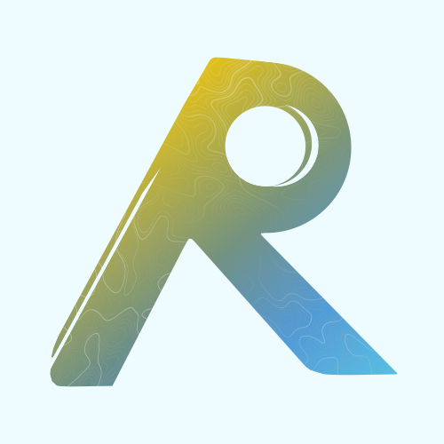

### Untuk: *Agatha Tatianingseto*

Dipersiapkan oleh:
| Informasi | Keterangan |
| --- | --- |
| Kelas | *K01* |
| Kelompok | *01* |

| NIM | Nama |
|---|---|
| *13525103* | *Ravinka Fathia Adinegara* |
| *13525013* | *Samantha Michelle S Silaban* |
| *13525055* | *Syakira Azzahra Rachmania* |
| *13525043* | *Aufa Tatsbita Zahra* |
| *13525046* | *Ghiffari Arya Adhitya* |
---

## Daftar Perubahan

| Revisi | Deskripsi |
| :--- | :--- |
| *A* | *(Dibenarkan di dokumen ini) Melengkapi bagian tabel kelas keseluruhan* |
| *B* |  |
| *C* |  |
| ... |  |

<!--  

> **Petunjuk pengerjaan:** *[Silahkan hapus bagian ini setelah selesai mengerjakan]*
>
> Dokumen ini melanjutkan **Spesifikasi Kebutuhan Perangkat Lunak (SKPL)** dan **Arsitektur Perangkat Lunak (APL)**. Gunakan nama, ID, kebutuhan, dan use case yang konsisten dengan kedua dokumen tersebut. Contoh pola ID baru di bawah dapat disesuaikan dengan kesepakatan kelompok, ID yang sudah ada tetap dipertahankan.

  -->

---

# BAB 1: Pendahuluan

## 1.1 Tujuan Penulisan Dokumen
<!-- Tuliskan dengan ringkas tujuan dokumen DPPL ini dibuat dan siapa saja yang akan menggunakan dokumen ini. -->
Dokumen Deskripsi Perancangan Perangkat Lunak (DPPL) ini merupakan sebuah dokumen yang ditulis dengan tujuan memperoleh kejelasan untuk alur penggunaan dokumen agar perangkat lunak dapat dikembangkan sesuai alur pengguna seharusnya. Selain itu, dokumen ini juga ditulis untuk memperjelas spesifikasi teknis dan lingkungan (environment) perangkat lunak. Dokumen ini dapat digunakan oleh pengembang sebagai pemandu bagaimana perangkat lunak harus dibuat, dipertahankan, dan diuji. Bagi pengguna, dokumen ini dapat digunakan untuk memahami alur semestinya atau alternatif (terkaan) dari perangkat lunak.

## 1.2 Lingkup Masalah
<!-- Tuliskan dengan ringkas nama aplikasi dan deskripsi singkatnya. Bagian ini maksimal berisi satu paragraf, dapat diambil dari SKPL. -->
Guna membangun kota yang berkelanjutan, fasilitas publik yang aman dan universal menjadi instrumen utama yang tercantum pada Indikator SDG 11.7.1. Namun, pada kenyataannya fasilitas publik justru memiliki banyak catatan yang harus diperbaiki. Mulai dari infrastruktur layanan publik yang terbengkalai, akses jalan yang tidak ramah pejalan kaki, hingga maraknya aksi vandalisme. Sudah banyak metode untuk melaporkan fasilitas publik yang rusak, namun masih berjalan satu arah. Oleh karena itu, website RAWAT (Ruang Aspirasi Warga dan Aduan Terpadu) hadir untuk memfasilitasi sistem pelaporan yang lebih modern dan interaktif. Website ini diharapkan dapat meningkatkan _awareness_ masyarakat tentang kondisi fasilitas dan berkolaborasi dalam permintaan perbaikan fasilitas publik. Melalui fitur-fitur interaktif selayaknya media sosial, warga tidak hanya dapat menyampaikan laporan tetapi juga saling memvalidasi laporan, memberikan tanggapan, dan membangun kepedulian bersama terhadap fasilitas publik.

## 1.3 Definisi, Istilah, dan Singkatan
<!-- Semua definisi dan singkatan yang digunakan dalam dokumen ini beserta penjelasannya. -->

Tabel 1.3. Definisi Istilah dan Singkatan

| Singkatan, Akronim, atau Istilah | Penjelasan |
| :--- | :--- |
| *P/L* | *Singkatan dari Perangkat Lunak, yaitu aplikasi yang memberikan perintah kepada komputer untuk menjalankan tugas tertentu.* |
| *DPPL* | *Singkatan dari Spesifikasi Kebutuhan Perangkat Lunak, yaitu dokumen yang merangkum kriteria-kriteria yang diperlukan untuk membangun aplikasi menjalankan tugasnya.* |
| *UC* | *Singkatan dari Use Case.* |
| *...* | *...* |

## 1.4 Aturan Penomoran
<!-- Tuliskan aturan penomoran (ID) yang digunakan dalam dokumen ini. Gunakan pola ID yang **sama** dengan yang sudah dipakai pada dokumen-dokumen sebelumnya, jangan membuat pola baru di dokumen ini. -->

Tabel 1.4. Aturan Penomoran

| Hal/Bagian | Penomoran | Keterangan |
| :--- | :--- | :--- |
| *Use Case* | *UCXX* | |
| *Kelas* | *CXX* | |
| *...* | *...* |

## 1.5 Referensi
<!-- Cantumkan dokumentasi P/L yang dirujuk oleh dokumen ini, **minimal dokumen SKPL dan APL**. Tambahkan buku, panduan, atau dokumentasi lain apabila digunakan. -->
Berikut ini adalah dokumentasi yang dirujuk oleh dokumen ini.
* [SKPL RAWAT](https://github.com/ajalku/IF2150-RPL-K01-G01/blob/main/docs/M5/K01_G01_SKPL.md)
* [APL RAWAT](https://github.com/ajalku/IF2150-RPL-K01-G01/blob/main/docs/M6/K01_G01_APL.md)

## 1.6 Deskripsi Umum Dokumen (Ikhtisar)
<!-- Tuliskan sistematika pembahasan dokumen ini secara ringkas dan runut, dengan maksimal 1 paragraf. -->
Dokumen ini adalah Deskripsi Perancangan Perangkat Lunak atau disingkat DPPL. Bab 1 berisi Pendahuluan, lengkapnya terdapat tujuan penulisan dokumen; lingkup masalah; definisi, istilah, dan singkatan; aturan penomoran; referensi; serta deskripsi umum dokumen (bagian ini). Bab 2 berisi Perancangan Arsitektur yang mengandung rancangan lingkungan implementasi, _style/pattern_ arsitektur acuan, identifikasi komponen, dan model arsitektur perangkat lunak. Pada bab 3, yaitu Realisasi Use Case, berisi tiap use case beserta identifikasi kelas, diagram sekuens setiap skenario use case, serta diagram kelasnya. Terakhir, bab 5 berisi matriks kerunutan atau pemetaan kelas perancangan dengan use case terkait.

 

---

# BAB 2: Perancangan Arsitektur

## 2.1 Rancangan Lingkungan Implementasi

Tabel 2.1. Lingkungan Implementasi Perangkat Lunak
| Komponen | Spesifikasi |
| :--- | :--- |
| *OS* | *Cross-Platform, diharapkan sistem dapat berjalan di seluruh OS seperti Windows, Linux, MacOS, Android, dan IOS melalui web browser* |
| *DBMS* | *PostgreSQL* |
| *Development Tools* | *Visual Studio Code, Git* |
| *Filing System* | *Local File System* |
| *Bahasa Pemrograman* | *JavaScript* |

Lingkungan implementasi RAWAT menggunakan sistem operasi _Cross-Platform_ yang memungkinkan aplikasi diakses melalui web browser pada berbagai perangkat. PostgreSQL digunakan sebagai DBMS untuk mengelola basis data, sedangkan Visual Studio Code digunakan sebagai editor kode dan Git untuk mengelola versi kode. Foto laporan disimpan menggunakan Local File System pada server, sementara JavaScript digunakan sebagai bahasa pemrograman dalam pengembangan aplikasi.

## 2.2 Style/Pattern Arsitektur Acuan

<!-- Tentukan *architectural style* atau *pattern* yang menjadi acuan aplikasi, misalnya *layered architecture*, *client-server*, *repository*, *pipe and filter*, atau MVC (*Model-View-Controller*).

Gunakan hasil **BAB 1 Style/Pattern Arsitektur Acuan pada dokumen APL**, termasuk alasan pemilihan dan gambar penerapannya pada P/L kelompok. Gunakan komponen aplikasi sendiri pada gambar, bukan hanya contoh pola umum. -->

Terdapat dua arsitektur acuan yang digunakan, yakni MVC dan Client-Server.

### Pemilihan Arsitektur 1:  MVC
Arsitektur Model-View-Controller (MVC) dipakai dengan penjelasan fungsi per komponen sebagai berikut.
- Model : Menyimpan dan merepresentasikan data suatu objek serta menyediakan data ketika dibutuhkan  
- View : Mengatur penyajian data dari Model agar dapat dibaca dan dipahami pengguna dan menjadi media untuk menerima masukan pengguna.
- Controller : Menerima masukan pengguna, melakukan pengolahan yang diperlukan terhadap data dari Model, dan memberikan hasilnya kepada View untuk ditampilkan. 

Alasan pemilihan arsitektur ini adalah: 
- Banyak pengerjaan fitur yang membutuhkan pemisahan antara antarmuka pengguna dan proses pengolahan data. Contohnya pada kebutuhan fungsional yang berkaitan dengan pengisian form, seperti KF01, KF12, dan KF14. Bagian View akan bertanggung jawab untuk menampilkan formulir, sedangkan Controller dan Model akan menangani input dan penyimpanan data. Ini sesuai dengan prinsip MVC. 
- Mayoritas UI menggunakan data dari Model yang sama. Contohnya, KF04 menggunakan Model Laporan untuk menampilkan informasi umum pada peta, sedangkan KF05 menggunakan Model Laporan untuk menampilkan informasi laporan secara rinci. Dengan menggunakan arsitektur MVC, satu Model dapat digunakan beberapa View tanpa menduplikasi. 
- Dari sisi jenis pengguna, MVC cocok karena P/L ini banyak berinteraksi langsung dengan _user_, yaitu masyarakat umum. Ini juga didukung dengan KNF03 dan KNF08 yang berparameter Intercation Capability.

<i>Gambar 1. Gambar Diagram Arsitektur MVC</i>

### Pemilihan Arsitektur 2:  Client-Server
Arsitektur *client-server* membagi sistem menjadi *client* yang meminta *service* dan *server* yang menyediakan *service*.
- Client : Mengirim *request* ke server dengan menggunakan protokol HTTP. Pada P/L ini, *client* dapat mengajukan laporan serta memberikan *upvote* dan komentar pada laporan. Data-data tadi kemudian akan diproses oleh *server*.
- Server : Menerima *request* dan memprosesnya, lalu mengembalikan *response* ke *client*. *Server* akan memproses data laporan serta menyusun homepage yang bisa diakses *client*.

*Client* memerlukan *service* bersama dengan keadaan data terpusat yakni laporan-laporan yang diajukan. Seperti yang tertera pada Kebutuhan Non-Fungsional KNF05 dan KNF06 pada SKPL, sistem harus mampu melayani 1000 pengguna aktif secara bersamaan pada fitur trending dengan tingkat kegagalan *request* kurang dari 1% dan sistem harus menjaga layanan laporan tersedia 24 jam. Selain itu, sesuai KNF09 dan KNF10 sistem harus bisa melakukan sinkronisasi data dan menerapkan *Role-Based Access Control*. Jadi arsitektur *client-server* cocok untuk mendukung kebutuhan-kebutuhan yang disebutkan tadi sebab pengguna dan admin perlu mengakses data yang sudah disinkronisasi. 

<i>Gambar 2. Diagram Arsitektur Client-Server</i>

<!-- 

<i>Gambar 1. Contoh Arsitektur MVC</i>

 -->

## 2.3 Identifikasi Komponen / Modul / Subsistem

Berdasarkan arsitektur MVC dan client-server yang telah dipilih pada bagian 2.2, sistem RAWAT tersusun atas beberapa komponen yang saling terhubung. Komponen-komponen tersebut dikelompokkan berdasarkan perannya dalam arsitektur MVC juga dari sisi client atau server. Selain komponen MVC, terdapat komponen pendukung yakni integrasi dengan API eksternal dan penyimpanan data. Identifikasi komponen, jenis, dan penjelasan masing-masing komponen ditunjukkan pada Tabel 2.3.

Tabel 2.3. Identifikasi Komponen/Modul/Subsistem

| Nama Komponen/Modul/Subsistem | Jenis                 | Penjelasan                                                                                                           |
| :---------------------------- | :-------------------- | :------------------------------------------------------------------------------------------------------------------- |
| *Pengguna*                      | *Model, Server*               | *Merepresentasikan data pengguna maupun admin yang dapat melakukan registrasi, login, mengedit profil, membuat laporan, melihat laporan dan peta lokasi laporan, memberikan upvote, memeriksa laporan, mengatur status laporan, dan memberikan tanggapan sesuai dengan hak akses berdasarkan role.*                        |
| *Homepage*                   | *Model, Server*               | *Merepresentasikan informasi yang ditampilkan pada halaman utama sistem, termasuk daftar laporan, fitur-fitur yang tersedia, dan informasi ringkas laporan.*       |
| *Laporan*                     | *Model, Server*               | *Merepresentasikan informasi laporan mengenai masalah fasilitas atau ruang umum, termasuk nama masalah, lokasi, kategori, tingkat permasalahan, foto (opsional), deskripsi (opsional), dan status laporan.*          |
| *Lokasi*                   | *Model, Server*               | *Merepresentasikan informasi lokasi geografis yang terkait dengan suatu laporan dan digunakan untuk menampilkan laporan pada peta.*                                |
| *Upvote*                    | *Model, Server*           | *Merepresentasikan informasi pemberian upvote oleh pengguna terhadap suatu laporan.*                                                     |
| *Tanggapan* | *Model, Server* | *Merepresentasikan data tanggapan yang diberikan admin terhadap laporan yang sedang diproses.* |
| *Tutorial* | *Model, Server* | *Merepresentasikan informasi tutorial navigasi yang ditampilkan kepada pengguna.* |
| *PenggunaView*                 | *View, Client*                | *Menampilkan halaman registrasi dan login serta informasi pengguna sesuai dengan hak akses berdasarkan role.*     |
| *HomepageView*               | *View, Client*                | *Menampilkan halaman utama sistem beserta daftar laporan dan fitur yang dapat diakses pengguna maupun admin.*                                                       |
| *LaporanView*                | *View, Client*                | *Menampilkan informasi laporan serta halaman untuk membuat, melihat, memeriksa, dan memperbarui laporan.*                                      |
| *LokasiView*          | *View, Client*                | *Menampilkan informasi lokasi laporan dan peta interaktif yang digunakan untuk melihat laporan berdasarkan lokasi.*                                         |
| *UpvoteView* | *View, Client* | *Menampilkan tombol dan jumlah upvote pada laporan serta memungkinkan pengguna memberikan upvote.* |
| *TanggapanView* | *View, Client* | *Menampilkan tanggapan admin pada laporan serta menyediakan tampilan untuk memberikan tanggapan terhadap laporan.* |
| *TutorialView* | *View, Client* | *Menampilkan tutorial navigasi dan menyediakan tombol Next, Skip, dan Selesai.* |
| *MapAPIView* | *View, Client* | *Menampilkan peta, lokasi, dan informasi yang diperoleh dari API peta kepada pengguna.* |
| *PenggunaController*           | *Controller, Server*          | *Menangani proses registrasi, login, validasi data akun, verifikasi kredensial, dan pengaturan hak akses pengguna berdasarkan role.*                                             |
| *HomepageController*         | *Controller, Server*          | *Menangani proses pengambilan dan pengelolaan informasi yang ditampilkan pada halaman utama serta navigasi ke fitur laporan dan fitur-fitur lainnya yang tersedia.*                                          |
| *LaporanController*        | *Controller, Server*          | *Menangani proses pembuatan, pengambilan, pemeriksaan, dan pembaruan data laporan serta pengelolaan informasi terkait laporan.*                |
| *LokasiController*           | *Controller, Server*          | *Menangani proses pengambilan dan pengelolaan data lokasi laporan serta pencarian laporan berdasarkan lokasi untuk ditampilkan pada peta.*                                                              |
| *UpvoteController* | *Controller, Server* | *Menangani proses pemberian upvote oleh pengguna terhadap suatu laporan serta pengelolaan jumlah upvote.* |
| *TanggapanController* | *Controller, Server* | *Menangani proses pembuatan, pengambilan, dan penyimpanan tanggapan admin terhadap suatu laporan.* |
| *TutorialController* | *Controller, Server* | *Menangani proses perpindahan langkah tutorial serta aksi Next, Skip, dan Selesai.* |
| *MapAPI*       | *Integrasi Eksternal, Server* | *Menyimpan konfigurasi layanan API eksternal seperti apiKey dan baseURL.* |
| *MapAPIService* | *Integrasi Eksternal, Server* | *Mengatur proses request ke API, memproses response, dan mengirim hasil ke MapAPIView.* |
| *Database*                    | *Penyimpanan Data*    | *Menyimpan data Model secara persisten menggunakan PostgreSQL sebagai DBMS.*   |

## 2.4 Model Arsitektur Perangkat Lunak

<!-- Buat model arsitektur dalam bentuk satu atau lebih *view* yang memperlihatkan interaksi dan kolaborasi komponen, modul, serta subsistem dalam menjalankan fungsi sistem. Pilih notasi yang sesuai. Contoh *view*: *Logical View*, *Process View*, *Development View*, dan *Physical View*.

Gunakan hasil **BAB 3 Model Arsitektur Perangkat Lunak pada dokumen APL**. -->

### 2.4.1 Development View

<!-- Tuliskan secara singkat model arsitektur yang dipilih dan alasan model tersebut cocok untuk aplikasi.

<i>Gambar 2. Contoh Logical View pada P/L E-Commerce</i>

 -->

Model arsitektur yang dipilih adalah Development View dengan jenis Component Diagram karena dapat menggambarkan sistem RAWAT dengan jelas termasuk dependensi antarkomponen dan membuatnya mudah untuk dilihat. Dalam diagram ini, fungsionalitas setiap komponen dapat terlihat sekaligus hubungan fungsi tersebut dengan komponen lain.

<i>Gambar 3. Development View</i>  

<!-- ### 2.4.X View [Nama View]
*[Lakukan hal yang sama dengan bagian sebelumnya]* -->

 

---

# BAB 3: Realisasi Use Case

## 3.1 Use Case Melakukan Registrasi Akun

**ID Use Case:** *UC01*  
**Nama Use Case:** *Melakukan Registrasi Akun*

### 3.1.1 Identifikasi Kelas

Tabel 3.1. Identifikasi Kelas Use Case [UC01]

| No | Nama Kelas Perancangan | Nama Kelas Analisis Terkait |
|:--- | :--- | :--- |
| 1 | *PenggunaView* | *PenggunaView* |
| 2 | *PenggunaController* | *PenggunaController* |
| 3 | *Pengguna* | *Pengguna* |

### 3.1.2 Sequence Diagram
 

- **Skenario Normal**

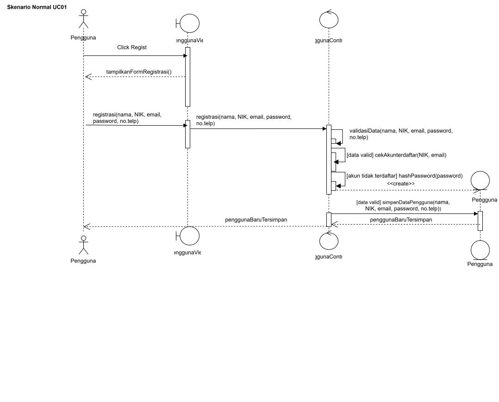

<i>Gambar 1. Sequence Diagram UC01</i>

- **Skenario Alternatif 1 : Data Registrasi Tidak Lengkap **

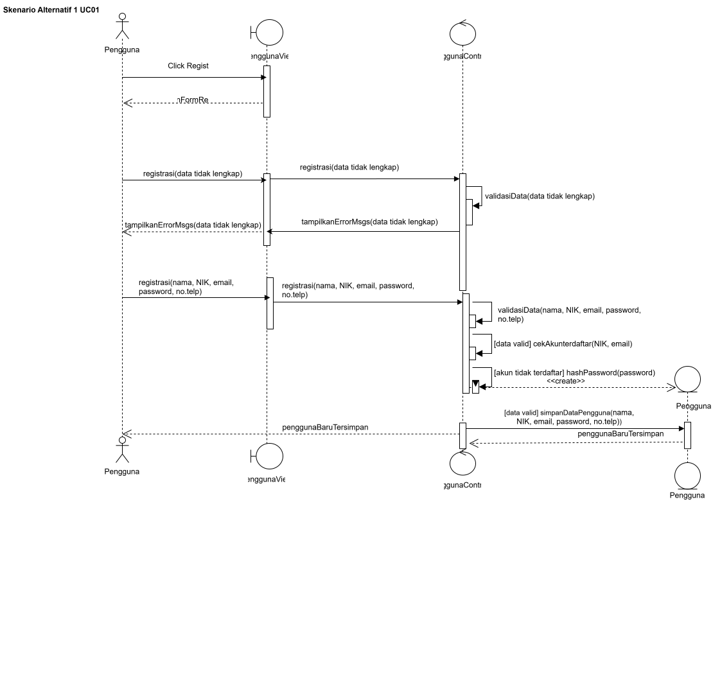

<i>Gambar 2. Sequence Diagram [UC01] - Data Registrasi Tidak Lengkap</i>

- **Skenario Alternatif 2 : Format NIK Tidak Valid **

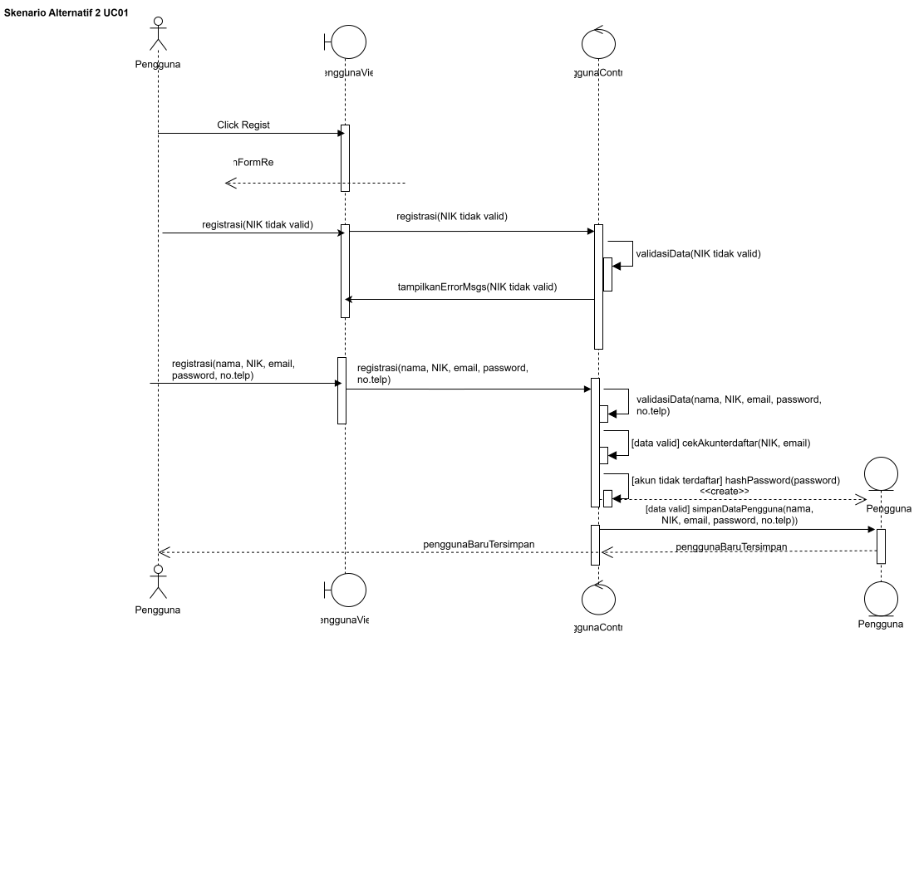

<i>Gambar 3. Sequence Diagram [UC01] - Format NIK Tidak Valid</i>

- **Skenario Alternatif 3 : Format Password Tidak Valid **

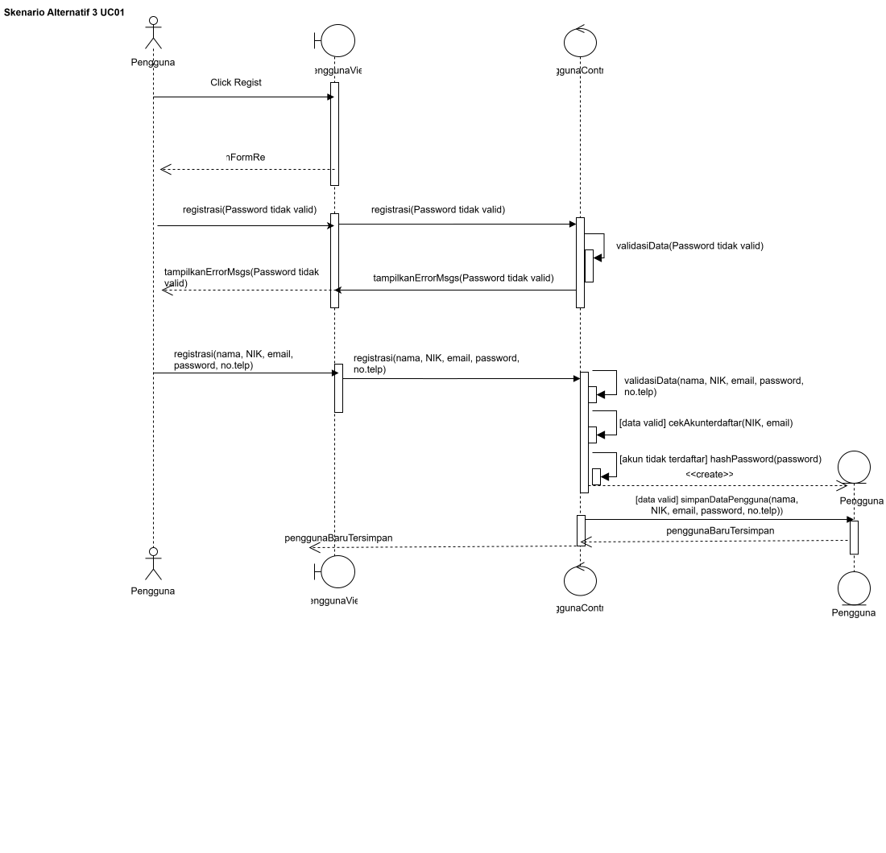

<i>Gambar 4. Sequence Diagram [UC01] - Format Password Tidak Valid</i>

### 3.1.3 Diagram Kelas

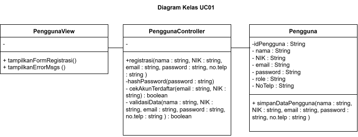

<i>Gambar 5. Diagram Kelas Melakukan Registrasi</i>

## 3.2 Use Case Melakukan Proses Login

**ID Use Case:** *UC02*  
**Nama Use Case:** *Melakukan Proses Login*

### 3.1.1 Identifikasi Kelas

Tabel 3.1. Identifikasi Kelas Use Case [UC02]

| No | Nama Kelas Perancangan | Nama Kelas Analisis Terkait |
|:--- | :--- | :--- |
| 1 | *PenggunaView* | *PenggunaView* |
| 2 | *PenggunaController* | *PenggunaController* |
| 3 | *Pengguna* | *Pengguna* |

### 3.1.2 Sequence Diagram
 

- **Skenario Normal**

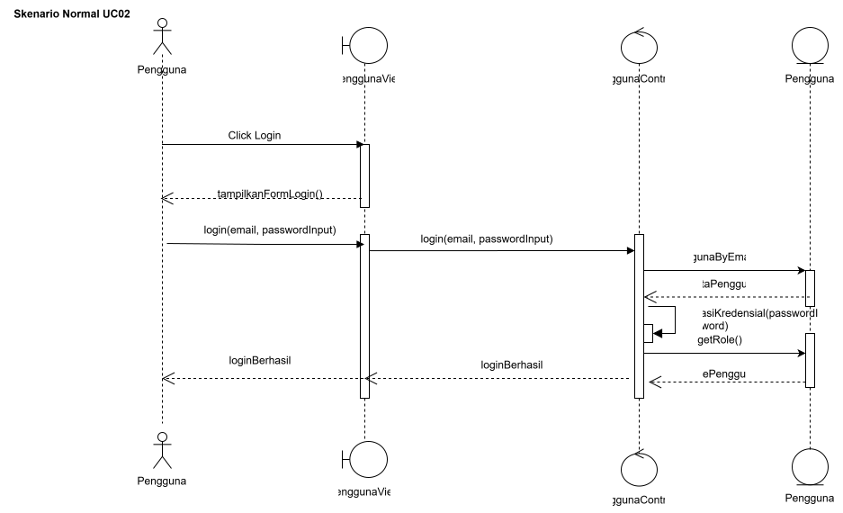

<i>Gambar 1. Sequence Diagram UC02</i>

- **Skenario Alternatif 1 : Data Login Tidak Lengkap **

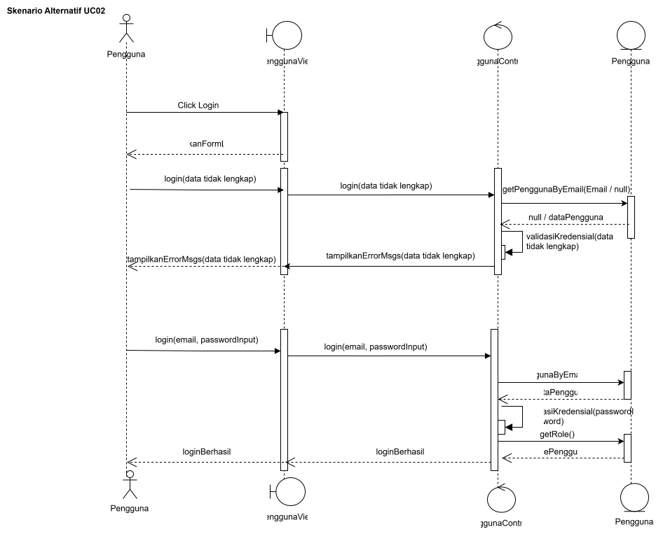

<i>Gambar 2. Sequence Diagram UC02 - Data Login Tidak Lengkap</i>

- **Skenario Alternatif 2 : Email Belum Terdaftar**

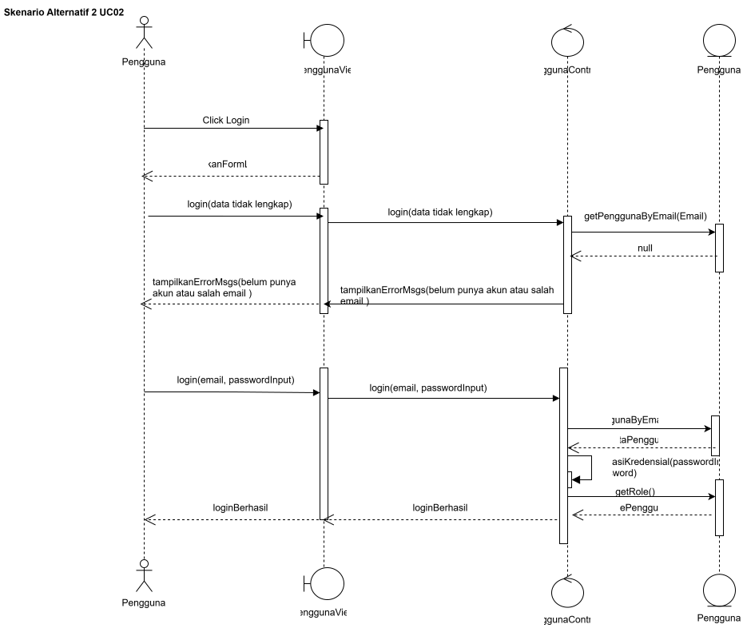

<i>Gambar 3. Sequence Diagram UC02 - Email Belum Terdaftar</i>

- **Skenario Alternatif 3 : Password Tidak Sesuai **

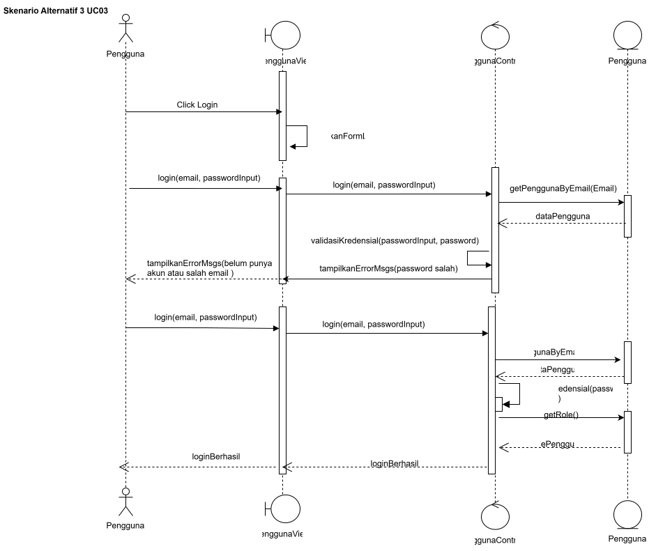

<i>Gambar 4. Sequence Diagram UC02 - Password Tidak Sesuai</i>

## 3.3 Use Case Mengakses Peta Interaktif

**ID Use Case:** *UC03*  
**Nama Use Case:** *Mengakses Peta Interaktif*

### 3.3.1 Identifikasi Kelas

Tabel 3.1. Identifikasi Kelas Use Case [UC02]

| No | Nama Kelas Perancangan | Nama Kelas Analisis Terkait |
|:--- | :--- | :--- |
| 1 | *PenggunaView* | *PenggunaView* |
| 2 | *PenggunaController* | *PenggunaController* |
| 3 | *Pengguna* | *Pengguna* |
| 4 | *Lokasi* | *Lokasi* |
| 5 | *LokasiController* | *LokasiContorller* |
| 6 | *LokasiView* | *LokasiView* |
| 7 | *Laporan* | *Laporan* |
| 8 | *LaporanController* | *LaporanCotnroller* |
| 9 | *LaporanView* | *LaporanView* |
| 10 | *MapAPI* | *MapAPI* |
| 11 | *MapAPIService* | *MapAPIService*|
| 12 | *MapAPIView* | *MapAPIView*|

### 3.3.2 Sequence Diagram
 

- **Skenario Normal**

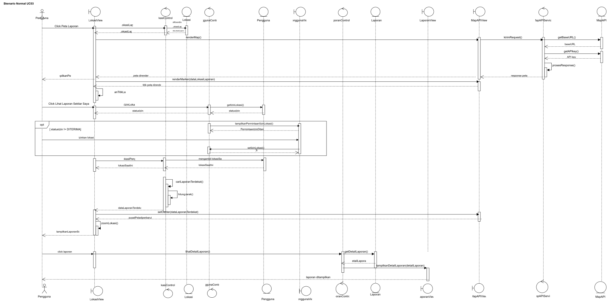

<i>Gambar 1. Sequence Diagram UC03</i>

- **Skenario Alternatif 1 : Pengguna Belum Mengaktifkan Akses Lokasi di Perangkat **

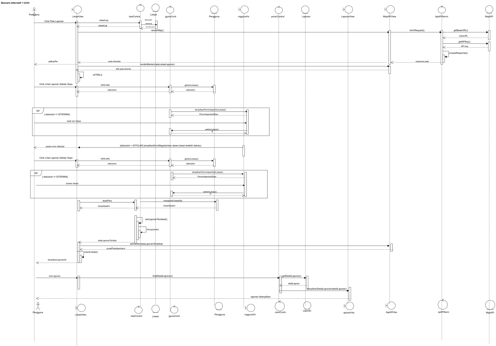

<i>Gambar 2. Sequence Diagram UC03 - Pengguna Belum Mengaktifkan Akses Lokasi di Perangkat</i>

- **Skenario Alternatif 2 : API Peta Gagal Dimuat**

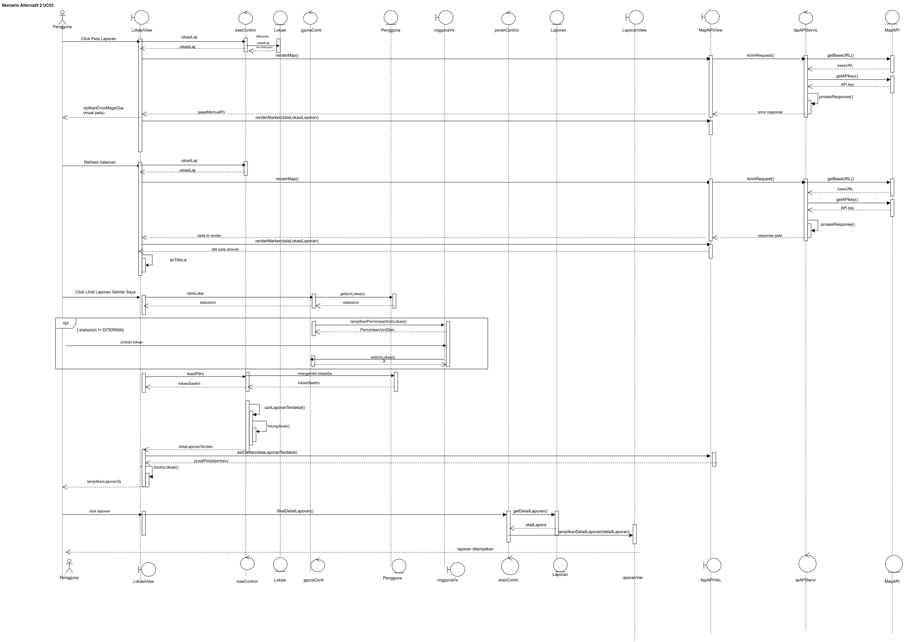

<i>Gambar 3. Sequence Diagram UC03 - API Peta Gagal Dimuat</i>

- **Skenario Alternatif 3 : Tidak Terdapat Laporan di Sekitar Pengguna**

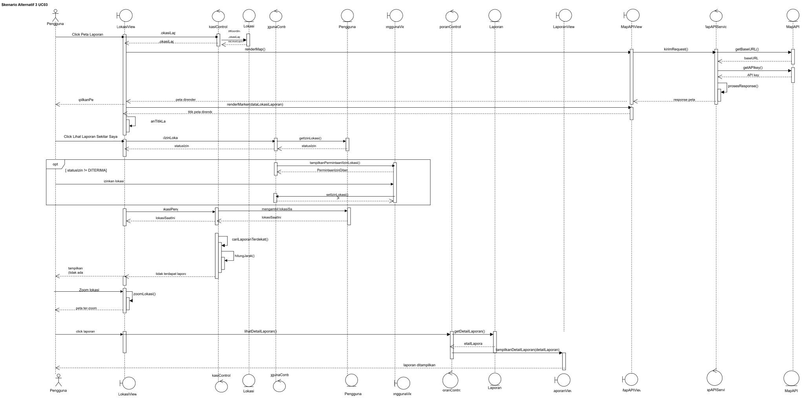

<i>Gambar 4. Tidak Terdapat Laporan di Sekitar Pengguna</i>

### 3.3.3 Diagram Kelas

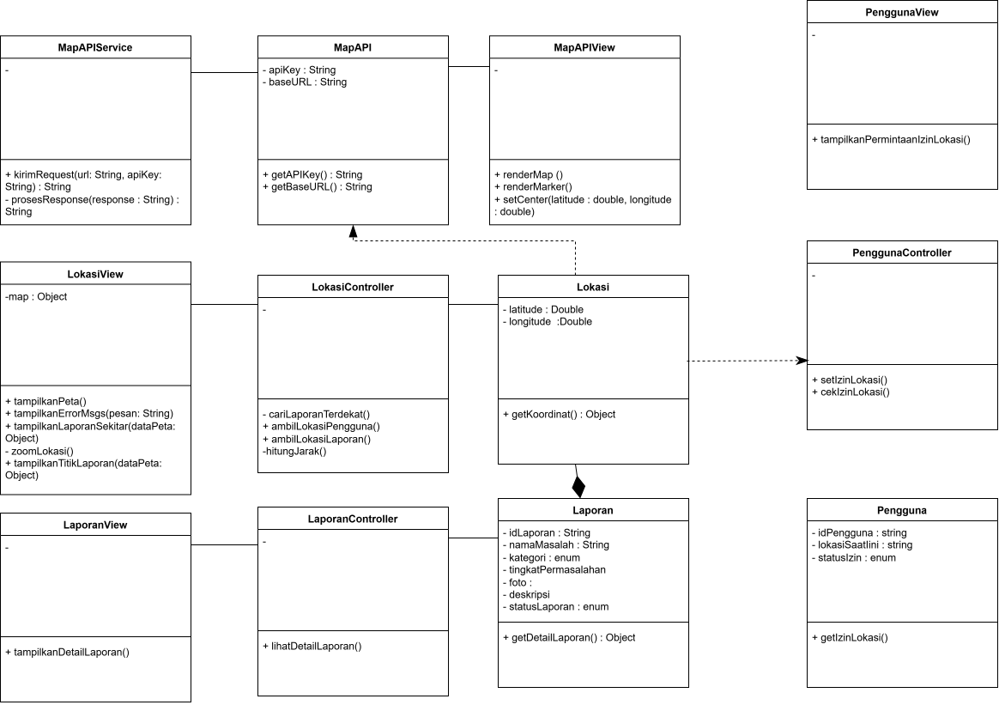

<i>Gambar 5. Diagram Kelas Mengakses Peta Interaktif</i>

## 3.4 Use Case Melihat Laporan

**ID Use Case:** *UC04*  
**Nama Use Case:** *Melihat Laporan*

### 3.4.1 Identifikasi Kelas

Tabel 3.4 Identifikasi Kelas Use Case [UC04]
| No | Nama Kelas Perancangan | Nama Kelas Analisis Terkait |
|:--- | :--- | :--- |
| *1* | *HomepageView* | *HomepageView*  |
| *2* | *HomepageController* | *HomepageController* |
| *3* | *Homepage* | *Homepage* |
| *4* | *LokasiView* | *LokasiView* |
| *5* |*LokasiController* | *LokasiController* |
| *6* | *Lokasi* | *Lokasi* |
| *7* | *Laporan* | *Laporan* |
| *8* | *LaporanView* | *LaporanView* |
| *9* | *LaporanController* | *LaporanController* |
| *10* | *MapAPI* | *MapAPI* |
| *11* | *MapAPIService* | *-* | *MapAPIService* |
| *12* | *MapAPIView* | *-* | *MapAPIView* |
| ... | *...* | *...* |

### 3.4.2 Sequence Diagram

**Skenario Normal**

<i>Gambar X. Sequence Diagram [UC04]</i>

**Skenario Alternatif 1: Detail laporan tidak lengkap**

<i>Gambar X. Sequence Diagram [UC04]</i>

**Skenario Alternatif 2: Laporan gagal dimuat**

<i>Gambar X. Sequence Diagram [UC04]</i>

### 3.4.3 Diagram Kelas

<i>Gambar X. Class Diagram [UC04]</i>

## 3.5 Use Case Mendapat Tutorial Navigasi Antar Halaman

### 3.5.1 Identifikasi Kelas

| No | Nama Kelas Perancangan | Nama Kelas Analisis Terkait |
|:--- | :--- | :--- |
| *C09* | *HomepageView* | *HomepageView* |
| *C16* | *HomepageController* | *HomepageController* |
| *C01* | *Homepage* | *Homepage* |
| *C11* | *LokasiView* | *LokasiView* |
| *C18* |*LokasiController* | *LokasiController* |
| *C04* | *Lokasi* | *Lokasi* |
| *C03* | *Laporan* | *Laporan* |
| *C10* | *LaporanView* | *LaporanView* |
| *C17* | *LaporanController* | *LaporanController* |
| *C22* | *MapAPI* | *MapAPI* |
| *C23* | *MapAPIService* | *MapAPIService* |
| *C24* | *MapAPIView* | *MapAPIView* |
| ... | *...* | *...* |

### 3.5.2 Sequence Diagram

**Skenario Normal**

<i>Gambar X. Sequence Diagram [UC05]</i>

**Skenario Alternatif 1: Pengguna Memilih Skip Tutorial**

<i>Gambar X. Sequence Diagram [UC05]</i>

### 3.5.3 Diagram Kelas

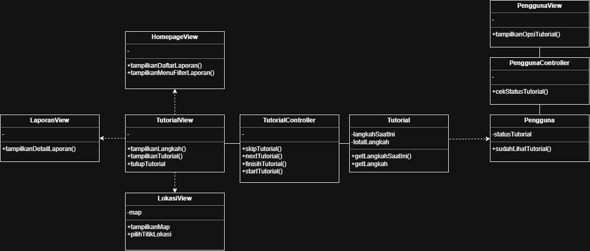

<i>Gambar X. Class Diagram [UC05]</i>

 

## 3.6 Use Case Melakukan Upvote

### 3.6.1 Identifikasi Kelas

| No | Nama Kelas Perancangan | Nama Kelas Analisis Terkait |
|:--- | :--- | :--- |
| *1* | *Pengguna* | *Pengguna* |
| *2* | *Laporan* | *Laporan* |
| *3* | *Homepage* | *Homepage* |
| *4* | *Upvote* | *Upvote* |
| *5* |*UpvoteController* | *UpvoteController* |
| *6* | *LaporanController* | *LaporanController* |
| *7* | *LaporanView* | *LaporanView* |
| *8* | *PenggunaView* | *PenggunaView* |
| *9* | *PenggunaController* | *PenggunaController* |
| *10* | *UpvoteView* | *UpvoteView* |
| *11* | *HomepageView* | *HomepageView* |
| *12* | *HomepageController* | *HomepageController* |

### 3.6.2 Sequence Diagram

**Skenario Normal**

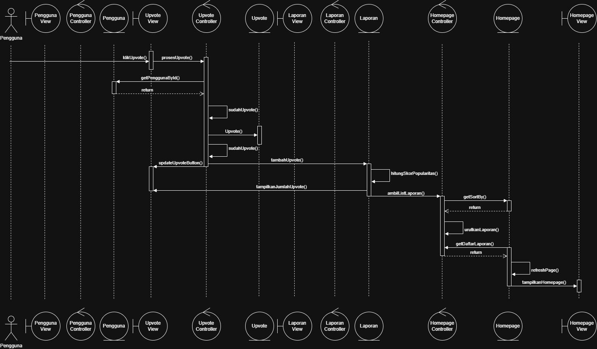

<i>Gambar X. Sequence Diagram [UC06]</i>

**Skenario Alternatif 1: Pengguna Gagal Melakukan Upvote**

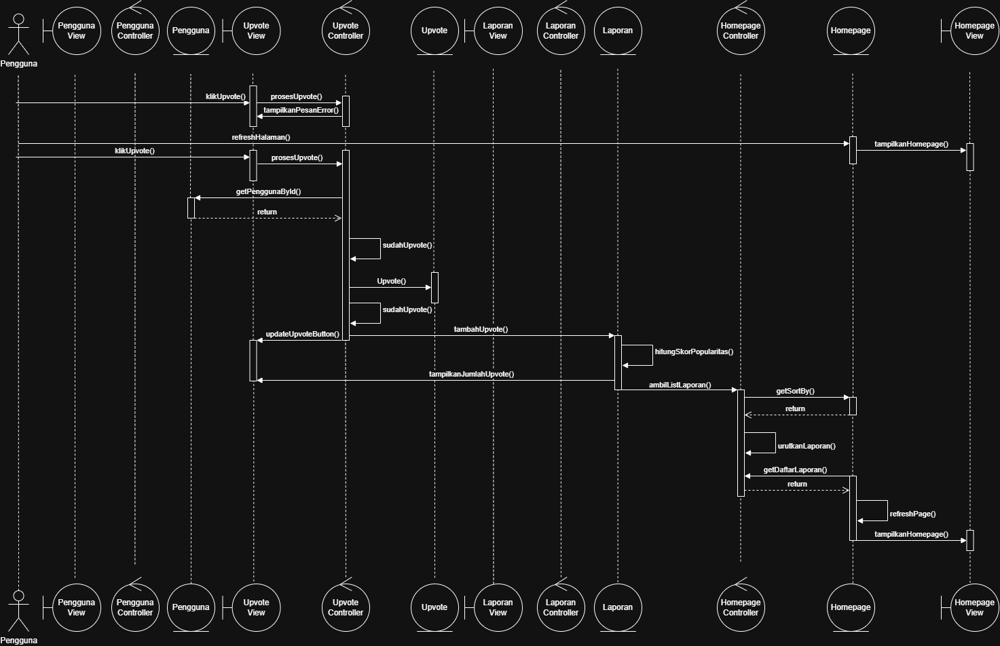

<i>Gambar X. Sequence Diagram UC06</i>

### 3.6.3 Diagram Kelas

<i>Gambar X. Class Diagram UC06</i>

 

## 3.7 Use Case Mengunggah Laporan Baru

**ID Use Case:** *UC07*  
**Nama Use Case:** *Mengunggah Laporan Baru*

### 3.7.1 Identifikasi Kelas

Tabel 3.7. Identifikasi Kelas Use Case [UC07]
| No | Nama Kelas Perancangan | Nama Kelas Analisis Terkait |
|:--- | :--- | :--- |
| 1 | *Pengguna* | *Pengguna* |
| 2 | *HomePage* | *HomePage* |
| 3 | *Laporan* | *Laporan* |
| 4 | *Lokasi* | *Lokasi* |
| 5 | *PenggunaView* | *PenggunaView* |
| 6 | *HomepageView* | *HomepageView* |
| 7 | *LaporanView* | *LaporanView* |
| 8 | *LokasiView* | *LokasiView* |
| 9 | *PenggunaController* | *PenggunaController* |
| 10 | *HomepageController* | *HomepageController* |
| 11 | *LaporanController* | *LaporanController* |
| 12 | *LokasiController* | *LokasiController* |

### 3.7.2 Sequence Diagram

- **Skenario Normal**

<i>Gambar Sequence Diagram [UC07]</i>

- **Skenario Alternatif 1: Data Wajib unutk Membuat Laporan Masih Belum Lengkap**

<i>Gambar Sequence Diagram [UC07] - Data Wajib unutk Membuat Laporan Masih Belum Lengkap</i>

- **Skenario Alternatif 2: Format File Foto yang Diunggah Tidak Sesuai**

<i>Gambar Sequence Diagram [UC07] - Format File Foto yang Diunggah Tidak Sesuai</i>

- **Skenario Alternatif 3: Pengguna Membatalkan Konfirmasi Pengiriman Laporan**

<i>Gambar Sequence Diagram [UC07] - Pengguna Membatalkan Konfirmasi Pengiriman Laporan</i>

### 3.7.3 Diagram Kelas

<i>Gambar Diagram Mengunggah Laporan Baru</i>

## 3.8 Use Case Memeriksa Laporan

**ID Use Case:** *UC08*  
**Nama Use Case:** *Memeriksa Laporan*

### 3.8.1 Identifikasi Kelas

Tabel 3.8. Identifikasi Kelas Use Case [UC08]

| No | Nama Kelas Perancangan | Nama Kelas Analisis Terkait |
|:--- | :--- | :--- |
| 1 | *Pengguna* | *Pengguna* |
| 2 | *HomePage* | *HomePage* |
| 3 | *Laporan* | *Laporan* |

| 4 | *PenggunaView* | *PenggunaView* |
| 5 | *HomepageView* | *HomepageView* |
| 6 | *LaporanView* | *LaporanView* |

| 7 | *PenggunaController* | *PenggunaController* |
| 8 | *HomepageController* | *HomepageController* |
| 9 | *LaporanController* | *LaporanController* |

### 3.8.2 Sequence Diagram

- **Skenario Normal**

<i>Gambar Sequence Diagram [UC08]</i>

- **Skenario Alternatif 1: Laporan Ternyata Tidak Valid dan Pengguna Mengirimkan Konfirmasi Ulang Sebelum Jangka Waktu 2 Minggu Berakhir**

<i>Gambar Sequence Diagram [UC08] - Laporan Ternyata Tidak Valid dan Pengguna Mengirimkan Konfirmasi Ulang Sebelum Jangka Waktu 2 Minggu Berakhir</i>

- **Skenario Alternatif 2: Laporan Ternyata Tidak Valid dan Pengguna Tidak Mengirimkan Konfirmasi Ulang Hingga Jangka Waktu 2 Minggu Berakhir**

<i>Gambar Sequence Diagram [UC08] - Laporan Ternyata Tidak Valid dan Pengguna Tidak Mengirimkan Konfirmasi Ulang Hingga Jangka Waktu 2 Minggu Berakhir</i>

### 3.8.3 Diagram Kelas

<i>Gambar Diagram Kelas Memeriksa Laporan</i>

## 3.9 Use Case Memperbarui Status Penanganan Laporan

**ID Use Case:** *UC09*  
**Nama Use Case:** *Memperbarui Status Penanganan Laporan*

### 3.9.1 Identifikasi Kelas

Tabel 3.9. Identifikasi Kelas Use Case UC09

| No | Nama Kelas Perancangan | Nama Kelas Analisis Terkait |
|:--- | :--- | :--- |
| 1 | *C01 - Pengguna* | *C01 - Pengguna (entity)* |
| 2 | *C02 - Homepage* | *C02 - Homepage (entity)* |
| 3 | *C03 - Laporan* | *C03 - Laporan (entity)* |
| 4 | *C06 - Tanggapan* | *C06 - Tanggapan (entity)* |
| 5 | *C08 - PenggunaView* | *C08 - PenggunaView (boundary)* |
| 6 | *C09 - HomepageView* | *C09 - HomepageView (boundary)* |
| 7 | *C10 - LaporanView* | *C10 - LaporanView (boundary)* |
| 8 | *C13 - TanggapanView* | *C13 - TanggapanView (boundary)* |
| 9 | *C15 - PenggunaController* | *C15 - PenggunaController (control)* |
| 10 | *C16 - HomepageController* | *C16 - HomepageController (control)* |
| 11 | *C17 - LaporanController* | *C17 - LaporanController (control)* |
| 12 | *C20 - TanggapanController* | *C20 - TanggapanController (control)* |

### 3.9.2 Sequence Diagram
 

- **Skenario Normal**

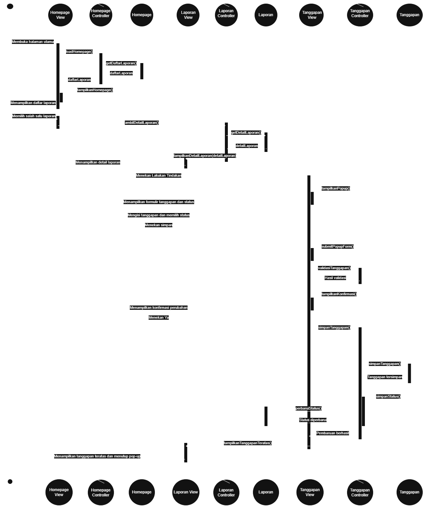

<i>Gambar 1. Sequence Diagram UC09</i>

- **Skenario Alternatif 1 : Admin membatalkan konfirmasi perubahan status laporan **

<i>Gambar 2. Sequence Diagram UC09 - Admin membatalkan konfirmasi perubahan status laporan</i>

### 3.9.3 Diagram Kelas

<i>Gambar 5. Diagram Kelas Memperbarui Stauts Penangan Laporan</i>

## 3.10 Use Case Mengedit Profil

**ID Use Case:** *UC10*  
**Nama Use Case:** *Mengedit Profil*

### 3.9.1 Identifikasi Kelas

Tabel 3.9. Identifikasi Kelas Use Case UC09

| No | Nama Kelas Perancangan | Nama Kelas Analisis Terkait |
|:--- | :--- | :--- |
| 1 | *PenggunaView* | *PenggunaView* |
| 2 | *PenggunaController* | *PenggunaController* |
| 3 | *Pengguna* | *Pengguna* |

### 3.9.2 Sequence Diagram
 

- **Skenario Normal**

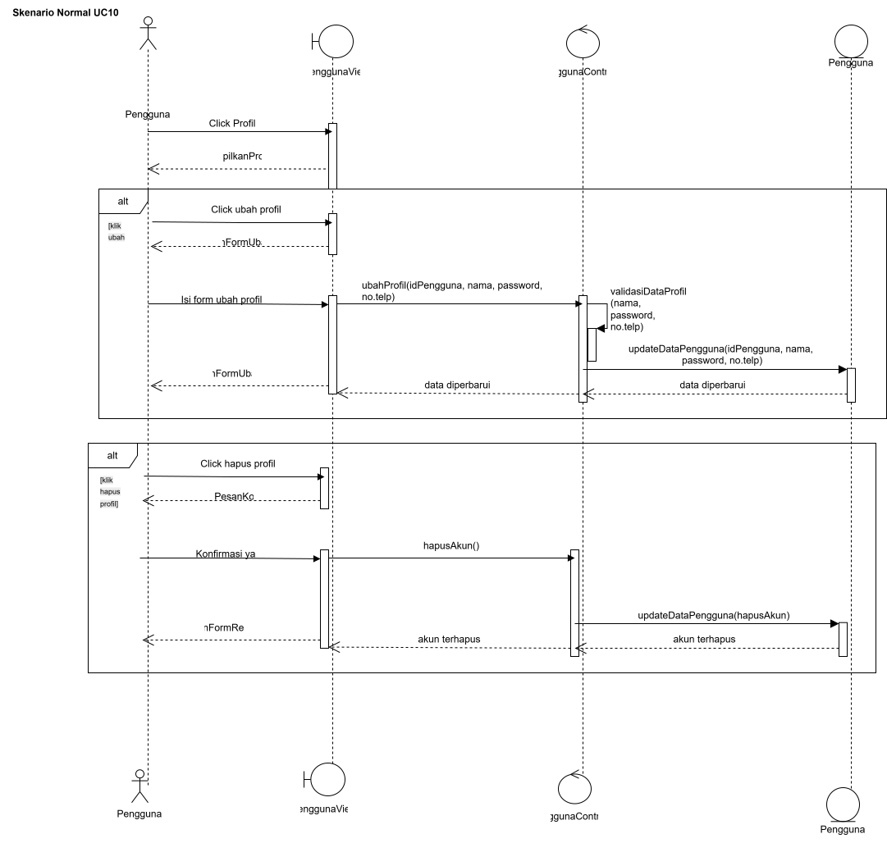

<i>Gambar 1. Sequence Diagram UC10</i>

- **Skenario Alternatif 1 : Pengguna membatalkan penghapusan akun **

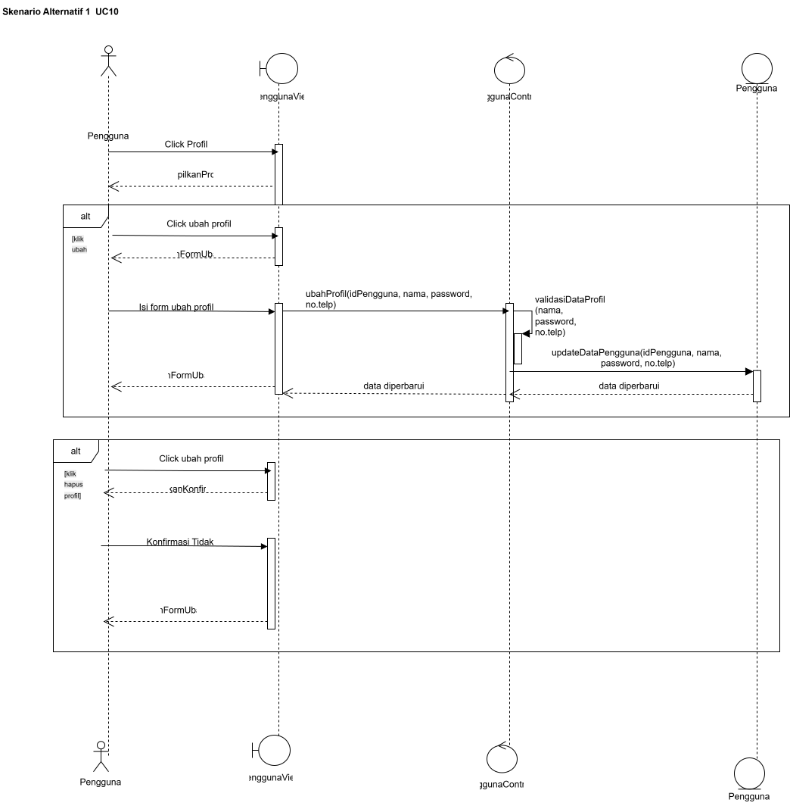

<i>Gambar 2. Sequence Diagram UC10 - Pengguna membatalkan penghapusan akun </i>

### 3.10.3 Diagram Kelas

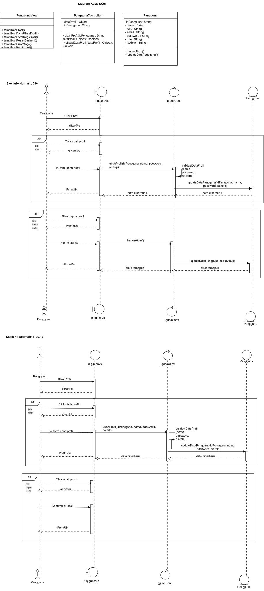

<i>Gambar 5. Diagram Kelas Mengedit Laporan</i>

---

# BAB 4: Diagram Kelas Keseluruhan

## 4.1 Diagram Kelas

<!-- **Bagian ini diisi dengan diagram kelas keseluruhan.** -->

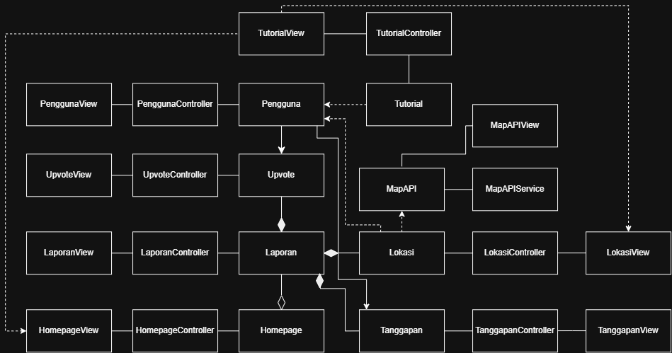

<i>Gambar 4.1 Diagram Kelas Perancangan Keseluruhan RAWAT</i>

Tabel 4.1 Daftar Kelas Perancangan Keseluruhan

| ID Kelas | Nama Kelas | Atribut | Metode/Operasi |
| :--- | :--- | :--- | :--- |
| *C01* | *Pengguna* | *-idPengguna, -nama, -role, -NIK, -email, -password, -NoTelp, -lokasiSaatIni, -izinLokasi, -statusTutorial* | *+getRole(), +simpanDataPengguna(), +getPenggunaByEmail(), +getPenggunaByNIK(), +getIzinLokasi(), +sudahLihatTutorial(), +getPenggunaById(), +hapusAkun(), +updateDataPengguna()* |
| *C02* | *HomePage* | *-sortBy, -daftarLaporan* | *+getDaftarLaporan(), +refreshPage(), +getSortBy()* |
| *C03* | *Laporan* | *-idLaporan, -namaMasalah, -kategori, -tingkatPermasalahan, -statusPrivasi, -foto, -deskripsi, -statusLaporan, -titikLokasi, -bobotUrgensi, -jumlahUpvote, -skorPopuler, -skorUrgensi* | *+getDetailLaporan(), +perbaruiStatus(), +updateStatusLaporan(), +hapusLaporan(), +simpanLaporan(), +tambahUpvote(), +hitungSkorPopularitas, +getJumlahUpvote(), +getSkorPopuler()* |
| *C04* | *Lokasi* | *-latitude, -longitude, -alamat* | *+getKoordinat(), +getAlamat()* |
| *C05* | *Upvote* | *-waktuUpvote, -statusUpvote* | *+upvote()* |
| *C06* | *Tanggapan* | *-statusTanggapan, -waktuTanggapan, -deskripsiTanggapan* | *+simpanTanggapan()* |
| *C07* | *Tutorial* | *-langkahSaatIni, -totalLangkah* | *+getLangkahSaatIni(), +getTotalLangkah()* |
| *C08* | *PenggunaView* | *-* | *+tampilkanFormRegistrasi(), +tampilkanErrorMsgs(), +tampilkanFormLogin(), +taampilkanPermintaanIzinLokasi(), +tampilkanOpsiTutorial(), +tampilkanFormKonfirmasi(), +tampilkanNotifAdmin(), +klikKonfirmasi()* |
| *C09* | *HomepageView* | *-* | *+tampilkanHomepage(), +pilihFilter(), +tampilkanDaftarLaporan(), +tampilkanMenuFilterLaporan()* |
| *C10* | *LaporanView* | *-dataForm* | *+tampilkanDetailLaporan(), +tampilkanTanggapanTeratas(), +tampilkanForm(), +tampilkanErrorMsg(), +tampilkanKonfirmasi(), +tampilkanPesanBerhasil(), +klikPost(), +klikYa(), +klikTidak()* |
| *C11* | *LokasiView* | *-map* | *+tampilkanMap(), +pilihTitikLokasi(), +tampilkanPeta(), +tampilkanErrorMsgs(), +tampilkanTitikLaporan()* |
| *C12* | *UpvoteView* | *-* | *+klikUpvote(), +tampilkanJumlahUpvote(), +tampilkanPesanError(), +updateUpvoteButton()* |
| *C13* | *TanggapanView* | *-dataPopupForm* | *+tampilkanPopup(), +submitPopupForm(), +tampilkanKonfirmasi()* |
| *C14* | *TutorialView* | *-* | *+tampilkanTutorial(), +tampilkanLangkah(), +tutupTutorial*|
| *C15* | *PenggunaController* | *-* | *+regitrasi, -hashPassword(), -cekAkunTerdaftar(), -validasiData(), +login(), -validasiKredensial(), +setIzinLokasi(), +cekIzinLokasi(), +cekStatusTutorial(), +sudahLogin(), +kirimKonfimasiUlang(), +ubahProfil(), -validasiDataProfil()* |
| *C16* | *HomepageController* | *-* | *+loadHomepage(), +pilihLaporan, +urutkanLaporan(), +filterLaporan(), +ambilListLaporan()* |
| *C17* | *LaporanController* | *-* | *+lihatDetailLaporan(), +ambilDetailLaporan(), +validasiKelengkapanData(), +validasiFoto(), +buatIdUnik(), +simpanLaporan(), +updateStatusLaporan, +kirimPermintaanKonfirmasi(), +setBatasWaktu2Minggu(), +cekBatasWaktu(), +hapusLaporanOtomatis()* |
| *C18* | *LokasiController* | *-* | *getDataLokasi(), cariLokasi(), +cariLaporanTerdekat(), -ambilLokasiPengguna(), -mintaIzinLokasi(), +ambilLokasiLaporan(), -hitungJarak()* |
| *C19* | *UpvoteController* | *-* | *+prosesUpvote(), +sudahUpvote()* |
| *C20* | *TanggapanController* | *-* | *+validasiTanggapan(), +simpanTanggapan(), +simpanStatus()* |
| *C21* | *TutorialController* | *-* | *+skipTutorial(), +nextTutorial(), +finishTutorial(), +startTutorial()* |
| *C22* | *MapAPI* | *-apiKey, -baseURL* | *+getAPIKey(), +getBaseURL()* |
| *C23* | *MapAPIService* | *-* | *+geocode(), -kirimRequest(), -prosesResponse()* |
| *C24* | *MapAPIView* | *-* | *+renderMap(), +renderMarker(), +setCenter()* |
| *...* | *...* | *...* | *...* |

 

---

# BAB 5: Matriks Kerunutan

<!-- Petakan kelas perancangan dengan use case yang terkait. Gunakan **BAB 6 Traceability pada dokumen SKPL** sebagai acuan keterkaitan kelas analisis dan use case, lalu sesuaikan dengan realisasi use case dan kelas perancangan pada BAB 3–BAB 5 DPPL. -->

Tabel 5.1. Matriks Kerunutan Kelas terhadap Use Case

| Kelas | Use Case Terkait |
| :--- | :--- |
| *C01 - Pengguna* | *UC01 - Melakukan Registrasi Akun, UC02 - Melakukan Proses Login, UC03 - Mengakses Peta Interaktif, UC04 - Melihat Detail Laporan, UC05 - Mendapat Tutorial Navigasi antar halaman, UC06 - Melakukan Upvote, UC07 - Mengunggah Laporan Baru, UC08 - Memeriksa Laporan, UC09 - Memperbarui Status Penanganan Laporan, UC10 - Mengedit Profil* |
| *C02 - HomePage* | *UC03 - Mengakses Peta Interaktif, UC04 - Melihat Detail Laporan, UC06 - Melakukan Upvote, UC07 - Mengunggah Laporan Baru, UC08 - Memeriksa Laporan, UC09 - Memperbarui Status Penanganan Laporan, UC10 - Mengedit Profil* |
| *C03 - Laporan* | *UC04 - Melihat Detail Laporan, UC06 - Melakukan Upvote, UC07 - Mengunggah Laporan Baru, UC08 - Memeriksa Laporan, UC09 - Memperbarui Status Penanganan Laporan* |
| *C04 - Lokasi* | *UC03 - Mengakses Peta Interaktif, UC04 - Melihat Detail Laporan, UC07 - Mengunggah Laporan Baru* |
| *C05 - Upvote* | *UC06 - Melakukan Upvote* |
| *C06 - Tanggapan* | *UC09 - Memperbarui Status Penanganan Laporan* |
| *C07 - Tutorial* | *UC05 - Mendapat Tutorial Navigasi antar halaman* |
| *C08 - PenggunaView* | *UC01 - Melakukan Registrasi Akun, UC02 - Melakukan Proses Login* |
| *C09 - HomepageView* | *UC03 - Mengakses Peta Interaktif, UC04 - Melihat Detail Laporan, UC06 - Melakukan Upvote, UC07 - Mengunggah Laporan Baru, UC08 - Memeriksa Laporan, UC09 - Memperbarui Status Penanganan Laporan, UC10 - Mengedit Profil* |
| *C10 - LaporanView* | *UC04 - Melihat Detail Laporan, UC07 - Mengunggah Laporan Baru, UC08 - Memeriksa Laporan, UC09 - Memperbarui Status Penanganan Laporan* |
| *C11 - LokasiView* | *UC03 - Mengakses Peta Interaktif, UC04 - Melihat Detail Laporan, UC07 - Mengunggah Laporan Baru* |
| *C12 - UpvoteView* | *UC06 - Melakukan Upvote* |
| *C13 - TanggapanView* | *UC09 - Memperbarui Status Penanganan Laporan* |
| *C14 - TutorialView* | *UC05 - Mendapat Tutorial Navigasi antar halaman* |
| *C15 - PenggunaController* | *UC01 - Melakukan Registrasi Akun, UC02 - Melakukan Proses Login* |
| *C16 - HomepageController* | *UC03 - Mengakses Peta Interaktif, UC04 - Melihat Detail Laporan, UC06 - Melakukan Upvote, UC07 - Mengunggah Laporan Baru, UC08 - Memeriksa Laporan, UC09 - Memperbarui Status Penanganan Laporan, UC10 - Mengedit Profil* |
| *C17 - LaporanController* | *UC04 - Melihat Detail Laporan, UC07 - Mengunggah Laporan Baru, UC08 - Memeriksa Laporan, UC09 - Memperbarui Status Penanganan Laporan* |
| *C18 - LokasiController* | *UC03 - Mengakses Peta Interaktif, UC04 - Melihat Detail Laporan, UC07 - Mengunggah Laporan Baru* |
| *C19 - UpvoteController* | *UC06 - Melakukan Upvote* |
| *C20 - TanggapanController* | *UC09 - Memperbarui Status Penanganan Laporan* |
| *C21 - TutorialController* | *UC05 - Mendapat Tutorial Navigasi antar halaman* |
| *C22 - MapAPI* | *UC03 - Mengakses Peta Interaktif, UC04 - Melihat Detail Laporan* |
| *C23 - MapAPIService* | *UC03 - Mengakses Peta Interaktif, UC04 - Melihat Detail Laporan* |
| *C24 - MapAPIView* | *UC03 - Mengakses Peta Interaktif, UC04 - Melihat Detail Laporan* |
