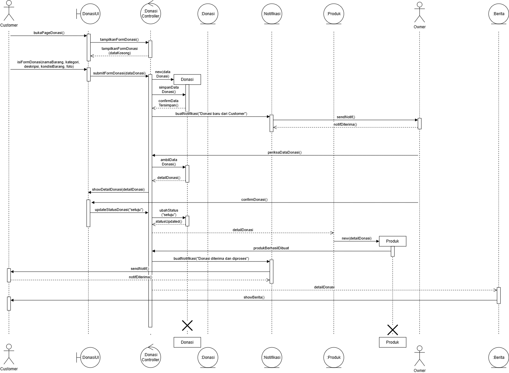

<h1>
IF2150 REKAYASA PERANGKAT LUNAK
<br>
TUGAS 5
<br>
DESKRIPSI PERANCANGAN PERANGKAT LUNAK (DPPL)
</h1>
<br>

## *RAWAT (Ruang Aspirasi Warga dan Aduan Terpadu)*
<p align="left">
  
</p>

### Untuk: *Agatha Tatianingseto*

Dipersiapkan oleh:
| Informasi | Keterangan |
| --- | --- |
| Kelas | *K01* |
| Kelompok | *01* |

| NIM | Nama |
|---|---|
| *13525103* | *Ravinka Fathia Adinegara* |
| *13525013* | *Samantha Michelle S Silaban* |
| *13525055* | *Syakira Azzahra Rachmania* |
| *13525043* | *Aufa Tatsbita Zahra* |
| *13525046* | *Ghiffari Arya Adhitya* |
---

## Daftar Perubahan

| Revisi | Deskripsi |
| :--- | :--- |
| *A* | *Deskripsikan perubahan yang dilakukan dari dokumen sebelumnya pada dokumen ini. Jika tidak terdapat perubahan, harap kosongkan tabel.* |
| *B* |  |
| *C* |  |
| ... |  |

---

<br>

> **Petunjuk pengerjaan:** *[Silahkan hapus bagian ini setelah selesai mengerjakan]*
>
> Dokumen ini melanjutkan **Deskripsi Perancangan Perangkat Lunak**. Gunakan nama, ID, kebutuhan, dan use case yang konsisten dengan kedua dokumen tersebut. Contoh pola ID baru di bawah dapat disesuaikan dengan kesepakatan kelompok, ID yang sudah ada tetap dipertahankan.

<br>

---


# BAB 1: Pendahuluan

## 1.1 Tujuan Penulisan Dokumen
Tuliskan dengan ringkas tujuan dokumen DPPL ini dibuat dan siapa saja yang akan menggunakan dokumen ini.

## 1.2 Lingkup Masalah
Tuliskan dengan ringkas nama aplikasi dan deskripsi singkatnya. Bagian ini maksimal berisi satu paragraf, dapat diambil dari SKPL.

## 1.3 Definisi, Istilah, dan Singkatan
Semua definisi dan singkatan yang digunakan dalam dokumen ini beserta penjelasannya.

Tabel 1.3. Definisi Istilah dan Singkatan

| Singkatan, Akronim, atau Istilah | Penjelasan |
| :--- | :--- |
| *P/L* | *Singkatan dari Perangkat Lunak, yaitu aplikasi yang memberikan perintah kepada komputer untuk menjalankan tugas tertentu.* |
| *DPPL* | *Singkatan dari Spesifikasi Kebutuhan Perangkat Lunak, yaitu dokumen yang merangkum kriteria-kriteria yang diperlukan untuk membangun aplikasi menjalankan tugasnya.* |
| *UC* | *Singkatan dari Use Case.* |
| *...* | *...* |

## 1.4 Aturan Penomoran
Tuliskan aturan penomoran (ID) yang digunakan dalam dokumen ini. Gunakan pola ID yang **sama** dengan yang sudah dipakai pada dokumen-dokumen sebelumnya, jangan membuat pola baru di dokumen ini.

Tabel 1.4. Aturan Penomoran

| Hal/Bagian | Penomoran | Keterangan |
| :--- | :--- | :--- |
| *Uce Case* | *UCXX* | |
| *Kelas* | *CXX* | |
| *...* | *...* |

## 1.5 Referensi
Cantumkan dokumentasi P/L yang dirujuk oleh dokumen ini, **minimal dokumen SKPL dan APL**. Tambahkan buku, panduan, atau dokumentasi lain apabila digunakan.

## 1.6 Deskripsi Umum Dokumen (Ikhtisar)
Tuliskan sistematika pembahasan dokumen ini secara ringkas dan runut, dengan maksimal 1 paragraf.

<br>

---

# BAB 2: Perancangan Arsitektur

## 2.1 Rancangan Lingkungan Implementasi

Sebutkan *operating system*, DBMS, *development tools*, *filing system*, dan bahasa pemrograman yang digunakan.

## 2.2 Style/Pattern Arsitektur Acuan

Tentukan *architectural style* atau *pattern* yang menjadi acuan aplikasi, misalnya *layered architecture*, *client-server*, *repository*, *pipe and filter*, atau MVC (*Model-View-Controller*).


Gunakan hasil **BAB 1 Style/Pattern Arsitektur Acuan pada dokumen APL**, termasuk alasan pemilihan dan gambar penerapannya pada P/L kelompok. Gunakan komponen aplikasi sendiri pada gambar, bukan hanya contoh pola umum.

<p align="center">

</p>
<p align="center">
<i>Gambar 1. Contoh Arsitektur MVC</i>
</p>

## 2.3 Identifikasi Komponen / Modul / Subsistem

Identifikasi komponen, modul, atau subsistem penyusun aplikasi berdasarkan *pattern* yang telah ditetapkan. Jelaskan tanggung jawab masing-masing komponen. Pengelompokan dapat mengikuti lapisan arsitektur atau fungsi/peran komponen dalam sistem.

Dapat menyalin dari dokumen DPPL sebelumnya

Tabel 2.3. Identifikasi Komponen/Modul/Subsistem

| Nama Komponen/Modul/Subsistem | Jenis | Penjelasan |
| :--- | :--- | :--- |
| *[Nama komponen/modul/subsistem]* | *[Jenis]* | *[Tanggung jawab komponen]* |
| *[Nama komponen/modul/subsistem]* | *[Jenis]* | *[Tanggung jawab komponen]* |
| *...* | *...* | *...* |

## 2.4 Model Arsitektur Perangkat Lunak

Buat model arsitektur dalam bentuk satu atau lebih *view* yang memperlihatkan interaksi dan kolaborasi komponen, modul, serta subsistem dalam menjalankan fungsi sistem. Pilih notasi yang sesuai. Contoh *view*: *Logical View*, *Process View*, *Development View*, dan *Physical View*.

Gunakan hasil **BAB 3 Model Arsitektur Perangkat Lunak pada dokumen APL**. 

### 2.4.1 View [Nama View]

Tuliskan secara singkat model arsitektur yang dipilih dan alasan model tersebut cocok untuk aplikasi.

<p align="center">

</p>
<p align="center">
<i>Gambar 2. Contoh Logical View pada P/L E-Commerce</i>
</p>

### 2.4.X View [Nama View]
*[Lakukan hal yang sama dengan bagian sebelumnya]*

<br>

---


# BAB 3: Realisasi Use Case

## 3.1 Use Case [Nama Use Case 1]

**ID Use Case:** *[UC01 sesuai SKPL]*  
**Nama Use Case:** *[Nama use case sesuai SKPL]*

### 3.1.1 Identifikasi Kelas

Identifikasi kelas yang terkait dengan use case tersebut. Kelas di tahap perancangan dapat berbeda dengan dengan kelas di tahap analisis. Dapat menggunakan tabel di bawah:

Tabel 3.1. Identifikasi Kelas Use Case [UC01]

| No | Nama Kelas Perancangan | Nama Kelas Analisis Terkait |
|:--- | :--- | :--- |
| 1 | *[Nama kelas perancangan]* | *[Nama kelas analisis pada SKPL]* |
| 2 | *[Nama kelas perancangan]* | *[Nama kelas analisis pada SKPL]* |
| ... | *...* | *...* |

### 3.1.2 Sequence Diagram

Buat *sequence diagram* untuk **setiap skenario use case**, mencakup skenario normal dan alternatif pada subbab 4.4 SKPL. Diagram melibatkan kelas-kelas yang telah diidentifikasi pada SKPL. 

- **Skenario Normal**

<p align="center">

</p>
<p align="center">
<i>Gambar X. Sequence Diagram [UC01]</i>
</p>

- **Skenario Alternatif [Nomor]: [Nama Skenario]**

<p align="center">

</p>
<p align="center">
<i>Gambar X. Sequence Diagram [UC01] - [Nama skenario alternatif]</i>
</p>

### 3.1.3 Diagram Kelas

Buatlah diagram kelas untuk use case ini yang terdiri atas kelas-kelas dari 3.1.1. **Setiap kelas pada diagram wajib menampilkan atribut dan metode/operasi langsung di dalam kotak kelasnya**, sehingga tidak perlu membuat tabel daftar atribut dan metode per kelas pada subbab ini. Daftar lengkap atribut dan metode seluruh kelas disajikan pada Tabel 4.1 (Bab 4).

<p align="center">

</p>
<p align="center">
<i>Gambar X. Diagram Kelas [Nama Uce Case]</i>
</p>

Pada diagram, pastikan:
- Atribut dituliskan beserta visibilitas dan tipe datanya, misalnya `- email: String`.
- Operasi dituliskan beserta visibilitas, parameter, dan tipe kembaliannya, misalnya `+ login(email: String, password: String): Boolean`.
- Relasi antarkelas (asosiasi, agregasi, komposisi, generalisasi, dan dependensi) digambarkan lengkap dengan multiplisitas.
- Semua operasi yang dipanggil pada sequence diagram 3.1.2 (skenario normal dan alternatif) ada pada kelas yang bersangkutan.
- Kelas yang sama dengan kelas di use case lain memakai nama, atribut, dan metode yang konsisten.

## 3.2 Use Case XX

Silahkan lanjutkan untuk  *use case* berikutnya dengan content yang sama dengan 3.1

<br>

---

# BAB 4: Diagram Kelas Keseluruhan

## 4.1 Diagram Kelas

**Bagian ini diisi dengan diagram kelas keseluruhan.**

<p align="center">

</p>
<p align="center">
<i>Gambar 4.1. Diagram Kelas Perancangan Keseluruhan [Nama P/L]</i>
</p>

Tabel 4.1. Daftar Kelas Perancangan Keseluruhan

| ID Kelas | Nama Kelas | Atribut | Metode/Operasi |
| :--- | :--- | :--- | :--- |
| *[C01]* | *[Nama kelas]* | *[Daftar atribut]* | *[Daftar metode/operasi]* |
| *[C02]* | *[Nama kelas]* | *[Daftar atribut]* | *[Daftar metode/operasi]* |
| *[C03]* | *[Nama kelas]* | *[Daftar atribut]* | *[Daftar metode/operasi]* |
| *...* | *...* | *...* | *...* |

---

# BAB 5: Perancangan Rinci Kelas

Tabel 5.1. Daftar Kelas Perancangan dan Kelas Analisis Terkait

| No | Nama Kelas Perancangan | Nama Kelas Analisis Terkait |
| :--- | :--- | :--- |
| 1 | *Pengguna* | *Pengguna* |
| 2 | *PenggunaView* | *PenggunaView* |
| 3 | *PenggunaController* | *PenggunaController* |
| 4 | *Upvote* | *Upvote* |
| 5 | *UpvoteView* | *UpvoteView* |
| 6 | *UpvoteController* | *UpvoteController* |

## 5.1 Kelas Pengguna

**Nama Kelas:** *Pengguna*  
**ID Kelas:** *C01*

Tabel 5.1.1. Operasi Kelas Pengguna
| Nama Operasi | Visibility (private, public) | Keterangan |
| :--- | :--- | :--- |
| *simpanDataPengguna(nama:String, NIK:String, email:String, hashPassword:String, noTelp : String) : Boolean* | *Public* | *Menyimpan data pengguna baru ke database, mengembalikan True jika berhasil tersimpan dan False jika gagal tersimpan.* |
| *getPenggunaByEmail(email: String) : Pengguna* | *Public* | *Mencari pengguna berdasarkan email. Mengembalikan objek Pengguna.* |
| *getRole() : String* | *Public* | *Memberikan informasi _role_ dari pengguna* |
| *getIzinLokasi() : StatusIzin* | *Public* | *Memberikan informasi status izin lokasi (DITERIMA/DITOLAK/BELUM_DIMINTA* |
| *getLokasiSaatIni() : Object* | *Public* | *Memberikan longitude dan latitude dari lokasi pengguna* |
| *hapusDataPengguna() : Boolean* | *Public* | *Menghapus data akun pengguna dari database dan mengembalikan status keberhasilan penghapusan.* |
| *updateDataPengguna(dataPengguna : Map<String, String>) : Boolean* | *Public* | *Menyimpan data akun pengguna terbaru ke database dan mengembalikan status keberhasilan penyimpanan.* |
| *sudahLihatTutorial() : Boolean* | *Public* | *Memberikan informasi status melihat tutorial, True jika sudah dan False jika belum.* |
| *getPenggunaById(idPengguna : String) : Pengguna* | *Public* | *Memberikan data Pengguna melalui ID Pengguna.* |


Tabel 5.1.2. Atribut Kelas Pengguna

| Nama Atribut | Visibility (private, public) | Tipe |
| :--- | :--- | :--- |
| *idPengguna* | *Private* | *String* |
| *nama* | *Private* | *String* |
| *NIK* | *Private* | *String* |
| *email* | *Private* | *String* |
| *hashPassword* | *Private* | *String* |
| *noTelp* | *Private* | *String* |
| *role* | *Private* | *String* |
| *statusIzin* | *Private* | *StatusIzin (enum)* |
| *statusTutorial* | *Private* | *Boolean* |
| *latitude* | *Private* | *Double* |
| *longitude* | *Private* | *Double* |


### 5.1.1 Algoritma/Query

**Nama Kelas:** *Pengguna*  
**Nama Operasi:** *simpanDataPengguna(nama : String, NIK : String, email : String, hashPassword : String, noTelp : String) : Boolean*  
**ID Algoritma:** *Algo-001*

```text
ALGORITMA simpanDataPengguna

INPUT: nama, NIK, email, hashPassword, noTelp
OUTPUT: Boolean

1. Jalankan query INSERT untuk menyimpan data pengguna. [Q-001]
2. IF penyimpanan berhasil THEN
      RETURN true
   ELSE
      RETURN false
   ENDIF
```
Tabel 5.1.1. Query Operasi simpanDataPengguna()

| No Query | Query | Keterangan |
| :--- | :--- | :--- |
| *Q-001* | *INSERT INTO pengguna (nama, nik, email, hash_password, no_telp) VALUES ($1, $2, $3, $4, $5);* | *Menyimpan data pengguna baru ke database* |

### 5.1.2 Algoritma/Query

**Nama Kelas:** *Pengguna*  
**Nama Operasi:** *getPenggunaByEmail(email: String) : Pengguna*  
**ID Algoritma:** *Algo-002*
```text
ALGORITMA getPenggunaByEmail

INPUT: email
OUTPUT: Pengguna atau null

1. Cari data pengguna berdasarkan email. [Q-002]
2. IF pengguna ditemukan THEN
      Buat objek Pengguna dari hasil query.
      RETURN objek Pengguna
   ELSE
      RETURN null
   ENDIF

```
Tabel 5.1.2. Query Operasi getPenggunaByEmail()

| No Query | Query | Keterangan |
| :--- | :--- | :--- |
| *Q-002* | *SELECT * FROM pengguna WHERE email = $1;* | *Mencari pengguna berdasarkan email* |

### 5.1.3 Algoritma/Query

**Nama Kelas:** *Pengguna*  
**Nama Operasi:** *updateDatapengguna(dataPengguna : Map<String, String>) : Boolean*  
**ID Algoritma:** *Algo-003*
```text
ALGORITMA updateDataPengguna

INPUT: dataPengguna
OUTPUT: Boolean

1. Ambil idPengguna dari objek Pengguna saat ini.

2. IF dataPengguna memiliki atribut "nama" THEN
      Tambahkan nama ke daftar perubahan.
   ENDIF

3. IF dataPengguna memiliki atribut "noTelp" THEN
      Tambahkan noTelp ke daftar perubahan.
   ENDIF

4. IF dataPengguna memiliki atribut "hashPassword" THEN
      Tambahkan password ke daftar perubahan.
   ENDIF

6. IF daftar perubahan kosong THEN
      RETURN false
   ENDIF

7. Jalankan query UPDATE berdasarkan daftar perubahan
   dan idPengguna.

8. IF pembaruan berhasil THEN
      RETURN true
   ELSE
      RETURN false
   ENDIF

```
Tabel 5.1.3. Query Operasi updateDataPengguna
| No Query | Query | Keterangan |
| :--- | :--- | :--- |
| *Q-003* | *UPDATE pengguna SET nama = $1 WHERE id_pengguna = $2;* | *Contoh query jika hanya nama yang diperbarui* |

### 5.1.4 Algoritma/Query

**Nama Kelas:** *Pengguna*  
**Nama Operasi:** *hapusDataPengguna() : Boolean*  
**ID Algoritma:** *Algo-004*
``` text
ALGORITMA hapusDataPengguna

INPUT: Tidak ada
OUTPUT: Boolean

1. Ambil idPengguna dari objek Pengguna saat ini.
2. Jalankan query DELETE berdasarkan idPengguna.
3. IF satu record data pengguna berhasil dihapus THEN
      RETURN true
   ELSE
      RETURN false
   ENDIF
```
Tabel 5.1.4. Query Operasi hapusDataPengguna()
| No Query | Query | Keterangan |
| :--- | :--- | :--- |
| *Q-004* | *DELETE FROM pengguna WHERE id_pengguna = $1* | *Menghapus data akun pengguna berdasarkan ID* |

## 5.2 Kelas PenggunaView

**Nama Kelas:** *PenggunaView*  
**ID Kelas:** *C08*

Tabel 5.2.1. Operasi Kelas PenggunaView
| Nama Operasi | Visibility (private, public) | Keterangan |
| :--- | :--- | :--- |
| *tampilkanFormRegistrasi()* | *Public* | *Menampilkan formulir registrasi kepada pengguna.* |
| *tampilkanErrorMsgs(pesan : String)* | *Public* | *Menampilkan pesan kesalahan kepada pengguna.* |
| *tampilkanFormLogin()* | *Public* | *Menampilkan formulir login kepada pengguna.* |
| *tampilkanPermintaanIzinLokasi()* | *Public* | *Menampilkan permintaan izin akses lokasi.* |
| *tampilkanProfil()* | *Public* | *Menampilkan profil pengguna.* |
| *tampilkanFormUbahProfil()* | *Public* | *Menampilkan formulir untuk mengedit profil.* |
| *tampilkanPesanBerhasil(pesan : String)* | *Public* | *Menampilkan pesan berhasil atas aksi yang dilakukan pengguna.* |
| *tampilkanFormKonfirmasi(pesan : String)* | *Public* | *Menampilkan pertanyaan konfirmasi untuk aksii yang dilakukan pengguna.* |
| *tampilkanNotifAdmin(pesan : String)* | *Public* | *Menampilkan notifikasi terhadap perbaruan laporan kepada admin.* |
| *tampilkanOpsiTutorial()* | *Public* | *Menampilkan opsi tutorial.* |


Tabel 5.2.2. Atribut Kelas PenggunaView

| Nama Atribut | Visibility (private, public) | Tipe |
| :--- | :--- | :--- |
| *-* | *-* | *-* |


### 5.2.1 Algoritma/Query

**Nama Kelas:** *PenggunaView*  
**Nama Operasi:** *tampilkanFormKonfirmasi(pesan : String)*  
**ID Algoritma:** *Algo-005*
``` text
ALGORITMA tampilkanFormKonfirmasi

INPUT: pesan : String
OUTPUT: Tampilan pertanyaan konfirmasi

1. Tampilkan pertanyaan konfirmasi berisi pesan.
2. Tampilkan pilihan Ya dan Tidak.
3. Tunggu pengguna memilih Ya atau Tidak. 
4. IF pengguna memilih Ya THEN
	Teruskan aksi yang dikonfirmasi ke Controller.
    ELSE
	Tutup pertanyaan konfirmasi.
    ENDIF
```
### 5.2.2 Algoritma/Query
**Nama Kelas:** *PenggunaView*  
**Nama Operasi:** *tampilkanNotifAdmin*  
**ID Algoritma:** *Algo-006*
``` text

ALGORITMA tampilkanNotifAdmin

INPUT: Pesan
OUTPUT: Tampilan notifikasi admin

1. Terima pesan notifikasi.
2. Tampilkan notifikasi berisi pesan kepada admin.
3. Tampilkan pilihan untuk melihat laporan.
4. IF admin memilih melihat laporan THEN
      Arahkan admin ke halaman laporan.
   ELSE
      Tutup notifikasi.
   ENDIF
```


## 5.3 Kelas PenggunaController

**Nama Kelas:** *PenggunaController*  
**ID Kelas:** *C15*

Tabel 5.3.1. Operasi Kelas PenggunaController
| Nama Operasi | Visibility (private, public) | Keterangan |
| :--- | :--- | :--- |
| *registrasi(nama : String, NIK : String, email : String, password : String, noTelp : String)* | *Public* | *Menerima data formulir data registrasi dan mengoordinasikan penyimpanan akun baru.* |
|*hashPassword(password : String) : String*| *Private*| *Melakukan _hashing_ kepada input password*|
|*cekAkunTerdaftar( email : String, NIK : String) : Boolean*| *Private* | *Memeriksa apakah email atau NIK sudah terdaftar dalam database. *|
|*validasiData(nama : String, NIK : String, email : String, password : String, noTelp : String) : String*| *Private* | *Memvalidasi data seperti pengecekan password, kelengkapan data, dan format data.*|
|*login(email : String, password : String)*| *Public* | *Menerima data formulir data login dan memprosesnya.*|
|*validasiKredensial(passwordInput : String, hashPpassword : String) : Boolean*| *Private* | *Melakukan verifikasi terhadap password yang diinput dengan password _hash_ yang ada di database.*|
|*setIzinLokasi(statusIzin : StatusIzin)*| *Public* | *Menerima status izin lokasi dan mengoordinasikan pembaruannya ke Entity Pengguna.*|
|*cekIzinLokasi() : StatusIzin*| *Public* |*Memanggil getIzinLokasi() pada Entitiy Pengguna untuk mengetahui status izin lokasi.*|
|*cekStatusTutorial() : Boolean*| *Public* | *Memanggil sudahLihatTutorial() pada Entitiy Pengguna untuk mengetahui statusTutorial.*|
|*sudahLogin(idPengguna : String) : Boolean*| *Public* | *Memeriksa apakah pengguna dengan ID tersebut memiliki sesi login yang masih aktif.*|
|*kirimKonfirmasiUlang()*| *Public* | *Mengirimkan permintaan konfirmasi ulang kepada admin agar laporan dapat diperiksa dan divalidasi kembali.*|
|*ubahProfil(dataPengguna : Map<String, String>) : Boolean* | *Public* | *Mengoordinasikan validasi dan pembaruan data profil pengguna.*|
|*validasiDataProfil (dataPengguna : Map<String, String>) : String*| *Private* | Memvalidasi format dan kesesuaian atribut profil yang ingin diperbarui*|
|*hapusAkun() : Boolean*| *Public*| *Mengoordinasikan penghapusan akun melalui Entity Pengguna dan mengembalikan status keberhasilannya. *|

Tabel 5.2.2. Atribut Kelas PenggunaController

| Nama Atribut | Visibility (private, public) | Tipe |
| :--- | :--- | :--- |
| *-* | *-* | *-* |


### 5.3.1. Algoritma/Query
**Nama Kelas:** *PenggunaController*  
**Nama Operasi:** *registrasi(nama, NIK, email, password, noTelp)*  
**ID Algoritma:** *Algo-007*
``` text

ALGORITMA registrasi

INPUT: nama, NIK, email, password, noTelp
OUTPUT: Tidak ada

1. Panggil validasiData(nama, NIK, email, password, noTelp).

2. IF data tidak valid THEN
      Panggil tampilkanErrorMsgs("Data tidak valid").
      Hentikan proses.
   ENDIF

3. Panggil cekAkunTerdaftar(email, NIK).

4. IF akun sudah terdaftar THEN
      Panggil tampilkanErrorMsgs("Akun sudah terdaftar").
      Hentikan proses.
   ENDIF

5. hashPassword ← hashPassword(password).

6. Panggil simpanDataPengguna(nama, NIK, email,
   hashPassword, noTelp) pada Entity Pengguna.

7. IF penyimpanan berhasil THEN
      Panggil tampilkanPesanBerhasil("Registrasi berhasil").
   ELSE
      Panggil tampilkanErrorMsgs("Registrasi gagal").
   ENDIF

```

### 5.3.2. Algoritma/Query
**Nama Kelas:** *PenggunaController*  
**Nama Operasi:** *login(email, password)*  
**ID Algoritma:** *Algo-008*

```text
ALGORITMA login

INPUT: email, password
OUTPUT: Tidak ada

1. Panggil getPenggunaByEmail(email) pada Entity Pengguna.

2. IF pengguna tidak ditemukan THEN
      Panggil tampilkanErrorMsgs("Email atau password salah").
      Hentikan proses.
   ENDIF

3. Ambil hashPassword dari data Pengguna.

4. Panggil validasiKredensial(password, hashPassword).

5. IF kredensial valid THEN
      Panggil getRole() pada Entity Pengguna.
      Buat sesi login pengguna.
      Arahkan pengguna ke halaman sesuai role.
   ELSE
      Panggil tampilkanErrorMsgs("Email atau password salah").
   ENDIF
```
### 5.3.3. Algoritma/Query
**Nama Kelas:** *PenggunaController*  
**Nama Operasi:** *validasiData(nama, NIK, email, password, noTelp) : String*  
**ID Algoritma:** *Algo-009*
```text
ALGORITMA validasiData

INPUT: nama, NIK, email, password, noTelp
OUTPUT: String

1. IF terdapat data wajib yang kosong THEN
      RETURN "Data belum lengkap".
   ENDIF

2. IF format NIK tidak valid THEN
      RETURN "NIK tidak valid".
   ENDIF

3. IF format email tidak valid THEN
      RETURN "Email tidak valid".
   ENDIF

4. IF password tidak memenuhi ketentuan THEN
      RETURN "Password tidak valid".
   ENDIF

5. IF format noTelp tidak valid THEN
      RETURN "Nomor telepon tidak valid".
   ENDIF

6. RETURN ""

### 5.3.4. Algoritma/Query
**Nama Kelas:** *PenggunaController*  
**Nama Operasi:** *validasiKredensial(passwordInput, hashPassword) : Boolean*  
**ID Algoritma:** *Algo-010*
```text
ALGORITMA validasiKredensial

INPUT: passwordInput, hashPassword
OUTPUT: Boolean

1. Hitung hashInput ← SHA256(passwordInput).

2. Bandingkan hashInput dengan hashPassword
   yang tersimpan dalam database.

3. IF hashInput = hashPassword THEN
      RETURN true
   ELSE
      RETURN false
   ENDIF
```

### 5.3.5. Algoritma/Query
**Nama Kelas:** *PenggunaController*  
**Nama Operasi:** *ubahProfil(dataPengguna : Map<String, String>) : Boolean*  
**ID Algoritma:** *Algo-011*
```text
ALGORITMA ubahProfil

INPUT: dataPengguna
OUTPUT: Boolean

1. Panggil validasiDataProfil(dataPengguna).

2. IF data tidak valid THEN
      Panggil tampilkanErrorMsgs("Data profil tidak valid").
      RETURN false
   ENDIF

3. IF dataPengguna memiliki atribut "password" THEN
      hashBaru ← hashPassword(dataPengguna["password"])
      Hapus atribut "password" dari dataPengguna.
      Tambahkan ("hashPassword", hashBaru)
      ke dataPengguna.
   ENDIF

4. Panggil updateDataPengguna(dataPengguna)
   pada Entity Pengguna.

5. IF pembaruan berhasil THEN
      Panggil tampilkanPesanBerhasil("Profil berhasil diubah").
      RETURN true
   ELSE
      Panggil tampilkanErrorMsgs("Gagal mengubah profil").
      RETURN false
   ENDIF
```

### 5.3.6. Algoritma/Query
**Nama Kelas:** *PenggunaController*  
**Nama Operasi:** *hapusAkun() : Boolean* 
**ID Algoritma:** *Algo-012*
```text
ALGORITMA hapusAkun

INPUT: Tidak ada
OUTPUT: Boolean

1. Panggil hapusDataPengguna() pada Entity Pengguna.

2. IF penghapusan berhasil THEN
      Akhiri sesi login pengguna.
      RETURN true
   ELSE
      RETURN false
   ENDIF
```

## 5.4 Kelas Lokasi

**Nama Kelas:** *Lokasi*  
**ID Kelas:** *C04*

Tabel 5.4.1. Operasi Kelas Lokasi
| Nama Operasi | Visibility (private, public) | Keterangan |
| :--- | :--- | :--- |
| *getKoordinat() : Real, Real* | *Public* | *Memberikan koordinat (longitude dan latitude) laporan*|
| *getAlamat() : String*| *Public* | *Mengambil alamat dalam bentuk teks dari objek lokasi*|

Tabel 5.4.2. Atribut Kelas Lokasi

| Nama Atribut | Visibility (private, public) | Tipe |
| :--- | :--- | :--- |
| *Latitude* | *Private* | *Real* |
| *Longitude* | *Private* | *Real* |
| *Alamat* | *Private* | *String* |

### 5.4.1. Algoritma/Query
**Nama Kelas:** *Lokasi*  
**Nama Operasi:** *getKoordinat()*  
**ID Algoritma:** *Algo-013*

```text
ALGORITMA getKoordinat

INPUT: Tidak ada
OUTPUT: latitude: Real, longtiude: Real

1. Ambil atribut latitude dan longitude
   dari objek Lokasi saat ini.

2. RETURN {latitude, longitude}
```

## 5.5 Kelas LokasiController

**Nama Kelas:** *LokasiController*  
**ID Kelas:** *C18*

Tabel 5.4.1. Operasi Kelas Lokasi
| Nama Operasi | Visibility (private, public) | Keterangan |
| :--- | :--- | :--- |
| *cariLaporanTerdekat() : List<Laporan>* | *Private* | *Mencari laporan terdekat dari lokasi pengguna*|
| *ambilLokasiPengguna() : Object*| *Public* | *Mengambil lokasi pengguna dalam bentuk longitude dan latitude*|
| *ambilLokasiLaporan(alamat: String) : Object*| *Public* | *Mengambil koordinat latitude dan longitude laporan berdasarkan alamat menggunakan geocoding.*|
| *hitungJarak(lokasiPengguna: Object, lokasiLaporan : Object) : Real*| *Private* | *Menghitung jarak laporan dengan pengguna*|


Tabel 5.4.2. Atribut Kelas Lokasi

| Nama Atribut | Visibility (private, public) | Tipe |
| :--- | :--- | :--- |
| *-* | *-* | *-* |

### 5.5.1. Algoritma/Query
**Nama Kelas:** *LokasiController*  
**Nama Operasi:** *ambilLokasiLaporan(alamat: String) : Object*  
**ID Algoritma:** *Algo-014*
```text
ALGORITMA ambilLokasiLaporan

INPUT: alamat
OUTPUT: Object (latitude, longitude)

1. IF alamat kosong THEN
      RETURN null
   ENDIF

2. Kirim alamat ke layanan geocoding.

3. Terima hasil geocoding.

4. IF lokasi ditemukan THEN
      Ambil latitude dan longitude.
      RETURN {latitude, longitude}
   ELSE
      RETURN null
   ENDIF

### 5.5.2. Algoritma/Query
**Nama Kelas:** *LokasiController*  
**Nama Operasi:** *hitungJarak(lokasiPengguna : Object, lokasiLaporan : Object)*  
**ID Algoritma:** *Algo-015*
```text
ALGORITMA hitungJarak

INPUT: lokasiPengguna, lokasiLaporan
OUTPUT: jarak: Real (kilometer)

1. Ambil latitude dan longitude dari kedua lokasi.

2. Konversi seluruh koordinat dari derajat ke radian.

3. Hitung:
   deltaLat ← latLaporan - latPengguna
   deltaLon ← lonLaporan - lonPengguna

4. Hitung:
   a ← sin²(deltaLat/2)
        + cos(latPengguna) × cos(latLaporan)
        × sin²(deltaLon/2)

5. Hitung:
   c ← 2 × atan2(√a, √(1-a))

6. jarak ← 6371 × c

7. RETURN jarak
```
### 5.5.2. Algoritma/Query
**Nama Kelas:** *LokasiController*  
**Nama Operasi:** *cariLaporanTerdekat() : List<Laporan>*  
**ID Algoritma:** *Algo-016*
```text
ALGORITMA cariLaporanTerdekat

INPUT: Tidak ada
OUTPUT: List<Laporan>

1. lokasiPengguna ← ambilLokasiPengguna()

2. IF lokasiPengguna = null THEN
      RETURN daftar kosong.
   ENDIF

3. daftarLaporan ← Homepage.getDaftarLaporan()

4. Inisialisasi daftarJarak ← array kosong.

5. FOR setiap laporan dalam daftarLaporan DO
      lokasiLaporan ← laporan.lokasi.getKoordinat()

      jarak ← hitungJarak(lokasiPengguna, lokasiLaporan)

      Tambahkan {laporan.idLaporan, jarak} ke daftarJarak.
   ENDFOR

6. Urutkan daftarJarak berdasarkan jarak ascending.

7. Susun List<Laporan> sesuai urutan idLaporan pada daftarJarak.

8. RETURN List<Laporan>.
```

## 5.5 Kelas Upvote

**Nama Kelas:** *Upvote*  
**ID Kelas:** *C05*

Tabel 5.5.1. Operasi Kelas Upvote
| Nama Operasi | Visibility (private, public) | Keterangan |
| :--- | :--- | :--- |
| *upvote(idPengguna:String, idLaporan:String) : Boolean* | *Public* | *Menyimpan data upvote yang dilakukan oleh pengguna pada suatu laporan.* |


Tabel 5.5.2. Atribut Kelas Upvote

| Nama Atribut | Visibility (private, public) | Tipe |
| :--- | :--- | :--- |
| *waktuUpvote* | *Private* | *Timestamp* |
| *statusUpvote* | *Private* | *Boolean* |


### 5.5.1 Algoritma/Query

**Nama Kelas:** *Pengguna*  
**Nama Operasi:** *simpanDataPengguna(nama : String, NIK : String, email : String, hashPassword : String, noTelp : String) : Boolean*  
**ID Algoritma:** *Algo-00?*

```text
ALGORITMA upvote

INPUT: idPengguna, idLaporan
OUTPUT: Boolean

1. Ambil waktu saat upvote dilakukan.
2. Tetapkan statusUpvote menjadi true.
3. Jalankan query INSERT untuk menyimpan data upvote. [Q-XXX]
4. IF penyimpanan berhasil THEN
      RETURN true
   ELSE
      RETURN false
   ENDIF
```
Tabel 5.5.3. Query Operasi upvote()

| No Query | Query | Keterangan |
| :--- | :--- | :--- |
| *Q-00?* | *INSERT INTO upvote (id_pengguna, id_laporan, waktu_upvote, status_upvote) VALUES ($1, $2, CURRENT_TIMESTAMP, TRUE);* | *Menyimpan data upvote pengguna pada laporan* |
$1 diisi dengan idPengguna, sedangkan $2 diisi dengan idLaporan.


## 5.12 Kelas UpvoteView

**Nama Kelas:** *UpvoteView*  
**ID Kelas:** *C12*

Tabel 5.12.1. Operasi Kelas UpvoteView
| Nama Operasi | Visibility (private, public) | Keterangan |
| :--- | :--- | :--- |
| *klikUpvote()* | *Public* | *Menangani interaksi pengguna saat menekan tombol upvote.* |
| *tampilkanJumlahUpvote(jumlahUpvote: Integer)* | *Public* | *Menampilkan jumlah upvote dari suatu laporan.* |
| *tampilkanPesanError()* | *Public* | *Menampilkan pesan error jika upvote tidak berhasil diproses.* |
| *updateUpvoteButton(statusUpvote: Boolean)* | *Public* | *Memperbarui tampilan tombol upvote berdasarkan status upvote.* |


## 5.19 Kelas UpvoteController

**Nama Kelas:** *UpvoteController*  
**ID Kelas:** *C19*

Tabel 5.19.1. Operasi Kelas UpvoteController
| Nama Operasi | Visibility (private, public) | Keterangan |
| :--- | :--- | :--- |
| *prosesUpvote(idPengguna:String, idLaporan:String) : Boolean* | *Public* | *Memproses upvote dengan memeriksa apakah pengguna sudah melakukan upvote dan menyimpan data upvote jika diperbolehkan.* |
| *sudahUpvote(idPengguna:String, idLaporan:String) : Boolean* | *Public* | *Memeriksa apakah pengguna sudah melakukan upvote pada laporan tertentu.* |


### 5.19.1 Algoritma/Query

**Nama Kelas:** *UpvoteController*  
**Nama Operasi:** *sudahUpvote(idPengguna : String, idLaporan : String) : Boolean*  
**ID Algoritma:** *Algo-00?*

```text
ALGORITMA sudahUpvote

INPUT: idPengguna, idLaporan
OUTPUT: Boolean

1. Jalankan query SELECT untuk memeriksa apakah data upvote pengguna pada laporan tersebut sudah ada. [Q-XXX]
2. IF data upvote ditemukan THEN
      RETURN true
   ELSE
      RETURN false
   ENDIF
```
Tabel 5.19.2. Query Operasi sudahUpvote()

| No Query | Query | Keterangan |
| :--- | :--- | :--- |
| *Q-00?* | *SELECT 1 FROM upvote WHERE id_pengguna = $1 AND id_laporan = $2 AND status_upvote = TRUE LIMIT 1;* | *Memeriksa apakah pengguna sudah melakukan upvote pada laporan tertentu* |

### 5.19.2 Algoritma/Query

**Nama Kelas:** *UpvoteController*  
**Nama Operasi:** *prosesUpvote(idPengguna : String, idLaporan : String) : Boolean*  
**ID Algoritma:** *Algo-00?*

```text
ALGORITMA prosesUpvote

INPUT: idPengguna, idLaporan
OUTPUT: Boolean

1. Panggil sudahUpvote(idPengguna, idLaporan)
2. IF pengguna sudah melakukan upvote THEN
      Panggil UpvoteView.tampilkanPesanError().
      RETURN false
   ENDIF
3. Panggil Upvote.upvote(idPengguna, idLaporan)
4. IF penyimpanan upvote gagal THEN
      Panggil UpvoteView.tampilkanPesanError()
      RETURN false
   ENDIF
5. Panggil UpvoteView.updateUpvoteButton(true).
6. Ambil jumlah upvote terbaru melalui Laporan.getJumlahUpvote().
7. Panggil UpvoteView.tampilkanJumlahUpvote(jumlahUpvote).
8. RETURN true.
```


## 5.6 Kelas Tanggapan

**Nama Kelas:** *Tanggapan*  
**ID Kelas:** *C06*

Tabel 5.6.1. Operasi Kelas Tanggapan
| Nama Operasi | Visibility (private, public) | Keterangan |
| :--- | :--- | :--- |
| *simpanTanggapan(idLaporan:String, dataPopupForm:FormTanggapan): Boolean* | *Public* | *Menyimpan data tanggapan admin atas suatu laporan.* |


Tabel 5.6.2. Atribut Kelas Tanggapan

| Nama Atribut | Visibility (private, public) | Tipe |
| :--- | :--- | :--- |
| *statusTanggapan* | *Private* | *Boolean* |
| *waktuTanggapan* | *Private* | *Timestamp* |
| *deskripsiTanggapan* | *Private* | *String* |


### 5.6.1 Algoritma/Query

**Nama Kelas:** *Tanggapan*  
**Nama Operasi:** *simpanTanggapan(idLaporan:String, dataPopupForm:FormTanggapan): Boolean*  
**ID Algoritma:** *Algo-00?*

```text
ALGORITMA simpanTanggapan

INPUT: idLaporan, dataPopupForm
OUTPUT: Boolean

1. Ambil statusTanggapan dan deskripsiTanggapan dari dataPopupForm.
2. Jalankan query INSERT untuk menyimpan tanggapan. [Q-XXX]
3. IF penyimpanan berhasil THEN
      RETURN true
   ELSE
      RETURN false
   ENDIF
```
Tabel 5.6.3. Query Operasi simpanTanggapan()

| No Query | Query | Keterangan |
| :--- | :--- | :--- |
| *Q-00?* | *INSERT INTO tanggapan (id_laporan, status_tanggapan, waktu_tanggapan, deskripsi_tanggapan) VALUES ($1, $2, CURRENT_TIMESTAMP, $3);* | *Menyimpan hasil pemeriksaan validitas laporan, waktu tanggapan, dan deskripsi alasan jika laporan dinyatakan tidak valid.* |
$1 = idLaporan
$2 = statusTanggapan
$3 = deskripsiTanggapan


## 5.13 Kelas TanggapanView

**Nama Kelas:** *TanggapanView*  
**ID Kelas:** *C13*

Tabel 5.13.1. Operasi Kelas TanggapanView
| Nama Operasi | Visibility (private, public) | Keterangan |
| :--- | :--- | :--- |
| *tampilkanPopup(idLaporan:String)* | *Public* | *Menampilkan formulir tanggapan admin untuk laporan yang dipilih.* |
| *submitPopupForm(dataPopupForm:FormTanggapan): Boolean* | *Public* | *Memvalidasi data formulir dan menampilkan konfirmasi jika data valid.* |
| *tampilkanKonfirmasi(dataPopupForm:FormTanggapan)* | *Public* | *Menampilkan ringkasan tanggapan admin dan meminta konfirmasi sebelum penyimpanan.* |

Tabel 5.13.2. Atribut Kelas TanggapanView

| Nama Atribut | Visibility (private, public) | Tipe |
| :--- | :--- | :--- |
| *dataPopupForm* | *Private* | *FormTanggapan :<statusTanggapan : Boolean, deskripsiTanggapan : String>* |


## 5.20 Kelas TanggapanController

**Nama Kelas:** *TanggapanController*  
**ID Kelas:** *C20*

Tabel 5.20.1. Operasi Kelas TanggapanController
| Nama Operasi | Visibility (private, public) | Keterangan |
| :--- | :--- | :--- |
| *validasiTanggapan(dataPopupForm:FormTanggapan): Boolean)* | *Public* | *Melakukan validasi/memeriksa apakah laporan yang diberikan oleh pengguna valid.* |
| *simpanTanggapan(idLaporan:String, dataPopupForm:FormTanggapan): Boolean* | *Public* | *Mengatur proses penyimpanan tanggapan admin atas valid atau tidaknya suatu laporan.* |
| *simpanStatus(idLaporan:String, statusLaporan:StatusLaporan (enum)): Boolean* | *Public* | *Mengatur proses penyimpanan status laporan yang ditetapkan oleh admin.* |


### 5.20.1 Algoritma/Query

**Nama Kelas:** *TanggapanController*  
**Nama Operasi:** *validasiTanggapan(dataPopupForm:FormTanggapan): Boolean)*  
**ID Algoritma:** *Algo-00?*

```text
ALGORITMA validasiTanggapan

INPUT: dataPopupForm
OUTPUT: Boolean

1. statusTanggapan ← dataPopupForm.statusTanggapan
2. IF statusTanggapan = TRUE THEN
      RETURN true
   ELSE
      RETURN false
   ENDIF
```

### 5.20.2 Algoritma/Query

**Nama Kelas:** *TanggapanController*  
**Nama Operasi:** *simpanTanggapan(idLaporan:String, dataPopupForm:FormTanggapan): Boolean*  
**ID Algoritma:** *Algo-00?*

```text
ALGORITMA simpanTanggapan

INPUT: idLaporan, dataPopupForm
OUTPUT: Boolean

1. Panggil validasiTanggapan(dataPopupForm).
2. IF data tidak valid THEN
      RETURN false
   ENDIF
3. Panggil Tanggapan.simpanTanggapan(idLaporan, dataPopupForm).
4. RETURN hasil operasi penyimpanan.
```


### 5.20.3 Algoritma/Query

**Nama Kelas:** *TanggapanController*  
**Nama Operasi:** *simpanStatus(idLaporan:String, statusLaporan:StatusLaporan (enum)): Boolean*  
**ID Algoritma:** *Algo-00?*

```text
ALGORITMA simpanStatus

INPUT: idLaporan, statusPenanganan
OUTPUT: Boolean

1. Jalankan query UPDATE untuk memperbarui status penanganan laporan [Q-00X]
2. IF pembaruan berhasil THEN
      RETURN true
   ELSE
      RETURN false
   ENDIF
```

Tabel 5.20.2. Query Operasi simpanStatus()

| No Query | Query | Keterangan |
| :--- | :--- | :--- |
| *Q-00?* | *UPDATE laporan SET status_penanganan = $1 WHERE id_laporan = $2;* | *Memperbarui status penanganan laporan berdasarkan pilihan admin.* |

$1 = statusLaporan
$2 = idLaporan


## 5.7 Kelas Tutorial

**Nama Kelas:** *Tutorial*  
**ID Kelas:** *C07*

Tabel 5.7.1. Operasi Kelas Tutorial
| Nama Operasi | Visibility (private, public) | Keterangan |
| :--- | :--- | :--- |
| *getLangkahSaatIni(): Integer* | *Public* | *Mengembalikan nomor langkah tutorial yang sedang ditampilkan.* |
| *getTotalLangkah(): Integer* | *Public* | *Mengembalikan jumlah seluruh langkah tutorial.* |


Tabel 5.7.2. Atribut Kelas Tutorial

| Nama Atribut | Visibility (private, public) | Tipe |
| :--- | :--- | :--- |
| *langkahSaatIni* | *Private* | *Integer* |
| *totalLangkah* | *Private* | *Integer* |


### 5.7.1 Algoritma/Query

**Nama Kelas:** *Tutorial*  
**Nama Operasi:** *getLangkahSaatIni(): Integer*  
**ID Algoritma:** *Algo-00?*

```text
ALGORITMA getLangkahSaatIni

INPUT: -
OUTPUT: Integer

1. Ambil nilai atribut langkahSaatIni.
2. Kembalikan nilai langkahSaatIni.
```

### 5.7.2 Algoritma/Query

**Nama Kelas:** *Tutorial*  
**Nama Operasi:** *getTotalLangkah(): Integer*  
**ID Algoritma:** *Algo-00?*

```text
ALGORITMA getTotalLangkah

INPUT: -
OUTPUT: Integer

1. Ambil nilai atribut totalLangkah.
2. Kembalikan nilai totalLangkah.
```


## 5.14 Kelas TutorialView

**Nama Kelas:** *TutorialView*  
**ID Kelas:** *C14*

Tabel 5.14.1. Operasi Kelas TutorialView
| Nama Operasi | Visibility (private, public) | Keterangan |
| :--- | :--- | :--- |
| *tampilkanTutorial()* | *Public* | *Menampilkan antarmuka tutorial.* |
| *tampilkanLangkah(langkahSaatIni: Integer)* | *Public* | *Menampilkan langkah tutorial sesuai nomor langkah yang diberikan.* |
| *tampilkanPesanError()* | *Public* | *Menampilkan pesan kesalahan jika tutorial gagal ditampilkan atau diproses.* |
| *tutupTutorial()* | *Public* | *Menutup antarmuka tutorial.* |


## 5.21 Kelas TutorialController

**Nama Kelas:** *TutorialController*  
**ID Kelas:** *C21*

Tabel 5.21.1. Operasi Kelas TutorialController
| Nama Operasi | Visibility (private, public) | Keterangan |
| :--- | :--- | :--- |
| *startTutorial(): Boolean* | *Public* | *Menangani proses start tutorial.* |
| *nextTutorial(): Boolean* | *Public* | *Menangani proses next tutorial.* |
| *skipTutorial(): Boolean* | *Public* | *Menangani proses skip tutorial.* |
| *finishTutorial(): Boolean* | *Public* | *Menangani proses finish tutorial.* |


### 5.21.1 Algoritma/Query

**Nama Kelas:** *TutorialController*  
**Nama Operasi:** *startTutorial(): Boolean*  
**ID Algoritma:** *Algo-00?*

```text
ALGORITMA startTutorial

INPUT: -
OUTPUT: Boolean

1. langkahSaatIni = 1
2. Tetapkan totalLangkah sesuai jumlah langkah tutorial.
3. Panggil operasi tampilkanTutorial() pada TutorialView.
4. Panggil operasi tampilkanLangkah(langkahSaatIni) pada TutorialView.
5. IF tutorial berhasil diinisialisasi THEN
      RETURN true
   ELSE
      RETURN false
   ENDIF
```

### 5.21.2 Algoritma/Query

**Nama Kelas:** *TutorialController*  
**Nama Operasi:** *nextTutorial(): Boolean*  
**ID Algoritma:** *Algo-00?*

```text
ALGORITMA nextTutorial

INPUT: -
OUTPUT: Boolean

1. Ambil nilai langkahSaatIni dan totalLangkah dari objek Tutorial.
2. IF langkahSaatIni < totalLangkah THEN
      langkahSaatIni = langkahSaatIni + 1
      Panggil operasi tampilkanLangkah(langkahSaatIni) pada TutorialView
      RETURN true
   ELSE
      RETURN false
   ENDIF
```

### 5.21.3 Algoritma/Query

**Nama Kelas:** *TutorialController*  
**Nama Operasi:** *skipTutorial(): Boolean*  
**ID Algoritma:** *Algo-00?*

```text
ALGORITMA skipTutorial

INPUT: -
OUTPUT: Boolean

1. Panggil TutorialView.tutupTutorial()
2. IF tutorial berhasil ditutup THEN
      RETURN true
   ELSE
      RETURN false
   ENDIF
```

### 5.21.4 Algoritma/Query

**Nama Kelas:** *TutorialController*  
**Nama Operasi:** *finishTutorial(): Boolean*  
**ID Algoritma:** *Algo-00?*

```text
ALGORITMA finishTutorial

INPUT: -
OUTPUT: Boolean

1. IF langkahSaatIni != totalLangkah THEN
      RETURN false
   ENDIF
2. statusTutorial = true
3. Simpan perubahan statusTutorial ke database.
4. IF penyimpanan berhasil THEN
      Panggil TutorialView.tutupTutorial().
      RETURN true
   ELSE
      RETURN false
   ENDIF
```


<!--Bagian ini diisi dengan daftar seluruh kelas dalam tabel berikut:

Tabel 5.1. Daftar Kelas Perancangan dan Kelas Analisis Terkait

| No | Nama Kelas Perancangan | Nama Kelas Analisis Terkait |
| :--- | :--- | :--- |
| 1 | *[Nama kelas perancangan]* | *[Nama kelas analisis pada SKPL atau -]* |
| 2 | *[Nama kelas perancangan]* | *[Nama kelas analisis pada SKPL atau -]* |
| ... | *...* | *...* |

Untuk **setiap kelas**, identifikasi operasi berdasarkan tanggung jawab kelas beserta *visibility*-nya, serta atribut beserta *visibility* dan tipenya. Buat subbab tersendiri untuk setiap kelas.

## 5.1 Kelas [Nama Kelas 1]

**Nama Kelas:** *[Nama kelas]*  
**ID Kelas:** *[ID kelas]*

Tabel 5.1.1. Operasi Kelas [Nama Kelas 1]

| Nama Operasi | Visibility (private, public) | Keterangan |
| :--- | :--- | :--- |
| *[Signature operasi, termasuk parameter dan tipe kembalian]* | *[Visibility]* | *[Tanggung jawab operasi]* |
| *...* | *...* | *...* |

Tabel 5.1.2. Atribut Kelas [Nama Kelas 1]

| Nama Atribut | Visibility (private, public) | Tipe |
| :--- | :--- | :--- |
| *[Nama atribut]* | *[Visibility]* | *[Tipe sesuai bahasa pemrograman yang digunakan]* |
| *...* | *...* | *...* |

### 5.1.1 Algoritma/Query

Bagian ini diisi untuk kerangka algoritma proses yang dianggap cukup penting. Algoritma dapat dituliskan sebagai *pseudocode*. Implementasi *skeleton code* juga dapat digunakan untuk kelas yang sudah terdefinisi pada bahasa pemrograman tertentu.

**Nama Kelas:** *[Nama kelas]*  
**Nama Operasi:** *[Signature operasi]*  
**ID Algoritma:** *[Algo-001]*

```text
[Tuliskan pseudocode algoritma operasi di sini.]
```

Jika operasi mengacu pada query tertentu, lengkapi tabel berikut. 

Tabel 5.1.1. Query Operasi [Nama Operasi]

| No Query | Query | Keterangan |
| :--- | :--- | :--- |
| *[Q-001]* | *[Tuliskan query]* | *[Fungsi query]* |
| *...* | *...* | *...* |


### 5.1.2 Algoritma/Query

*[Ulangi pola 5.1.1 untuk operasi penting berikutnya pada kelas yang sama, jika ada.]*

## 5.2 Kelas [Nama Kelas Berikutnya]

*[Ulangi pola 5.1: nama dan ID kelas, tabel operasi, tabel atribut, serta subbab algoritma/query untuk operasi penting jika diperlukan.]*

<br>
-->

---

# BAB 6: Perancangan Antarmuka

<!--
## 6.1 Rancangan Antarmuka [ID Layar 1]

Masukkan versi awal prototipe antarmuka, dimana untuk setiap antarmuka/layar, tuliskan spesifikasi rinci objek yang ditampilkan dan reaksi sistem terhadap interaksi pengguna.

**Antarmuka:** *[ID layar]*  
**Nama Layar:** *[Nama layar]*

<p align="center">

</p>
<p align="center">
<i>Gambar 6.1. Rancangan Antarmuka [ID Layar] - [Nama Layar]</i>
</p>

Tabel 6.1. Spesifikasi Objek Antarmuka [ID Layar]

| Id_Objek | Jenis | Konten | Keterangan |
| :--- | :--- | :--- | :--- |
| *[ID objek]* | *[Jenis objek, misalnya Button, RTF Box, dll]* | *[String yang tampil pada layar]* | *[Reaksi sistem, layar tujuan, tautan, atau ID algoritma yang dijalankan]* |
| *[ID objek]* | *[Jenis objek]* | *[Konten yang ditampilkan]* | *[Reaksi sistem atau nama file terkait beserta deskripsi ringkasnya]* |
| *...* | *...* | *...* | *...* |


## 6.X Rancangan Antarmuka [ID Layar X]

*[Ulangi pola 6.1 untuk layar berikutnya sampai semua layar teridentifikasi]*
-->

## 6.1 Rancangan Antarmuka I-01

<--Masukkan versi awal prototipe antarmuka, dimana untuk setiap antarmuka/layar, tuliskan spesifikasi rinci objek yang ditampilkan dan reaksi sistem terhadap interaksi pengguna.--!>

**Antarmuka:** *I-01*  
**Nama Layar:** *Login Page*

<p align="center">

</p>
<p align="center">
<i>Gambar 6.1. Rancangan Antarmuka I-01 - Login Page</i>
</p>

Tabel 6.1. Spesifikasi Objek Antarmuka I-01

| Id_Objek | Jenis | Konten | Keterangan |
| :--- | :--- | :--- | :--- |
| *I-01-TXT1* | *Text Box* | *Akun email* | *...* |
| *I-01-TXT2* | *Text Box* | *Password akun* | *...* |
| *I-01-BTN1* | *Button* | *Tombol Login* | *...* |

## 6.2 Rancangan Antarmuka I-02

**Antarmuka:** *I-02*  
**Nama Layar:** *Registration Page*

<p align="center">

</p>
<p align="center">
<i>Gambar 6.2. Rancangan Antarmuka I-02 - Registration Page</i>
</p>

Tabel 6.2. Spesifikasi Objek Antarmuka I-02

| Id_Objek | Jenis | Konten | Keterangan |
| :--- | :--- | :--- | :--- |
| *I-02-TXT1* | *Text Box* | *NIK* | *...* |
| *I-02-TXT2* | *Text Box* | *Akun email* | *...* |
| *I-02-TXT3* | *Text Box* | *Password akun* | *...* |
| *I-01-BTN1* | *Button* | *Tombol daftar* | *...* |


## 6.3 Rancangan Antarmuka I-03

**Antarmuka:** *I-03*  
**Nama Layar:** *Homepage*

<p align="center">

</p>
<p align="center">
<i>Gambar 6.3. Rancangan Antarmuka I-03 - Homepage</i>
</p>

Tabel 6.3. Spesifikasi Objek Antarmuka I-03

| Id_Objek | Jenis | Konten | Keterangan |
| :--- | :--- | :--- | :--- |
| *I-03-BTN1* | *Button* | *Post Laporan* | *...* |
| *I-03-BTN2* | *Button* | *Lihat Laporan* | *...* |
| *I-03-BTN3* | *Button* | *Upvote* | *...* |
| *I-03-BTN4* | *Button* | *Komentar(?)* | *...* |
| *I-03-BTN5* | *Button* | *Profil* | *...* |
| *I-03-BTN6* | *Button* | *Menu Map* | *...* |

## 6.4 Rancangan Antarmuka I-04

**Antarmuka:** *I-04*  
**Nama Layar:** *Page Laporan*

<p align="center">

</p>
<p align="center">
<i>Gambar 6.4. Rancangan Antarmuka I-04 - Page Laporan</i>
</p>

Tabel 6.4. Spesifikasi Objek Antarmuka I-04

| Id_Objek | Jenis | Konten | Keterangan |
| :--- | :--- | :--- | :--- |
| *I-04-TXT1* | *Text* | *Nama masalah* | *...* |


## 6.5 Rancangan Antarmuka I-05

**Antarmuka:** *I-05*  
**Nama Layar:** *Post Laporan*

<p align="center">

</p>
<p align="center">
<i>Gambar 6.5. Rancangan Antarmuka I-05 - Post Laporan</i>
</p>

Tabel 6.5. Spesifikasi Objek Antarmuka I-05

| Id_Objek | Jenis | Konten | Keterangan |
| :--- | :--- | :--- | :--- |
| *I-05-TXT1* | *Text Box* | *Nama masalah* | *...* |
| *I-05-TXT2* | *Text Box* | *...* | *...* |
| *I-05-TXT3* | *Text Box* | *...* | *...* |
| *I-05-BTN1* | *Button* | *Tombol post* | *...* |

## 6.6 Rancangan Antarmuka I-06

**Antarmuka:** *I-06*  
**Nama Layar:** *Periksa Laporan*

<p align="center">

</p>
<p align="center">
<i>Gambar 6.6. Rancangan Antarmuka I-06 - Periksa Laporan</i>
</p>

Tabel 6.6. Spesifikasi Objek Antarmuka I-06

| Id_Objek | Jenis | Konten | Keterangan |
| :--- | :--- | :--- | :--- |
| *I-06-TXT1* | *Text Box* | *...* | *...* |
| *I-06-TXT2* | *Text Box* | *...* | *...* |
| *I-06-TXT3* | *Text Box* | *...* | *...* |
| *I-06-BTN1* | *Button* | *Tombol validasi (?)* | *...* |

## 6.2 Rancangan Antarmuka I-07

**Antarmuka:** *I-07*  
**Nama Layar:** *Peta Interaktif*

<p align="center">

</p>
<p align="center">
<i>Gambar 6.7. Rancangan Antarmuka I-07 - Peta Interaktif</i>
</p>

Tabel 6.7. Spesifikasi Objek Antarmuka I-07

| Id_Objek | Jenis | Konten | Keterangan |
| :--- | :--- | :--- | :--- |
| *I-07-TXT1* | *Text Box* | *...* | *...* |
| *I-07-TXT2* | *Text Box* | *...* | *...* |
| *I-07-TXT3* | *Text Box* | *...* | *...* |
| *I-07-BTN1* | *Button* | *...* | *...* |

## 6.8 Rancangan Antarmuka I-08

**Antarmuka:** *I-08*  
**Nama Layar:** *Profil (???)*

<p align="center">

</p>
<p align="center">
<i>Gambar 6.8. Rancangan Antarmuka I-08 - Profil</i>
</p>

Tabel 6.8. Spesifikasi Objek Antarmuka I-08

| Id_Objek | Jenis | Konten | Keterangan |
| :--- | :--- | :--- | :--- |
| *...* | *...* | *...* | *...* |

## 6.Y Rancangan Antarmuka Keseluruhan

Tuliskan daftar gambar seluruh antarmuka. Berikan ID unik untuk setiap tampilan dan gunakan ID yang sama pada subbab perancangan antarmuka masing-masing.

Tabel 6.Y. Rancangan Antarmuka Keseluruhan

| No | Tampilan Antarmuka |
| :--- | :--- |
| *[I-01]* |  |
| *[I-02]* | *[Sisipkan gambar antarmuka I-02]* |
| *[I-XX]* | *[Sisipkan gambar antarmuka berikutnya]* |

<br>

---

# BAB 7: Matriks Kerunutan

Petakan kelas perancangan dengan use case yang terkait. Gunakan **BAB 6 Traceability pada dokumen SKPL** sebagai acuan keterkaitan kelas analisis dan use case, lalu sesuaikan dengan realisasi use case dan kelas perancangan pada BAB 3–BAB 5 DPPL.

Tabel 7.1. Matriks Kerunutan Kelas terhadap Use Case

| Kelas | Use Case Terkait |
| :--- | :--- |
| *[ID kelas - Nama kelas]* | *[ID UC - Nama use case; tuliskan seluruh use case terkait]* |
| *[ID kelas - Nama kelas]* | *[ID UC - Nama use case]* |
| *...* | *...* |
