<h1>
IF2150 REKAYASA PERANGKAT LUNAK
<br>
TUGAS 5
<br>
DESKRIPSI PERANCANGAN PERANGKAT LUNAK (DPPL)
</h1>
<br>

## *RAWAT (Ruang Aspirasi Warga dan Aduan Terpadu)*
<p align="left">
  
</p>

### Untuk: *Agatha Tatianingseto*

Dipersiapkan oleh:
| Informasi | Keterangan |
| --- | --- |
| Kelas | *K01* |
| Kelompok | *01* |

| NIM | Nama |
|---|---|
| *13525103* | *Ravinka Fathia Adinegara* |
| *13525013* | *Samantha Michelle S Silaban* |
| *13525055* | *Syakira Azzahra Rachmania* |
| *13525043* | *Aufa Tatsbita Zahra* |
| *13525046* | *Ghiffari Arya Adhitya* |
---

## Daftar Perubahan

| Revisi | Deskripsi |
| :--- | :--- |
| *A* | *Deskripsikan perubahan yang dilakukan dari dokumen sebelumnya pada dokumen ini. Jika tidak terdapat perubahan, harap kosongkan tabel.* |
| *B* |  |
| *C* |  |
| ... |  |

---

<br>

> **Petunjuk pengerjaan:** *[Silahkan hapus bagian ini setelah selesai mengerjakan]*
>
> Dokumen ini melanjutkan **Deskripsi Perancangan Perangkat Lunak**. Gunakan nama, ID, kebutuhan, dan use case yang konsisten dengan kedua dokumen tersebut. Contoh pola ID baru di bawah dapat disesuaikan dengan kesepakatan kelompok, ID yang sudah ada tetap dipertahankan.

<br>

---


# BAB 1: Pendahuluan

## 1.1 Tujuan Penulisan Dokumen
Dokumen Deskripsi Perancangan Perangkat Lunak 2 (DPPL 2) ini merupakan sebuah dokumen yang ditulis dengan tujuan memperoleh kejelasan untuk alur penggunaan dokumen agar perangkat lunak dapat dikembangkan sesuai alur pengguna seharusnya. Selain itu, dokumen ini juga ditulis untuk memperjelas spesifikasi teknis dan lingkungan (environment) perangkat lunak. Dokumen ini dapat digunakan oleh pengembang sebagai pemandu bagaimana perangkat lunak harus dibuat, dipertahankan, dan diuji. Bagi pengguna, dokumen ini dapat digunakan untuk memahami alur semestinya atau alternatif (terkaan) dari perangkat lunak.

## 1.2 Lingkup Masalah
Guna membangun kota yang berkelanjutan, fasilitas publik yang aman dan universal menjadi instrumen utama yang tercantum pada Indikator SDG 11.7.1. Namun, pada kenyataannya fasilitas publik justru memiliki banyak catatan yang harus diperbaiki. Mulai dari infrastruktur layanan publik yang terbengkalai, akses jalan yang tidak ramah pejalan kaki, hingga maraknya aksi vandalisme. Sudah banyak metode untuk melaporkan fasilitas publik yang rusak, namun masih berjalan satu arah. Oleh karena itu, website RAWAT (Ruang Aspirasi Warga dan Aduan Terpadu) hadir untuk memfasilitasi sistem pelaporan yang lebih modern dan interaktif. Website ini diharapkan dapat meningkatkan _awareness_ masyarakat tentang kondisi fasilitas dan berkolaborasi dalam permintaan perbaikan fasilitas publik. Melalui fitur-fitur interaktif selayaknya media sosial, warga tidak hanya dapat menyampaikan laporan tetapi juga saling memvalidasi laporan, memberikan tanggapan, dan membangun kepedulian bersama terhadap fasilitas publik.

## 1.3 Definisi, Istilah, dan Singkatan

Tabel 1.3. Definisi Istilah dan Singkatan

| Singkatan, Akronim, atau Istilah | Penjelasan |
| :--- | :--- |
| *P/L* | *Singkatan dari Perangkat Lunak, yaitu aplikasi yang memberikan perintah kepada komputer untuk menjalankan tugas tertentu.* |
| *DPPL* | *Singkatan dari Spesifikasi Kebutuhan Perangkat Lunak, yaitu dokumen yang merangkum kriteria-kriteria yang diperlukan untuk membangun aplikasi menjalankan tugasnya.* |
| *UC* | *Singkatan dari Use Case.* |
| *RAWAT* | *Singkatan dari nama P/L yaitu (Ruang Aspirasi Warga dan Aduan Terpadu)* |
| *NIK* | *Singkatan dari Nomor Induk Kependudukan* |
| *API* | *Singkatan dari Application Programming Interface, yaitu perantara agar dua sistem dapat terhubung* |
| *Upvote* | *Memberikan dukungan positif terhadap sesuatu (post/komentar)* |


## 1.4 Aturan Penomoran
<!-- Tuliskan aturan penomoran (ID) yang digunakan dalam dokumen ini. Gunakan pola ID yang **sama** dengan yang sudah dipakai pada dokumen-dokumen sebelumnya, jangan membuat pola baru di dokumen ini. -->

Tabel 1.4. Aturan Penomoran

| Hal/Bagian | Penomoran | Keterangan |
| :--- | :--- | :--- |
| *Uce Case* | *UCXX* | |
| *Kelas* | *CXX* | |
| *Id Objek* | *I-XX-XXXX* | *I merupakan singkatan dari ID, XX adalah nomor urut layanan antarmuka, XXXX adalah nomor urut objek* |
| *Use Case* | *UCXX* | *UC merupakan singkatan dari Use Case, diikuti nomor urut dua digit.* |
| *Kelas* | *CXX* | *C merupakan singkatan dari Class/Kelas, diikuti nomor urut dua digit.* |
| *Algoritma* | *Algo-XXX* | *Algo merupakan singkatan dari Algoritma, diikuti nomor urut tiga digit* |
| *Query* | *Q-XXX* | *Q merupakan singkatan dari Query, diikuti nomor urut tiga digit* |

## 1.5 Referensi
Berikut ini adalah dokumentasi yang dirujuk oleh dokumen ini.
* [SKPL RAWAT](https://github.com/ajalku/IF2150-RPL-K01-G01/blob/main/docs/M5/K01_G01_SKPL.md)
* [APL RAWAT](https://github.com/ajalku/IF2150-RPL-K01-G01/blob/main/docs/M6/K01_G01_APL.md)

## 1.6 Deskripsi Umum Dokumen (Ikhtisar)
Dokumen DPPL (Deskripsi Perancangan Perangkat Lunak) 2 ini terdiri atas 7 bab. Bab 1 adalah Bab Pendahuluan yang mencakup tujuan penulisan dokumen, lingkup masalah, definisi, istilah, dan singkatan, aturan penomoran, referensi, dan deskripsi umum dokumen. Kemudian, Bab 2: Perancangan Arsitektur berisi rancangan lingkungan implementasi, style/pattern arsitektur acuan, identifikasi komponen/modul/subsistem, serta model arsitektur perangkat lunak. Setelah itu, Bab 3 berisi realisasi usecase dengan identifikasi kelas, sequence diagram, dan diagram kelas. Bab 4 adalah diagram kelas keseluruhan. Kemudian, bab 5 berisi perancangan rinci setiap kelas beserta algoritma atau query metode-metodenya. Bab 6 adalah perancangan antarmuka. Terakhir, bab 7 berisi matriks kerunutan kelas dan usecase.

<br>

---

# BAB 2: Perancangan Arsitektur

## 2.1 Rancangan Lingkungan Implementasi

Tabel 2.1. Lingkungan Implementasi Perangkat Lunak
| Komponen | Spesifikasi |
| :--- | :--- |
| *OS* | *Cross-Platform, diharapkan sistem dapat berjalan di seluruh OS seperti Windows, Linux, MacOS, Android, dan IOS melalui web browser* |
| *DBMS* | *PostgreSQL* |
| *Development Tools* | *Visual Studio Code, Git* |
| *Filing System* | *Local File System* |
| *Bahasa Pemrograman* | *JavaScript* |

Lingkungan implementasi RAWAT menggunakan sistem operasi _Cross-Platform_ yang memungkinkan aplikasi diakses melalui web browser pada berbagai perangkat. PostgreSQL digunakan sebagai DBMS untuk mengelola basis data, sedangkan Visual Studio Code digunakan sebagai editor kode dan Git untuk mengelola versi kode. Foto laporan disimpan menggunakan Local File System pada server, sementara JavaScript digunakan sebagai bahasa pemrograman dalam pengembangan aplikasi.


## 2.2 Style/Pattern Arsitektur Acuan

<!-- Tentukan *architectural style* atau *pattern* yang menjadi acuan aplikasi, misalnya *layered architecture*, *client-server*, *repository*, *pipe and filter*, atau MVC (*Model-View-Controller*).

Gunakan hasil **BAB 1 Style/Pattern Arsitektur Acuan pada dokumen APL**, termasuk alasan pemilihan dan gambar penerapannya pada P/L kelompok. Gunakan komponen aplikasi sendiri pada gambar, bukan hanya contoh pola umum. -->

Terdapat dua arsitektur acuan yang digunakan, yakni MVC dan Client-Server.

### Pemilihan Arsitektur 1:  MVC
Arsitektur Model-View-Controller (MVC) dipakai dengan penjelasan fungsi per komponen sebagai berikut.
- Model : Menyimpan dan merepresentasikan data suatu objek serta menyediakan data ketika dibutuhkan  
- View : Mengatur penyajian data dari Model agar dapat dibaca dan dipahami pengguna dan menjadi media untuk menerima masukan pengguna.
- Controller : Menerima masukan pengguna, melakukan pengolahan yang diperlukan terhadap data dari Model, dan memberikan hasilnya kepada View untuk ditampilkan. 

Alasan pemilihan arsitektur ini adalah: 
- Banyak pengerjaan fitur yang membutuhkan pemisahan antara antarmuka pengguna dan proses pengolahan data. Contohnya pada kebutuhan fungsional yang berkaitan dengan pengisian form, seperti KF01, KF12, dan KF14. Bagian View akan bertanggung jawab untuk menampilkan formulir, sedangkan Controller dan Model akan menangani input dan penyimpanan data. Ini sesuai dengan prinsip MVC. 
- Mayoritas UI menggunakan data dari Model yang sama. Contohnya, KF04 menggunakan Model Laporan untuk menampilkan informasi umum pada peta, sedangkan KF05 menggunakan Model Laporan untuk menampilkan informasi laporan secara rinci. Dengan menggunakan arsitektur MVC, satu Model dapat digunakan beberapa View tanpa menduplikasi. 
- Dari sisi jenis pengguna, MVC cocok karena P/L ini banyak berinteraksi langsung dengan _user_, yaitu masyarakat umum. Ini juga didukung dengan KNF03 dan KNF08 yang berparameter Intercation Capability.

<p align="center">

</p>
<p align="center">
<i>Gambar 1. Gambar Diagram Arsitektur MVC</i>
</p>

### Pemilihan Arsitektur 2:  Client-Server
Arsitektur *client-server* membagi sistem menjadi *client* yang meminta *service* dan *server* yang menyediakan *service*.
- Client : Mengirim *request* ke server dengan menggunakan protokol HTTP. Pada P/L ini, *client* dapat mengajukan laporan serta memberikan *upvote* dan komentar pada laporan. Data-data tadi kemudian akan diproses oleh *server*.
- Server : Menerima *request* dan memprosesnya, lalu mengembalikan *response* ke *client*. *Server* akan memproses data laporan serta menyusun homepage yang bisa diakses *client*.

*Client* memerlukan *service* bersama dengan keadaan data terpusat yakni laporan-laporan yang diajukan. Seperti yang tertera pada Kebutuhan Non-Fungsional KNF05 dan KNF06 pada SKPL, sistem harus mampu melayani 1000 pengguna aktif secara bersamaan pada fitur trending dengan tingkat kegagalan *request* kurang dari 1% dan sistem harus menjaga layanan laporan tersedia 24 jam. Selain itu, sesuai KNF09 dan KNF10 sistem harus bisa melakukan sinkronisasi data dan menerapkan *Role-Based Access Control*. Jadi arsitektur *client-server* cocok untuk mendukung kebutuhan-kebutuhan yang disebutkan tadi sebab pengguna dan admin perlu mengakses data yang sudah disinkronisasi. 

<p align="center">

</p>
<p align="center">
<i>Gambar 2. Diagram Arsitektur Client-Server</i>
</p>


<!-- <p align="center">

</p>
<p align="center">
<i>Gambar 1. Contoh Arsitektur MVC</i>
</p> -->

## 2.3 Identifikasi Komponen / Modul / Subsistem

Berdasarkan arsitektur MVC dan client-server yang telah dipilih pada bagian 2.2, sistem RAWAT tersusun atas beberapa komponen yang saling terhubung. Komponen-komponen tersebut dikelompokkan berdasarkan perannya dalam arsitektur MVC juga dari sisi client atau server. Selain komponen MVC, terdapat komponen pendukung yakni integrasi dengan API eksternal dan penyimpanan data. Identifikasi komponen, jenis, dan penjelasan masing-masing komponen ditunjukkan pada Tabel 2.3.

Tabel 2.3. Identifikasi Komponen/Modul/Subsistem

| Nama Komponen/Modul/Subsistem | Jenis                 | Penjelasan                                                                                                           |
| :---------------------------- | :-------------------- | :------------------------------------------------------------------------------------------------------------------- |
| *Pengguna*                      | *Model, Server*               | *Merepresentasikan data pengguna maupun admin yang dapat melakukan registrasi, login, mengedit profil, membuat laporan, melihat laporan dan peta lokasi laporan, memberikan upvote, memeriksa laporan, mengatur status laporan, dan memberikan tanggapan sesuai dengan hak akses berdasarkan role.*                        |
| *Homepage*                   | *Model, Server*               | *Merepresentasikan informasi yang ditampilkan pada halaman utama sistem, termasuk daftar laporan, fitur-fitur yang tersedia, dan informasi ringkas laporan.*       |
| *Laporan*                     | *Model, Server*               | *Merepresentasikan informasi laporan mengenai masalah fasilitas atau ruang umum, termasuk nama masalah, lokasi, kategori, tingkat permasalahan, foto (opsional), deskripsi (opsional), dan status laporan.*          |
| *Lokasi*                   | *Model, Server*               | *Merepresentasikan informasi lokasi geografis yang terkait dengan suatu laporan dan digunakan untuk menampilkan laporan pada peta.*                                |
| *Upvote*                    | *Model, Server*           | *Merepresentasikan informasi pemberian upvote oleh pengguna terhadap suatu laporan.*                                                     |
| *Tanggapan* | *Model, Server* | *Merepresentasikan data tanggapan yang diberikan admin terhadap laporan yang sedang diproses.* |
| *Tutorial* | *Model, Server* | *Merepresentasikan informasi tutorial navigasi yang ditampilkan kepada pengguna.* |
| *PenggunaView*                 | *View, Client*                | *Menampilkan halaman registrasi dan login serta informasi pengguna sesuai dengan hak akses berdasarkan role.*     |
| *HomepageView*               | *View, Client*                | *Menampilkan halaman utama sistem beserta daftar laporan dan fitur yang dapat diakses pengguna maupun admin.*                                                       |
| *LaporanView*                | *View, Client*                | *Menampilkan informasi laporan serta halaman untuk membuat, melihat, memeriksa, dan memperbarui laporan.*                                      |
| *LokasiView*          | *View, Client*                | *Menampilkan informasi lokasi laporan dan peta interaktif yang digunakan untuk melihat laporan berdasarkan lokasi.*                                         |
| *UpvoteView* | *View, Client* | *Menampilkan tombol dan jumlah upvote pada laporan serta memungkinkan pengguna memberikan upvote.* |
| *TanggapanView* | *View, Client* | *Menampilkan tanggapan admin pada laporan serta menyediakan tampilan untuk memberikan tanggapan terhadap laporan.* |
| *TutorialView* | *View, Client* | *Menampilkan tutorial navigasi dan menyediakan tombol Next, Skip, dan Selesai.* |
| *MapAPIView* | *View, Client* | *Menampilkan peta, lokasi, dan informasi yang diperoleh dari API peta kepada pengguna.* |
| *PenggunaController*           | *Controller, Server*          | *Menangani proses registrasi, login, validasi data akun, verifikasi kredensial, dan pengaturan hak akses pengguna berdasarkan role.*                                             |
| *HomepageController*         | *Controller, Server*          | *Menangani proses pengambilan dan pengelolaan informasi yang ditampilkan pada halaman utama serta navigasi ke fitur laporan dan fitur-fitur lainnya yang tersedia.*                                          |
| *LaporanController*        | *Controller, Server*          | *Menangani proses pembuatan, pengambilan, pemeriksaan, dan pembaruan data laporan serta pengelolaan informasi terkait laporan.*                |
| *LokasiController*           | *Controller, Server*          | *Menangani proses pengambilan dan pengelolaan data lokasi laporan serta pencarian laporan berdasarkan lokasi untuk ditampilkan pada peta.*                                                              |
| *UpvoteController* | *Controller, Server* | *Menangani proses pemberian upvote oleh pengguna terhadap suatu laporan serta pengelolaan jumlah upvote.* |
| *TanggapanController* | *Controller, Server* | *Menangani proses pembuatan, pengambilan, dan penyimpanan tanggapan admin terhadap suatu laporan.* |
| *TutorialController* | *Controller, Server* | *Menangani proses perpindahan langkah tutorial serta aksi Next, Skip, dan Selesai.* |
| *MapAPI*       | *Integrasi Eksternal, Server* | *Menyimpan konfigurasi layanan API eksternal seperti apiKey dan baseURL.* |
| *MapAPIService* | *Integrasi Eksternal, Server* | *Mengatur proses request ke API, memproses response, dan mengirim hasil ke MapAPIView.* |
| *Database*                    | *Penyimpanan Data*    | *Menyimpan data Model secara persisten menggunakan PostgreSQL sebagai DBMS.*   |

## 2.4 Model Arsitektur Perangkat Lunak

<!-- Buat model arsitektur dalam bentuk satu atau lebih *view* yang memperlihatkan interaksi dan kolaborasi komponen, modul, serta subsistem dalam menjalankan fungsi sistem. Pilih notasi yang sesuai. Contoh *view*: *Logical View*, *Process View*, *Development View*, dan *Physical View*.

Gunakan hasil **BAB 3 Model Arsitektur Perangkat Lunak pada dokumen APL**. -->

### 2.4.1 Development View

<!-- Tuliskan secara singkat model arsitektur yang dipilih dan alasan model tersebut cocok untuk aplikasi.

<p align="center">

</p>
<p align="center">
<i>Gambar 2. Contoh Logical View pada P/L E-Commerce</i>
</p> -->

Model arsitektur yang dipilih adalah Development View dengan jenis Component Diagram karena dapat menggambarkan sistem RAWAT dengan jelas termasuk dependensi antarkomponen dan membuatnya mudah untuk dilihat. Dalam diagram ini, fungsionalitas setiap komponen dapat terlihat sekaligus hubungan fungsi tersebut dengan komponen lain.

<p align="center">

</p>
<p align="center">
<i>Gambar 3. Development View</i>  
</p>

<!-- ### 2.4.X View [Nama View]
*[Lakukan hal yang sama dengan bagian sebelumnya]* -->

<br>

---
# BAB 3: Realisasi Use Case

## 3.1 Use Case Melakukan Registrasi Akun

**ID Use Case:** *UC01*  
**Nama Use Case:** *Melakukan Registrasi Akun*

### 3.1.1 Identifikasi Kelas

Tabel 3.1. Identifikasi Kelas Use Case [UC01]

| No | Nama Kelas Perancangan | Nama Kelas Analisis Terkait |
|:--- | :--- | :--- |
| 1 | *PenggunaView* | *PenggunaView* |
| 2 | *PenggunaController* | *PenggunaController* |
| 3 | *Pengguna* | *Pengguna* |

### 3.1.2 Sequence Diagram
 

- **Skenario Normal**

<p align="center">
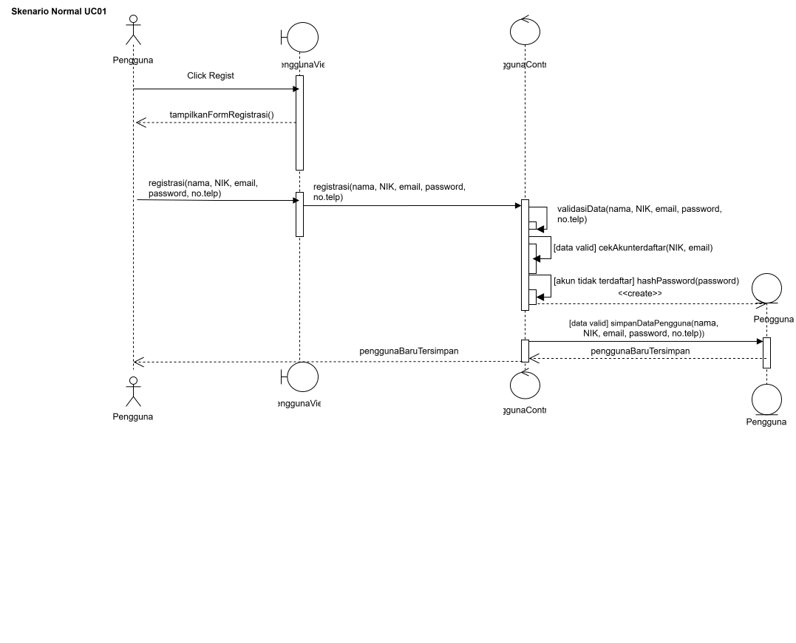
</p>
<p align="center">
<i>Gambar 1. Sequence Diagram UC01</i>
</p>

- **Skenario Alternatif 1 : Data Registrasi Tidak Lengkap **

<p align="center">
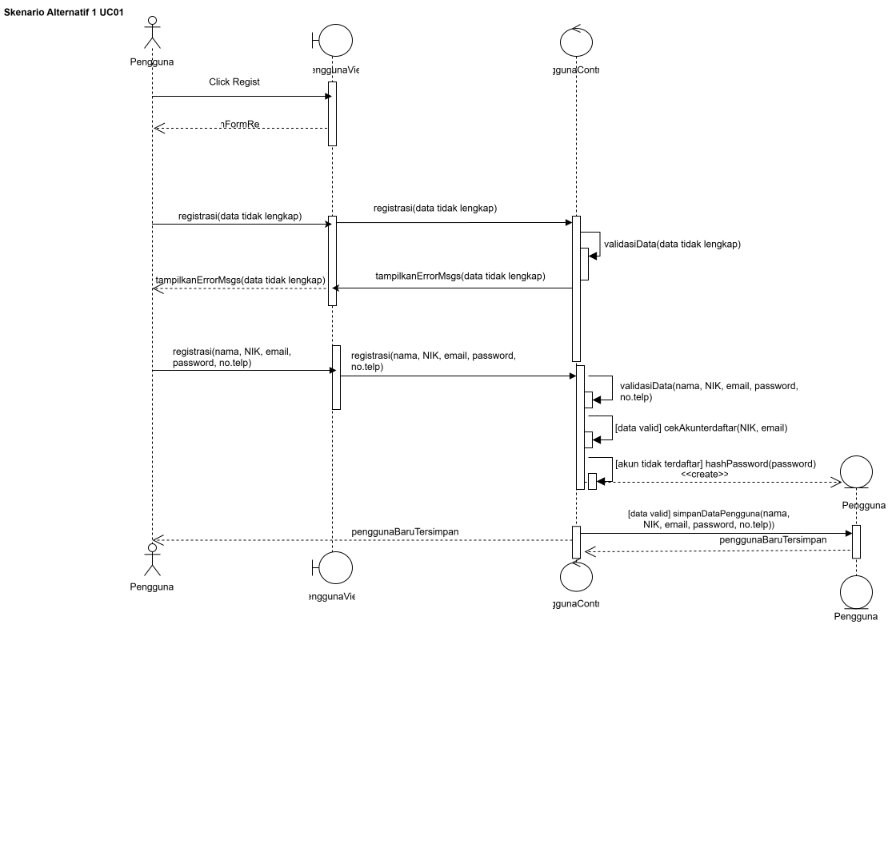
</p>
<p align="center">
<i>Gambar 2. Sequence Diagram [UC01] - Data Registrasi Tidak Lengkap</i>
</p>

- **Skenario Alternatif 2 : Format NIK Tidak Valid **

<p align="center">
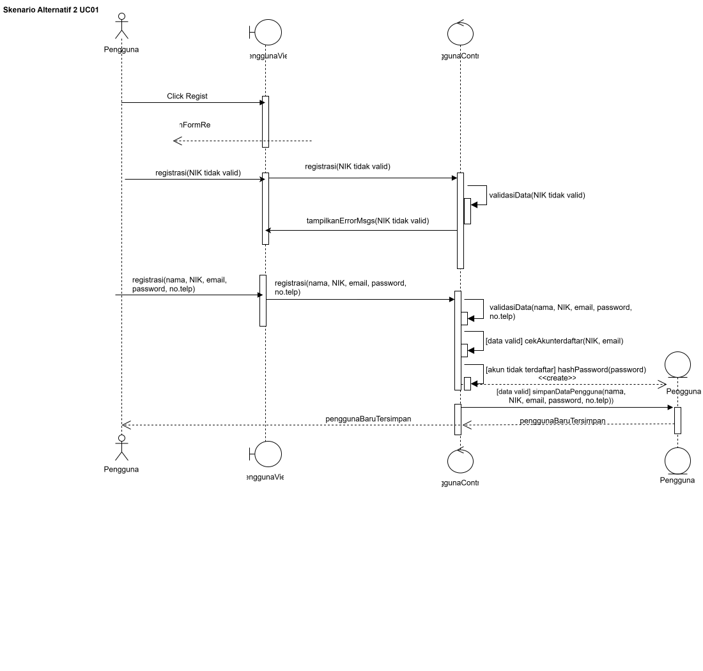
</p>
<p align="center">
<i>Gambar 3. Sequence Diagram [UC01] - Format NIK Tidak Valid</i>
</p>

- **Skenario Alternatif 3 : Format Password Tidak Valid **

<p align="center">
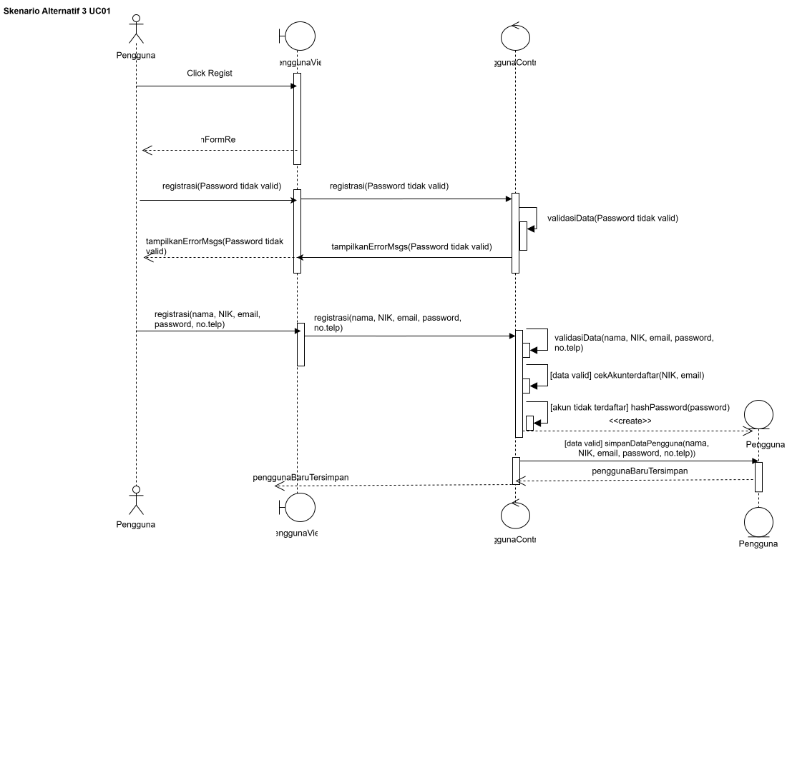
</p>
<p align="center">
<i>Gambar 4. Sequence Diagram [UC01] - Format Password Tidak Valid</i>
</p>


### 3.1.3 Diagram Kelas

<p align="center">

</p>
<p align="center">
<i>Gambar 5. Diagram Kelas Melakukan Registrasi</i>
</p>


## 3.2 Use Case Melakukan Proses Login

**ID Use Case:** *UC02*  
**Nama Use Case:** *Melakukan Proses Login*

### 3.1.1 Identifikasi Kelas

Tabel 3.1. Identifikasi Kelas Use Case [UC02]

| No | Nama Kelas Perancangan | Nama Kelas Analisis Terkait |
|:--- | :--- | :--- |
| 1 | *PenggunaView* | *PenggunaView* |
| 2 | *PenggunaController* | *PenggunaController* |
| 3 | *Pengguna* | *Pengguna* |

### 3.1.2 Sequence Diagram
 

- **Skenario Normal**

<p align="center">
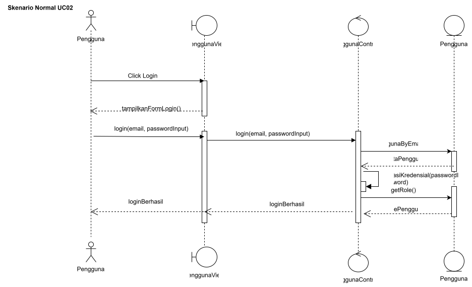
</p>
<p align="center">
<i>Gambar 1. Sequence Diagram UC02</i>
</p>

- **Skenario Alternatif 1 : Data Login Tidak Lengkap **

<p align="center">
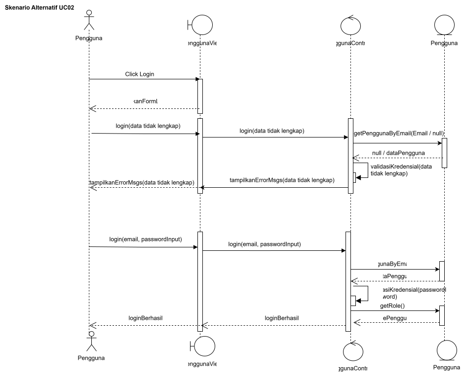
</p>
<p align="center">
<i>Gambar 2. Sequence Diagram UC02 - Data Login Tidak Lengkap</i>
</p>

- **Skenario Alternatif 2 : Email Belum Terdaftar**

<p align="center">
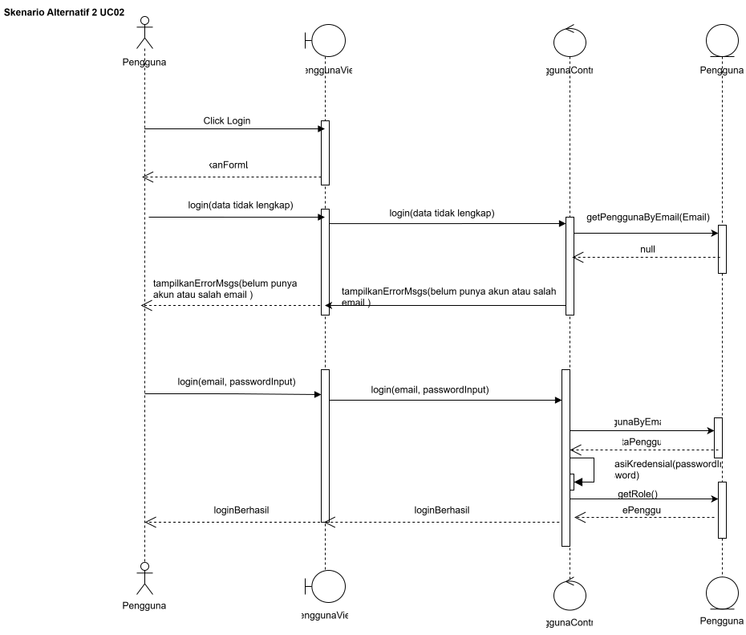
</p>
<p align="center">
<i>Gambar 3. Sequence Diagram UC02 - Email Belum Terdaftar</i>
</p>

- **Skenario Alternatif 3 : Password Tidak Sesuai **

<p align="center">
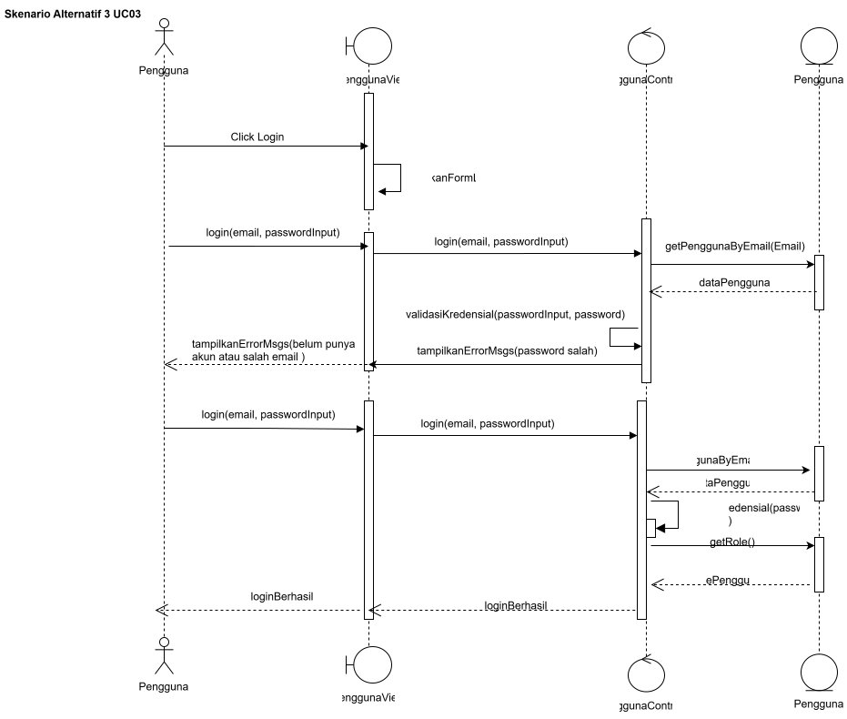
</p>
<p align="center">
<i>Gambar 4. Sequence Diagram UC02 - Password Tidak Sesuai</i>
</p>


## 3.3 Use Case Mengakses Peta Interaktif

**ID Use Case:** *UC03*  
**Nama Use Case:** *Mengakses Peta Interaktif*

### 3.3.1 Identifikasi Kelas

Tabel 3.1. Identifikasi Kelas Use Case [UC02]

| No | Nama Kelas Perancangan | Nama Kelas Analisis Terkait |
|:--- | :--- | :--- |
| 1 | *PenggunaView* | *PenggunaView* |
| 2 | *PenggunaController* | *PenggunaController* |
| 3 | *Pengguna* | *Pengguna* |
| 4 | *Lokasi* | *Lokasi* |
| 5 | *LokasiController* | *LokasiContorller* |
| 6 | *LokasiView* | *LokasiView* |
| 7 | *Laporan* | *Laporan* |
| 8 | *LaporanController* | *LaporanCotnroller* |
| 9 | *LaporanView* | *LaporanView* |
| 10 | *MapAPI* | *MapAPI* |
| 11 | *MapAPIService* | *MapAPIService*|
| 12 | *MapAPIView* | *MapAPIView*|

### 3.3.2 Sequence Diagram
 

- **Skenario Normal**

<p align="center">
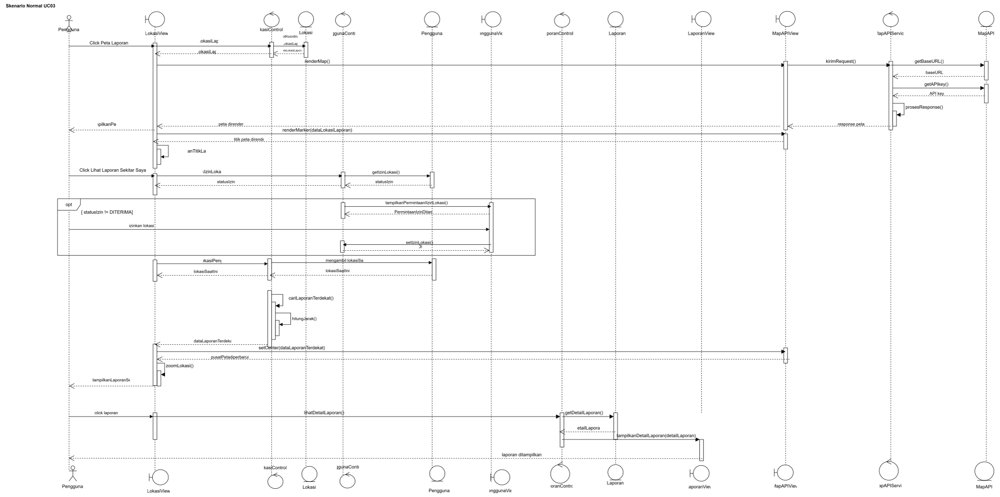
</p>
<p align="center">
<i>Gambar 1. Sequence Diagram UC03</i>
</p>

- **Skenario Alternatif 1 : Pengguna Belum Mengaktifkan Akses Lokasi di Perangkat **

<p align="center">
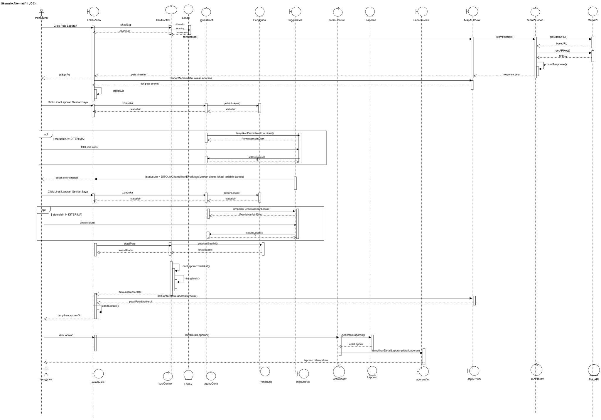
</p>
<p align="center">
<i>Gambar 2. Sequence Diagram UC03 - Pengguna Belum Mengaktifkan Akses Lokasi di Perangkat</i>
</p>

- **Skenario Alternatif 2 : API Peta Gagal Dimuat**

<p align="center">
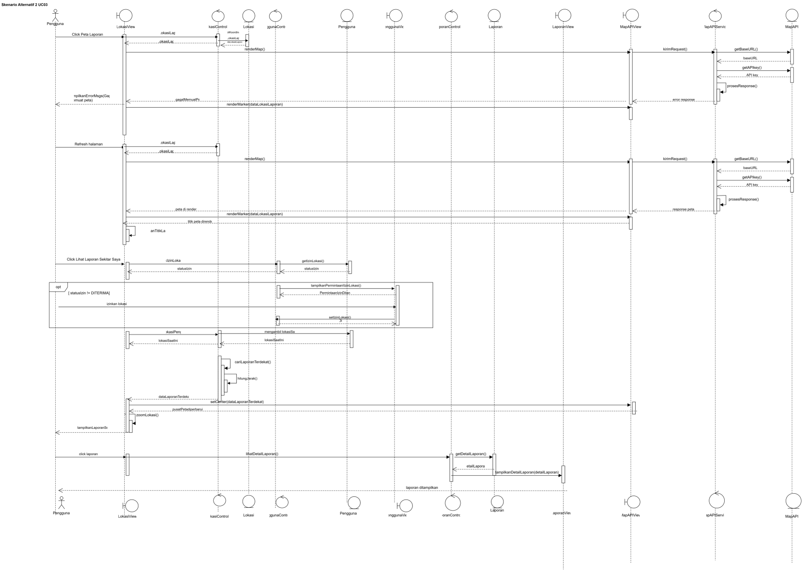
</p>
<p align="center">
<i>Gambar 3. Sequence Diagram UC03 - API Peta Gagal Dimuat</i>
</p>

- **Skenario Alternatif 3 : Tidak Terdapat Laporan di Sekitar Pengguna**

<p align="center">
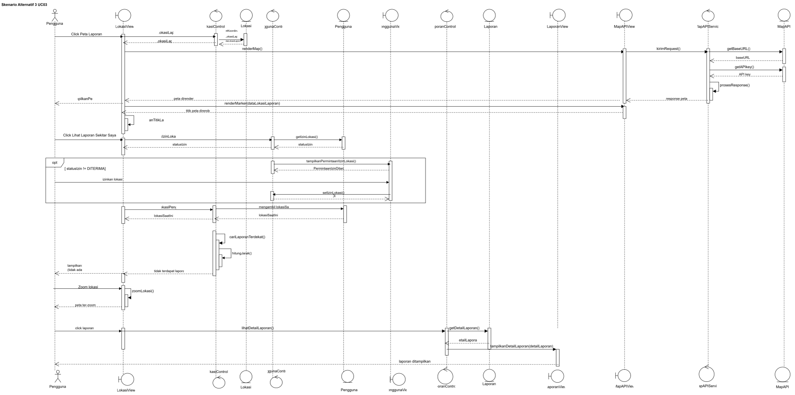
</p>
<p align="center">
<i>Gambar 4. Tidak Terdapat Laporan di Sekitar Pengguna</i>
</p>

### 3.3.3 Diagram Kelas

<p align="center">
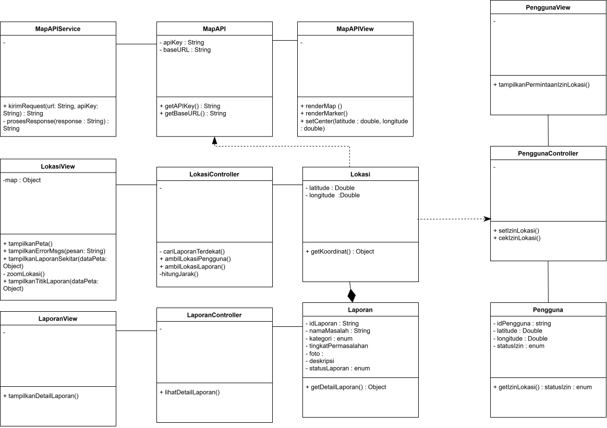
</p>
<p align="center">
<i>Gambar 5. Diagram Kelas Mengakses Peta Interaktif</i>
</p>


## 3.4 Use Case Melihat Laporan

**ID Use Case:** *UC04*  
**Nama Use Case:** *Melihat Laporan*

### 3.4.1 Identifikasi Kelas

Tabel 3.4 Identifikasi Kelas Use Case [UC04]
| No | Nama Kelas Perancangan | Nama Kelas Analisis Terkait |
|:--- | :--- | :--- |
| *1* | *HomepageView* | *HomepageView*  |
| *2* | *HomepageController* | *HomepageController* |
| *3* | *Homepage* | *Homepage* |
| *4* | *LokasiView* | *LokasiView* |
| *5* |*LokasiController* | *LokasiController* |
| *6* | *Lokasi* | *Lokasi* |
| *7* | *Laporan* | *Laporan* |
| *8* | *LaporanView* | *LaporanView* |
| *9* | *LaporanController* | *LaporanController* |
| *10* | *MapAPI* | *MapAPI* |
| *11* | *MapAPIService* | *-* | *MapAPIService* |
| *12* | *MapAPIView* | *-* | *MapAPIView* |
| ... | *...* | *...* |

### 3.4.2 Sequence Diagram

**Skenario Normal**
<p align="center">
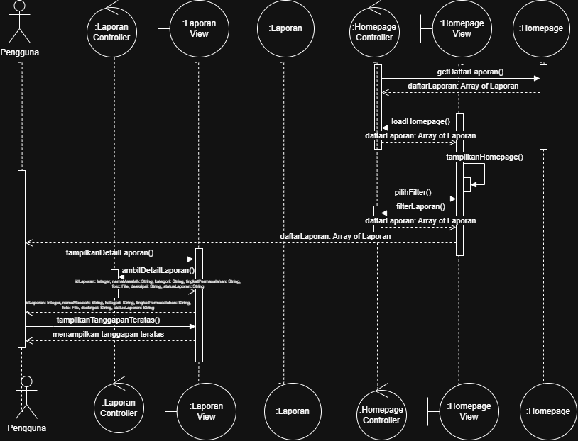
</p>
<p align="center">
<i>Gambar X. Sequence Diagram [UC04]</i>
</p>

**Skenario Alternatif 1: Detail laporan tidak lengkap**
<p align="center">
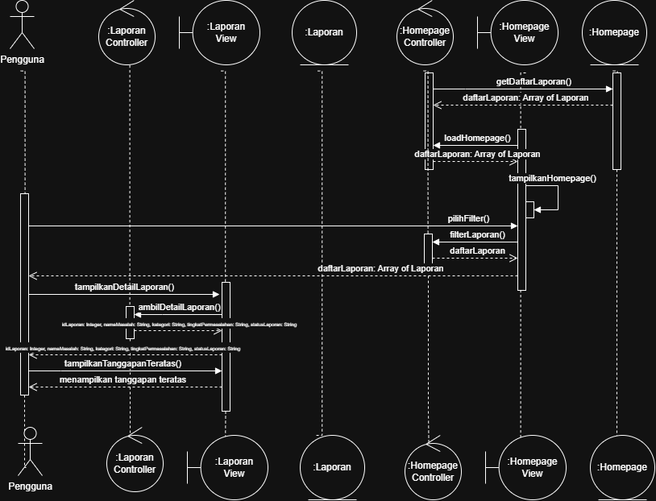
</p>
<p align="center">
<i>Gambar X. Sequence Diagram [UC04]</i>
</p>

**Skenario Alternatif 2: Laporan gagal dimuat**
<p align="center">
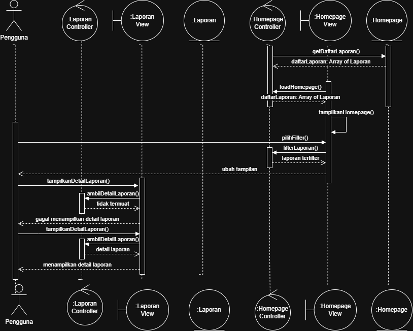
</p>
<p align="center">
<i>Gambar X. Sequence Diagram [UC04]</i>
</p>

### 3.4.3 Diagram Kelas
<p align="center">
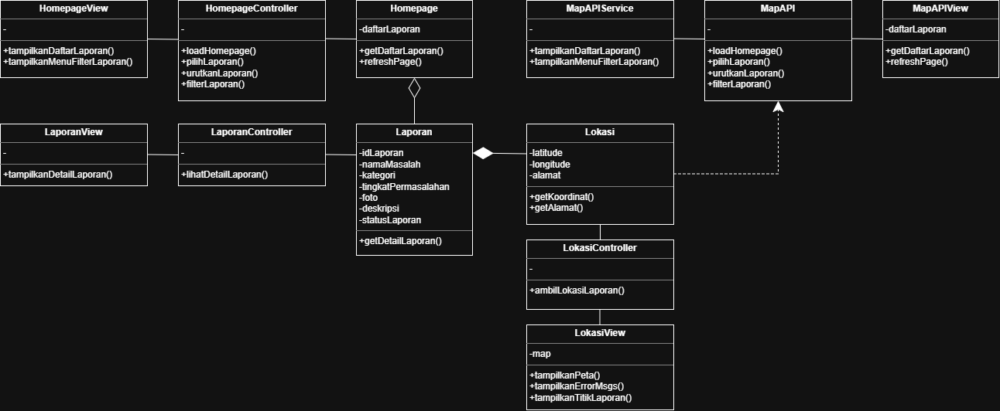
</p>
<p align="center">
<i>Gambar X. Class Diagram [UC04]</i>
</p>

## 3.5 Use Case Mendapat Tutorial Navigasi Antar Halaman

### 3.5.1 Identifikasi Kelas

| No | Nama Kelas Perancangan | Nama Kelas Analisis Terkait |
|:--- | :--- | :--- |
| *C09* | *HomepageView* | *HomepageView* |
| *C16* | *HomepageController* | *HomepageController* |
| *C01* | *Homepage* | *Homepage* |
| *C11* | *LokasiView* | *LokasiView* |
| *C18* |*LokasiController* | *LokasiController* |
| *C04* | *Lokasi* | *Lokasi* |
| *C03* | *Laporan* | *Laporan* |
| *C10* | *LaporanView* | *LaporanView* |
| *C17* | *LaporanController* | *LaporanController* |
| *C22* | *MapAPI* | *MapAPI* |
| *C23* | *MapAPIService* | *MapAPIService* |
| *C24* | *MapAPIView* | *MapAPIView* |
| ... | *...* | *...* |

### 3.5.2 Sequence Diagram

**Skenario Normal**
<p align="center">

</p>
<p align="center">
<i>Gambar X. Sequence Diagram [UC05]</i>
</p>

**Skenario Alternatif 1: Pengguna Memilih Skip Tutorial**
<p align="center">

</p>
<p align="center">
<i>Gambar X. Sequence Diagram [UC05]</i>
</p>

### 3.5.3 Diagram Kelas
<p align="center">

</p>
<p align="center">
<i>Gambar X. Class Diagram [UC05]</i>
</p>

<br>


## 3.6 Use Case Melakukan Upvote

### 3.6.1 Identifikasi Kelas

| No | Nama Kelas Perancangan | Nama Kelas Analisis Terkait |
|:--- | :--- | :--- |
| *1* | *Pengguna* | *Pengguna* |
| *2* | *Laporan* | *Laporan* |
| *3* | *Homepage* | *Homepage* |
| *4* | *Upvote* | *Upvote* |
| *5* |*UpvoteController* | *UpvoteController* |
| *6* | *LaporanController* | *LaporanController* |
| *7* | *LaporanView* | *LaporanView* |
| *8* | *PenggunaView* | *PenggunaView* |
| *9* | *PenggunaController* | *PenggunaController* |
| *10* | *UpvoteView* | *UpvoteView* |
| *11* | *HomepageView* | *HomepageView* |
| *12* | *HomepageController* | *HomepageController* |

### 3.6.2 Sequence Diagram

**Skenario Normal**
<p align="center">

</p>
<p align="center">
<i>Gambar X. Sequence Diagram [UC06]</i>
</p>

**Skenario Alternatif 1: Pengguna Gagal Melakukan Upvote**
<p align="center">

</p>
<p align="center">
<i>Gambar X. Sequence Diagram UC06</i>
</p>

### 3.6.3 Diagram Kelas
<p align="center">
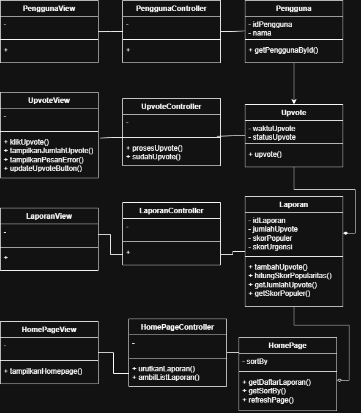
</p>
<p align="center">
<i>Gambar X. Class Diagram UC06</i>
</p>

<br>

## 3.7 Use Case Mengunggah Laporan Baru

**ID Use Case:** *UC07*  
**Nama Use Case:** *Mengunggah Laporan Baru*

### 3.7.1 Identifikasi Kelas


Tabel 3.7. Identifikasi Kelas Use Case [UC07]
| No | Nama Kelas Perancangan | Nama Kelas Analisis Terkait |
|:--- | :--- | :--- |
| 1 | *Pengguna* | *Pengguna* |
| 2 | *HomePage* | *HomePage* |
| 3 | *Laporan* | *Laporan* |
| 4 | *Lokasi* | *Lokasi* |
| 5 | *PenggunaView* | *PenggunaView* |
| 6 | *HomepageView* | *HomepageView* |
| 7 | *LaporanView* | *LaporanView* |
| 8 | *LokasiView* | *LokasiView* |
| 9 | *PenggunaController* | *PenggunaController* |
| 10 | *HomepageController* | *HomepageController* |
| 11 | *LaporanController* | *LaporanController* |
| 12 | *LokasiController* | *LokasiController* |


### 3.7.2 Sequence Diagram

- **Skenario Normal**

<p align="center">

</p>
<p align="center">
<i>Gambar Sequence Diagram [UC07]</i>
</p>

- **Skenario Alternatif 1: Data Wajib unutk Membuat Laporan Masih Belum Lengkap**

<p align="center">

</p>
<p align="center">
<i>Gambar Sequence Diagram [UC07] - Data Wajib unutk Membuat Laporan Masih Belum Lengkap</i>
</p>

- **Skenario Alternatif 2: Format File Foto yang Diunggah Tidak Sesuai**

<p align="center">

</p>
<p align="center">
<i>Gambar Sequence Diagram [UC07] - Format File Foto yang Diunggah Tidak Sesuai</i>
</p>

- **Skenario Alternatif 3: Pengguna Membatalkan Konfirmasi Pengiriman Laporan**

<p align="center">

</p>
<p align="center">
<i>Gambar Sequence Diagram [UC07] - Pengguna Membatalkan Konfirmasi Pengiriman Laporan</i>
</p>

### 3.7.3 Diagram Kelas

<p align="center">

</p>
<p align="center">
<i>Gambar Diagram Mengunggah Laporan Baru</i>
</p>

## 3.8 Use Case Memeriksa Laporan

**ID Use Case:** *UC08*  
**Nama Use Case:** *Memeriksa Laporan*

### 3.8.1 Identifikasi Kelas


Tabel 3.8. Identifikasi Kelas Use Case [UC08]

| No | Nama Kelas Perancangan | Nama Kelas Analisis Terkait |
|:--- | :--- | :--- |
| 1 | *Pengguna* | *Pengguna* |
| 2 | *HomePage* | *HomePage* |
| 3 | *Laporan* | *Laporan* |

| 4 | *PenggunaView* | *PenggunaView* |
| 5 | *HomepageView* | *HomepageView* |
| 6 | *LaporanView* | *LaporanView* |

| 7 | *PenggunaController* | *PenggunaController* |
| 8 | *HomepageController* | *HomepageController* |
| 9 | *LaporanController* | *LaporanController* |

### 3.8.2 Sequence Diagram

- **Skenario Normal**

<p align="center">

</p>
<p align="center">
<i>Gambar Sequence Diagram [UC08]</i>
</p>

- **Skenario Alternatif 1: Laporan Ternyata Tidak Valid dan Pengguna Mengirimkan Konfirmasi Ulang Sebelum Jangka Waktu 2 Minggu Berakhir**

<p align="center">

</p>
<p align="center">
<i>Gambar Sequence Diagram [UC08] - Laporan Ternyata Tidak Valid dan Pengguna Mengirimkan Konfirmasi Ulang Sebelum Jangka Waktu 2 Minggu Berakhir</i>
</p>

- **Skenario Alternatif 2: Laporan Ternyata Tidak Valid dan Pengguna Tidak Mengirimkan Konfirmasi Ulang Hingga Jangka Waktu 2 Minggu Berakhir**

<p align="center">

</p>
<p align="center">
<i>Gambar Sequence Diagram [UC08] - Laporan Ternyata Tidak Valid dan Pengguna Tidak Mengirimkan Konfirmasi Ulang Hingga Jangka Waktu 2 Minggu Berakhir</i>
</p>

### 3.8.3 Diagram Kelas

<p align="center">

</p>
<p align="center">
<i>Gambar Diagram Kelas Memeriksa Laporan</i>
</p>

## 3.9 Use Case Memperbarui Status Penanganan Laporan

**ID Use Case:** *UC09*  
**Nama Use Case:** *Memperbarui Status Penanganan Laporan*

### 3.9.1 Identifikasi Kelas

Tabel 3.9. Identifikasi Kelas Use Case UC09

| No | Nama Kelas Perancangan | Nama Kelas Analisis Terkait |
|:--- | :--- | :--- |
| 1 | *C01 - Pengguna* | *C01 - Pengguna (entity)* |
| 2 | *C02 - Homepage* | *C02 - Homepage (entity)* |
| 3 | *C03 - Laporan* | *C03 - Laporan (entity)* |
| 4 | *C06 - Tanggapan* | *C06 - Tanggapan (entity)* |
| 5 | *C08 - PenggunaView* | *C08 - PenggunaView (boundary)* |
| 6 | *C09 - HomepageView* | *C09 - HomepageView (boundary)* |
| 7 | *C10 - LaporanView* | *C10 - LaporanView (boundary)* |
| 8 | *C13 - TanggapanView* | *C13 - TanggapanView (boundary)* |
| 9 | *C15 - PenggunaController* | *C15 - PenggunaController (control)* |
| 10 | *C16 - HomepageController* | *C16 - HomepageController (control)* |
| 11 | *C17 - LaporanController* | *C17 - LaporanController (control)* |
| 12 | *C20 - TanggapanController* | *C20 - TanggapanController (control)* |

### 3.9.2 Sequence Diagram
 

- **Skenario Normal**

<p align="center">
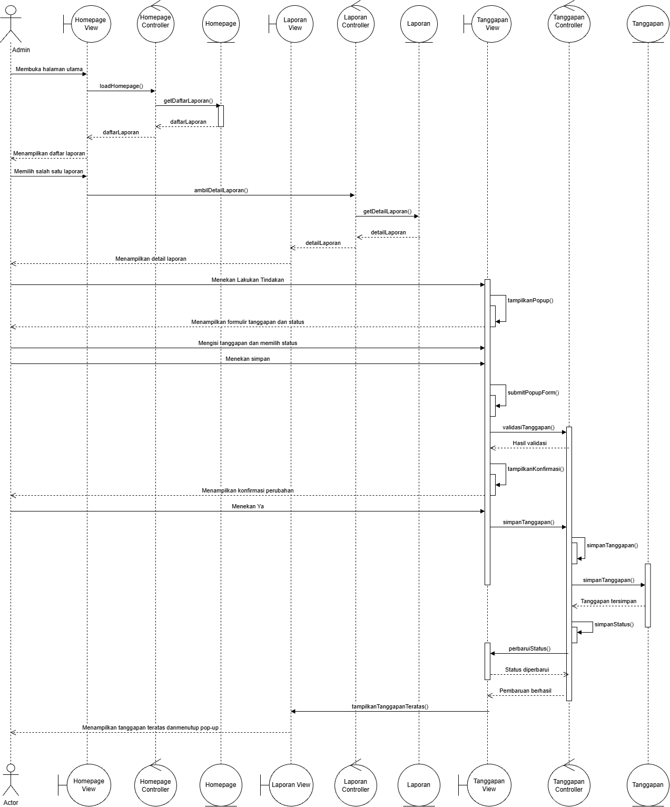
</p>
<p align="center">
<i>Gambar 1. Sequence Diagram UC09</i>
</p>

- **Skenario Alternatif 1 : Admin membatalkan konfirmasi perubahan status laporan**

<p align="center">

</p>
<p align="center">
<i>Gambar 2. Sequence Diagram UC09 - Admin membatalkan konfirmasi perubahan status laporan</i>
</p>


### 3.9.3 Diagram Kelas

<p align="center">
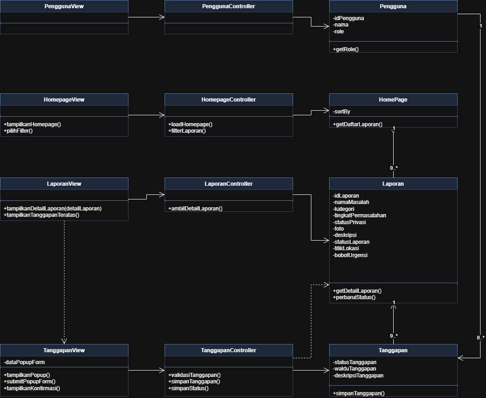
</p>
<p align="center">
<i>Gambar 5. Diagram Kelas Memperbarui Stauts Penangan Laporan</i>
</p>


## 3.10 Use Case Mengedit Profil

**ID Use Case:** *UC10*  
**Nama Use Case:** *Mengedit Profil*

### 3.10.1 Identifikasi Kelas

Tabel 3.9. Identifikasi Kelas Use Case UC09

| No | Nama Kelas Perancangan | Nama Kelas Analisis Terkait |
|:--- | :--- | :--- |
| 1 | *PenggunaView* | *PenggunaView* |
| 2 | *PenggunaController* | *PenggunaController* |
| 3 | *Pengguna* | *Pengguna* |


### 3.10.2 Sequence Diagram
 

- **Skenario Normal**

<p align="center">
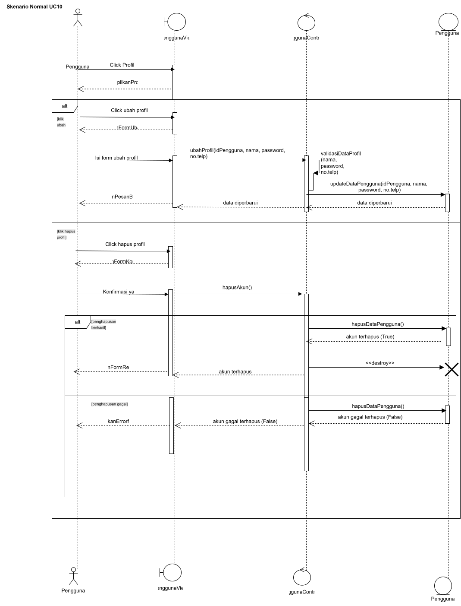
</p>
<p align="center">
<i>Gambar 1. Sequence Diagram UC10</i>
</p>

- **Skenario Alternatif 1 : Pengguna membatalkan penghapusan akun**

<p align="center">
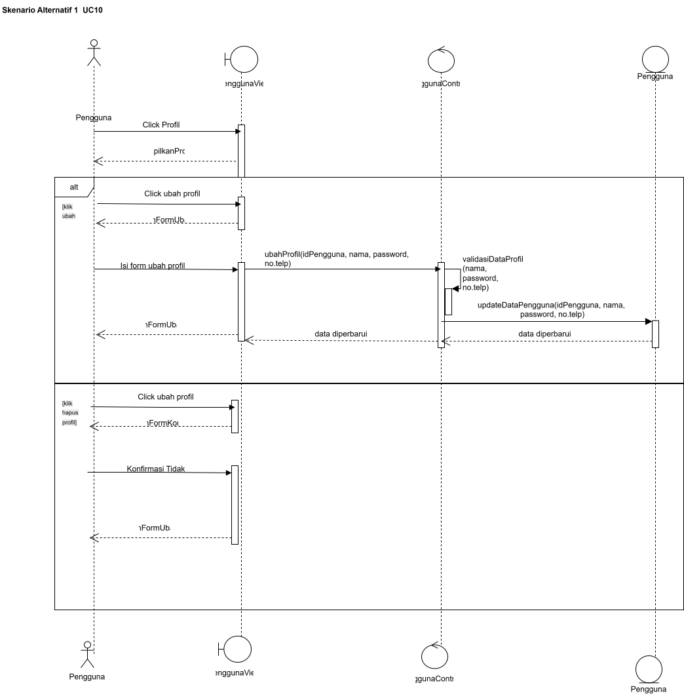
</p>
<p align="center">
<i>Gambar 2. Sequence Diagram UC10 - Pengguna membatalkan penghapusan akun </i>
</p>


### 3.10.3 Diagram Kelas

<p align="center">
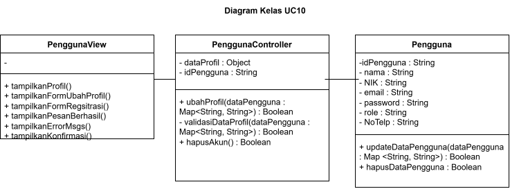
</p>
<p align="center">
<i>Gambar 5. Diagram Kelas Mengedit Laporan</i>
</p>
---

# BAB 4: Diagram Kelas Keseluruhan

## 4.1 Diagram Kelas

<!-- **Bagian ini diisi dengan diagram kelas keseluruhan.** -->

<p align="center">

</p>
<p align="center">
<i>Gambar 4.1 Diagram Kelas Perancangan Keseluruhan RAWAT</i>
</p>

Tabel 4.1 Daftar Kelas Perancangan Keseluruhan

| ID Kelas | Nama Kelas | Atribut | Metode/Operasi |
| :--- | :--- | :--- | :--- |
| *C01* | *Pengguna* | *-idPengguna, -nama, -role, -NIK, -email, -password, -NoTelp, -lokasiSaatIni, -izinLokasi, -statusTutorial* | *+getRole(), +simpanDataPengguna(), +getPenggunaByEmail(), +getPenggunaByNIK(), +getIzinLokasi(), +sudahLihatTutorial(), +getPenggunaById(), +hapusAkun(), +updateDataPengguna()* |
| *C02* | *HomePage* | *-sortBy, -daftarLaporan* | *+getDaftarLaporan(), +refreshPage(), +getSortBy()* |
| *C03* | *Laporan* | *-idLaporan, -namaMasalah, -kategori, -tingkatPermasalahan, -statusPrivasi, -foto, -deskripsi, -statusLaporan, -titikLokasi, -bobotUrgensi, -jumlahUpvote, -skorPopuler, -skorUrgensi* | *+getDetailLaporan(), +perbaruiStatus(), +updateStatusLaporan(), +hapusLaporan(), +simpanLaporan(), +tambahUpvote(), +hitungSkorPopularitas, +getJumlahUpvote(), +getSkorPopuler()* |
| *C04* | *Lokasi* | *-latitude, -longitude, -alamat* | *+getKoordinat(), +getAlamat()* |
| *C05* | *Upvote* | *-waktuUpvote, -statusUpvote* | *+upvote()* |
| *C06* | *Tanggapan* | *-statusTanggapan, -waktuTanggapan, -deskripsiTanggapan* | *+simpanTanggapan()* |
| *C07* | *Tutorial* | *-langkahSaatIni, -totalLangkah* | *+getLangkahSaatIni(), +getTotalLangkah()* |
| *C08* | *PenggunaView* | *-* | *+tampilkanFormRegistrasi(), +tampilkanErrorMsgs(), +tampilkanFormLogin(), +taampilkanPermintaanIzinLokasi(), +tampilkanOpsiTutorial(), +tampilkanFormKonfirmasi(), +tampilkanNotifAdmin(), +klikKonfirmasi()* |
| *C09* | *HomepageView* | *-* | *+tampilkanHomepage(), +pilihFilter(), +tampilkanDaftarLaporan(), +tampilkanMenuFilterLaporan()* |
| *C10* | *LaporanView* | *-dataForm* | *+tampilkanDetailLaporan(), +tampilkanTanggapanTeratas(), +tampilkanForm(), +tampilkanErrorMsg(), +tampilkanKonfirmasi(), +tampilkanPesanBerhasil(), +klikPost(), +klikYa(), +klikTidak()* |
| *C11* | *LokasiView* | *-map* | *+tampilkanMap(), +pilihTitikLokasi(), +tampilkanPeta(), +tampilkanErrorMsgs(), +tampilkanTitikLaporan()* |
| *C12* | *UpvoteView* | *-* | *+klikUpvote(), +tampilkanJumlahUpvote(), +tampilkanPesanError(), +updateUpvoteButton()* |
| *C13* | *TanggapanView* | *-dataPopupForm* | *+tampilkanPopup(), +submitPopupForm(), +tampilkanKonfirmasi()* |
| *C14* | *TutorialView* | *-* | *+tampilkanTutorial(), +tampilkanLangkah(), +tutupTutorial*|
| *C15* | *PenggunaController* | *-* | *+regitrasi, -hashPassword(), -cekAkunTerdaftar(), -validasiData(), +login(), -validasiKredensial(), +setIzinLokasi(), +cekIzinLokasi(), +cekStatusTutorial(), +sudahLogin(), +kirimKonfimasiUlang(), +ubahProfil(), -validasiDataProfil()* |
| *C16* | *HomepageController* | *-* | *+loadHomepage(), +pilihLaporan, +urutkanLaporan(), +filterLaporan(), +ambilListLaporan()* |
| *C17* | *LaporanController* | *-* | *+lihatDetailLaporan(), +ambilDetailLaporan(), +validasiKelengkapanData(), +validasiFoto(), +buatIdUnik(), +simpanLaporan(), +updateStatusLaporan, +kirimPermintaanKonfirmasi(), +setBatasWaktu2Minggu(), +cekBatasWaktu(), +hapusLaporanOtomatis()* |
| *C18* | *LokasiController* | *-* | *getDataLokasi(), cariLokasi(), +cariLaporanTerdekat(), -ambilLokasiPengguna(), -mintaIzinLokasi(), +ambilLokasiLaporan(), -hitungJarak()* |
| *C19* | *UpvoteController* | *-* | *+prosesUpvote(), +sudahUpvote()* |
| *C20* | *TanggapanController* | *-* | *+validasiTanggapan(), +simpanTanggapan(), +simpanStatus()* |
| *C21* | *TutorialController* | *-* | *+skipTutorial(), +nextTutorial(), +finishTutorial(), +startTutorial()* |
| *C22* | *MapAPI* | *-apiKey, -baseURL* | *+getAPIKey(), +getBaseURL()* |
| *C23* | *MapAPIService* | *-* | *+geocode(), -kirimRequest(), -prosesResponse()* |
| *C24* | *MapAPIView* | *-* | *+renderMap(), +renderMarker(), +setCenter()* |
| *...* | *...* | *...* | *...* |

<br> 
---

# BAB 5: Perancangan Rinci Kelas

Tabel 5.1. Daftar Kelas Perancangan dan Kelas Analisis Terkait

| No | Nama Kelas Perancangan | Nama Kelas Analisis Terkait |
| :--- | :--- | :--- |
| 1 | *Pengguna* | *Pengguna* |
| 2 | *PenggunaView* | *PenggunaView* |
| 3 | *PenggunaController* | *PenggunaController* |
| 4 | *Upvote* | *Upvote* |
| 5 | *UpvoteView* | *UpvoteView* |
| 6 | *UpvoteController* | *UpvoteController* |

## 5.1 Kelas Pengguna

**Nama Kelas:** *Pengguna*  
**ID Kelas:** *C01*

Tabel 5.1.1. Operasi Kelas Pengguna
| Nama Operasi | Visibility (private, public) | Keterangan |
| :--- | :--- | :--- |
| *simpanDataPengguna(nama:String, NIK:String, email:String, hashPassword:String, noTelp : String) : Boolean* | *Public* | *Menyimpan data pengguna baru ke database, mengembalikan True jika berhasil tersimpan dan False jika gagal tersimpan.* |
| *getPenggunaByEmail(email: String) : Pengguna* | *Public* | *Mencari pengguna berdasarkan email. Mengembalikan objek Pengguna.* |
| *getRole() : String* | *Public* | *Memberikan informasi _role_ dari pengguna* |
| *getIzinLokasi() : StatusIzin* | *Public* | *Memberikan informasi status izin lokasi (DITERIMA/DITOLAK/BELUM_DIMINTA)* |
| *getLokasiSaatIni() : Object* | *Public* | *Memberikan longitude dan latitude dari lokasi pengguna* |
| *hapusDataPengguna() : Boolean* | *Public* | *Menghapus data akun pengguna dari database dan mengembalikan status keberhasilan penghapusan.* |
| *updateDataPengguna(dataPengguna : Map<String, String>) : Boolean* | *Public* | *Menyimpan data akun pengguna terbaru ke database dan mengembalikan status keberhasilan penyimpanan.* |
| *sudahLihatTutorial() : Boolean* | *Public* | *Memberikan informasi status melihat tutorial, True jika sudah dan False jika belum.* |
| *getPenggunaById(idPengguna : String) : Pengguna* | *Public* | *Memberikan data Pengguna melalui ID Pengguna.* |


Tabel 5.1.2. Atribut Kelas Pengguna

| Nama Atribut | Visibility (private, public) | Tipe |
| :--- | :--- | :--- |
| *idPengguna* | *Private* | *String* |
| *nama* | *Private* | *String* |
| *NIK* | *Private* | *String* |
| *email* | *Private* | *String* |
| *hashPassword* | *Private* | *String* |
| *noTelp* | *Private* | *String* |
| *role* | *Private* | *String* |
| *statusIzin* | *Private* | *StatusIzin (enum)* |
| *statusTutorial* | *Private* | *Boolean* |
| *latitude* | *Private* | *Double* |
| *longitude* | *Private* | *Double* |


### 5.1.1 Algoritma/Query

**Nama Kelas:** *Pengguna*  
**Nama Operasi:** *simpanDataPengguna(nama : String, NIK : String, email : String, hashPassword : String, noTelp : String) : Boolean*  
**ID Algoritma:** *Algo-001*

```text
ALGORITMA simpanDataPengguna

INPUT: nama, NIK, email, hashPassword, noTelp
OUTPUT: Boolean

Jalankan query INSERT untuk menyimpan data pengguna. [Q-001]
IF penyimpanan berhasil THEN
   RETURN true
ELSE
   RETURN false
```
Tabel 5.1.1. Query Operasi simpanDataPengguna()

| No Query | Query | Keterangan |
| :--- | :--- | :--- |
| *Q-001* | *INSERT INTO pengguna (nama, nik, email, hash_password, no_telp) VALUES ($1, $2, $3, $4, $5);* | *Menyimpan data pengguna baru ke database* |

### 5.1.2 Algoritma/Query

**Nama Kelas:** *Pengguna*  
**Nama Operasi:** *getPenggunaByEmail(email: String) : Pengguna / getPenggunaById(idPengguna: String) : Pengguna*  
**ID Algoritma:** *Algo-002*
```text
ALGORITMA getPenggunaByEmail/getPenggunaById

INPUT: email/idPengguna
OUTPUT: Pengguna atau null

Cari data pengguna berdasarkan email (untuk getPenggunaByEmail) atau idPengguna (untuk getPenggunaById). [Q-002] / [Q-003]
IF pengguna ditemukan THEN
   Buat objek Pengguna dari hasil query.
   RETURN objek Pengguna
ELSE
   RETURN null
ENDIF

```
Tabel 5.1.2. Query Operasi getPenggunaByEmail() / getPenggunaByID()

| No Query | Query | Keterangan |
| :--- | :--- | :--- |
| *Q-002* | *SELECT * FROM pengguna WHERE email = $1;* | *Mencari pengguna berdasarkan email* |
| *Q-003* | *SELECT * FROM pengguna WHERE idPengguna = $1;* | *Mencari pengguna berdasarkan ID* |

### 5.1.3 Algoritma/Query

**Nama Kelas:** *Pengguna*  
**Nama Operasi:** *updateDatapengguna(dataPengguna : Map<String, String>) : Boolean*  
**ID Algoritma:** *Algo-003*
```text
ALGORITMA updateDataPengguna

INPUT: dataPengguna
OUTPUT: Boolean

Ambil idPengguna dari objek Pengguna saat ini.

IF dataPengguna memiliki atribut "nama" THEN
   Tambahkan nama ke daftar perubahan.

IF dataPengguna memiliki atribut "noTelp" THEN
   Tambahkan noTelp ke daftar perubahan.

IF dataPengguna memiliki atribut "hashPassword" THEN
   Tambahkan password ke daftar perubahan.
  
IF daftar perubahan kosong THEN
   RETURN false

Jalankan query UPDATE berdasarkan daftar perubahan
   dan idPengguna. [Q-004]

IF pembaruan berhasil THEN
   RETURN true
ELSE
   RETURN false

```
Tabel 5.1.3. Query Operasi updateDataPengguna
| No Query | Query | Keterangan |
| :--- | :--- | :--- |
| *Q-004* | *UPDATE pengguna SET nama = $1 WHERE id_pengguna = $2;* | *Contoh query jika hanya nama yang diperbarui* |

### 5.1.4 Algoritma/Query

**Nama Kelas:** *Pengguna*  
**Nama Operasi:** *hapusDataPengguna() : Boolean*  
**ID Algoritma:** *Algo-004*
``` text
ALGORITMA hapusDataPengguna

INPUT: Tidak ada
OUTPUT: Boolean

Ambil idPengguna dari objek Pengguna saat ini.
Jalankan query DELETE berdasarkan idPengguna. [Q-005]
IF satu record data pengguna berhasil dihapus THEN
   RETURN true
ELSE
   RETURN false
```
Tabel 5.1.4. Query Operasi hapusDataPengguna()
| No Query | Query | Keterangan |
| :--- | :--- | :--- |
| *Q-005* | *DELETE FROM pengguna WHERE id_pengguna = $1* | *Menghapus data akun pengguna berdasarkan ID* |

### 5.1.5 Algoritma/Query

**Nama Kelas:** *Pengguna*  
**Nama Operasi:** *GETTER: getRole/getIzinLokasi/getLokasiSaatIni/sudahLihatTutorial*  
**ID Algoritma:** *Algo-005*
``` text
ALGORITMA GETTER

INPUT: Tidak ada
OUTPUT: Atribut kelas

RETURN [Atribut]
```


## 5.2 Kelas Homepage

**Nama Kelas:** *Homepage*  
**ID Kelas:** *C02*

Tabel 5.2.1. Operasi Kelas Homepage

| Nama Operasi | Visibility (private, public) | Keterangan |
| :--- | :--- | :--- |
| *getDaftarLaporan() : daftarLaporan* | *Public* | *Mengambil daftar laporan untuk nantinya ditunjukkan ke pengguna, mengembalikan daftar laporan* |
| *refreshPage()* | *Public* | *Memuat ulang homepage sesuai permintaan pengguna, berupa prosedur yang akan melakukan ulang langkah-langkah serupa seperti ketika membuka Homepage* |
| *getSortBy(daftarLaporan: array [...] of laporan, sortBy: string) : daftarLaporan* | *Public* | *Mengurutkan laporan berdasarkan permintaan pengguna (popularitas, waktu, lokasi)* |
<!-- | *[Signature operasi, termasuk parameter dan tipe kembalian]* | *[Visibility]* | *[Tanggung jawab operasi]* | -->

Tabel 5.2.2. Atribut Kelas Homepage

| Nama Atribut | Visibility (private, public) | Tipe |
| :--- | :--- | :--- |
| *sortBy* | *Private* | *string* |
| *daftarLaporan* | *Private* | *array [...] of laporan* |
| *sortType* | *Private* | *SortType (enum)* |
| *filterBy* | *Private* | *string* |
| *...* | *...* | *...* |
<!-- | *[Nama atribut]* | *[Visibility]* | *[Tipe sesuai bahasa pemrograman yang digunakan]* | -->

### 5.2.1 Algoritma/Query

**Nama Kelas:** *Homepage*  
**Nama Operasi:** *getDaftarLaporan()*  
**ID Algoritma:** *Algo-005*

```text
ALGORITMA getDaftarLaporan

INPUT: Tidak ada
OUTPUT: daftarLaporan atau null

1. Jalankan query SELECT untuk mengambil seluruh data laporan [Q-005]
2. IF ada 1 atau lebih laporan THEN
        RETURN daftarLaporan
   ELSE
        RETURN null
   ENDIF
```

Tabel 5.2.1. Query Operasi getDaftarLaporan()

| No Query | Query | Keterangan |
| :--- | :--- | :--- |
| *Q-005* | *SELECT * FROM daftarLaporan* | *Mengambil seluruh laporan yang ada* |
| *...* | *...* | *...* |

### 5.2.2 Algoritma/Query

<!-- *[Ulangi pola 5.1.1 untuk operasi penting berikutnya pada kelas yang sama, jika ada.]* -->

**Nama Kelas:** *Homepage*
**Nama Operasi:** getSortBy(daftarLaporan, sortBy)
**ID Algoritma:** *Algo-006*

```text
ALGORITMA getSortBy

INPUT: daftarLaporan, sortBy
OUTPUT: daftarLaporan atau null

1. Ambil daftar laporan yang terdapat di homepage
2. Jalankan query SELECT dan ORDER BY untuk mengurutkan laporan [Q-006]
3. RETURN daftarLaporan
```
Tabel 5.2.1. Query Operasi getDaftarLaporan()

| No Query | Query | Keterangan |
| :--- | :--- | :--- |
| *Q-006* | *SELECT * FROM laporan ORDER BY waktuLapor ASC* | *Contoh query jika ingin mengurutkan daftar laporan menaik berdasarkan waktuLapor* |
| *...* | *...* | *...* |


## 5.3 Kelas Laporan

**Nama Kelas:** *Laporan*  
**ID Kelas:** *C03*

Tabel 5.3.1. Operasi Kelas Laporan

| Nama Operasi | Visibility (private, public) | Keterangan |
| :--- | :--- | :--- |
| *getDetailLaporan(idLaporan: String) : laporan* | *Public* | *Memberikan detail laporan berdasarkan lapo_ran yang diberikan* |
| *updateStatusLaporan(idLaporan: String, statusLaporan: StatusLaporan) : Boolean* | *Public* | *Memperbarui status laporan (BELUM_DILIHAT/DILIHAT/DIPERBAIKI/SELESAI), True jika berhasil, False jika gagal* |
| *hapusLaporan(idLaporan: String) : Boolean* | *Public* | *Menghapus laporan berdasarkan idLaporan, True jika berhasil, False jika gagal* |
| *simpanLaporan(namaMasalah: string, kategori: string, tingkatPermasalahan: TingkatPermasalahan, statusPrivasi: StatusPrivasi, foto: File, deskripsi: string, titikLokasi: Koordinat) : Boolean* | *Public* | *Menyimpan data laporan baru ke database, mengembalikan True jika berhasil tersimpan dan False jika tidak* |
| *tambahUpvote(idLaporan: String) : Boolean* | *Public* | *Menambahkan upvote yang berada dalam sebuah laporan, True jika berhasil menambahkan, False jika gagal* |
| *hitungSkorPopularitas(idLaporan: String) : Real* | *Public* | *Menghitung skor popularitas sebuah laporan, mengembalikan skor tersebut (bilangan real)* |
| *getJumlahUpvote(idLaporan: String) : Integer* | *Public* | *Memberikan jumlah upvote sebuah laporan, berupa integer* |
| *getSkorPopuler(idLaporan: String) : Real* | *Public* | *Memberikan skor popularitas sebuah laporan* |
||||

Tabel 5.3.2. Atribut Kelas Laporan

| Nama Atribut | Visibility (private, public) | Tipe |
| :--- | :--- | :--- |
| *laporan* | *Private* | *Laporan: <idLaporan: String, namaMasalah: String, kategori: String, tingkatPermasalahan: TingkatPermasalahan (enum), statusPrivasi: StatusPrivasi (enum), foto: File, deskripsi: String, statusLaporan: StatusLaporan (enum), titikLokasi: Koordinat, bobotUrgensi: Real, jumlahUpvote: Integer, skorPopuler: Real, skorUrgensi: Real>* |
| *idLaporan* | *Private* | *String* |
| *namaMasalah* | *Private* | *String* |
| *kategori* | *Private* | *String* |
| *tingkatPermasalahan* | *Private* | *TingkatPermasalahan (enum)* |
| *statusPrivasi* | *Private* | *StatusPrivasi (enum)* |
| *foto* | *Private* | *File* |
| *deskripsi* | *Private* | *String* |
| *statusLaporan* | *Private* | *StatusLaporan (enum)* |
| *titikLokasi* | *Private* | *Koordinat: <latitude : Real, longitude : Real>* |
| *bobotUrgensi* | *Private* | *Real* |
| *jumlahUpvote* | *Private* | *Integer* |
| *skorPopuler* | *Private* | *Real* |
| *skorUrgensi* | *Private* | *Real* |
| *batasWaktu* | *Private* | *Timestamp* |
||||
<!-- | *[Nama atribut]* | *[Visibility]* | *[Tipe sesuai bahasa pemrograman yang digunakan]* | -->

### 5.3.1 Algoritma/Query

**Nama Kelas:** *Laporan*  
**Nama Operasi:** *getDetailLaporan(idLaporan: String) : laporan*  
**ID Algoritma:** *Algo-007*

```text
ALGORITMA getDetailLaporan

INPUT: idLaporan
OUTPUT: laporan

1. Jalankan query SELECT untuk mengambil detail laporan berdasarkan ID [Q-007]
2. IF laporan ditemukan THEN
        RETURN laporan
   ELSE
        RETURN null
   ENDIF
```

Tabel 5.3.3. Query Operasi getDetailLaporan()

| No Query | Query | Keterangan |
| :--- | :--- | :--- |
| *Q-007* | *SELECT * FROM daftarLaporan WHERE idLaporan = $1* | *Mencari laporan berdasarkan idLaporan* |
||||

### 5.3.2 Algoritma/Query
**Nama Kelas:** *Laporan*  
**Nama Operasi:** *updateStatusLaporan(idLaporan: String, statusLaporan: StatusLaporan) : Boolean*  
**ID Algoritma:** *Algo-008*

```text
ALGORITMA updateStatusLaporan

INPUT: idLaporan, statusLaporan
OUTPUT: Boolean

1. Jalankan query UPDATE berdasarkan statusLaporan dan idLaporan [Q-008]
2. IF perubahan berhasil THEN
        RETURN true
   ELSE
        RETURN false
   ENDIF
```

Tabel 5.3.4. Query Operasi updateStatusLaporan()

| No Query | Query | Keterangan |
| :--- | :--- | :--- |
| *Q-008* | *UPDATE laporan SET statusLaporan = $1 WHERE idLaporan = $2* | *Memperbarui statusLaporan* |
||||

### 5.3.3 Algoritma/Query
**Nama Kelas:** *Laporan*  
**Nama Operasi:** *hapusLaporan(idLaporan: String) : Boolean*  
**ID Algoritma:** *Algo-009*

```text
ALGORITMA hapusLaporan

INPUT: idLaporan
OUTPUT: Boolean

1. Jalankan query DELETE berdasarkan idLaporan [Q-009]
2. IF satu record laporan berhasil dihapus THEN
        RETURN true
   ELSE
        RETURN false
   ENDIF
```

Tabel 5.3.5. Query Operasi hapusLaporan()

| No Query | Query | Keterangan |
| :--- | :--- | :--- |
| *Q-009* | *DELETE FROM laporan WHERE idLaporan = $1* | *Menghapus data laporan berdasarkan ID* |
||||

### 5.3.4 Algoritma/Query
**Nama Kelas:** *Laporan*  
**Nama Operasi:** *simpanLaporan(namaMasalah: string, kategori: string, tingkatPermasalahan: TingkatPermasalahan, statusPrivasi: StatusPrivasi, foto: File, deskripsi: string, titikLokasi: Koordinat) : Boolean*  
**ID Algoritma:** *Algo-010*

```text
ALGORITMA simpanLaporan

INPUT: namaMasalah, kategori, tingkatPermasalahan, statusPrivasi, foto, deskripsi, titikLokasi
OUTPUT: Boolean

1. IF namaMasalah = null THEN
     RETURN false
   ENDIF

2. IF kategori = null THEN
     RETURN false
   ENDIF

3. IF tingkatPermasalahan = null THEN
     RETURN false
   ENDIF

4. IF statusPrivasi = null THEN
     RETURN false
   ENDIF

5. IF foto != null THEN
     Tambahkan foto ke daftar pembaruan list laporan
   ENDIF

6. IF deskripsi != null THEN
     Tambahkan deskripsi ke daftar pembaruan list laporan
   ENDIF

7. IF titikLokasi = null THEN
     RETURN false
   ENDIF

8. Jalankan query INSERT untuk menyimpan data pengguna [Q-010]

9. IF penyimpanan berhasil THEN
     RETURN true
   ELSE
     RETURN false
   ENDIF
```

Tabel 5.3.6. Query Operasi simpanLaporan()

| No Query | Query | Keterangan |
| :--- | :--- | :--- |
| *Q-010* | *INSERT INTO laporan (namaMasalah, kategori, tingkatPermasalahan, statusPrivasi, titikLokasi) VALUES ($1, $2, $3, $4, $5)* | *Menyimpan data laporan baru ke database* |
||||

### 5.3.5 Algoritma/Query
**Nama Kelas:** *Laporan*  
**Nama Operasi:** *tambahUpvote(idLaporan: String) : Boolean*  
**ID Algoritma:** *Algo-011*

```text
ALGORITMA simpanLaporan

INPUT: idLaporan
OUTPUT: Boolean

1. Jalankan query UPDATE untuk menambahkan upvote [Q-011]
2. IF penambahan berhasil THEN
     RETURN true
   ELSE
     RETURN false
   ENDIF

```

Tabel 5.3.7. Query Operasi tambahUpvote()

| No Query | Query | Keterangan |
| :--- | :--- | :--- |
| *Q-011* | *UPDATE laporan SET jumlah_upvote = jumlah_upvote + 1 WHERE idLaporan = $1* | *Menambahkan jumlahUpvote sebuah laporan* |
||||

### 5.3.6 Algoritma/Query
**Nama Kelas:** *Laporan*  
**Nama Operasi:** *getJumlahUpvote(idLaporan: String) : Integer*  
**ID Algoritma:** *Algo-012*

```text
ALGORITMA getJumlahUpvote

INPUT: idLaporan
OUTPUT: Integer

1. Jalankan query SELECT untuk mendapatkan jumlah upvote [Q-012]
2. IF pengambilan berhasil THEN
     RETURN jumlahUpvote
   ELSE
     RETURN null
   ENDIF

```

Tabel 5.3.8. Query Operasi getJumlahUpvote()

| No Query | Query | Keterangan |
| :--- | :--- | :--- |
| *Q-012* | *SELECT jumlah_upvote FROM laporan WHERE id_laporan = $1* | *Mengambil jumlahUpvote sebuah laporan* |
||||

### 5.3.7 Algoritma/Query
**Nama Kelas:** *Laporan*  
**Nama Operasi:** *getSkorPopuler(idLaporan: String) : Real*  
**ID Algoritma:** *Algo-013*

```text
ALGORITMA getSkorPopuler

INPUT: idLaporan
OUTPUT: Real

1. Jalankan query SELECT untuk mendapatkan skor populer [Q-013]
2. IF pengambilan berhasil THEN
     RETURN skorPopuler
   ELSE
     RETURN null
   ENDIF

```

Tabel 5.3.9. Query Operasi getSkorPopuler()

| No Query | Query | Keterangan |
| :--- | :--- | :--- |
| *Q-013* | *SELECT skor_populer FROM laporan WHERE id_laporan = $1* | *Mengambil skorPopuler sebuah laporan* |
||||

### 5.3.8 Algoritma/Query
**Nama Kelas:** *Laporan*
**Nama Operasi:** *hitungSkorPopularitas(idLaporan: String) : Real*
**ID Algoritma:** *Algo-014*

```text
ALGORITMA hitungSkorPopularitas

INPUT: idLaporan
OUTPUT: Real

1. Jalankan getSkorPopuler(idLaporan)
2. Jalankan operasi untuk menghitung skor populer
3. Kembalikan skor populer
```

Tabel 5.3.9. Query Operasi hitungSkorPopularitas()

| No Query | Query | Keterangan |
| :--- | :--- | :--- |
| *-* | *-* | *-* |
||||

## 5.4 Kelas Lokasi

**Nama Kelas:** *Lokasi*  
**ID Kelas:** *C04*

Tabel 5.4.1. Operasi Kelas Lokasi
| Nama Operasi | Visibility (private, public) | Keterangan |
| :--- | :--- | :--- |
| *getKoordinat() : Real, Real* | *Public* | *Memberikan koordinat (longitude dan latitude) laporan*|
| *getAlamat() : String*| *Public* | *Mengambil alamat dalam bentuk teks dari objek lokasi*|

Tabel 5.4.2. Atribut Kelas Lokasi

| Nama Atribut | Visibility (private, public) | Tipe |
| :--- | :--- | :--- |
| *Latitude* | *Private* | *Real* |
| *Longitude* | *Private* | *Real* |
| *Alamat* | *Private* | *String* |

### 5.4.1. Algoritma/Query
**Nama Kelas:** *Lokasi*  
**Nama Operasi:** *getKoordinat()*  
**ID Algoritma:** *Algo-013*

```text
ALGORITMA getKoordinat

INPUT: Tidak ada
OUTPUT: latitude: Real, longtiude: Real

Ambil atribut latitude dan longitude dari objek Lokasi saat ini.
RETURN {latitude, longitude}
```

## 5.5 Kelas Upvote

**Nama Kelas:** *Upvote*  
**ID Kelas:** *C05*

Tabel 5.5.1. Operasi Kelas Upvote
| Nama Operasi | Visibility (private, public) | Keterangan |
| :--- | :--- | :--- |
| *upvote(idPengguna:String, idLaporan:String) : Boolean* | *Public* | *Menyimpan data upvote yang dilakukan oleh pengguna pada suatu laporan.* |


Tabel 5.5.2. Atribut Kelas Upvote

| Nama Atribut | Visibility (private, public) | Tipe |
| :--- | :--- | :--- |
| *waktuUpvote* | *Private* | *Timestamp* |
| *statusUpvote* | *Private* | *Boolean* |


### 5.5.1 Algoritma/Query

**Nama Kelas:** *Upvote*  
**Nama Operasi:** *simpanDataPengguna(nama : String, NIK : String, email : String, hashPassword : String, noTelp : String) : Boolean*  
**ID Algoritma:** *Algo-00?*

```text
ALGORITMA upvote

INPUT: idPengguna, idLaporan
OUTPUT: Boolean

1. Ambil waktu saat upvote dilakukan.
2. Tetapkan statusUpvote menjadi true.
3. Jalankan query INSERT untuk menyimpan data upvote. [Q-XXX]
4. IF penyimpanan berhasil THEN
      RETURN true
   ELSE
      RETURN false
   ENDIF
```
Tabel 5.5.3. Query Operasi upvote()

| No Query | Query | Keterangan |
| :--- | :--- | :--- |
| *Q-00?* | *INSERT INTO upvote (id_pengguna, id_laporan, waktu_upvote, status_upvote) VALUES ($1, $2, CURRENT_TIMESTAMP, TRUE);* | *Menyimpan data upvote pengguna pada laporan* |

$1 diisi dengan idPengguna, sedangkan $2 diisi dengan idLaporan.


## 5.6 Kelas Tanggapan

**Nama Kelas:** *Tanggapan*  
**ID Kelas:** *C06*

Tabel 5.6.1. Operasi Kelas Tanggapan
| Nama Operasi | Visibility (private, public) | Keterangan |
| :--- | :--- | :--- |
| *simpanTanggapan(idLaporan:String, dataPopupForm:FormTanggapan): Boolean* | *Public* | *Menyimpan data tanggapan admin atas suatu laporan.* |


Tabel 5.6.2. Atribut Kelas Tanggapan

| Nama Atribut | Visibility (private, public) | Tipe |
| :--- | :--- | :--- |
| *statusTanggapan* | *Private* | *Boolean* |
| *waktuTanggapan* | *Private* | *Timestamp* |
| *deskripsiTanggapan* | *Private* | *String* |


### 5.6.1 Algoritma/Query

**Nama Kelas:** *Tanggapan*  
**Nama Operasi:** *simpanTanggapan(idLaporan:String, dataPopupForm:FormTanggapan): Boolean*  
**ID Algoritma:** *Algo-00?*

```text
ALGORITMA simpanTanggapan

INPUT: idLaporan, dataPopupForm
OUTPUT: Boolean

1. Ambil statusTanggapan dan deskripsiTanggapan dari dataPopupForm.
2. Jalankan query INSERT untuk menyimpan tanggapan. [Q-XXX]
3. IF penyimpanan berhasil THEN
      RETURN true
   ELSE
      RETURN false
   ENDIF
```
Tabel 5.6.3. Query Operasi simpanTanggapan()

| No Query | Query | Keterangan |
| :--- | :--- | :--- |
| *Q-00?* | *INSERT INTO tanggapan (id_laporan, status_tanggapan, waktu_tanggapan, deskripsi_tanggapan) VALUES ($1, $2, CURRENT_TIMESTAMP, $3);* | *Menyimpan hasil pemeriksaan validitas laporan, waktu tanggapan, dan deskripsi alasan jika laporan dinyatakan tidak valid.* |

$1 = idLaporan
$2 = statusTanggapan
$3 = deskripsiTanggapan


## 5.7 Kelas Tutorial

**Nama Kelas:** *Tutorial*  
**ID Kelas:** *C07*

Tabel 5.7.1. Operasi Kelas Tutorial
| Nama Operasi | Visibility (private, public) | Keterangan |
| :--- | :--- | :--- |
| *getLangkahSaatIni(): Integer* | *Public* | *Mengembalikan nomor langkah tutorial yang sedang ditampilkan.* |
| *getTotalLangkah(): Integer* | *Public* | *Mengembalikan jumlah seluruh langkah tutorial.* |


Tabel 5.7.2. Atribut Kelas Tutorial

| Nama Atribut | Visibility (private, public) | Tipe |
| :--- | :--- | :--- |
| *langkahSaatIni* | *Private* | *Integer* |
| *totalLangkah* | *Private* | *Integer* |


### 5.7.1 Algoritma/Query

**Nama Kelas:** *Tutorial*  
**Nama Operasi:** *getLangkahSaatIni(): Integer*  
**ID Algoritma:** *Algo-00?*

```text
ALGORITMA getLangkahSaatIni

INPUT: -
OUTPUT: Integer

1. Ambil nilai atribut langkahSaatIni.
2. Kembalikan nilai langkahSaatIni.
```

### 5.7.2 Algoritma/Query

**Nama Kelas:** *Tutorial*  
**Nama Operasi:** *getTotalLangkah(): Integer*  
**ID Algoritma:** *Algo-00?*

```text
ALGORITMA getTotalLangkah

INPUT: -
OUTPUT: Integer

1. Ambil nilai atribut totalLangkah.
2. Kembalikan nilai totalLangkah.
```

## 5.8 Kelas PenggunaView

**Nama Kelas:** *PenggunaView*  
**ID Kelas:** *C08*

Tabel 5.8.1. Operasi Kelas PenggunaView
| Nama Operasi | Visibility (private, public) | Keterangan |
| :--- | :--- | :--- |
| *tampilkanFormRegistrasi()* | *Public* | *Menampilkan formulir registrasi kepada pengguna.* |
| *tampilkanErrorMsgs(pesan : String)* | *Public* | *Menampilkan pesan kesalahan kepada pengguna.* |
| *tampilkanFormLogin()* | *Public* | *Menampilkan formulir login kepada pengguna.* |
| *tampilkanPermintaanIzinLokasi()* | *Public* | *Menampilkan permintaan izin akses lokasi.* |
| *tampilkanProfil()* | *Public* | *Menampilkan profil pengguna.* |
| *tampilkanFormUbahProfil()* | *Public* | *Menampilkan formulir untuk mengedit profil.* |
| *tampilkanPesanBerhasil(pesan : String)* | *Public* | *Menampilkan pesan berhasil atas aksi yang dilakukan pengguna.* |
| *tampilkanFormKonfirmasi(pesan : String)* | *Public* | *Menampilkan pertanyaan konfirmasi untuk aksii yang dilakukan pengguna.* |
| *tampilkanNotifAdmin(pesan : String)* | *Public* | *Menampilkan notifikasi terhadap perbaruan laporan kepada admin.* |
| *tampilkanOpsiTutorial()* | *Public* | *Menampilkan opsi tutorial.* |


Tabel 5.8.2. Atribut Kelas PenggunaView

| Nama Atribut | Visibility (private, public) | Tipe |
| :--- | :--- | :--- |
| *-* | *-* | *-* |

## 5.9 Kelas HomepageView

**Nama Kelas:** *HomepageView*  
**ID Kelas:** *C09*

Tabel 5.9.1. Operasi Kelas HomepageView

| Nama Operasi | Visibility (private, public) | Keterangan |
| :--- | :--- | :--- |
| *tampilkanHomepage()* | *Public* | *Menampilkan homepage untuk pengguna, berupa prosedur tanpa parameter masukan* |
| *pilihFilter()* | *Public* | *Memilih filter dari pengguna |
| *tampilkanDaftarLaporan()* | *Public* | *Menampilkan daftar laporan untuk pengguna, berupa prosedur tanpa parameter masukan* |
| *tampilkanMenuFilterLaporan()* | *Public* | *Memilih filter dari pengguna, menghasilkan keluaran filterBy* |
||||

<!-- | *[Signature operasi, termasuk parameter dan tipe kembalian]* | *[Visibility]* | *[Tanggung jawab operasi]* | -->

Tabel 5.9.2. Atribut Kelas HomepageView

| Nama Atribut | Visibility (private, public) | Tipe |
| :--- | :--- | :--- |
| *-* | *-* | *-* |
||||


## 5.10 Kelas LaporanView

**Nama Kelas:** *LaporanView*  
**ID Kelas:** *C10*

Tabel 5.10.1. Operasi Kelas LaporanView

| Nama Operasi | Visibility (private, public) | Keterangan |
| :--- | :--- | :--- |
| *tampilkanDetailLaporan()* | *Public* | *Menampilkan detail laporan untuk pengguna* |
| *tampilkanTanggapanTeratas()* | *Public* | *Menampilkan tanggapan teratas untuk pengguna* |
| *tampilkanForm()* | *Public* | *Menampilkan form untuk diisi pengguna* |
| *tampilkanErrorMsg()* | *Public* | *Menampilkan error message* |
| *tampilkanKonfirmasi()* | *Public* | *Menampilkan konfirmasi untuk menyimpan laporan bagi pengguna* |
| *tampilkanPesanBerhasil()* | *Public* | *Menampilkan pesan berhasil bagi pengguna* |
| *klikPost(dataForm)* | *Public* | *Pengklikan tombol post dari pengguna* |
| *klikYa(dataForm)* | *Public* | *Konfirmasi untuk post laporan dari pengguna* |
| *klikTidak()* | *Public* | *Konfirmasi untuk tidak jadi menge-post laporan dari pengguna* |
||||

<!-- | *[Signature operasi, termasuk parameter dan tipe kembalian]* | *[Visibility]* | *[Tanggung jawab operasi]* | -->

Tabel 5.10.2. Atribut Kelas LaporanView

| Nama Atribut | Visibility (private, public) | Tipe |
| :--- | :--- | :--- |
| *dataForm* | *Private* | *Laporan* |
||||


## 5.11 Kelas LokasiView

**Nama Kelas:** *LokasiView*  
**ID Kelas:** *C11*

Tabel 5.11.1. Operasi Kelas LokasiView
| Nama Operasi | Visibility (private, public) | Keterangan |
| :--- | :--- | :--- |
| *tampilkanPeta()* | *Public* | *Menampilkan tampilan peta*|
| *tampilkanLaporanSekitar()*| *Public* | *Menampilkan laporan di sekitar pengguna pada peta.*|
| *zoomLokasi()*| *Private* | *Melakukan zoom-in atau zoom-out pada peta*|
|*tampilkanTitikLaporan(dataPeta:Object)*| *Public* | *Menampilkan titik lokasi laporan pada peta*|
|*tampilkanErrorMsgs(pesan : String)*| *Public* | *Menampilkan pesan kesalahan yang berhubungan dengan penampilan peta/lokasi*|
|*pilihTitikLokasi(Real,Real)*| *Public*| *Menangani pemilihan titik laporan pada peta untuk menampilkan detail laporan yang dipilih.* |


Tabel 5.11.2. Atribut Kelas LokasiView

| Nama Atribut | Visibility (private, public) | Tipe |
| :--- | :--- | :--- |
| *map* | *Private* | *Object* |

## 5.12 Kelas UpvoteView

**Nama Kelas:** *UpvoteView*  
**ID Kelas:** *C12*

Tabel 5.12.1. Operasi Kelas UpvoteView
| Nama Operasi | Visibility (private, public) | Keterangan |
| :--- | :--- | :--- |
| *klikUpvote()* | *Public* | *Menangani interaksi pengguna saat menekan tombol upvote.* |
| *tampilkanJumlahUpvote(jumlahUpvote: Integer)* | *Public* | *Menampilkan jumlah upvote dari suatu laporan.* |
| *tampilkanPesanError()* | *Public* | *Menampilkan pesan error jika upvote tidak berhasil diproses.* |
| *updateUpvoteButton(statusUpvote: Boolean)* | *Public* | *Memperbarui tampilan tombol upvote berdasarkan status upvote.* |


## 5.13 Kelas TanggapanView

**Nama Kelas:** *TanggapanView*  
**ID Kelas:** *C13*

Tabel 5.13.1. Operasi Kelas TanggapanView
| Nama Operasi | Visibility (private, public) | Keterangan |
| :--- | :--- | :--- |
| *tampilkanPopup(idLaporan:String)* | *Public* | *Menampilkan formulir tanggapan admin untuk laporan yang dipilih.* |
| *submitPopupForm(dataPopupForm:FormTanggapan): Boolean* | *Public* | *Memvalidasi data formulir dan menampilkan konfirmasi jika data valid.* |
| *tampilkanKonfirmasi(dataPopupForm:FormTanggapan)* | *Public* | *Menampilkan ringkasan tanggapan admin dan meminta konfirmasi sebelum penyimpanan.* |

Tabel 5.13.2. Atribut Kelas TanggapanView

| Nama Atribut | Visibility (private, public) | Tipe |
| :--- | :--- | :--- |
| *dataPopupForm* | *Private* | *FormTanggapan :<statusTanggapan : Boolean, deskripsiTanggapan : String>* |


## 5.14 Kelas TutorialView

**Nama Kelas:** *TutorialView*  
**ID Kelas:** *C14*

Tabel 5.14.1. Operasi Kelas TutorialView
| Nama Operasi | Visibility (private, public) | Keterangan |
| :--- | :--- | :--- |
| *tampilkanTutorial()* | *Public* | *Menampilkan antarmuka tutorial.* |
| *tampilkanLangkah(langkahSaatIni: Integer)* | *Public* | *Menampilkan langkah tutorial sesuai nomor langkah yang diberikan.* |
| *tampilkanPesanError()* | *Public* | *Menampilkan pesan kesalahan jika tutorial gagal ditampilkan atau diproses.* |
| *tutupTutorial()* | *Public* | *Menutup antarmuka tutorial.* |


## 5.15 Kelas PenggunaController

**Nama Kelas:** *PenggunaController*  
**ID Kelas:** *C15*

Tabel 5.15.1. Operasi Kelas PenggunaController
| Nama Operasi | Visibility (private, public) | Keterangan |
| :--- | :--- | :--- |
| *registrasi(nama : String, NIK : String, email : String, password : String, noTelp : String)* | *Public* | *Menerima data formulir data registrasi dan mengoordinasikan penyimpanan akun baru.* |
|*hashPassword(password : String) : String*| *Private*| *Melakukan _hashing_ kepada input password*|
|*cekAkunTerdaftar( email : String, NIK : String) : Boolean*| *Private* | *Memeriksa apakah email atau NIK sudah terdaftar dalam database.*|
|*validasiData(nama : String, NIK : String, email : String, password : String, noTelp : String) : String*| *Private* | *Memvalidasi data seperti pengecekan password, kelengkapan data, dan format data.*|
|*login(email : String, password : String)*| *Public* | *Menerima data formulir data login dan memprosesnya.*|
|*validasiKredensial(passwordInput : String, hashPpassword : String) : Boolean*| *Private* | *Melakukan verifikasi terhadap password yang diinput dengan password _hash_ yang ada di database.*|
|*setIzinLokasi(statusIzin : StatusIzin)*| *Public* | *Menerima status izin lokasi dan mengoordinasikan pembaruannya ke Entity Pengguna.*|
|*cekIzinLokasi() : StatusIzin*| *Public* |*Memanggil getIzinLokasi() pada Entitiy Pengguna untuk mengetahui status izin lokasi.*|
|*cekStatusTutorial() : Boolean*| *Public* | *Memanggil sudahLihatTutorial() pada Entitiy Pengguna untuk mengetahui statusTutorial.*|
|*sudahLogin(idPengguna : String) : Boolean*| *Public* | *Memeriksa apakah pengguna dengan ID tersebut memiliki sesi login yang masih aktif.*|
|*kirimKonfirmasiUlang()*| *Public* | *Mengirimkan permintaan konfirmasi ulang kepada admin agar laporan dapat diperiksa dan divalidasi kembali.*|
|*ubahProfil(dataPengguna : Map<String, String>) : Boolean* | *Public* | *Mengoordinasikan validasi dan pembaruan data profil pengguna.*|
|*validasiDataProfil (dataPengguna : Map<String, String>) : String*| *Private* | *Memvalidasi format dan kesesuaian atribut profil yang ingin diperbarui*|
|*hapusAkun() : Boolean*| *Public*| *Mengoordinasikan penghapusan akun melalui Entity Pengguna dan mengembalikan status keberhasilannya.*|

Tabel 5.15.2. Atribut Kelas PenggunaController

| Nama Atribut | Visibility (private, public) | Tipe |
| :--- | :--- | :--- |
| *-* | *-* | *-* |


### 5.15.1. Algoritma/Query
**Nama Kelas:** *PenggunaController*  
**Nama Operasi:** *registrasi(nama, NIK, email, password, noTelp)*  
**ID Algoritma:** *Algo-006*
``` text

ALGORITMA registrasi

INPUT: nama, NIK, email, password, noTelp
OUTPUT: Tidak ada

Panggil validasiData(nama, NIK, email, password, noTelp).

IF data tidak valid THEN
   Panggil tampilkanErrorMsgs("Data tidak valid").
   Hentikan proses.

Panggil cekAkunTerdaftar(email, NIK).

IF akun sudah terdaftar THEN
   Panggil tampilkanErrorMsgs("Akun sudah terdaftar").
      Hentikan proses.

hashPassword ← hashPassword(password).

Panggil simpanDataPengguna(nama, NIK, email, hashPassword, noTelp) pada Entity Pengguna.

IF penyimpanan berhasil THEN
   Panggil tampilkanPesanBerhasil("Registrasi berhasil").
ELSE
   Panggil tampilkanErrorMsgs("Registrasi gagal").

```

### 5.15.2. Algoritma/Query
**Nama Kelas:** *PenggunaController*  
**Nama Operasi:** *login(email, password)*  
**ID Algoritma:** *Algo-007*

```text
ALGORITMA login

INPUT: email, password
OUTPUT: Tidak ada

Panggil getPenggunaByEmail(email) pada Entity Pengguna.

IF pengguna tidak ditemukan THEN
   Panggil tampilkanErrorMsgs("Email atau password salah").
   Hentikan proses.

Ambil hashPassword dari data Pengguna.

Panggil validasiKredensial(password, hashPassword).

IF kredensial valid THEN
   Panggil getRole() pada Entity Pengguna.
   Buat sesi login pengguna.
   Arahkan pengguna ke halaman sesuai role.
ELSE
   Panggil tampilkanErrorMsgs("Email atau password salah").
```
### 5.15.3. Algoritma/Query
**Nama Kelas:** *PenggunaController*  
**Nama Operasi:** *validasiData(nama, NIK, email, password, noTelp) : String*  
**ID Algoritma:** *Algo-008*
```text
ALGORITMA validasiData

INPUT: nama, NIK, email, password, noTelp
OUTPUT: String

IF terdapat data wajib yang kosong THEN
   RETURN "Data belum lengkap".

IF format NIK tidak valid THEN
      RETURN "NIK tidak valid".

IF format email tidak valid THEN
      RETURN "Email tidak valid".

IF password tidak memenuhi ketentuan THEN
      RETURN "Password tidak valid".

IF format noTelp tidak valid THEN
      RETURN "Nomor telepon tidak valid"

RETURN ""
```
### 5.15.4. Algoritma/Query
**Nama Kelas:** *PenggunaController*  
**Nama Operasi:** *validasiKredensial(passwordInput, hashPassword) : Boolean*  
**ID Algoritma:** *Algo-009*
```text
ALGORITMA validasiKredensial

INPUT: passwordInput, hashPassword
OUTPUT: Boolean

Hitung hashInput ← SHA256(passwordInput).

Bandingkan hashInput dengan hashPassword yang tersimpan dalam database.

IF hashInput = hashPassword THEN
      RETURN true
   ELSE
      RETURN false
```

### 5.15.5. Algoritma/Query
**Nama Kelas:** *PenggunaController*  
**Nama Operasi:** *ubahProfil(dataPengguna : Map<String, String>) : Boolean*  
**ID Algoritma:** *Algo-010*
```text
ALGORITMA ubahProfil

INPUT: dataPengguna
OUTPUT: Boolean

Panggil validasiDataProfil(dataPengguna).

IF data tidak valid THEN
   Panggil tampilkanErrorMsgs("Data profil tidak valid").
   RETURN false
  
IF dataPengguna memiliki atribut "password" THEN
      hashBaru ← hashPassword(dataPengguna["password"])
      Hapus atribut "password" dari dataPengguna.
      Tambahkan ("hashPassword", hashBaru) ke dataPengguna.

Panggil updateDataPengguna(dataPengguna) pada Entity Pengguna.

IF pembaruan berhasil THEN
   Panggil tampilkanPesanBerhasil("Profil berhasil diubah").
   RETURN true
ELSE
   Panggil tampilkanErrorMsgs("Gagal mengubah profil").
   RETURN false
```

### 5.15.6. Algoritma/Query
**Nama Kelas:** *PenggunaController*  
**Nama Operasi:** *hapusAkun() : Boolean* 
**ID Algoritma:** *Algo-011*
```text
ALGORITMA hapusAkun

INPUT: Tidak ada
OUTPUT: Boolean

Panggil hapusDataPengguna() pada Entity Pengguna.

IF penghapusan berhasil THEN
   Akhiri sesi login pengguna.
   RETURN true
ELSE
   RETURN false
ENDIF
```

### 5.15.7. Algoritma/Query
**Nama Kelas:** *PenggunaController*  
**Nama Operasi:** *setIzinLokasi()* 
**ID Algoritma:** *Algo-012*
```text
ALGORITMA setIzinLokasi

INPUT: StatuIzin
OUTPUT: Tidak Ada

Panggil setIzinLokasi(statusIzin) pada Entity Pengguna
```

### 5.15.8. Algoritma/Query
**Nama Kelas:** *PenggunaController*  
**Nama Operasi:** *cekIzinLokasi()* 
**ID Algoritma:** *Algo-013*
```text
ALGORITMA cekIzinLokasi

INPUT: Tidak ada
OUTPUT: StatusIzin

statusIzin <- Pengguna.getIzinLokasi()
RETURN statusIzin
```
### 5.15.9. Algoritma/Query
**Nama Kelas:** *PenggunaController*  
**Nama Operasi:** *cekStatusTutorial()* 
**ID Algoritma:** *Algo-014*
```text
ALGORITMA cekStatusTutorial()

INPUT: Tidak ada
OUTPUT: StatusIzin

statusTutorial <- Pengguna.sudahLihatTutorial()
RETURN statusTutorial
```


## 5.16 Kelas HomepageController

**Nama Kelas:** *HomepageController*  
**ID Kelas:** *C16*

Tabel 5.16.1. Operasi Kelas HomepageController

| Nama Operasi | Visibility (private, public) | Keterangan |
| :--- | :--- | :--- |
| *loadHomepage()* | *Public* | *Memuat homepage, prosedur tanpa parameter yang dilakukan ketika pengguna memulai sesi baru di aplikasi* |
| *pilihLaporan()* | *Public* | *Memilih laporan berdasarkan aksi pengguna* |
| *urutkanLaporan(daftarLaporan: array [...] of laporan, sortBy: string, sortType: SortType): Boolean* | *Public* | *Mengurutkan laporan berdasarkan pilihan pengguna dengan sortType yang dipilih (ASC/DESC)* |
| *filterLaporan(daftarLaporan: array [...] of laporan, filterBy: string): Boolean* | *Public* | *Memfilter laporan berdasarkan pilihan pengguna* |
| *ambilListLaporan(): array [...] of laporan* | *Public* | *Mengambil daftar laporan yang tersedia* |
||||

<!-- | *[Signature operasi, termasuk parameter dan tipe kembalian]* | *[Visibility]* | *[Tanggung jawab operasi]* | -->

Tabel 5.16.2. Atribut Kelas HomepageController

| Nama Atribut | Visibility (private, public) | Tipe |
| :--- | :--- | :--- |
| *-* | *-* | *-* |
||||

### 5.16.1 Algoritma/Query

<!-- ID ALGORITMA PERLU DIGANTI -->
**Nama Kelas:** *HomepageController*  
**Nama Operasi:** *urutkanLaporan(daftarLaporan: array [...] of laporan, sortBy: string, sortType: SortType): Boolean*  
**ID Algoritma:** *[Algo-00X]*

<!-- ID QUERY PERLU DIGANTI -->
```text
ALGORITMA urutkanLaporan

INPUT: daftarLaporan, sortBy, sortType
OUTPUT: Boolean

1. Jalankan query SELECT dan ORDER BY untuk melakukan sorting pada daftar laporan [Q-00X]
2. IF sorting berhasil THEN
     RETURN true
   ELSE
     RETURN false
   ENDIF

```

Tabel 5.16.3. Query Operasi urutkanLaporan()

<!-- ID QUERY PERLU DIGANTI -->
| No Query | Query | Keterangan |
| :--- | :--- | :--- |
| *Q-00x* | *SELECT * FROM laporan ORDER BY waktuLapor ASC* | *Contoh query jika ingin mengurutkan daftar laporan menaik berdasarkan waktuLapor* |
||||

### 5.16.2 Algoritma/Query

<!-- ID ALGORITMA PERLU DIGANTI -->
**Nama Kelas:** *HomepageController*  
**Nama Operasi:** *filterLaporan(daftarLaporan: array [...] of laporan, filterBy: string): Boolean*
**ID Algoritma:** *[Algo-00X]*

<!-- ID QUERY PERLU DIGANTI -->
```text
ALGORITMA filterLaporan

INPUT: daftarLaporan, filterBy
OUTPUT: Boolean

1. Jalankan query SELECT untuk melakukan filtering pada daftar laporan [Q-00X]
2. IF filtering berhasil THEN
     RETURN true
   ELSE
     RETURN false
   ENDIF

```

Tabel 5.16.4. Query Operasi filterLaporan()

<!-- ID QUERY PERLU DIGANTI -->
| No Query | Query | Keterangan |
| :--- | :--- | :--- |
| *Q-00x* | *SELECT * FROM laporan WHERE kategori = $1* | *Contoh query jika ingin memfilter laporan berdasarkan kategori* |
||||

### 5.16.3 Algoritma/Query
<!-- ID ALGORITMA PERLU DIGANTI -->
**Nama Kelas:** *HomepageController*  
**Nama Operasi:** *ambilListLaporan(): array [...] of laporan* 
**ID Algoritma:** *Algo-00X*

<!-- ID QUERY PERLU DIGANTI -->
```text
ALGORITMA filterLaporan

INPUT: daftarLaporan, filterBy
OUTPUT: Boolean

1. Jalankan query SELECT untuk mengambil daftarLaporan [Q-00X]
2. IF laporan >= 1 THEN
     RETURN daftarLaporan
   ELSE
     RETURN []
   ENDIF

```

Tabel 5.16.4. Query Operasi filterLaporan()

<!-- ID QUERY PERLU DIGANTI -->
| No Query | Query | Keterangan |
| :--- | :--- | :--- |
| *Q-00x* | *SELECT * FROM laporan* | *Mengambil daftar laporan* |
||||

## 5.17 Kelas LaporanController

**Nama Kelas:** *LaporanController*  
**ID Kelas:** *C17*

Tabel 5.17.1. Operasi Kelas LaporanController

| Nama Operasi | Visibility (private, public) | Keterangan |
| :--- | :--- | :--- |
| *lihatDetailLaporan(laporan: Laporan)* | *Public* | *Menampilkan detail laporan sesuai permintaan pengguna* |
| *ambilDetailLaporan(idLaporan: String): laporan* | *Public* | *Memberikan detail laporan yang diminta, mengembalikan laporan* |
| *validasiKelengkapanData(namaMasalah: string, kategori: string, tingkatPermasalahan: TingkatPermasalahan, statusPrivasi: StatusPrivasi, titikLokasi: Koordinat) : Boolean* | *Public* | *Memeriksa kelengkapan data laporan yang ingin dilaporkan. Mengembalikan true bila data yang diperlukan lengkap* |
| *validasiFoto(foto: File) : Boolean* | *Public* | *Mengembalikan true jika format foto valid (JPG, JPEG, PNG)* |
| *buatIdUnik() : String* | *Public* | *Membuat ID unik setiap kali membuat laporan* |
| *simpanLaporan(namaMasalah: string, kategori: string, tingkatPermasalahan: TingkatPermasalahan, statusPrivasi: StatusPrivasi, foto: File, deskripsi: string, titikLokasi: Koordinat) : Boolean* | *Public* | *Menyimpan data laporan baru ke database, mengembalikan True jika berhasil tersimpan dan False jika tidak* |
| *updateStatusLaporan(idLaporan: String, statusLaporan: StatusLaporan) : Boolean* | *Public* | *Memperbarui status laporan (BELUM_DILIHAT/DILIHAT/DIPERBAIKI/SELESAI), True jika berhasil, False jika gagal* |
| *kirimPermintaanKonfirmasi()* | *Public* | *Mengirim permintaan konfirmasi untuk menyimpan laporan* |
| *setBatasWaktu2Minggu(idLaporan: String)* | *Public* | *Mengeset batas waktu 2 minggu untuk laporan yang tidak valid sebelum dihapus otomatis* |
| *cekBatasWaktu(idLaporan: String): Boolean* | *Public* | *Mengecek apabila batas waktu untuk laporan yang tidak valid sudah terlewati atau belum, mengembalikan True jika sudah lewat batas waktu* |
| *hapusLaporanOtomatis(idLaporan: String): Boolean* | *Public* | *Menghapus laporan otomatis apabila sudah melewati batas waktu* |
||||

Tabel 5.1.2. Atribut Kelas LaporanController

| Nama Atribut | Visibility (private, public) | Tipe |
| :--- | :--- | :--- |
| *-* | *-* | *-* |
||||

## 5.17.1 Algoritma/Query

<!-- ID ALGORITMA PERLU DIGANTI -->
**Nama Kelas:** *LaporanController*  
**Nama Operasi:** *validasiKelengkapanData(namaMasalah: string, kategori: string, tingkatPermasalahan: TingkatPermasalahan, statusPrivasi: StatusPrivasi, titikLokasi: Koordinat) : Boolean*  
**ID Algoritma:** *Algo-00X*

```text
ALGORITMA validasiKelengkapanData

INPUT: namaMasalah, kategori, tingkatPermasalahan, statuPrivasi, titikLokasi
OUTPUT: Boolean

1. IF namaMasalah = null THEN RETURN False
   ELSE IF kategori = null THEN RETURN False
   ELSE IF tingkatPermasalahan = null THEN RETURN False
   ELSE IF statusPrivasi = null THEN RETURN False
   ELSE IF titik lokasi = null THEN RETURN False
   ELSE RETURN True
```

Tabel 5.16.3. Query Operasi validasiKelengkapanData()

| No Query | Query | Keterangan |
| :--- | :--- | :--- |
| *-* | *-* | *-* |
||||

## 5.17.2 Algoritma/Query

<!-- ID ALGORITMA PERLU DIGANTI -->
**Nama Kelas:** *LaporanController*  
**Nama Operasi:** *validasiFoto(foto: File) : Boolean*  
**ID Algoritma:** *Algo-00X*

```text
ALGORITMA validasiFoto

INPUT: foto
OUTPUT: Boolean

1. IF foto memiliki format JPG/JPEG/PNG THEN
      RETURN True
   ELSE
      RETURN False
```

Tabel 5.16.4. Query Operasi validasiKelengkapanData()

| No Query | Query | Keterangan |
| :--- | :--- | :--- |
| *-* | *-* | *-* |
||||

## 5.17.3 Algoritma/Query

**Nama Kelas:** *LaporanController*
**Nama Operasi:** *simpanLaporan(namaMasalah: string, kategori: string, tingkatPermasalahan: TingkatPermasalahan, statusPrivasi: StatusPrivasi, foto: File, deskripsi: string, titikLokasi: Koordinat) : Boolean*  
**ID Algoritma:** *Algo-010*

```text
ALGORITMA simpanLaporan

INPUT: namaMasalah, kategori, tingkatPermasalahan, statusPrivasi, foto, deskripsi, titikLokasi
OUTPUT: Boolean

1. IF namaMasalah = null THEN
     RETURN false
   ENDIF

2. IF kategori = null THEN
     RETURN false
   ENDIF

3. IF tingkatPermasalahan = null THEN
     RETURN false
   ENDIF

4. IF statusPrivasi = null THEN
     RETURN false
   ENDIF

5. IF foto != null THEN
     Tambahkan foto ke daftar pembaruan list laporan
   ENDIF

6. IF deskripsi != null THEN
     Tambahkan deskripsi ke daftar pembaruan list laporan
   ENDIF

7. IF titikLokasi = null THEN
     RETURN false
   ENDIF

8. Jalankan query INSERT untuk menyimpan data pengguna [Q-010]

9. IF penyimpanan berhasil THEN
     RETURN true
   ELSE
     RETURN false
   ENDIF
```

Tabel 5.17.5. Query Operasi simpanLaporan()

| No Query | Query | Keterangan |
| :--- | :--- | :--- |
| *Q-010* | *INSERT INTO laporan (namaMasalah, kategori, tingkatPermasalahan, statusPrivasi, titikLokasi) VALUES ($1, $2, $3, $4, $5)* | *Menyimpan data laporan baru ke database* |
||||

### 5.17.4 Algoritma/Query
**Nama Kelas:** *LaporanController*  
**Nama Operasi:** *updateStatusLaporan(idLaporan: String, statusLaporan: StatusLaporan) : Boolean*  
**ID Algoritma:** *Algo-008*

```text
ALGORITMA updateStatusLaporan

INPUT: idLaporan, statusLaporan
OUTPUT: Boolean

1. Jalankan query UPDATE berdasarkan statusLaporan dan idLaporan [Q-008]
2. IF perubahan berhasil THEN
        RETURN true
   ELSE
        RETURN false
   ENDIF
```

Tabel 5.17.6. Query Operasi updateStatusLaporan()

| No Query | Query | Keterangan |
| :--- | :--- | :--- |
| *Q-008* | *UPDATE laporan SET statusLaporan = $1 WHERE idLaporan = $2* | *Memperbarui statusLaporan* |
||||

## 5.17.5 Algoritma/Query

<!-- ID ALGORITMA PERLU DIGANTI -->
**Nama Kelas:** *LaporanController*  
**Nama Operasi:** *setBatasWaktu2Minggu(idLaporan: String)*  
**ID Algoritma:** *Algo-00X*

<!-- ID QUERY PERLU DIGANTI -->
```text
ALGORITMA setBatasWaktu2Minggu

INPUT: idLaporan
OUTPUT: Tidak ada

1. Jalankan operasi UPDATE untuk mengupdate batasWaktu di sebuah laporan [Q-0XX]

```

<!-- ID QUERY PERLU DIGANTI -->
Tabel 5.16.7. Query Operasi setBatasWaktu2Minggu()

| No Query | Query | Keterangan |
| :--- | :--- | :--- |
| *Q-0XX* | *UPDATE laporan SET batas_waktu = $1 WHERE id_laporan = $2* | *-* |
||||

## 5.17.6 Algoritma/Query

<!-- ID ALGORITMA PERLU DIGANTI -->
**Nama Kelas:** *LaporanController*  
**Nama Operasi:** *cekBatasWaktu(idLaporan: String): Boolean*  
**ID Algoritma:** *Algo-00X*

<!-- ID QUERY PERLU DIGANTI -->
```text
ALGORITMA cekBatasWaktu

INPUT: idLaporan
OUTPUT: Boolean

1. Jalankan operasi SELECT untuk mengambil batasWaktu laporan berdasarkan idLaporan
2. IF NOW() - batasWaktu <= 0 THEN
      RETURN True
   ELSE
      RETURN False

```

<!-- ID QUERY PERLU DIGANTI -->
Tabel 5.16.8. Query Operasi cekBatasWaktu()

| No Query | Query | Keterangan |
| :--- | :--- | :--- |
| *Q-0XX* | *SELECT batas_waktu FROM laporan WHERE id_laporan = $1* | *Mengambil batasWaktu dari sebuah laporan* |
||||

## 5.17.6 Algoritma/Query

<!-- ID ALGORITMA PERLU DIGANTI -->
**Nama Kelas:** *LaporanController*  
**Nama Operasi:** *hapusLaporanOtomatis(idLaporan: String): Boolean*  
**ID Algoritma:** *Algo-00X*

```text
ALGORITMA hapusLaporanOtomatis

INPUT: idLaporan
OUTPUT: Boolean

1. IF cekBatasWaktu(idLaporan) THEN
      Jalankan query DELETE untuk menghapus laporan [Q-009]
      IF penghapusan berhasil THEN
          RETURN True
      ELSE
          RETURN False
   ELSE
      RETURN False

```

Tabel 5.17.9. Query Operasi hapusLaporanOtomatis()

| No Query | Query | Keterangan |
| :--- | :--- | :--- |
| *Q-009* | *DELETE FROM laporan WHERE idLaporan = $1* | *Menghapus data laporan berdasarkan ID* |
||||

## 5.18 Kelas LokasiController

**Nama Kelas:** *LokasiController*  
**ID Kelas:** *C18*

Tabel 5.18.1. Operasi Kelas Lokasi
| Nama Operasi | Visibility (private, public) | Keterangan |
| :--- | :--- | :--- |
| *cariLaporanTerdekat() : List<Laporan>* | *Private* | *Mencari laporan terdekat dari lokasi pengguna*|
| *ambilLokasiPengguna() : Object*| *Public* | *Mengambil lokasi pengguna dalam bentuk longitude dan latitude*|
| *ambilLokasiLaporan(alamat: String) : Object*| *Public* | *Mengambil koordinat latitude dan longitude laporan berdasarkan alamat menggunakan geocoding.*|
| *hitungJarak(lokasiPengguna: Object, lokasiLaporan : Object) : Real*| *Private* | *Menghitung jarak laporan dengan pengguna*|


Tabel 5.18.2. Atribut Kelas Lokasi

| Nama Atribut | Visibility (private, public) | Tipe |
| :--- | :--- | :--- |
| *-* | *-* | *-* |

### 5.18.1. Algoritma/Query
**Nama Kelas:** *LokasiController*  
**Nama Operasi:** *ambilLokasiLaporan(alamat: String) : Object*  
**ID Algoritma:** *Algo-014*
```text
ALGORITMA ambilLokasiLaporan

INPUT: alamat
OUTPUT: Object (latitude, longitude)

IF alamat kosong THEN
   RETURN null

Kirim alamat ke layanan geocoding.

Terima hasil geocoding.

IF lokasi ditemukan THEN
   Ambil latitude dan longitude.
   RETURN {latitude, longitude}
ELSE
   RETURN null
```
### 5.18.2. Algoritma/Query
**Nama Kelas:** *LokasiController*  
**Nama Operasi:** *hitungJarak(lokasiPengguna : Object, lokasiLaporan : Object)*  
**ID Algoritma:** *Algo-015*
```text
ALGORITMA hitungJarak

INPUT: lokasiPengguna, lokasiLaporan
OUTPUT: jarak: Real (kilometer)

Ambil latitude dan longitude dari kedua lokasi.

Konversi seluruh koordinat dari derajat ke radian.

Hitung: 
   deltaLat ← latLaporan - latPengguna
   deltaLon ← lonLaporan - lonPengguna

Hitung:
   a ← sin²(deltaLat/2) + cos(latPengguna) × cos(latLaporan) × sin²(deltaLon/2)

Hitung:
   c ← 2 × atan2(√a, √(1-a))

jarak ← 6371 × c

RETURN jarak
```
### 5.18.2. Algoritma/Query
**Nama Kelas:** *LokasiController*  
**Nama Operasi:** *cariLaporanTerdekat() : List<Laporan>*  
**ID Algoritma:** *Algo-016*
```text
ALGORITMA cariLaporanTerdekat

INPUT: Tidak ada
OUTPUT: List<Laporan>

lokasiPengguna ← ambilLokasiPengguna()

IF lokasiPengguna = null THEN
   RETURN daftar kosong.
daftarLaporan ← Homepage.getDaftarLaporan()

Inisialisasi daftarJarak ← array kosong.

FOR setiap laporan dalam daftarLaporan DO
   lokasiLaporan ← laporan.lokasi.getKoordinat()

   jarak ← hitungJarak(lokasiPengguna, lokasiLaporan)

   Tambahkan {laporan.idLaporan, jarak} ke daftarJarak.

Urutkan daftarJarak berdasarkan jarak ascending.

Susun List<Laporan> sesuai urutan idLaporan pada daftarJarak.

RETURN List<Laporan>.
```

## 5.19 Kelas UpvoteController

**Nama Kelas:** *UpvoteController*  
**ID Kelas:** *C19*

Tabel 5.19.1. Operasi Kelas UpvoteController
| Nama Operasi | Visibility (private, public) | Keterangan |
| :--- | :--- | :--- |
| *prosesUpvote(idPengguna:String, idLaporan:String) : Boolean* | *Public* | *Memproses upvote dengan memeriksa apakah pengguna sudah melakukan upvote dan menyimpan data upvote jika diperbolehkan.* |
| *sudahUpvote(idPengguna:String, idLaporan:String) : Boolean* | *Public* | *Memeriksa apakah pengguna sudah melakukan upvote pada laporan tertentu.* |


### 5.19.1 Algoritma/Query

**Nama Kelas:** *UpvoteController*  
**Nama Operasi:** *sudahUpvote(idPengguna : String, idLaporan : String) : Boolean*  
**ID Algoritma:** *Algo-00?*

```text
ALGORITMA sudahUpvote

INPUT: idPengguna, idLaporan
OUTPUT: Boolean

1. Jalankan query SELECT untuk memeriksa apakah data upvote pengguna pada laporan tersebut sudah ada. [Q-XXX]
2. IF data upvote ditemukan THEN
      RETURN true
   ELSE
      RETURN false
   ENDIF
```
Tabel 5.19.2. Query Operasi sudahUpvote()

| No Query | Query | Keterangan |
| :--- | :--- | :--- |
| *Q-00?* | *SELECT 1 FROM upvote WHERE id_pengguna = $1 AND id_laporan = $2 AND status_upvote = TRUE LIMIT 1;* | *Memeriksa apakah pengguna sudah melakukan upvote pada laporan tertentu* |

### 5.19.2 Algoritma/Query

**Nama Kelas:** *UpvoteController*  
**Nama Operasi:** *prosesUpvote(idPengguna : String, idLaporan : String) : Boolean*  
**ID Algoritma:** *Algo-00?*

```text
ALGORITMA prosesUpvote

INPUT: idPengguna, idLaporan
OUTPUT: Boolean

1. Panggil sudahUpvote(idPengguna, idLaporan)
2. IF pengguna sudah melakukan upvote THEN
      Panggil UpvoteView.tampilkanPesanError().
      RETURN false
   ENDIF
3. Panggil Upvote.upvote(idPengguna, idLaporan)
4. IF penyimpanan upvote gagal THEN
      Panggil UpvoteView.tampilkanPesanError()
      RETURN false
   ENDIF
5. Panggil UpvoteView.updateUpvoteButton(true).
6. Ambil jumlah upvote terbaru melalui Laporan.getJumlahUpvote().
7. Panggil UpvoteView.tampilkanJumlahUpvote(jumlahUpvote).
8. RETURN true.
```


## 5.21 Kelas TutorialController

**Nama Kelas:** *TutorialController*  
**ID Kelas:** *C21*

Tabel 5.21.1. Operasi Kelas TutorialController
| Nama Operasi | Visibility (private, public) | Keterangan |
| :--- | :--- | :--- |
| *startTutorial(): Boolean* | *Public* | *Menangani proses start tutorial.* |
| *nextTutorial(): Boolean* | *Public* | *Menangani proses next tutorial.* |
| *skipTutorial(): Boolean* | *Public* | *Menangani proses skip tutorial.* |
| *finishTutorial(): Boolean* | *Public* | *Menangani proses finish tutorial.* |


## 5.20 Kelas TanggapanController

**Nama Kelas:** *TanggapanController*  
**ID Kelas:** *C20*

Tabel 5.20.1. Operasi Kelas TanggapanController
| Nama Operasi | Visibility (private, public) | Keterangan |
| :--- | :--- | :--- |
| *validasiTanggapan(dataPopupForm:FormTanggapan): Boolean)* | *Public* | *Melakukan validasi/memeriksa apakah laporan yang diberikan oleh pengguna valid.* |
| *simpanTanggapan(idLaporan:String, dataPopupForm:FormTanggapan): Boolean* | *Public* | *Mengatur proses penyimpanan tanggapan admin atas valid atau tidaknya suatu laporan.* |
| *simpanStatus(idLaporan:String, statusLaporan:StatusLaporan (enum)): Boolean* | *Public* | *Mengatur proses penyimpanan status laporan yang ditetapkan oleh admin.* |


### 5.20.1 Algoritma/Query

**Nama Kelas:** *TanggapanController*  
**Nama Operasi:** *validasiTanggapan(dataPopupForm:FormTanggapan): Boolean)*  
**ID Algoritma:** *Algo-00?*

```text
ALGORITMA validasiTanggapan

INPUT: dataPopupForm
OUTPUT: Boolean

1. statusTanggapan ← dataPopupForm.statusTanggapan
2. IF statusTanggapan = TRUE THEN
      RETURN true
   ELSE
      RETURN false
   ENDIF
```

### 5.20.2 Algoritma/Query

**Nama Kelas:** *TanggapanController*  
**Nama Operasi:** *simpanTanggapan(idLaporan:String, dataPopupForm:FormTanggapan): Boolean*  
**ID Algoritma:** *Algo-00?*

```text
ALGORITMA simpanTanggapan

INPUT: idLaporan, dataPopupForm
OUTPUT: Boolean

1. Panggil validasiTanggapan(dataPopupForm).
2. IF data tidak valid THEN
      RETURN false
   ENDIF
3. Panggil Tanggapan.simpanTanggapan(idLaporan, dataPopupForm).
4. RETURN hasil operasi penyimpanan.
```


### 5.20.3 Algoritma/Query

**Nama Kelas:** *TanggapanController*  
**Nama Operasi:** *simpanStatus(idLaporan:String, statusLaporan:StatusLaporan (enum)): Boolean*  
**ID Algoritma:** *Algo-00?*

```text
ALGORITMA simpanStatus

INPUT: idLaporan, statusPenanganan
OUTPUT: Boolean

1. Jalankan query UPDATE untuk memperbarui status penanganan laporan [Q-00X]
2. IF pembaruan berhasil THEN
      RETURN true
   ELSE
      RETURN false
   ENDIF
```

Tabel 5.20.2. Query Operasi simpanStatus()

| No Query | Query | Keterangan |
| :--- | :--- | :--- |
| *Q-00?* | *UPDATE laporan SET status_penanganan = $1 WHERE id_laporan = $2;* | *Memperbarui status penanganan laporan berdasarkan pilihan admin.* |

$1 = statusLaporan
$2 = idLaporan

### 5.21.1 Algoritma/Query

**Nama Kelas:** *TutorialController*  
**Nama Operasi:** *startTutorial(): Boolean*  
**ID Algoritma:** *Algo-00?*

```text
ALGORITMA startTutorial

INPUT: -
OUTPUT: Boolean

1. langkahSaatIni = 1
2. Tetapkan totalLangkah sesuai jumlah langkah tutorial.
3. Panggil operasi tampilkanTutorial() pada TutorialView.
4. Panggil operasi tampilkanLangkah(langkahSaatIni) pada TutorialView.
5. IF tutorial berhasil diinisialisasi THEN
      RETURN true
   ELSE
      RETURN false
   ENDIF
```

### 5.21.2 Algoritma/Query

**Nama Kelas:** *TutorialController*  
**Nama Operasi:** *nextTutorial(): Boolean*  
**ID Algoritma:** *Algo-00?*

```text
ALGORITMA nextTutorial

INPUT: -
OUTPUT: Boolean

1. Ambil nilai langkahSaatIni dan totalLangkah dari objek Tutorial.
2. IF langkahSaatIni < totalLangkah THEN
      langkahSaatIni = langkahSaatIni + 1
      Panggil operasi tampilkanLangkah(langkahSaatIni) pada TutorialView
      RETURN true
   ELSE
      RETURN false
   ENDIF
```

### 5.21.3 Algoritma/Query

**Nama Kelas:** *TutorialController*  
**Nama Operasi:** *skipTutorial(): Boolean*  
**ID Algoritma:** *Algo-00?*

```text
ALGORITMA skipTutorial

INPUT: -
OUTPUT: Boolean

1. Panggil TutorialView.tutupTutorial()
2. IF tutorial berhasil ditutup THEN
      RETURN true
   ELSE
      RETURN false
   ENDIF
```

### 5.21.4 Algoritma/Query

**Nama Kelas:** *TutorialController*  
**Nama Operasi:** *finishTutorial(): Boolean*  
**ID Algoritma:** *Algo-00?*

```text
ALGORITMA finishTutorial

INPUT: -
OUTPUT: Boolean

1. IF langkahSaatIni != totalLangkah THEN
      RETURN false
   ENDIF
2. statusTutorial = true
3. Simpan perubahan statusTutorial ke database.
4. IF penyimpanan berhasil THEN
      Panggil TutorialView.tutupTutorial().
      RETURN true
   ELSE
      RETURN false
   ENDIF
```

## 5.22 Kelas MapAPI

**Nama Kelas:** *MapAPI*  
**ID Kelas:** *C22*

Tabel 5.1.1. Operasi Kelas MapAPI

| Nama Operasi | Visibility (private, public) | Keterangan |
| :--- | :--- | :--- |
| *getAPIKey() : String* | *Public* | *Memberikan nilai apiKey* |
| *getBaseURL() : String* | *Public* | *Memberikan nilai baseURL* |
||||

Tabel 5.1.2. Atribut Kelas [Nama Kelas 1]

| Nama Atribut | Visibility (private, public) | Tipe |
| :--- | :--- | :--- |
| *apiKey* | *Private* | *String* |
| *baseURL* | *Private* | *String* |
||||

## 5.23 Kelas MapAPIService

**Nama Kelas:** *MapAPIService*  
**ID Kelas:** *C23*

Tabel 5.23.1. Operasi Kelas MapAPIView
| Nama Operasi | Visibility (private, public) | Keterangan |
| :--- | :--- | :--- |
| *kirimRequest(url : String, apiKey: String)* | *Public* | *Mengirimkan HTTP request ke layanan API peta (misal Google Maps JavaScript API) menggunakan URL dan API key dan mengembalikan respons dari API*|
| *prosesResponses(response: String) : String* | *Private* | *Memproses hasil Google Maps JavaScript API dan memastikan layanan peta siap digunakan sistem.*|

Tabel 5.23.2. Atribut Kelas MapAPIService

| Nama Atribut | Visibility (private, public) | Tipe |
| :--- | :--- | :--- |
| *-* | *-* | *-* |

### 5.23.1. Algoritma/Query
**Nama Kelas:** *MapAPIService*  
**Nama Operasi:** *kirimRequest*  
**ID Algoritma:** *Algo-018*
```text
ALGORITMA kirimRequest

INPUT: url, apiKey
OUTPUT: String
Gabungkan url Google Maps JavaScript API dan apiKey untuk membentuk alamat web untuk membentuk URL permintaan ke server.

Kirim permintaan HTTP GET ke server Google Maps untuk memuat library
Google Maps JavaScript API yang diperlukan untuk menampilkan peta.

IF library berhasil dimuat THEN
   RETURN "SUCCESS"
ELSE
   RETURN "ERROR"
```
### 5.23.2. Algoritma/Query
**Nama Kelas:** *MapAPIView*  
**Nama Operasi:** *prosesResponses(response: String) : String *
**ID Algoritma:** *Algo-019*
```text
ALGORITMA prosesResponses

INPUT: response
OUTPUT: String

Periksa status pemuatan Google Maps JavaScript API berdasarkan response yang diterima.

IF response = "SUCCESS" THEN
   RETURN "API siap digunakan"
ELSE
   RETURN "Gagal memuat Google Maps API"

```

## 5.24 Kelas MapAPIView

**Nama Kelas:** *MapAPIView*  
**ID Kelas:** *C24*

Tabel 5.24.1. Operasi Kelas MapAPIView
| Nama Operasi | Visibility (private, public) | Keterangan |
| :--- | :--- | :--- |
| *getAPIKey() : String* | *Public* | *Mengembalikan API key yang digunakan untuk mengakses layanan API peta*|
| *getBaseURL() : String* | *Public* | *Mengembalikan _base url_ dari layanan API peta yang digunakan sistem*|

Tabel 5.24.2. Atribut Kelas MapAPIService

| Nama Atribut | Visibility (private, public) | Tipe |
| :--- | :--- | :--- |
| *apiKey* | *Private* | *String* |
| *baseURL* | *Private* | *String* |

<!--Bagian ini diisi dengan daftar seluruh kelas dalam tabel berikut:

Tabel 5.1. Daftar Kelas Perancangan dan Kelas Analisis Terkait

| No | Nama Kelas Perancangan | Nama Kelas Analisis Terkait |
| :--- | :--- | :--- |
| 1 | *[Nama kelas perancangan]* | *[Nama kelas analisis pada SKPL atau -]* |
| 2 | *[Nama kelas perancangan]* | *[Nama kelas analisis pada SKPL atau -]* |
| ... | *...* | *...* |

Untuk **setiap kelas**, identifikasi operasi berdasarkan tanggung jawab kelas beserta *visibility*-nya, serta atribut beserta *visibility* dan tipenya. Buat subbab tersendiri untuk setiap kelas.

## 5.1 Kelas [Nama Kelas 1]

**Nama Kelas:** *[Nama kelas]*  
**ID Kelas:** *[ID kelas]*

Tabel 5.1.1. Operasi Kelas [Nama Kelas 1]

| Nama Operasi | Visibility (private, public) | Keterangan |
| :--- | :--- | :--- |
| *[Signature operasi, termasuk parameter dan tipe kembalian]* | *[Visibility]* | *[Tanggung jawab operasi]* |
| *...* | *...* | *...* |

Tabel 5.1.2. Atribut Kelas [Nama Kelas 1]

| Nama Atribut | Visibility (private, public) | Tipe |
| :--- | :--- | :--- |
| *[Nama atribut]* | *[Visibility]* | *[Tipe sesuai bahasa pemrograman yang digunakan]* |
| *...* | *...* | *...* |

### 5.1.1 Algoritma/Query

Bagian ini diisi untuk kerangka algoritma proses yang dianggap cukup penting. Algoritma dapat dituliskan sebagai *pseudocode*. Implementasi *skeleton code* juga dapat digunakan untuk kelas yang sudah terdefinisi pada bahasa pemrograman tertentu.

**Nama Kelas:** *[Nama kelas]*  
**Nama Operasi:** *[Signature operasi]*  
**ID Algoritma:** *[Algo-001]*

```text
[Tuliskan pseudocode algoritma operasi di sini.]
```

Jika operasi mengacu pada query tertentu, lengkapi tabel berikut. 

Tabel 5.1.1. Query Operasi [Nama Operasi]

| No Query | Query | Keterangan |
| :--- | :--- | :--- |
| *[Q-001]* | *[Tuliskan query]* | *[Fungsi query]* |
| *...* | *...* | *...* |


### 5.1.2 Algoritma/Query

*[Ulangi pola 5.1.1 untuk operasi penting berikutnya pada kelas yang sama, jika ada.]*

## 5.2 Kelas [Nama Kelas Berikutnya]

*[Ulangi pola 5.1: nama dan ID kelas, tabel operasi, tabel atribut, serta subbab algoritma/query untuk operasi penting jika diperlukan.]*

<br>
-->

---

# BAB 6: Perancangan Antarmuka

<!--
## 6.1 Rancangan Antarmuka [ID Layar 1]

Masukkan versi awal prototipe antarmuka, dimana untuk setiap antarmuka/layar, tuliskan spesifikasi rinci objek yang ditampilkan dan reaksi sistem terhadap interaksi pengguna.

**Antarmuka:** *[ID layar]*  
**Nama Layar:** *[Nama layar]*

<p align="center">

</p>
<p align="center">
<i>Gambar 6.1. Rancangan Antarmuka [ID Layar] - [Nama Layar]</i>
</p>

Tabel 6.1. Spesifikasi Objek Antarmuka [ID Layar]

| Id_Objek | Jenis | Konten | Keterangan |
| :--- | :--- | :--- | :--- |
| *[ID objek]* | *[Jenis objek, misalnya Button, RTF Box, dll]* | *[String yang tampil pada layar]* | *[Reaksi sistem, layar tujuan, tautan, atau ID algoritma yang dijalankan]* |
| *[ID objek]* | *[Jenis objek]* | *[Konten yang ditampilkan]* | *[Reaksi sistem atau nama file terkait beserta deskripsi ringkasnya]* |
| *...* | *...* | *...* | *...* |


## 6.X Rancangan Antarmuka [ID Layar X]

*[Ulangi pola 6.1 untuk layar berikutnya sampai semua layar teridentifikasi]*
-->

## 6.1 Rancangan Antarmuka I-01

<--Masukkan versi awal prototipe antarmuka, dimana untuk setiap antarmuka/layar, tuliskan spesifikasi rinci objek yang ditampilkan dan reaksi sistem terhadap interaksi pengguna.--!>

**Antarmuka:** *I-01*  
**Nama Layar:** *Login Page*

<p align="center">

</p>
<p align="center">
<i>Gambar 6.1. Rancangan Antarmuka I-01 - Login Page</i>
</p>

Tabel 6.1. Spesifikasi Objek Antarmuka I-01

| Id_Objek | Jenis | Konten | Keterangan |
| :--- | :--- | :--- | :--- |
| *I-01-TXT1* | *Text Box* | *Akun email* | *...* |
| *I-01-TXT2* | *Text Box* | *Password akun* | *...* |
| *I-01-BTN1* | *Button* | *Tombol Login* | *...* |

## 6.2 Rancangan Antarmuka I-02

**Antarmuka:** *I-02*  
**Nama Layar:** *Registration Page*

<p align="center">

</p>
<p align="center">
<i>Gambar 6.2. Rancangan Antarmuka I-02 - Registration Page</i>
</p>

Tabel 6.2. Spesifikasi Objek Antarmuka I-02

| Id_Objek | Jenis | Konten | Keterangan |
| :--- | :--- | :--- | :--- |
| *I-02-TXT1* | *Text Box* | *NIK* | *...* |
| *I-02-TXT2* | *Text Box* | *Akun email* | *...* |
| *I-02-TXT3* | *Text Box* | *Password akun* | *...* |
| *I-01-BTN1* | *Button* | *Tombol daftar* | *...* |


## 6.3 Rancangan Antarmuka I-03

**Antarmuka:** *I-03*  
**Nama Layar:** *Homepage*

<p align="center">

</p>
<p align="center">
<i>Gambar 6.3. Rancangan Antarmuka I-03 - Homepage</i>
</p>

Tabel 6.3. Spesifikasi Objek Antarmuka I-03

| Id_Objek | Jenis | Konten | Keterangan |
| :--- | :--- | :--- | :--- |
| *I-03-BTN1* | *Button* | *Post Laporan* | *...* |
| *I-03-BTN2* | *Button* | *Lihat Laporan* | *...* |
| *I-03-BTN3* | *Button* | *Upvote* | *...* |
| *I-03-BTN4* | *Button* | *Komentar(?)* | *...* |
| *I-03-BTN5* | *Button* | *Profil* | *...* |
| *I-03-BTN6* | *Button* | *Menu Map* | *...* |

## 6.4 Rancangan Antarmuka I-04

**Antarmuka:** *I-04*  
**Nama Layar:** *Page Laporan*

<p align="center">

</p>
<p align="center">
<i>Gambar 6.4. Rancangan Antarmuka I-04 - Page Laporan</i>
</p>

Tabel 6.4. Spesifikasi Objek Antarmuka I-04

| Id_Objek | Jenis | Konten | Keterangan |
| :--- | :--- | :--- | :--- |
| *I-04-TXT1* | *Text* | *Nama masalah* | *...* |


## 6.5 Rancangan Antarmuka I-05

**Antarmuka:** *I-05*  
**Nama Layar:** *Post Laporan*

<p align="center">

</p>
<p align="center">
<i>Gambar 6.5. Rancangan Antarmuka I-05 - Post Laporan</i>
</p>

Tabel 6.5. Spesifikasi Objek Antarmuka I-05

| Id_Objek | Jenis | Konten | Keterangan |
| :--- | :--- | :--- | :--- |
| *I-05-TXT1* | *Text Box* | *Nama masalah* | *...* |
| *I-05-TXT2* | *Text Box* | *...* | *...* |
| *I-05-TXT3* | *Text Box* | *...* | *...* |
| *I-05-BTN1* | *Button* | *Tombol post* | *...* |

## 6.6 Rancangan Antarmuka I-06

**Antarmuka:** *I-06*  
**Nama Layar:** *Periksa Laporan*

<p align="center">

</p>
<p align="center">
<i>Gambar 6.6. Rancangan Antarmuka I-06 - Periksa Laporan</i>
</p>

Tabel 6.6. Spesifikasi Objek Antarmuka I-06

| Id_Objek | Jenis | Konten | Keterangan |
| :--- | :--- | :--- | :--- |
| *I-06-TXT1* | *Text Box* | *...* | *...* |
| *I-06-TXT2* | *Text Box* | *...* | *...* |
| *I-06-TXT3* | *Text Box* | *...* | *...* |
| *I-06-BTN1* | *Button* | *Tombol validasi (?)* | *...* |

## 6.2 Rancangan Antarmuka I-07

**Antarmuka:** *I-07*  
**Nama Layar:** *Peta Interaktif*

<p align="center">

</p>
<p align="center">
<i>Gambar 6.7. Rancangan Antarmuka I-07 - Peta Interaktif</i>
</p>

Tabel 6.7. Spesifikasi Objek Antarmuka I-07

| Id_Objek | Jenis | Konten | Keterangan |
| :--- | :--- | :--- | :--- |
| *I-07-TXT1* | *Text Box* | *...* | *...* |
| *I-07-TXT2* | *Text Box* | *...* | *...* |
| *I-07-TXT3* | *Text Box* | *...* | *...* |
| *I-07-BTN1* | *Button* | *...* | *...* |

## 6.8 Rancangan Antarmuka I-08

**Antarmuka:** *I-08*  
**Nama Layar:** *Profil (???)*

<p align="center">

</p>
<p align="center">
<i>Gambar 6.8. Rancangan Antarmuka I-08 - Profil</i>
</p>

Tabel 6.8. Spesifikasi Objek Antarmuka I-08

| Id_Objek | Jenis | Konten | Keterangan |
| :--- | :--- | :--- | :--- |
| *...* | *...* | *...* | *...* |

## 6.Y Rancangan Antarmuka Keseluruhan

Tuliskan daftar gambar seluruh antarmuka. Berikan ID unik untuk setiap tampilan dan gunakan ID yang sama pada subbab perancangan antarmuka masing-masing.

Tabel 6.Y. Rancangan Antarmuka Keseluruhan

| No | Tampilan Antarmuka |
| :--- | :--- |
| *[I-01]* |  |
| *[I-02]* | *[Sisipkan gambar antarmuka I-02]* |
| *[I-XX]* | *[Sisipkan gambar antarmuka berikutnya]* |

<br>

---

# BAB 7: Matriks Kerunutan

Petakan kelas perancangan dengan use case yang terkait. Gunakan **BAB 6 Traceability pada dokumen SKPL** sebagai acuan keterkaitan kelas analisis dan use case, lalu sesuaikan dengan realisasi use case dan kelas perancangan pada BAB 3–BAB 5 DPPL.

Tabel 7.1. Matriks Kerunutan Kelas terhadap Use Case

| Kelas | Use Case Terkait |
| :--- | :--- |
| *C01 - Pengguna* | *UC01 - Melakukan Registrasi Akun, UC02 - Melakukan Proses Login, UC03 - Mengakses Peta Interaktif, UC04 - Melihat Detail Laporan, UC05 - Mendapat Tutorial Navigasi antar halaman, UC06 - Melakukan Upvote, UC07 - Mengunggah Laporan Baru, UC08 - Memeriksa Laporan, UC09 - Memperbarui Status Penanganan Laporan, UC10 - Mengedit Profil* |
| *C02 - HomePage* | *UC03 - Mengakses Peta Interaktif, UC04 - Melihat Detail Laporan, UC06 - Melakukan Upvote, UC07 - Mengunggah Laporan Baru, UC08 - Memeriksa Laporan, UC09 - Memperbarui Status Penanganan Laporan, UC10 - Mengedit Profil* |
| *C03 - Laporan* | *UC04 - Melihat Detail Laporan, UC06 - Melakukan Upvote, UC07 - Mengunggah Laporan Baru, UC08 - Memeriksa Laporan, UC09 - Memperbarui Status Penanganan Laporan* |
| *C04 - Lokasi* | *UC03 - Mengakses Peta Interaktif, UC04 - Melihat Detail Laporan, UC07 - Mengunggah Laporan Baru* |
| *C05 - Upvote* | *UC06 - Melakukan Upvote* |
| *C06 - Tanggapan* | *UC09 - Memperbarui Status Penanganan Laporan* |
| *C07 - Tutorial* | *UC05 - Mendapat Tutorial Navigasi antar halaman* |
| *C08 - PenggunaView* | *UC01 - Melakukan Registrasi Akun, UC02 - Melakukan Proses Login* |
| *C09 - HomepageView* | *UC03 - Mengakses Peta Interaktif, UC04 - Melihat Detail Laporan, UC06 - Melakukan Upvote, UC07 - Mengunggah Laporan Baru, UC08 - Memeriksa Laporan, UC09 - Memperbarui Status Penanganan Laporan, UC10 - Mengedit Profil* |
| *C10 - LaporanView* | *UC04 - Melihat Detail Laporan, UC07 - Mengunggah Laporan Baru, UC08 - Memeriksa Laporan, UC09 - Memperbarui Status Penanganan Laporan* |
| *C11 - LokasiView* | *UC03 - Mengakses Peta Interaktif, UC04 - Melihat Detail Laporan, UC07 - Mengunggah Laporan Baru* |
| *C12 - UpvoteView* | *UC06 - Melakukan Upvote* |
| *C13 - TanggapanView* | *UC09 - Memperbarui Status Penanganan Laporan* |
| *C14 - TutorialView* | *UC05 - Mendapat Tutorial Navigasi antar halaman* |
| *C15 - PenggunaController* | *UC01 - Melakukan Registrasi Akun, UC02 - Melakukan Proses Login* |
| *C16 - HomepageController* | *UC03 - Mengakses Peta Interaktif, UC04 - Melihat Detail Laporan, UC06 - Melakukan Upvote, UC07 - Mengunggah Laporan Baru, UC08 - Memeriksa Laporan, UC09 - Memperbarui Status Penanganan Laporan, UC10 - Mengedit Profil* |
| *C17 - LaporanController* | *UC04 - Melihat Detail Laporan, UC07 - Mengunggah Laporan Baru, UC08 - Memeriksa Laporan, UC09 - Memperbarui Status Penanganan Laporan* |
| *C18 - LokasiController* | *UC03 - Mengakses Peta Interaktif, UC04 - Melihat Detail Laporan, UC07 - Mengunggah Laporan Baru* |
| *C19 - UpvoteController* | *UC06 - Melakukan Upvote* |
| *C20 - TanggapanController* | *UC09 - Memperbarui Status Penanganan Laporan* |
| *C21 - TutorialController* | *UC05 - Mendapat Tutorial Navigasi antar halaman* |
| *C22 - MapAPI* | *UC03 - Mengakses Peta Interaktif, UC04 - Melihat Detail Laporan* |
| *C23 - MapAPIService* | *UC03 - Mengakses Peta Interaktif, UC04 - Melihat Detail Laporan* |
| *C24 - MapAPIView* | *UC03 - Mengakses Peta Interaktif, UC04 - Melihat Detail Laporan* |
