# Test Case UC01 Registrasi & UC02 Login

## 1. Informasi Pengujian

| Informasi | Keterangan |
|---|---|
| File pengujian Backend | `src/backend/tests/AuthController.test.js` |
| Perintah Uji Backend| `node --test tests/AuthController.test.js` |

## 2. Hasil Pengujian BACKEND Registrasi (UC01)

| ID | Input / Kondisi | Expected Result Backend | Actual Result | Status |
|---|---|---|---|---|
| REG-01 | Semua field valid dan email/NIK belum dipakai | HTTP 201; operasi penyimpanan dipanggil dan password di-hash | Sesuai ekspektasi | PASS |
| REG-02 | Nama kosong | HTTP 400; database tidak diakses | Sesuai ekspektasi | PASS |
| REG-03 | NIK kosong | HTTP 400; database tidak diakses | Sesuai ekspektasi | PASS |
| REG-04 | NIK 15 digit | HTTP 400; registrasi ditolak | Sesuai ekspektasi | PASS |
| REG-05 | NIK 17 digit | HTTP 400; registrasi ditolak | Sesuai ekspektasi | PASS |
| REG-06 | NIK mengandung huruf | HTTP 400; registrasi ditolak | Sesuai ekspektasi | PASS |
| REG-07 | Email tanpa `@` | HTTP 400; registrasi ditolak | Sesuai ekspektasi | PASS |
| REG-08 | Password 7 karakter, tetapi memenuhi syarat kapital, angka, dan simbol | HTTP 400; password ditolak karena kurang dari 8 karakter | Sesuai ekspektasi | PASS |
| REG-09 | Password 73 byte, tetapi memenuhi syarat kapital, angka, dan simbol | HTTP 400; password ditolak karena melebihi 72 byte | Sesuai ekspektasi | PASS |
| REG-10 | Nomor telepon tidak diawali `08` | HTTP 400; registrasi ditolak | Sesuai ekspektasi | PASS |
| REG-11 | Nomor telepon terlalu pendek | HTTP 400; registrasi ditolak | Sesuai ekspektasi | PASS |
| REG-12 | Salah satu field wajib tidak dikirim | HTTP 400; registrasi ditolak | Sesuai ekspektasi | PASS |
| REG-13 | Password tepat 8 karakter, mengandung kapital, angka, dan simbol | HTTP 201; registrasi diterima | Sesuai ekspektasi | PASS |
| REG-14 | Password tepat 72 byte, mengandung kapital, angka, dan simbol | HTTP 201; registrasi diterima | Sesuai ekspektasi | PASS |
| REG-15 | Email sudah terdaftar | HTTP 409; operasi penyimpanan tidak dipanggil | Sesuai ekspektasi | PASS |
| REG-16 | NIK sudah terdaftar | HTTP 409; operasi penyimpanan tidak dipanggil | Sesuai ekspektasi | PASS |
| REG-17 | Terjadi unique constraint violation PostgreSQL (`23505`) | HTTP 409; konflik data ditangani | Sesuai ekspektasi | PASS |
| REG-18 | Terjadi kesalahan database | HTTP 500; detail error internal tidak dikirim ke pengguna | Sesuai ekspektasi | PASS |
| REG-19 | Password tanpa huruf kapital (`password123!`) | HTTP 400; password ditolak karena tidak mengandung huruf kapital | Sesuai ekspektasi | PASS |
| REG-20 | Password tanpa angka (`Password!`) | HTTP 400; password ditolak karena tidak mengandung angka | Sesuai ekspektasi | PASS |
| REG-21 | Password tanpa simbol (`Password123`) | HTTP 400; password ditolak karena tidak mengandung simbol | Sesuai ekspektasi | PASS |

## 3. Hasil Pengujian BACKEND Login (UC02)

| ID | Input / Kondisi | Expected Result Backend | Actual Result | Status |
|---|---|---|---|---|
| LOG-01 | Email kosong | HTTP 400; database tidak diakses | Sesuai ekspektasi | PASS |
| LOG-02 | Password kosong | HTTP 400; database tidak diakses | Sesuai ekspektasi | PASS |
| LOG-03 | Email tidak dikirim | HTTP 400; database tidak diakses | Sesuai ekspektasi | PASS |
| LOG-04 | Password bukan string | HTTP 400; database tidak diakses | Sesuai ekspektasi | PASS |
| LOG-05 | Email tidak terdaftar | HTTP 401; password tidak dibandingkan | Sesuai ekspektasi | PASS |
| LOG-06 | Password salah | HTTP 401; session tidak dibuat | Sesuai ekspektasi | PASS |
| LOG-07a | Kredensial Warga valid | HTTP 200; session diregenerasi dan data role Warga disimpan | Sesuai ekspektasi | PASS |
| LOG-07b | Kredensial Admin valid | HTTP 200; session diregenerasi dan data role Admin disimpan | Sesuai ekspektasi | PASS |
| LOG-08 | Gagal melakukan regenerasi session | HTTP 500; session tidak disimpan | Sesuai ekspektasi | PASS |
| LOG-09 | Gagal menyimpan session | HTTP 500; login gagal | Sesuai ekspektasi | PASS |
| LOG-10 | Terjadi kesalahan query database | HTTP 500; detail error internal tidak dikirim ke pengguna | Sesuai ekspektasi | PASS |

## 4. Hasil Pengujian  FRONTEND dan INTEGRASI - Registrasi (UC01)
| ID | Input / Aksi | Expected Result | Actual Result | Status | Bukti |
|---|---|---|---|---|---|
| FE-REG-01 | Membuka halaman registrasi | Form menampilkan nama, NIK, email, password, dan nomor telepon | Sesuai | PASS | 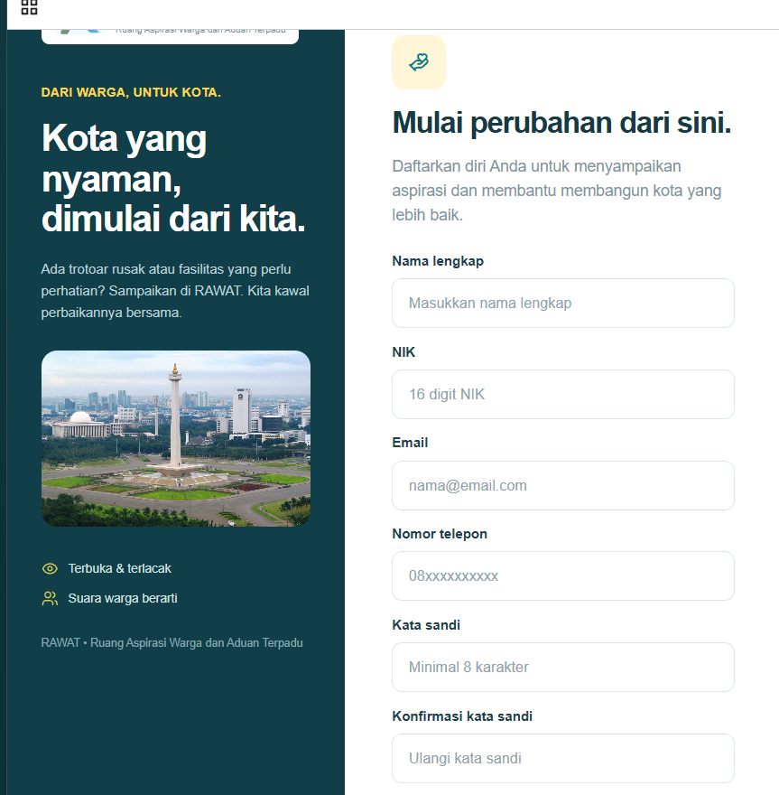|
| FE-REG-02 | Nama dikosongkan | Form menampilkan pesan bahwa nama wajib diisi |Sesuai | PASS | 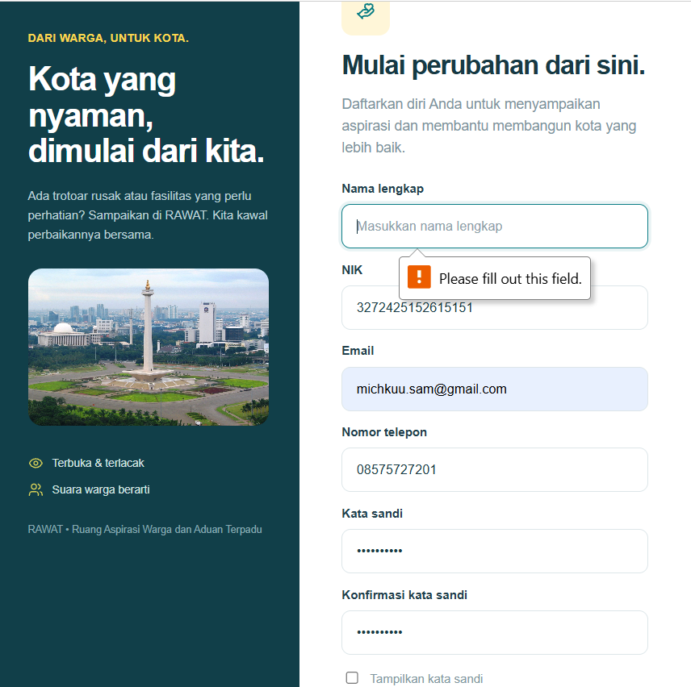|
| FE-REG-03 | NIK 15 digit | Form menampilkan pesan NIK tidak valid | Sesuai | PASS | 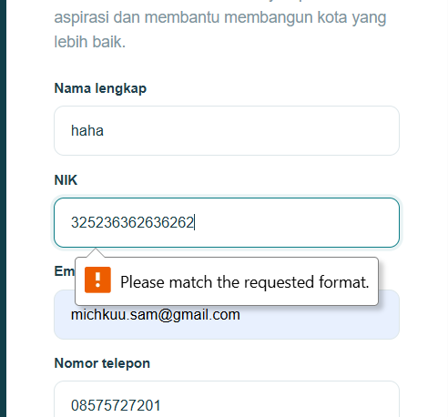|
| FE-REG-04 | NIK mengandung huruf | Form menampilkan pesan NIK tidak valid |Sesuai | PASS|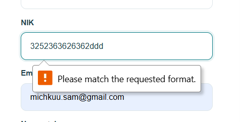|
| FE-REG-05 | Email tanpa `@` | Form menampilkan pesan email tidak valid | Sesuai |PASS | 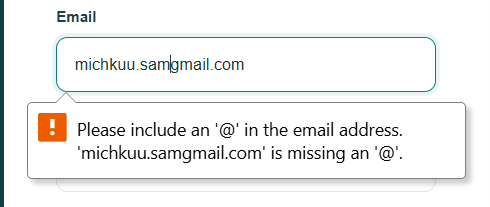|
| FE-REG-06 | Kata sandi hanya mengandung huruf kecil | Form menampilkan kata sandi harus mengandung huruf kapital, angka, dan simbol |Sesuai | PASS |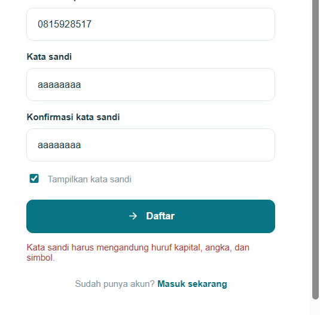 |
| FE-REG-07 | Password 7 karakter | Form menampilkan pesan password minimal 8 karakter | Sesuai | PASS | 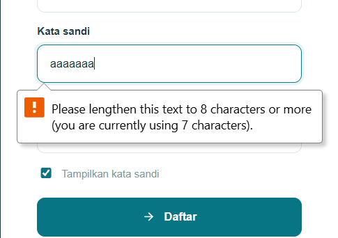 | 
| FE-REG-08 | Nomor telepon tidak diawali `08` | Form menampilkan pesan nomor telepon tidak valid |Sesuai | PASS  |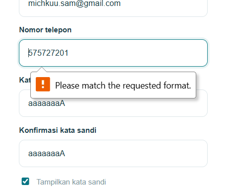 |
| FE-REG-08 | Menggunakan email yang sudah terdaftar | Form menampilkan pesan email atau NIK sudah terdaftar |Sesuai | PASS  | 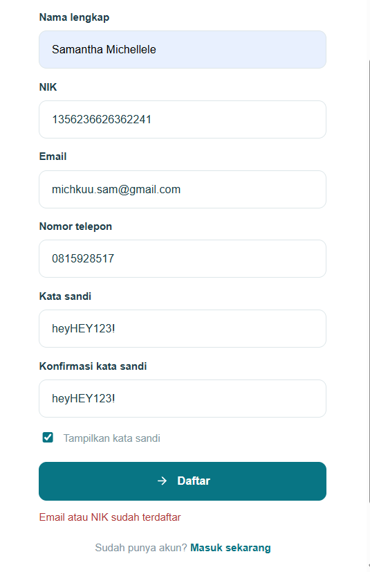|

## 5. Hasil Pengujian  FRONTEND dan INTEGRASI - Login  (UC02)

| ID | Input / Aksi | Expected Result | Actual Result | Status | Bukti |
|---|---|---|---|---|---|
| FE-LOG-01 | Membuka halaman login | Form email dan password ditampilkan | Sesuai | PASS | 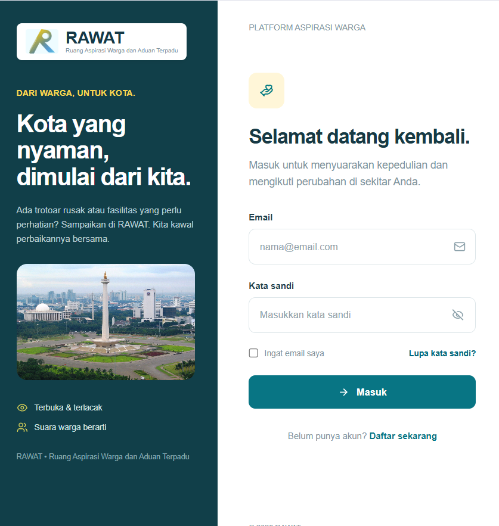|
| FE-LOG-02 | Email dikosongkan | Pesan validasi email wajib diisi ditampilkan |Sesuai | PASS | 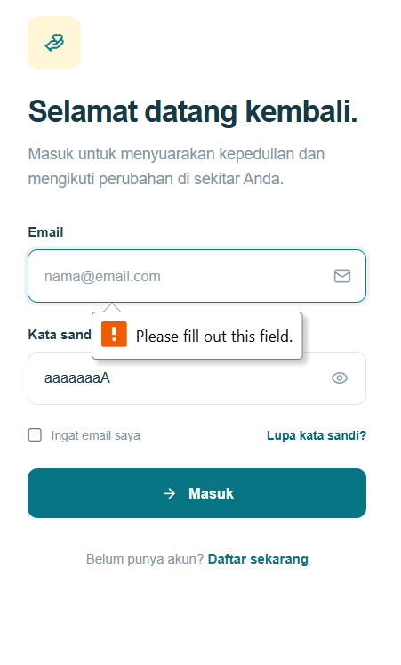|
| FE-LOG-03 | Password dikosongkan | Pesan validasi password wajib diisi ditampilkan | Sesuai | PASS | 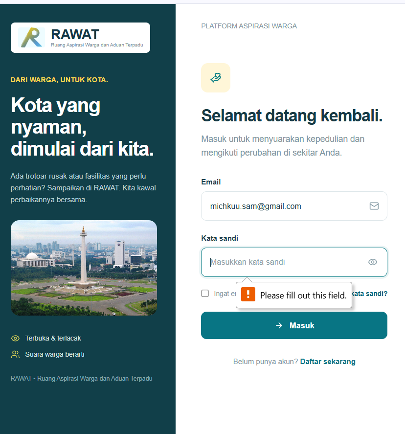|

## 6. Bukti Integrasi 

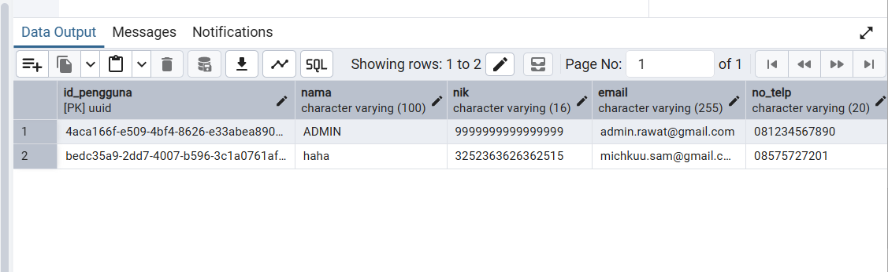
Gambar 2. Bukti akun baru berhasil masuk database

## 7. Bukti Pengujian

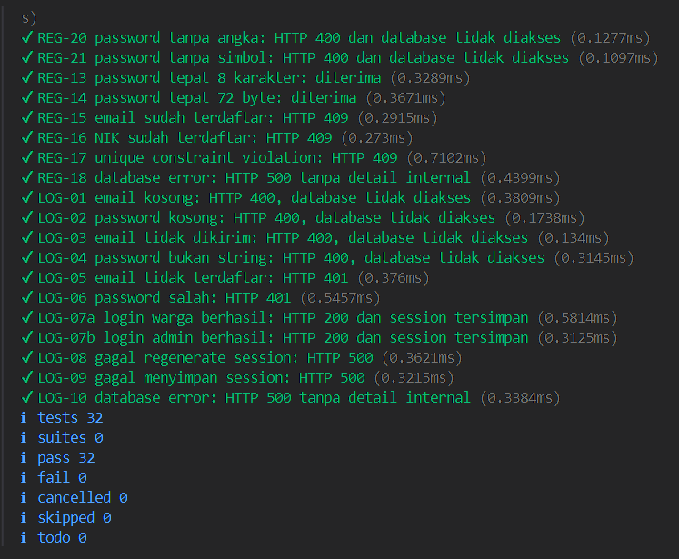

