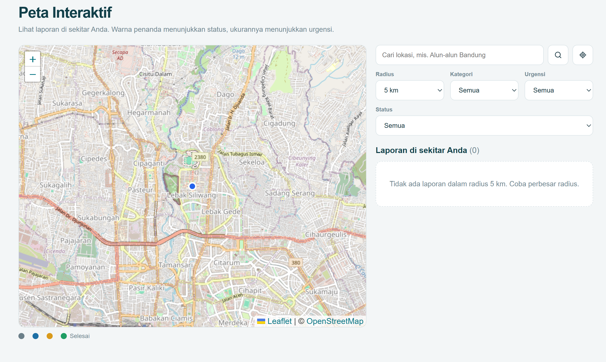
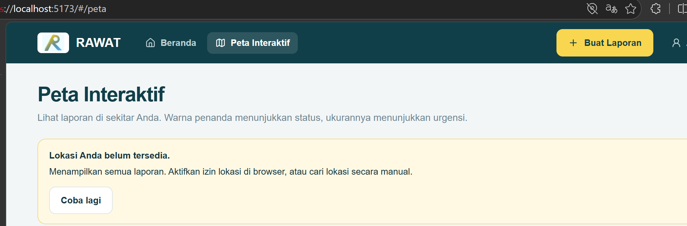
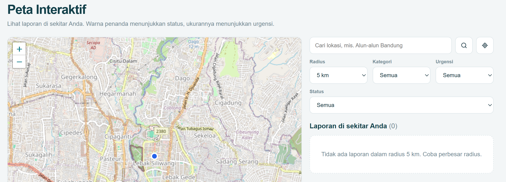
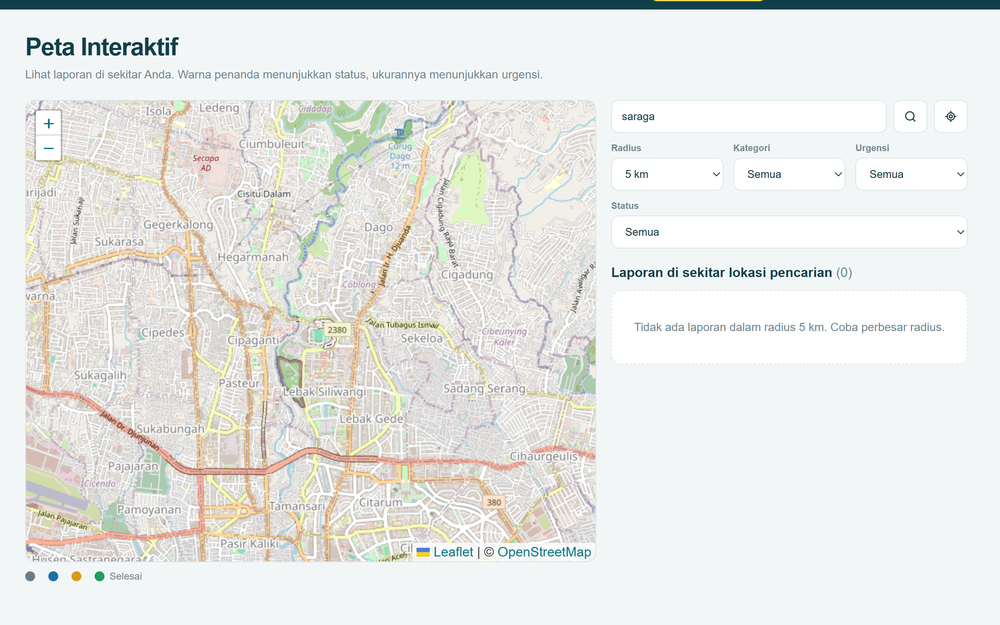
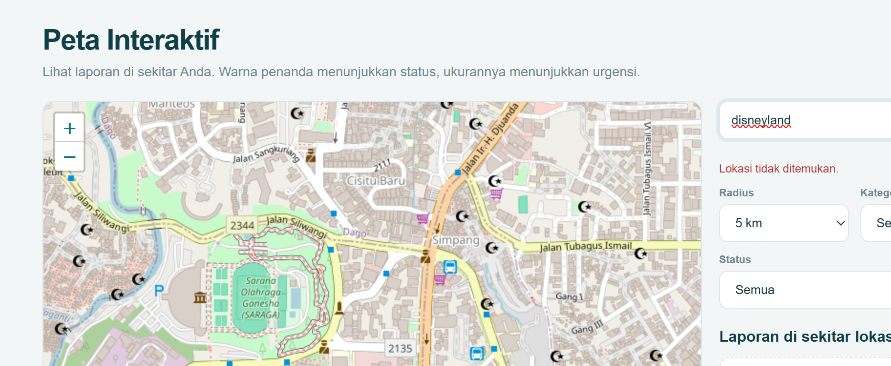
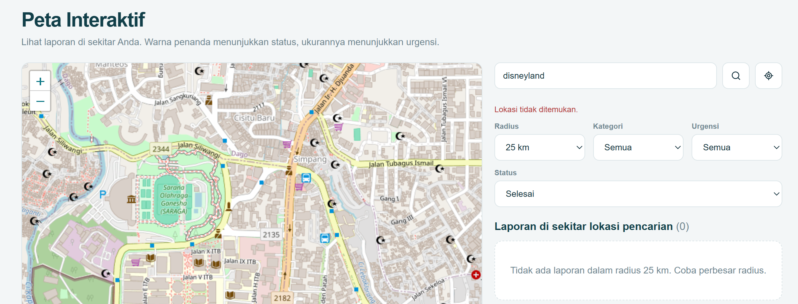
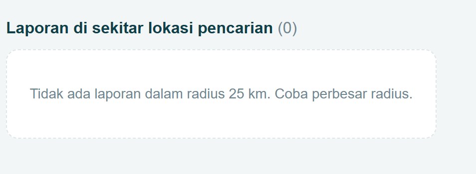
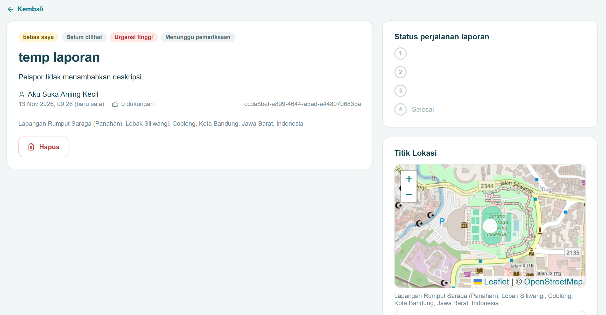

# Test Case Use Case Laporan dan Lokasi

Dokumen ini mencakup UC03 Mengakses Peta Interaktif, UC04 Melihat Detail Laporan,
UC07 Mengunggah Laporan Baru, UC08 Memeriksa Laporan, dan UC09 Memperbarui Status
Penanganan Laporan. Skenario disusun berdasarkan use case pada
`docs/M3/K01_G01_UC.md` dan perilaku implementasi saat ini.

## 1. Informasi Pengujian

| Informasi | Keterangan |
|---|---|
| Pengujian Backend | `src/backend/tests/` dengan Node.js `node:test` |
| Perintah Uji Backend | Dari root repo: `Set-Location src\backend; npm test` |
| Pengujian Frontend | Test otomatis service/API dengan Node.js `node:test`; UI tetap diuji manual melalui browser |
| Perintah Uji Frontend | Dari root repo: `Set-Location src\frontend; npm test` |
| Status dokumen | Test yang sudah dieksekusi ditandai PASS; testcase UI dan endpoint yang belum tercakup tetap NOT RUN |

## 2. Test Case Backend

### 2.1 Lokasi dan peta (UC03)

| ID | Input / Kondisi | Expected Result Backend | Actual Result | Status |
|---|---|---|---|---|
| BE-LOC-01 | `GET /api/lokasi/geocode` dengan alamat yang ditemukan | HTTP 200; respons berisi alamat dan koordinat hasil geocoding | Unit test lulus; hasil geocode dikembalikan | PASS |
| BE-LOC-02 | Geocode dengan alamat kosong atau hanya spasi | HTTP 400; pesan `Alamat wajib diisi` | Unit test lulus; layanan peta tidak dipanggil | PASS |
| BE-LOC-03 | Geocode dengan alamat yang tidak ditemukan | HTTP 404; pesan `Alamat tidak ditemukan` | Unit test lulus; HTTP 404 dikembalikan | PASS |
| BE-LOC-04 | Layanan geocoding gagal dihubungi | HTTP 502; pesan kegagalan layanan peta | Unit test lulus; HTTP 502 dikembalikan | PASS |
| BE-LOC-05 | `GET /api/lokasi/terdekat` dengan koordinat valid tanpa parameter radius | HTTP 200; memakai radius default 5 km, hasil hanya dalam radius dan diurutkan dari jarak terdekat | Unit test lulus; radius default dan pengurutan sesuai | PASS |
| BE-LOC-06 | Pencarian laporan terdekat tanpa koordinat pengguna | HTTP 400; pesan bahwa lokasi belum tersedia | Unit test lulus; HTTP 400 dikembalikan | PASS |
| BE-LOC-07 | Latitude/longitude bukan angka atau di luar rentang geografis | HTTP 400; koordinat ditolak | Unit test lulus; kedua kondisi ditolak | PASS |
| BE-LOC-08 | Radius tidak valid (0, negatif, bukan angka, atau lebih dari 50 km) | HTTP 400; pesan radius harus antara 0 dan 50 km | Unit test lulus; radius 0, -1, `abc`, dan 51 ditolak | PASS |
| BE-LOC-09 | Radius valid dan tidak ada laporan di area tersebut | HTTP 200; daftar `laporan` kosong | Unit test lulus; daftar kosong dan radius default 5 km | PASS |

### 2.2 Daftar, detail, dan pembuatan laporan (UC04, UC07)

| ID | Input / Kondisi | Expected Result Backend | Actual Result | Status |
|---|---|---|---|---|
| BE-LAP-01 | Membuat laporan dengan field wajib dan koordinat valid | HTTP 201; ID laporan dikembalikan; data laporan dan lokasi tersimpan dalam satu transaksi | Unit test lulus; HTTP 201 dan koordinat terkonversi benar | PASS |
| BE-LAP-02 | Membuat laporan tanpa nama masalah | HTTP 400; laporan tidak disimpan | Unit test lulus; penyimpanan tidak dipanggil | PASS |
| BE-LAP-03 | Membuat laporan tanpa lokasi | HTTP 400; laporan tidak disimpan | Unit test lulus; penyimpanan tidak dipanggil | PASS |
| BE-LAP-04 | Nama masalah lebih dari 150 karakter, kategori lebih dari 50 karakter, atau deskripsi lebih dari 2000 karakter | HTTP 400; field yang melampaui batas ditolak | Unit test lulus untuk ketiga batas panjang | PASS |
| BE-LAP-05 | Tingkat urgensi atau status privasi bukan nilai yang diizinkan | HTTP 400; laporan ditolak | Unit test lulus; laporan tidak disimpan | PASS |
| BE-LAP-06 | Koordinat parsial, bukan angka, atau di luar rentang geografis | HTTP 400; pesan `Koordinat lokasi tidak valid` | Unit test lulus; ketiga kondisi ditolak | PASS |
| BE-LAP-07 | Lokasi dikirim sebagai alamat dan geocoding tidak menemukan alamat | HTTP 400; laporan tidak disimpan dan pengguna diminta memilih titik pada peta | Unit test lulus; laporan tidak disimpan | PASS |
| BE-LAP-08 | Lokasi dikirim sebagai alamat dan layanan geocoding gagal | HTTP 502; laporan tidak disimpan | Unit test lulus; HTTP 502 dikembalikan | PASS |
| BE-LAP-09 | Foto bertipe selain JPG/JPEG/PNG atau ukuran lebih dari 5 MB | HTTP 400; foto ditolak | Test multipart lulus untuk tipe tidak didukung dan file di atas 5 MB | PASS |
| BE-LAP-10 | MIME foto JPG/PNG sesuai tetapi isi file bukan gambar JPEG/PNG | HTTP 400; foto ditolak berdasarkan pemeriksaan isi file | Unit test lulus; file foto dibersihkan setelah ditolak | PASS |
| BE-LAP-11 | Penyimpanan laporan atau lokasi gagal setelah transaksi dimulai | HTTP 500; transaksi dibatalkan dan file foto unggahan dibersihkan | Unit test lulus untuk HTTP 500, rollback, dan pembersihan file | PASS |
| BE-LAP-12 | `GET /api/laporan` dengan filter kategori/status dan pagination valid | HTTP 200; daftar sesuai filter dengan `page` dan `limit` | Unit test lulus; filter dan offset diteruskan ke model | PASS |
| BE-LAP-13 | Daftar laporan menggunakan status tidak valid | HTTP 400; pesan validasi status dikembalikan | Unit test lulus; model tidak dipanggil | PASS |
| BE-LAP-14 | Membuka detail menggunakan UUID yang valid dan laporan tersedia | HTTP 200; detail laporan, lokasi, dan tanggapan teratas dikembalikan | Unit test lulus; tanggapan teratas terlampir | PASS |
| BE-LAP-15 | ID laporan bukan UUID atau laporan tidak ditemukan | HTTP 404; pesan laporan tidak ditemukan | Unit test lulus; ID tidak valid dan detail tidak tersedia ditolak | PASS |
| BE-LAP-16 | Warga lain meminta detail laporan berstatus `TIDAK_VALID` atau laporan anonim | HTTP 404 untuk laporan tidak valid; nama pelapor anonim disamarkan | Unit test model/controller lulus untuk kedua aturan privasi | PASS |
| BE-LAP-17 | Membuka daftar/detail/foto laporan tanpa sesi login | HTTP 401 dari middleware autentikasi | Unit test middleware lulus; request ditolak | PASS |

### 2.3 Pemeriksaan dan perubahan status laporan (UC08, UC09)

| ID | Input / Kondisi | Expected Result Backend | Actual Result | Status |
|---|---|---|---|---|
| BE-ADM-01 | Admin mengirim hasil pemeriksaan `valid: true` dengan laporan yang ada | HTTP 200; status validasi disimpan sebagai `VALID` | Unit test lulus; hasil dan catatan diteruskan ke model | PASS |
| BE-ADM-02 | Admin mengirim `valid: false` dengan laporan yang ada | HTTP 200; status validasi menjadi `TIDAK_VALID` dan batas konfirmasi 14 hari dipasang | Unit test controller/model lulus; parameter status, catatan, dan interval 14 hari diverifikasi | PASS |
| BE-ADM-03 | Nilai `valid` bukan boolean atau tidak dikirim | HTTP 400; pemeriksaan ditolak | Unit test lulus; model tidak dipanggil | PASS |
| BE-ADM-04 | Catatan pemeriksaan lebih dari 1000 karakter | HTTP 400; catatan ditolak | Unit test lulus; model tidak dipanggil | PASS |
| BE-ADM-05 | ID laporan tidak valid atau laporan tidak ditemukan saat diperiksa | HTTP 404; tidak ada perubahan | Unit test lulus; laporan tidak ditemukan ditolak | PASS |
| BE-ADM-06 | Admin memperbarui status dengan salah satu status yang diizinkan | HTTP 200; status laporan diperbarui | Unit test lulus; status ternormalisasi dan diteruskan ke model | PASS |
| BE-ADM-07 | Status penanganan tidak termasuk nilai yang diizinkan | HTTP 400; status tidak diperbarui | Unit test lulus; model tidak dipanggil | PASS |
| BE-ADM-08 | Pengguna non-admin mengakses endpoint pemeriksaan atau perubahan status | HTTP 403; aksi tidak diteruskan ke controller | Test middleware role yang dipakai route admin lulus | PASS |
| BE-ADM-09 | Akses endpoint admin tanpa sesi | HTTP 401; aksi ditolak | Test middleware autentikasi/role lulus | PASS |
| BE-ADM-10 | Pemilik mengirim konfirmasi ulang sebelum batas waktu pada laporan `TIDAK_VALID` | HTTP 200; status validasi kembali ke `BELUM_DIPERIKSA` | Unit test lulus; konfirmasi diterima sebelum deadline | PASS |
| BE-ADM-11 | Pengguna bukan pemilik mengirim konfirmasi ulang atau laporan bukan `TIDAK_VALID` | HTTP 404 untuk bukan pemilik; HTTP 409 jika status tidak sedang `TIDAK_VALID` | Unit test lulus untuk kondisi bukan pemilik dan status lain | PASS |
| BE-ADM-12 | Batas waktu konfirmasi ulang telah lewat | HTTP 409; konfirmasi ulang ditolak | Unit test lulus; permintaan simpan tidak dijalankan | PASS |

## 3. Test Case Frontend dan Integrasi

### 3.1 Peta dan lokasi (UC03)

| ID | Input / Aksi | Expected Result | Actual Result | Status | Bukti |
|---|---|---|---|---|---|
| FE-LOC-01 | Membuka halaman Peta Interaktif | Peta, penanda laporan, legenda status, dan daftar laporan tampil | Sesuai | PASS |  |
| FE-LOC-02 | Izin lokasi browser diberikan | Peta berpusat di lokasi pengguna dan daftar menampilkan laporan dalam radius awal 5 km | Sesuai | PASS | [lokasibrowser](screenshots/FE-LOC-02.png) |
| FE-LOC-03 | Izin lokasi ditolak atau browser tidak mendukung geolokasi | Banner menjelaskan lokasi tidak tersedia; halaman tetap menampilkan semua laporan dan pencarian manual | Sesuai | PASS |  |
| FE-LOC-04 | Menekan tombol coba lagi setelah izin ditolak | Browser meminta izin lokasi kembali; jika diberikan, peta dan daftar beralih ke area pengguna | Sesuai | PASS |  |
| FE-LOC-05 | Mencari alamat/lokasi yang ditemukan | Peta berpusat ke hasil pencarian dan daftar laporan sekitar lokasi tampil | Sesuai | PASS |  |
| FE-LOC-06 | Mencari alamat yang tidak ditemukan | Pesan `Lokasi tidak ditemukan.` tampil dan lokasi pusat tidak berubah | Sesuai | PASS |  |
| FE-LOC-07 | Mengubah radius, kategori, urgensi, atau status | Daftar laporan diperbarui sesuai pilihan filter | Sesuai | PASS |  |
| FE-LOC-08 | Tidak ada laporan yang cocok di area/filter terpilih | Pesan keadaan kosong yang sesuai ditampilkan | Sesuai | PASS |  |
| FE-LOC-09 | Memilih marker laporan pada peta | Popup menampilkan nama, kategori, status, dan tautan ke detail laporan | Sesuai | PASS |  |

### 3.2 Melihat daftar, detail, dan lokasi laporan (UC04)

| ID | Input / Aksi | Expected Result | Actual Result | Status | Bukti |
|---|---|---|---|---|---|
| FE-LAP-01 | Membuka halaman Laporan Warga | Daftar laporan, filter kategori/status, opsi urutan, dan navigasi halaman tampil | Belum diuji | NOT RUN | - |
| FE-LAP-02 | Memilih urutan terbaru, terlama, atau terpopuler | Daftar dimuat ulang dengan urutan yang dipilih dan kembali ke halaman pertama | Belum diuji | NOT RUN | - |
| FE-LAP-03 | Memilih kategori atau status tertentu | Hanya laporan yang sesuai filter ditampilkan | Belum diuji | NOT RUN | - |
| FE-LAP-04 | Memilih salah satu laporan | Halaman detail menampilkan kategori, status, urgensi, lokasi, dan informasi laporan | Belum diuji | NOT RUN | - |
| FE-LAP-05 | Detail laporan tidak memiliki foto atau deskripsi | Detail tetap tampil; deskripsi menggunakan teks pengganti dan foto tidak ditampilkan | Belum diuji | NOT RUN | - |
| FE-LAP-06 | Menekan `Lihat di peta` pada detail | Halaman peta terbuka dengan koordinat laporan sebagai pusat dan laporan tersebut difokuskan | Belum diuji | NOT RUN | - |
| FE-LAP-07 | Detail gagal dimuat lalu pengguna menekan muat ulang | Pesan kesalahan dan aksi muat ulang ditampilkan; detail dimuat kembali jika layanan pulih | Belum diuji | NOT RUN | - |
| FE-LAP-08 | Membuka laporan yang tidak tersedia atau tidak berhak dilihat | Pesan gagal memuat detail ditampilkan, tanpa data laporan | Belum diuji | NOT RUN | - |

### 3.3 Membuat laporan (UC07)

| ID | Input / Aksi | Expected Result | Actual Result | Status | Bukti |
|---|---|---|---|---|---|
| FE-BUAT-01 | Membuka halaman Buat Laporan | Form nama masalah, kategori, urgensi, privasi, lokasi, foto opsional, dan deskripsi opsional tampil | Belum diuji | NOT RUN | - |
| FE-BUAT-02 | Mengirim form tanpa nama masalah atau kategori | Pesan validasi wajib tampil; dialog konfirmasi dan request penyimpanan tidak dibuka | Belum diuji | NOT RUN | - |
| FE-BUAT-03 | Mengirim form tanpa alamat dan tanpa titik peta | Pesan untuk menandai lokasi atau mengisi alamat tampil | Belum diuji | NOT RUN | - |
| FE-BUAT-04 | Memilih kategori `Lainnya` dan membiarkan kategori lain kosong | Validasi nama masalah/kategori wajib tampil | Belum diuji | NOT RUN | - |
| FE-BUAT-05 | Mencari alamat yang ditemukan atau memilih titik langsung di peta | Titik laporan ditampilkan pada peta dan koordinat digunakan saat mengirim laporan | Belum diuji | NOT RUN | - |
| FE-BUAT-06 | Mencari alamat yang tidak ditemukan | Pesan bahwa alamat tidak ditemukan tampil dan pengguna diarahkan memilih titik di peta | Belum diuji | NOT RUN | - |
| FE-BUAT-07 | Memilih lokasi saya saat geolokasi tidak tersedia/izin ditolak | Pesan alternatif tampil dan pengguna tetap dapat memilih titik di peta | Belum diuji | NOT RUN | - |
| FE-BUAT-08 | Memilih foto JPG/PNG berukuran sampai 5 MB | Pratinjau foto tampil | Belum diuji | NOT RUN | - |
| FE-BUAT-09 | Memilih file bukan JPG/PNG atau foto lebih dari 5 MB | File ditolak, input file dikosongkan, dan pesan kesalahan tampil | Belum diuji | NOT RUN | - |
| FE-BUAT-10 | Mengisi form valid lalu menekan Kirim Laporan | Dialog konfirmasi pengiriman tampil sebelum data dikirim | Belum diuji | NOT RUN | - |
| FE-BUAT-11 | Membatalkan dialog konfirmasi pengiriman | Dialog tertutup; laporan tidak dikirim dan form tetap dapat diedit | Belum diuji | NOT RUN | - |
| FE-BUAT-12 | Mengonfirmasi pengiriman form valid | Laporan tersimpan dan pengguna diarahkan ke halaman detail laporan baru | Belum diuji | NOT RUN | - |
| FE-BUAT-13 | Request pengiriman gagal | Pesan error tampil, dialog tertutup, dan form dapat dikirim ulang | Belum diuji | NOT RUN | - |

### 3.4 Memeriksa dan memperbarui laporan (UC08, UC09)

| ID | Input / Aksi | Expected Result | Actual Result | Status | Bukti |
|---|---|---|---|---|---|
| FE-ADM-01 | Admin membuka halaman Periksa Laporan | Antrean laporan belum diperiksa, filter validasi, pencarian, detail, dan peta lokasi tampil | Belum diuji | NOT RUN | - |
| FE-ADM-02 | Admin membuka formulir hasil pemeriksaan dan memilih valid | Form tanggapan dan status penanganan tampil; tanggapan tambahan boleh kosong | Belum diuji | NOT RUN | - |
| FE-ADM-03 | Admin memilih tidak valid tanpa mengisi tanggapan | Validasi alasan tanggapan wajib tampil dan dialog konfirmasi tidak dibuka | Belum diuji | NOT RUN | - |
| FE-ADM-04 | Mencoba mengisi tanggapan lebih dari 2000 karakter atau catatan lebih dari 1000 karakter | Batas panjang field mencegah input melampaui jumlah karakter yang ditentukan | Belum diuji | NOT RUN | - |
| FE-ADM-05 | Admin memilih status penanganan, mengisi hasil valid, lalu meninjau dan menyimpan | Dialog konfirmasi menampilkan hasil, status, dan tanggapan sebelum penyimpanan | Belum diuji | NOT RUN | - |
| FE-ADM-06 | Membatalkan dialog konfirmasi penyimpanan | Dialog tertutup; data pemeriksaan/status belum dikirim dan formulir tetap terbuka | Belum diuji | NOT RUN | - |
| FE-ADM-07 | Mengonfirmasi penyimpanan pemeriksaan dan status | Dialog/form tertutup; pesan berhasil tampil dan antrean/detail dimuat ulang | Belum diuji | NOT RUN | - |
| FE-ADM-08 | Penyimpanan pemeriksaan gagal | Pesan error tampil pada form; data tidak dilaporkan berhasil tersimpan | Belum diuji | NOT RUN | - |
| FE-ADM-09 | Warga membuka laporan miliknya yang dinyatakan tidak valid sebelum batas waktu | Catatan dan batas waktu tampil; tombol konfirmasi ulang tersedia | Belum diuji | NOT RUN | - |
| FE-ADM-10 | Pemilik mengirim konfirmasi ulang | Pesan berhasil tampil dan status laporan dimuat ulang | Belum diuji | NOT RUN | - |

## 4. Catatan Eksekusi

### Cara menjalankan

Dari root repository, jalankan perintah berikut di PowerShell:

```powershell
Set-Location src\backend
node --test tests\LaporanLokasiController.test.js
npm test

Set-Location ..\frontend
npm test
npm run lint
```

### Hasil eksekusi otomatis

| Suite | Hasil |
|---|---|
| Backend `node --test tests\LaporanLokasiController.test.js` | PASS — 48 test laporan/lokasi |
| Backend `npm test` (seluruh suite) | 89 lulus, 4 gagal pada `tests/ProfileController.test.js`; kegagalan ini berada di luar perubahan laporan/lokasi |
| Frontend `npm test` | PASS — 8 test service/API |
| Frontend `npm run lint` | PASS |

Test frontend saat ini menguji request service (URL, query, payload, error, dan sesi), bukan render/interaksi komponen React. Test backend memakai mock untuk model dan layanan geocoding; pengujian multipart menggunakan server Express lokal. Test ini tidak memerlukan database atau koneksi geocoding. Testcase antarmuka pada Bagian 3 tetap perlu diuji manual di browser dengan aplikasi berjalan; lengkapi kolom hasil dan bukti setelah pengujian tersebut.
