# Test Case Profil Pengguna RAWAT

## 1. Informasi Pengujian

| Informasi | Keterangan |
|---|---|
| Fitur | Lihat Profil, Ubah Profil, Ganti Password, dan Hapus Akun |
| File pengujian Backend | `src/backend/tests/ProfileController.test.js` |
| Perintah Uji Backend | `node --test tests/ProfileController.test.js` |

## 2. Hasil Pengujian BACKEND — Lihat dan Ubah Profil

| ID | Input / Kondisi | Expected Result Backend | Actual Result | Status |
|---|---|---|---|---|
| PROF-01 | Mengambil profil dengan session valid | HTTP 200; data profil sesuai ID pengguna pada session dan tidak mengandung password | Sesuai ekspektasi | PASS |
| PROF-02 | Mengakses profil tanpa session | HTTP 401; akses ditolak | Sesuai ekspektasi | PASS |
| PROF-03 | Data profil tidak ditemukan | HTTP 404; pengguna tidak ditemukan | Sesuai ekspektasi | PASS |
| PROF-04 | Terjadi kesalahan database saat mengambil profil | HTTP 500; informasi internal tidak dikirim ke pengguna | Sesuai ekspektasi | PASS |
| PROF-05 | Mengubah nama dan nomor telepon dengan data valid | HTTP 200; data diperbarui berdasarkan ID pada session | Sesuai ekspektasi | PASS |
| PROF-06 | Nama hanya berisi spasi | HTTP 400; pembaruan ditolak | Sesuai ekspektasi | PASS |
| PROF-07 | Nomor telepon tidak valid | HTTP 400; pembaruan ditolak | Sesuai ekspektasi | PASS |
| PROF-08 | Mencoba mengubah role menjadi Admin | HTTP 400; perubahan atribut terproteksi ditolak | Sesuai ekspektasi | PASS |
| PROF-09 | Mencoba mengubah ID pengguna lain | HTTP 400; perubahan atribut terproteksi ditolak | Sesuai ekspektasi | PASS |
| PROF-10 | Mengirim field yang tidak didukung | HTTP 400; pembaruan ditolak | Sesuai ekspektasi | PASS |
| PROF-11 | Body pembaruan profil kosong | HTTP 400; tidak ada data yang diperbarui | Sesuai ekspektasi | PASS |
| PROF-12 | Data pengguna tidak ditemukan saat pembaruan | HTTP 404; pembaruan gagal | Sesuai ekspektasi | PASS |
| PROF-13 | Terjadi kesalahan database saat memperbarui profil | HTTP 500; pembaruan gagal | Sesuai ekspektasi | PASS |

## 3. Hasil Pengujian BACKEND — Ganti Password

| ID | Input / Kondisi | Expected Result Backend | Actual Result | Status |
|---|---|---|---|---|
| PASS-01 | Password lama salah | HTTP 401; password tidak diperbarui | Sesuai ekspektasi | PASS |
| PASS-02 | Konfirmasi password berbeda dengan password baru | HTTP 400; password tidak diperbarui | Sesuai ekspektasi | PASS |
| PASS-03 | Password baru sama dengan password lama | HTTP 400; perubahan password ditolak | Sesuai ekspektasi | PASS |
| PASS-04 | Password baru 7 karakter | HTTP 400; password ditolak karena kurang dari 8 karakter | Sesuai ekspektasi | PASS |
| PASS-05 | Password baru 73 byte | HTTP 400; password ditolak karena melebihi 72 byte | Sesuai ekspektasi | PASS |
| PASS-06 | Password baru tidak mengandung huruf kapital | HTTP 400; password ditolak | Sesuai ekspektasi | PASS |
| PASS-07 | Password baru tidak mengandung angka | HTTP 400; password ditolak | Sesuai ekspektasi | PASS |
| PASS-08 | Password baru tidak mengandung simbol | HTTP 400; password ditolak | Sesuai ekspektasi | PASS |
| PASS-09 | Password lama benar dan password baru valid | HTTP 200; hash password diperbarui dan session tetap aktif | Sesuai ekspektasi | PASS |
| PASS-10 | Akun tidak ditemukan | HTTP 404; perubahan password gagal | Sesuai ekspektasi | PASS |
| PASS-11 | Salah satu field password tidak dikirim | HTTP 400; perubahan password ditolak | Sesuai ekspektasi | PASS |

## 4. Hasil Pengujian BACKEND — Hapus Akun

| ID | Input / Kondisi | Expected Result Backend | Actual Result | Status |
|---|---|---|---|---|
| DEL-01 | Warga menghapus akun sendiri | HTTP 200; akun dihapus, session diakhiri, dan cookie dibersihkan | Sesuai ekspektasi | PASS |
| DEL-02 | Admin mencoba menghapus akun sendiri | HTTP 403; penghapusan ditolak | Sesuai ekspektasi | PASS |
| DEL-03 | Akun pengguna tidak ditemukan | HTTP 404; penghapusan gagal | Sesuai ekspektasi | PASS |
| DEL-04 | Operasi penghapusan database gagal | HTTP 404; session tidak diakhiri sebagai penghapusan berhasil | Sesuai ekspektasi | PASS |
| DEL-05 | Akun berhasil dihapus, tetapi session gagal diakhiri | HTTP 500; respons menyatakan akun sudah dihapus dan cookie dibersihkan | Sesuai ekspektasi | PASS |
| DEL-06 | Menghapus akun tanpa login | HTTP 401; akses ditolak | Sesuai ekspektasi | PASS |

## 5. Hasil Pengujian BACKEND — Model Pengguna

| ID | Input / Kondisi | Expected Result Backend | Actual Result | Status |
|---|---|---|---|---|
| MODEL-01 | Mengambil informasi profil melalui model | Query hanya mengambil atribut profil tanpa NIK dan hash password | Sesuai ekspektasi | PASS |
| MODEL-02 | Memperbarui profil dengan atribut yang diizinkan dan tidak diizinkan | Query menggunakan parameterized SQL dan hanya memperbarui atribut yang diizinkan | Sesuai ekspektasi | PASS |
| MODEL-03 | Menghapus akun berdasarkan ID pengguna | Query DELETE menggunakan parameter ID pengguna, bukan interpolasi langsung | Sesuai ekspektasi | PASS |

## 6. Hasil Pengujian FRONTEND dan INTEGRASI — Lihat Profil

| ID | Input / Aksi | Expected Result | Actual Result | Status | Bukti |
|---|---|---|---|---|---|
| FE-PROF-01 | Membuka halaman Profil Warga | Halaman profil warga berhasil ditampilkan | Sesuai |PASS |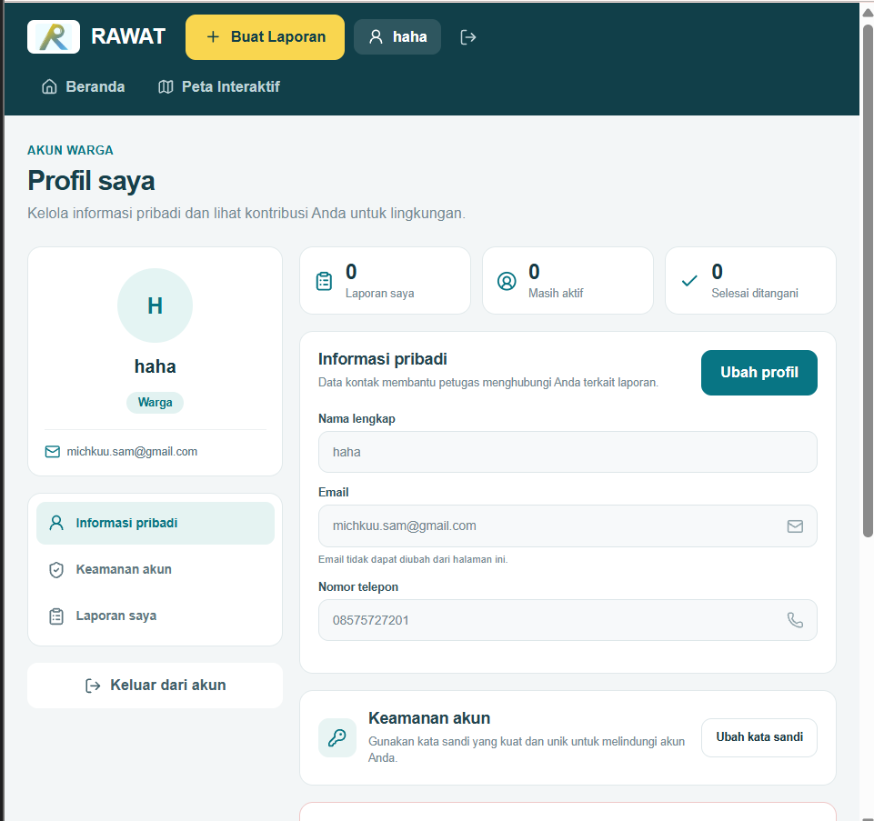 |
| FE-PROF-02 | Membuka profil sebagai Admin | Informasi dan fitur profil Admin ditampilkan | Sesuai | PASS |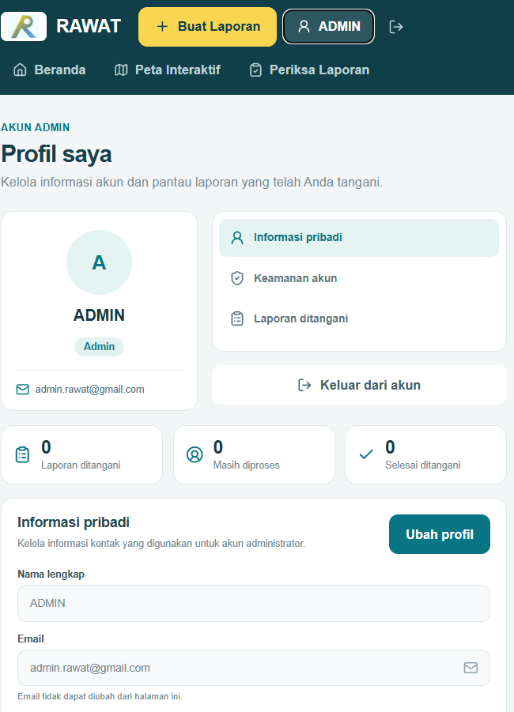 |
| FE-PROF-03 | Membuka profil tanpa autentikasi | Pengguna tidak dapat mengakses fitur profil yang terproteksi |Sesuai |PASS | 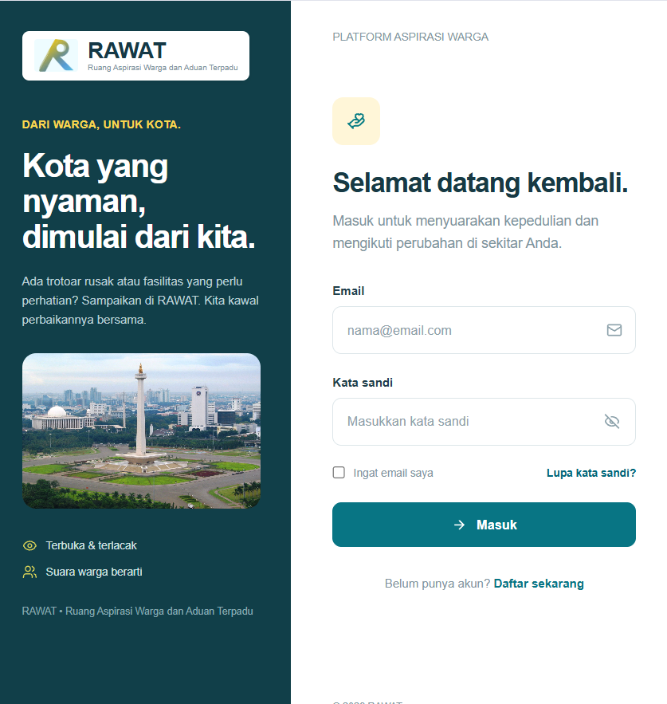|

## 7. Hasil Pengujian FRONTEND dan INTEGRASI — Ubah Profil

| ID | Input / Aksi | Expected Result | Actual Result | Status | Bukti |
|---|---|---|---|---|---|
| FE-EDIT-01 | Menekan tombol Ubah Profil | Form perubahan profil ditampilkan | Sesuai| PASS |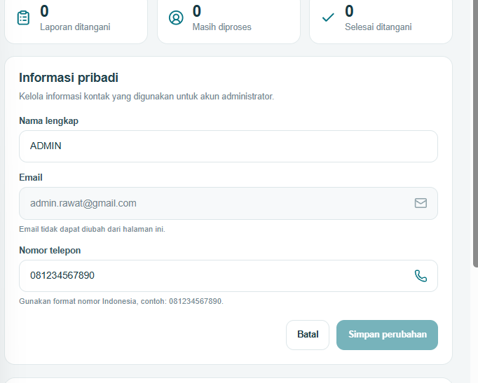 |
| FE-EDIT-02 | Memasukkan nomor telepon tidak valid | Form menampilkan pesan nomor telepon tidak valid |Sesuai |PASS |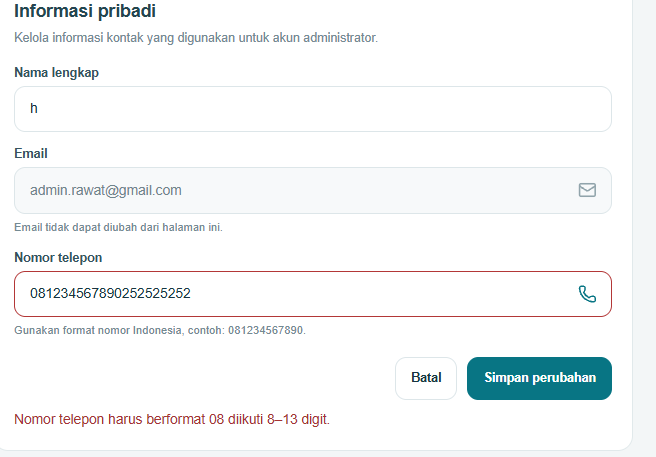 |
| FE-EDIT-03 | Menekan tombol Batal saat mengubah profil | Form ditutup dan perubahan yang belum disimpan dibatalkan | Sesuai| PASS | (tidak berubah) |
| FE-EDIT-04 | Menyimpan perubahan profil yang valid | Data baru tersimpan di PostgreSQL dan tetap muncul setelah refresh | Sesuai | PASS|  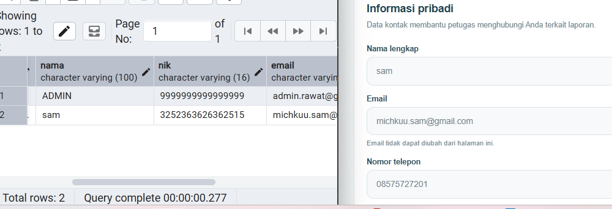|

## 8. Hasil Pengujian FRONTEND dan INTEGRASI — Ganti Password

| ID | Input / Aksi | Expected Result | Actual Result | Status | Bukti |
|---|---|---|---|---|---|
| FE-PASS-01 | Membuka form Ganti Password | Form password lama, password baru, dan konfirmasi password ditampilkan | Sesuai|PASS | 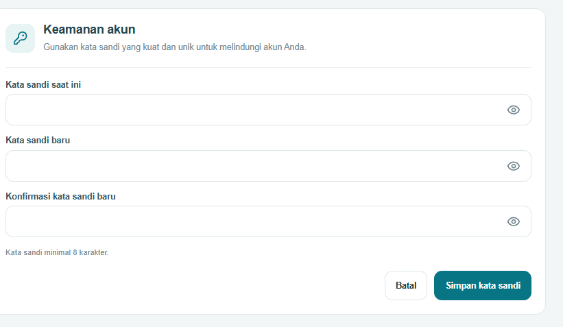|
| FE-PASS-02 | Password lama salah | Perubahan password ditolak dan pesan kesalahan ditampilkan | Sesuai |PASS |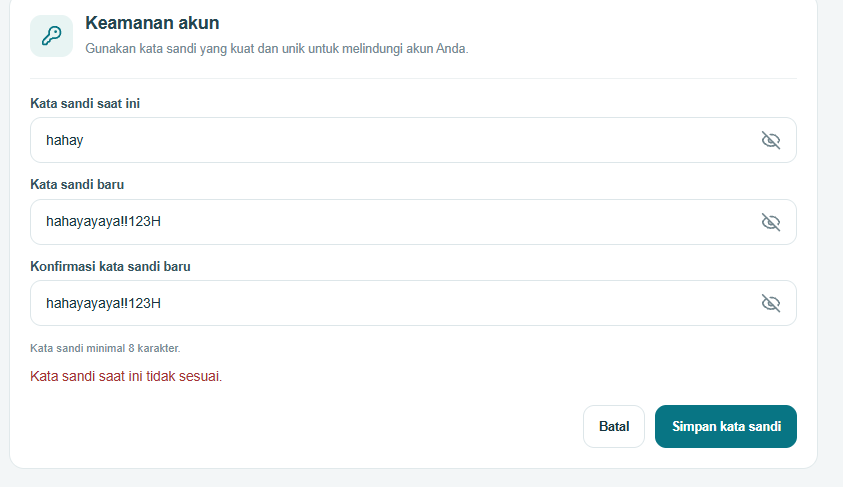 |
| FE-PASS-03 | Konfirmasi password berbeda | Form menampilkan pesan ketidakcocokan password | Sesuai|PASS | 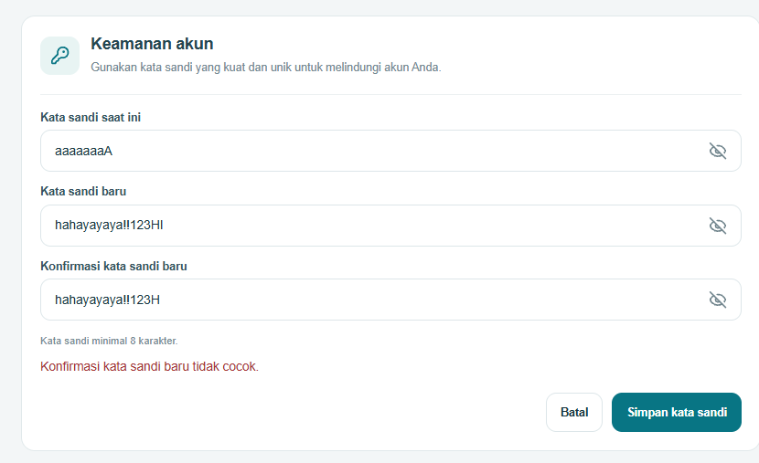|
| FE-PASS-04 | Password baru 7 karakter | Form menampilkan pesan password minimal 8 karakter |Sesuai |PASS | 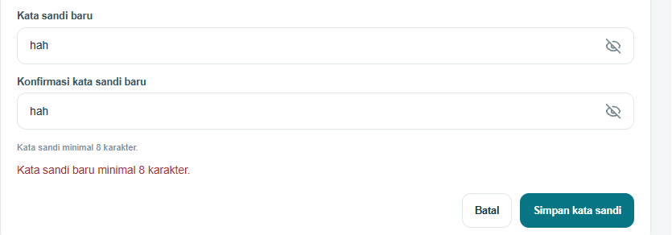|
| FE-PASS-05 | Password baru tanpa huruf kapital/simbol/angka | Form menampilkan pesan validasi kompleksitas password | Sesuai | PASS |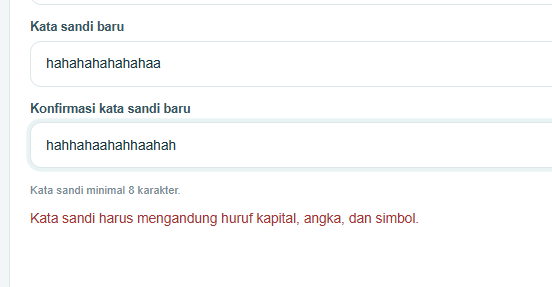 |
| FE-PASS-06 | Password baru sama dengan password lama | Perubahan password ditolak | | | 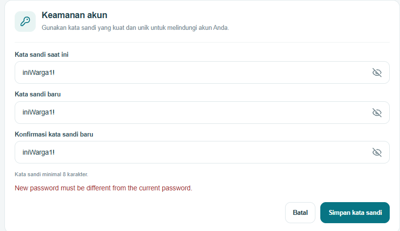|
| FE-PASS-07 | Password lama benar dan password baru valid | Perubahan password berhasil dan pesan sukses ditampilkan | Sesuai | PASS | 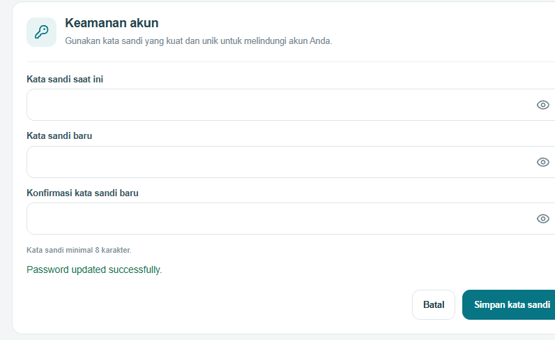|
| FE-PASS-08 | Logout kemudian login dengan password lama | Login ditolak karena password lama sudah tidak berlaku | Sesuai | PASS |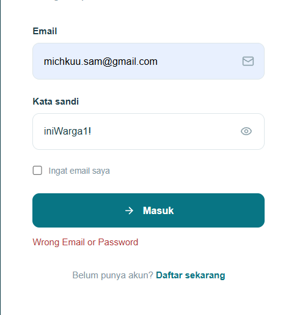 |

## 9. Hasil Pengujian FRONTEND dan INTEGRASI — Hapus Akun

| ID | Input / Aksi | Expected Result | Actual Result | Status | Bukti |
|---|---|---|---|---|---|
| FE-DEL-01 | Admin membuka halaman Profil | Tombol Hapus Akun tidak ditampilkan | | | 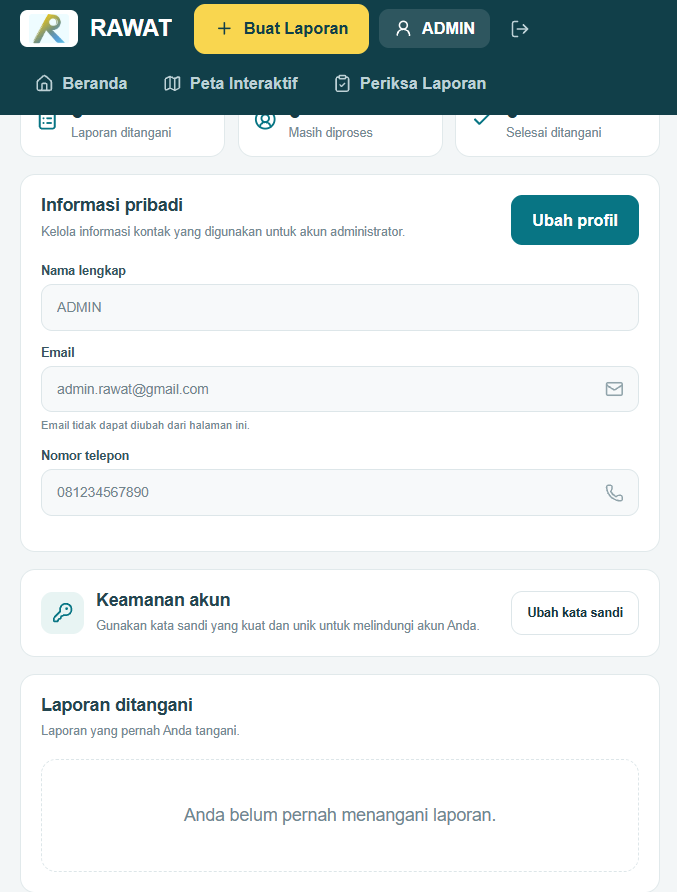|
| FE-DEL-02 | Warga menekan tombol Hapus Akun | Dialog konfirmasi penghapusan ditampilkan | | |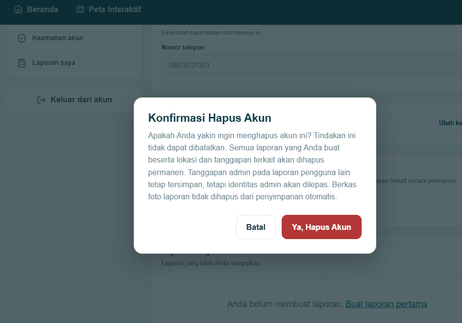 |
| FE-DEL-03 | Menekan Ya pada dialog konfirmasi | Akun berhasil dihapus dan pengguna diarahkan ke halaman autentikasi | Sesuai  | PASS| Kembali ke halaman login |
| FE-DEL-04 | Login kembali menggunakan akun yang telah dihapus | Login ditolak karena akun sudah tidak tersedia | Sesuai | PASS | 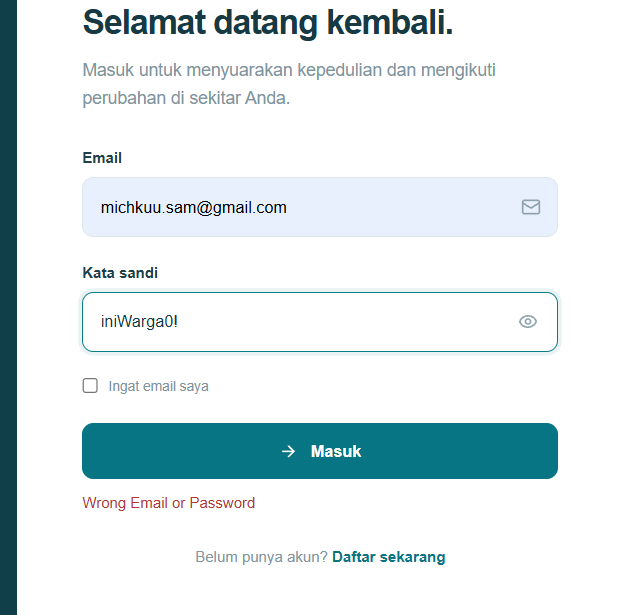|
| FE-DEL-05 | Memeriksa database setelah akun dihapus | Data akun tidak lagi ditemukan pada tabel `pengguna` | Sesuai | PASS |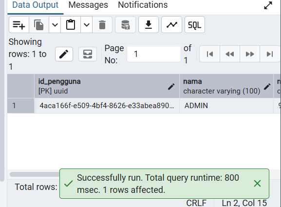 |

## 11. Bukti Integrasi

(sudah ada di gambar bukti pengujian frontend dan integrasi)

## 12. Bukti Pengujian Backend

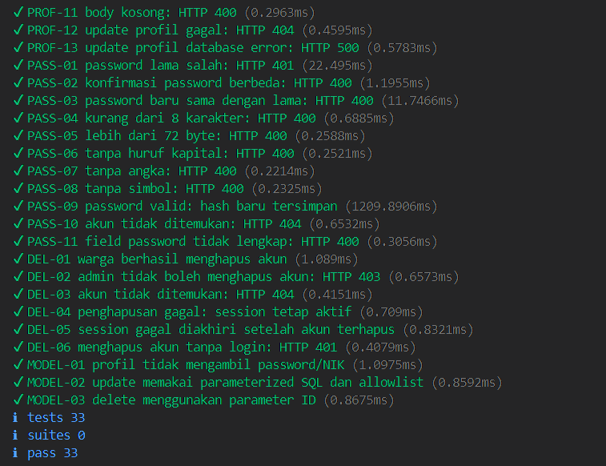

Gambar 4. Hasil automated unit testing backend fitur Profil Pengguna.
