# Test Case Use Case UC08 Memeriksa Laporan dan UC09 Memperbarui Status Penanganan Laporan

Dokumen ini mencakup pemeriksaan laporan dan pemberian tanggapan oleh admin (UC08), serta pembaruan status penanganan laporan (UC09).

## 1. Informasi Pengujian

| Informasi | Keterangan |
|---|---|
| Use case yang diuji | UC08 Memeriksa Laporan; UC09 Memperbarui Status Penanganan Laporan |
| File pengujian Backend | `src/backend/tests/TanggapanController.test.js` |
| Perintah uji Backend | `node --test tests/TanggapanController.test.js` |
| Cara menjalankan | Jalankan perintah dari folder `src/backend` |
| Jenis pengujian | Unit test; database dan request HTTP nyata tidak diperlukan |

## 2. Hasil Pengujian Backend Tanggapan

| ID | Input / Kondisi | Expected Result Backend | Actual Result | Status |
|---|---|---|---|---|
| TGP-01 | Hasil valid tanpa deskripsi | Tanggapan diterima | Sesuai ekspektasi | PASS |
| TGP-02 | Hasil tidak valid dengan alasan | Tanggapan diterima | Sesuai ekspektasi | PASS |
| TGP-03 | Hasil tidak valid tanpa alasan | Tanggapan ditolak | Sesuai ekspektasi | PASS |
| TGP-04 | Penyimpanan berhasil atau query gagal | Hasil fungsi mengikuti keberhasilan query | Sesuai ekspektasi | PASS |
| TGP-05 | Model menyimpan tanggapan | Query memakai parameter dan menyimpan ID admin | Sesuai ekspektasi | PASS |
| TGP-06 | Warga dan admin membaca tanggapan terbaru | Identitas admin hanya dikirim kepada admin | Sesuai ekspektasi | PASS |
| TGP-07 | Pembaruan status berhasil atau gagal | Hasil fungsi mengikuti hasil pembaruan laporan | Sesuai ekspektasi | PASS |
| TGP-08 | Pembaruan status gagal saat transaksi | Transaksi di-rollback dan client dilepas | Sesuai ekspektasi | PASS |
| TGP-09 | Request menyertakan `idAdmin` palsu | ID admin diambil dari sesi, transaksi di-commit | Sesuai ekspektasi | PASS |
| TGP-10 | Detail laporan dibaca warga dan admin | Identitas admin hanya ada pada respons admin | Sesuai ekspektasi | PASS |
| TGP-11 | Sesi tidak ada atau role bukan admin | Handler menolak dengan HTTP 401 atau 403 | Sesuai ekspektasi | PASS |
| TGP-12 | Pengguna non-admin mengakses endpoint | Middleware menolak dengan HTTP 403 | Sesuai ekspektasi | PASS |
| TGP-13 | Request tanpa sesi | Middleware menolak dengan HTTP 401 | Sesuai ekspektasi | PASS |
| TGP-14 | Pengguna membatalkan konfirmasi | Aksi penyimpanan tidak dipanggil | Sesuai ekspektasi | PASS |

## 3. Hasil Pengujian Frontend dan Integrasi (UC08, UC09)

Pengujian UI dilakukan manual melalui aplikasi. Backend dan frontend harus berjalan, dan akun pemeriksa harus memiliki role admin.

| ID | Input / Aksi | Expected Result | Actual Result | Status | Bukti |
|---|---|---|---|---|---|
| FE-TGP-01 | Admin membuka daftar laporan, detail laporan, lalu halaman Periksa Laporan | Daftar, detail, dan halaman pemeriksaan laporan ditampilkan | Alur dari daftar sampai halaman pemeriksaan terlihat | PASS | 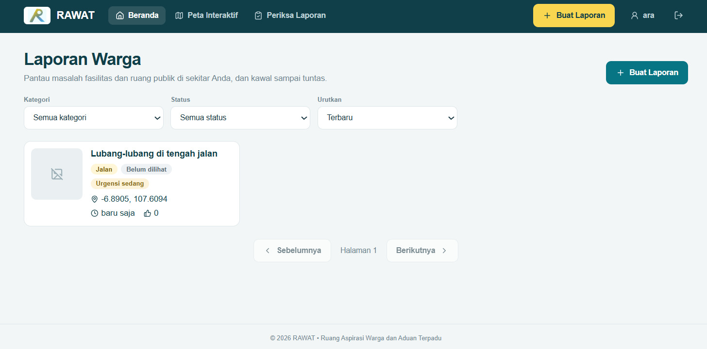 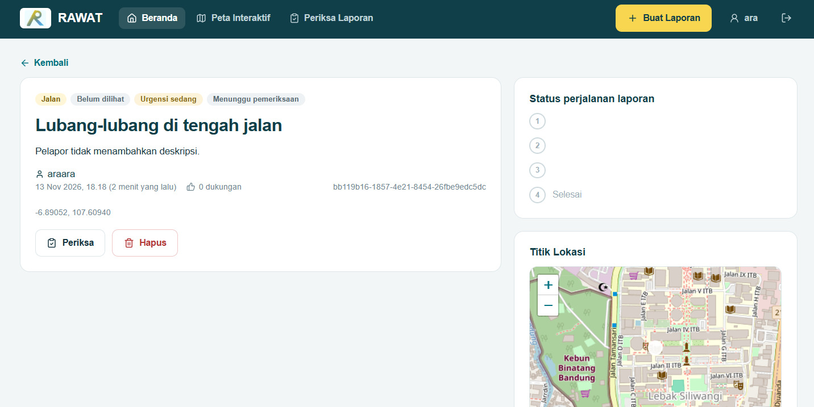 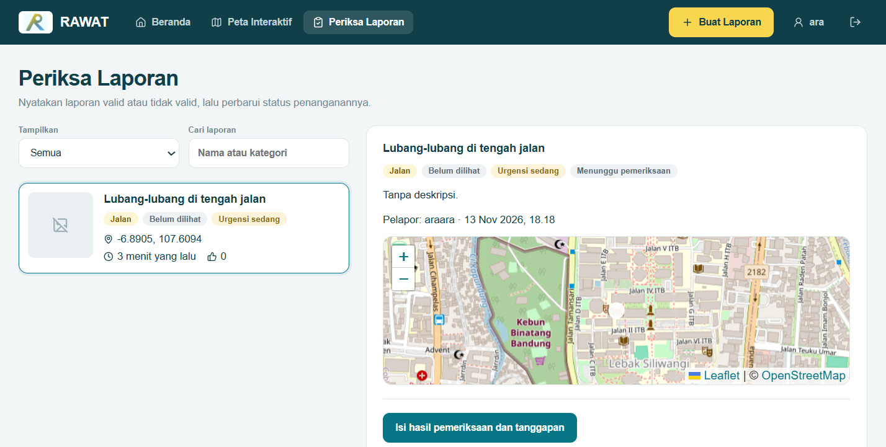 |
| FE-TGP-02 | Admin memilih "Laporan tidak valid", mengosongkan tanggapan, lalu meninjau dan menyimpan | Pesan bahwa alasan tanggapan wajib diisi ditampilkan | Pesan validasi alasan wajib ditampilkan | PASS | 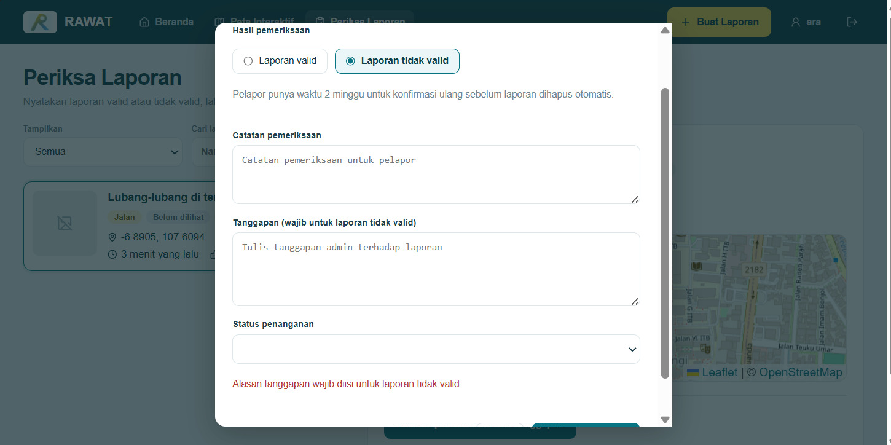 |
| FE-TGP-03 | Admin memberi hasil valid, mengisi catatan, lalu menyimpan | Dialog konfirmasi menampilkan hasil; setelah disimpan, pesan berhasil dan status laporan diperbarui | Pesan berhasil dan status valid terlihat; pada bukti dialog awal, status penanganan tertulis selesai | PASS |  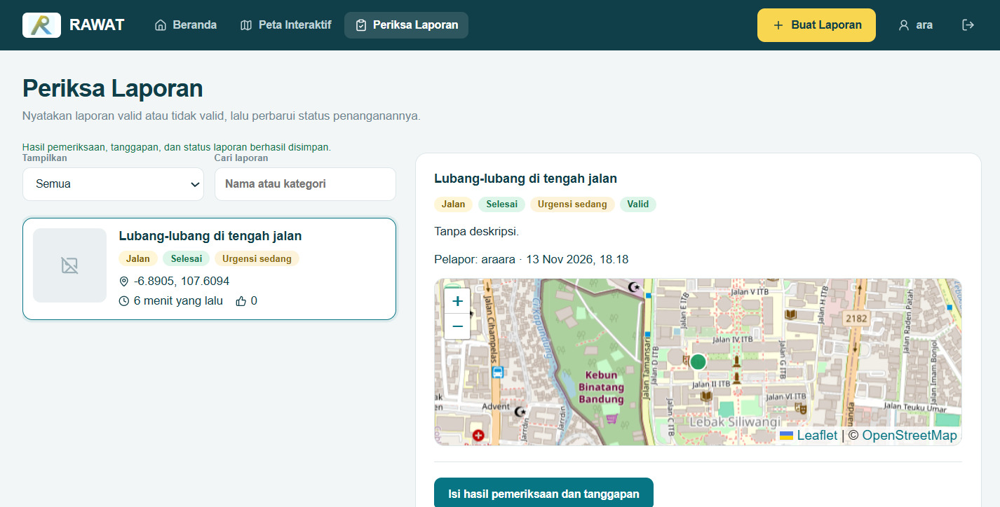 |
| FE-TGP-04 | Admin meninjau konfirmasi untuk hasil valid dan tidak valid dengan status penanganan | Dialog menampilkan hasil, status, dan tanggapan sebelum disimpan | Dialog konfirmasi untuk kedua hasil ditampilkan | PASS | 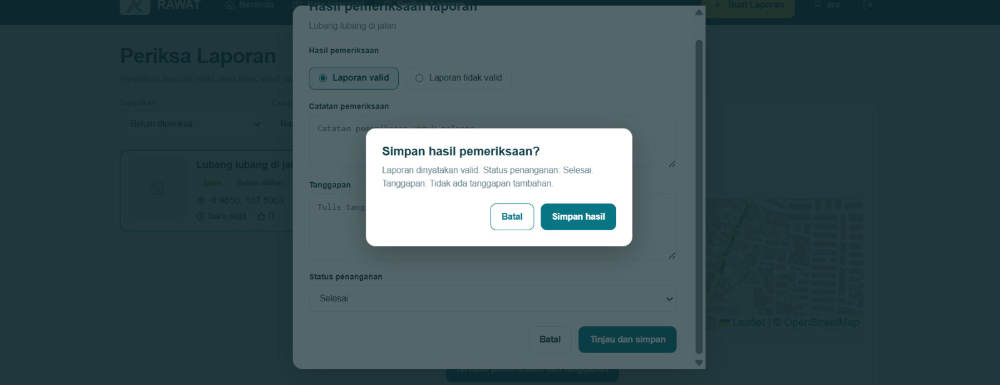 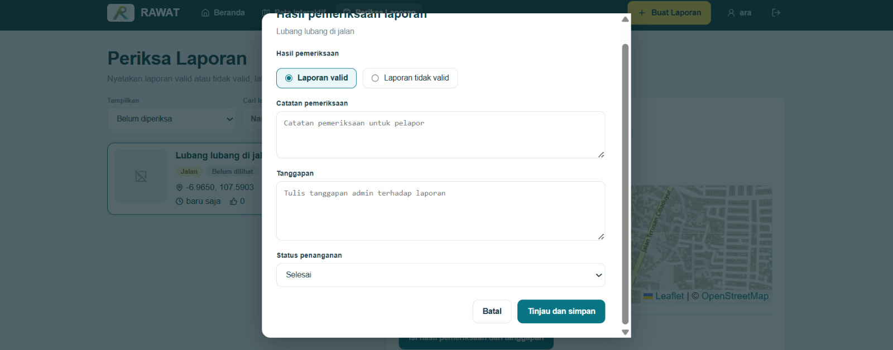 |
| FE-TGP-05 | Admin menyimpan pemeriksaan; pelapor kemudian membuka detail laporan | Pesan berhasil ditampilkan; hasil validasi, batas konfirmasi ulang, dan tanggapan admin tampil sesuai hasil | Pesan berhasil serta hasil dan tanggapan terlihat pada daftar/detail laporan | PASS | 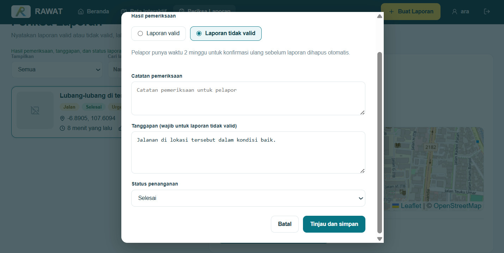 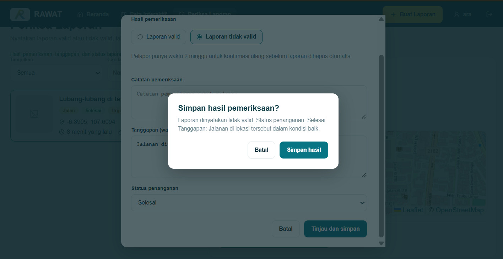 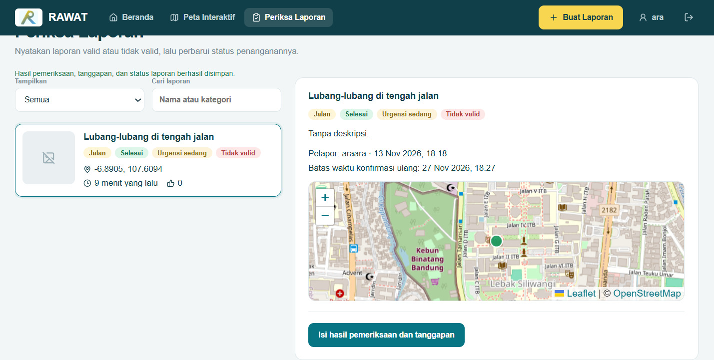 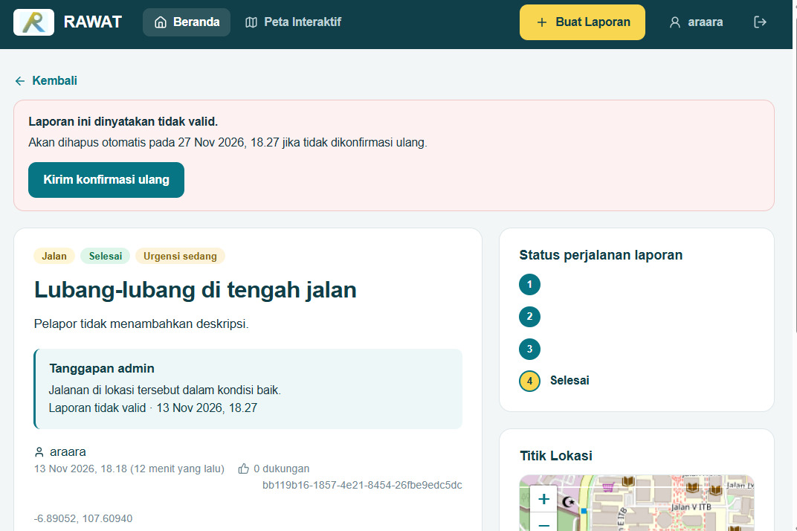 |
| FE-TGP-06 | Admin mengetik catatan pemeriksaan dan tanggapan hingga batas karakter | Catatan dibatasi maksimal 1000 karakter dan tanggapan maksimal 2000 karakter | Form menampilkan input catatan dan tanggapan panjang sesuai batas | PASS | 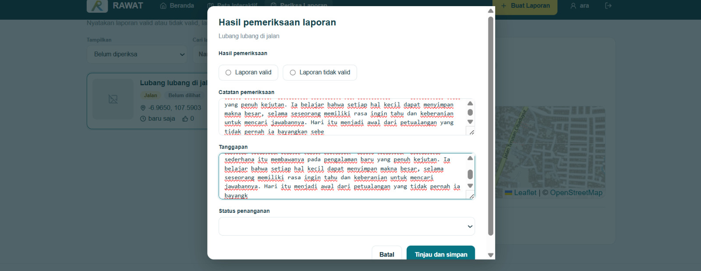 |

> **Catatan:** FE-TGP-03 perlu dicek ulang karena screenshot dialog menampilkan status penanganan `undefined`. Bukti pembatalan dialog konfirmasi secara manual belum tersedia; pembatalan saat ini tercakup pada unit test backend TGP-14.

## 4. Ringkasan Hasil

Test dijalankan dengan Node.js test runner. Hasil terakhir: **14 test lulus, 0 gagal**.
